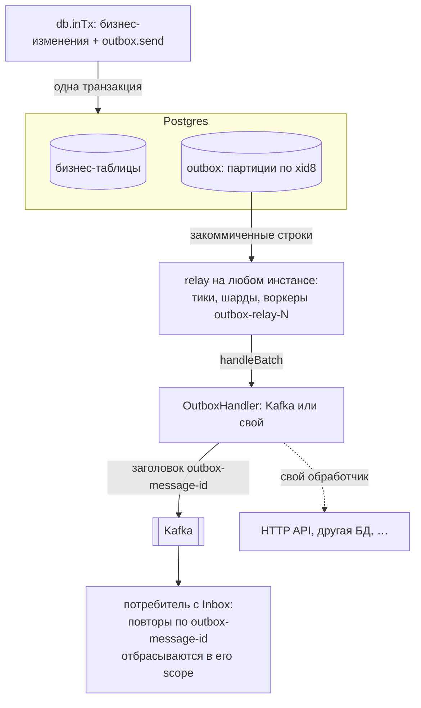
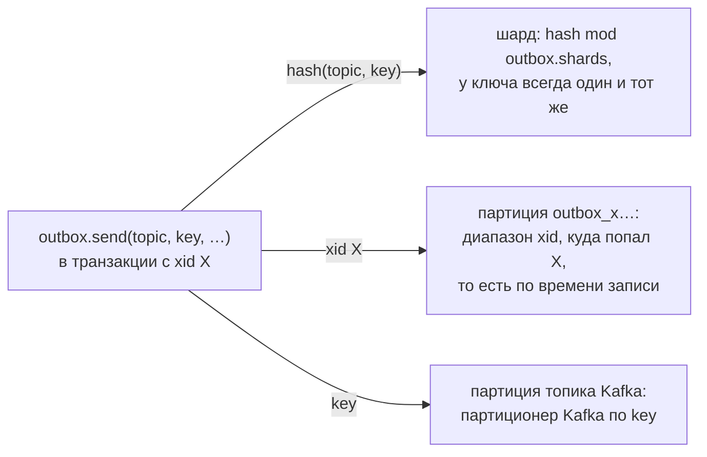
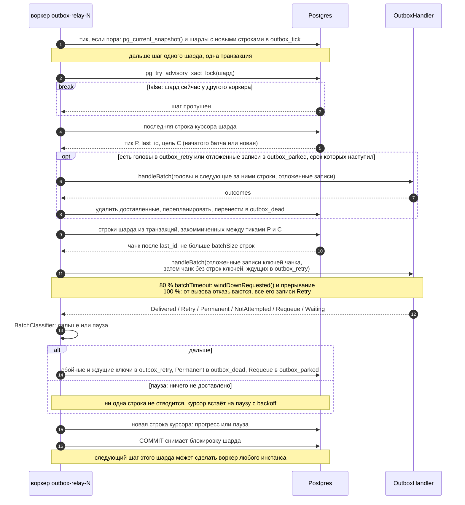
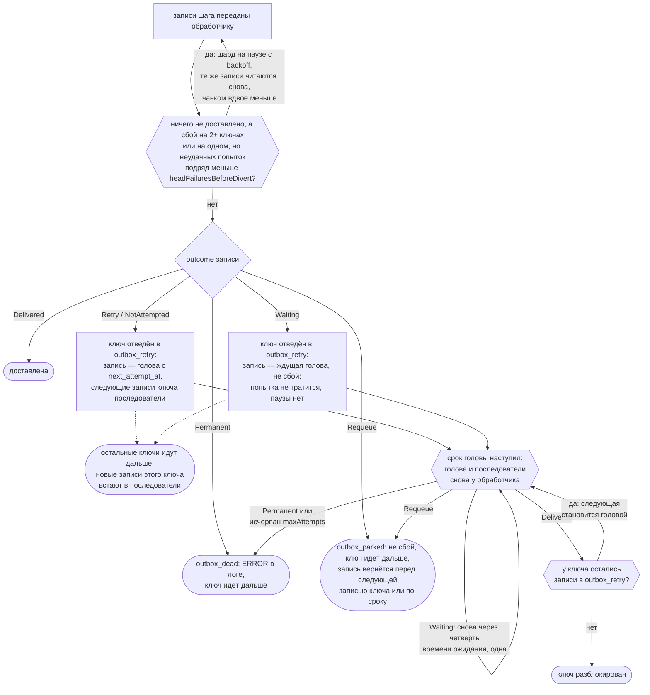
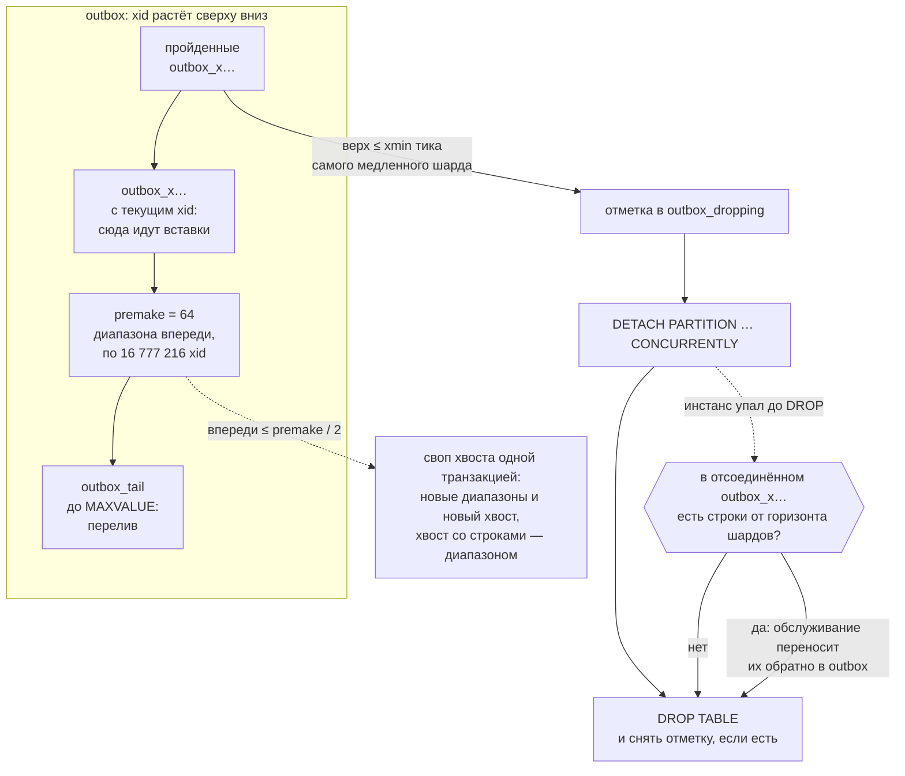

# outbox

Transactional outbox для Postgres: ядро без фреймворков и адаптеры для сервисов на
[Kora](https://github.com/Tinkoff/kora) 1.x и на [Spring Boot](#spring-boot) 3.5 и 4.1. Вы записываете сообщение в той
же транзакции базы данных, что и бизнес-данные; relay внутри вашего сервиса доставляет его после коммита — в Kafka или в
ваш собственный обработчик. Сообщение больше не теряется, если между коммитом и отправкой сервис упал, Kafka была
недоступна или шёл передеплой, а откаченная транзакция не отправляет ничего.

> **Доставка at-least-once: каждый получатель обязан быть идемпотентным по id сообщения.** Одно и то же сообщение может
> прийти больше одного раза (падение между отправкой и коммитом relay, таймаут, повтор). Exactly-once из outbox в Kafka
> не даёт ни одна реализация: коммит в Postgres и запись в Kafka не атомарны. Effectively-once получается на стороне
> получателя: у каждого сообщения стабильный UUIDv7, в Kafka это заголовок `outbox-message-id` (потребитель на Kora или
> Spring Boot отсеивает повторы через [inbox](#потребление-через-inbox)), для HTTP передавайте его как
> `Idempotency-Key`.

> **Адаптеру Kora нужна Kora 1.2.23 или новее.** `outbox-kora` объявляет
> `api(platform("ru.tinkoff.kora:kora-parent:1.2.23"))`. В сборке Gradle её подключение поднимает все модули Kora в
> вашем runtime classpath до 1.2.23, а через `database-jdbc` — и HikariCP до 7.1.0. Выставьте свою платформу
> `kora-parent` и annotation processors (`annotation-processors` или `symbol-processors` для KSP) тоже на 1.2.23, чтобы
> сгенерированный код и runtime совпадали.

- Артефакты (группа `io.github.dsudomoin`, `0.1.0-SNAPSHOT`, пока только через `mavenLocal()`): `outbox-core` без
  фреймворков, `outbox-kafka`, `outbox-micrometer`, адаптеры для Kora `outbox-kora`, `outbox-kafka-kora`,
  `outbox-admin-kora` и для Spring Boot `outbox-spring-boot`, `outbox-kafka-spring-boot`, `outbox-admin-spring-boot`;
  что для чего — в [Установке](#установка).
- Байткод Java 17; работает из Java и Kotlin. Блокирующий API: `send` выполняется внутри транзакции приложения, в Kora
  это `JdbcConnectionFactory.inTx`, в Spring Boot — `@Transactional` или `TransactionTemplate`, без фреймворка —
  `JdbcTransactions.inTx` ([Без фреймворка](#без-фреймворка)).

Общая схема: сообщение записывается одной транзакцией с бизнес-данными, relay на любом инстансе сервиса после коммита
передаёт его обработчику, а потребитель отбрасывает повторы через inbox.



## Содержание

- [Гарантии](#гарантии): что гарантируется и что нет, сценарии сбоев и их тесты
- [Требования](#требования): версии, роли, схема, соединения, проверка на других версиях
- [Установка](#установка)
- [Быстрый старт](#быстрый-старт) на Kora: подключение, настройка, отправка, Kafka, свои обработчики, inbox
- [Spring Boot](#spring-boot): подключение, `@Transactional`, обработчики и прокси, Kafka, миграции, запуск и остановка,
  Jackson, админ-API, тесты, отказы на старте
- [Без фреймворка](#без-фреймворка): свой менеджер транзакций, порядок запуска, миграции, Kafka, телеметрия
- [Как работает relay](#как-работает-relay)
- [Обработка сбоев](#обработка-сбоев)
- [Справочник по конфигурации](#справочник-по-конфигурации)
- [Требования к Kafka](#требования-к-kafka)
- [Эксплуатация](#эксплуатация): таблицы, партиции, админ-API и HTTP, dead letters, восстановление, деплои, версии
  контрактов и откат
- [Наблюдаемость](#наблюдаемость): метрики, трассы, Micrometer Observation, контракт по этапам
- [Тестирование вашего сервиса](#тестирование-вашего-сервиса)
- [Бенчмарки](#бенчмарки)
- [Заметки о дизайне](#заметки-о-дизайне)
- [Известные ограничения](#известные-ограничения)
- [Стабильность API](#стабильность-api)
- [Скиллы для AI-агентов](#скиллы-для-ai-агентов)

## Гарантии

### Гарантируется

- **Доставка at-least-once.** Каждое сообщение, чья транзакция закоммичена, передаётся обработчику, пока тот не
  сообщит о доставке, либо переносится в dead-таблицу с записью уровня ERROR в логе и метрикой
  `outbox.messages.failed{outcome="dead"}`. Это выполняется при падениях приложения, зависших воркерах, недоступности
  цели любой длительности, рестартах Postgres и передеплоях.
- **Судьбу dead letter решает хук или человек.** Письмо лежит в dead-таблице, пока о нём не закоммичено решение
  `OutboxDeadLetterHandler` (тоже at-least-once) или вызов админ-API. Без хука оно остаётся людям. Удаляют письма
  только решение `discard` (его же принимает хук Kafka DLQ для опубликованных писем), переотправка (решение хука или
  вызов админ-API: dead-строка удаляется той же транзакцией, что возвращает сообщение в outbox), удаление вызовом
  админ-API и `outbox.deadLetters.retention` для оставленных, если он задан ([Dead letters](#dead-letters)).
- **Откаченные сообщения никогда не доставляются.** Строка сообщения — часть вашей транзакции. `send` вне транзакции
  бросает `IllegalStateException`; в режиме autocommit он не выполняется никогда.
- **Доставка в порядке коммитов для каждой пары (topic, key).** Для двух сообщений с одним и тем же топиком и одним и
  тем же ненулевым ключом (сравнение побайтовое): если транзакция T1 закоммичена до того, как транзакция T2 отправила
  своё сообщение, обработчик получит сообщение T1 первым и не получит сообщение T2, пока сообщение T1 не доставлено.
  Сообщения одного ключа внутри одной транзакции сохраняют порядок вызовов `send` и `sendAll`. Исключений два:
  сообщение, перенесённое в dead-таблицу, больше не удерживает свой ключ, и ключ продолжает со следующего сообщения;
  сообщение, отложенное через [`Outcome.requeue()`](#свой-обработчик), доставляется после тех сообщений своего ключа,
  которые были доставлены, пока оно было отложено.
- **Стабильный id сообщения.** Каждое сообщение при отправке получает id в формате UUIDv7. `send` возвращает его, relay
  передаёт его при каждой попытке, а обработчик Kafka добавляет его в заголовок `outbox-message-id`. Потребители
  дедуплицируют по нему через [inbox](#потребление-через-inbox).
- **Длинные транзакции не задерживают доставку.** Транзакция, открытая минутами, задерживает только собственные
  сообщения (и писателей тех же ключей, которые ждут её блокировок по ключам). Сообщения, закоммиченные за это время,
  доставляются вовремя (см. [Заметки о дизайне](#заметки-о-дизайне)).
- **Изоляция.** Сбойная пара (topic, key) блокирует только себя. Недоступная цель приостанавливает доставку и ничего не
  теряет. Одно плохое сообщение не может застопорить шард: его изолируют и откладывают в сторону.
- **Откат релиза не теряет записей.** Запись, которую инстанс прочитать не может (версия контракта новее той, что
  читает его типизированный обработчик; запись для маршрута, которого у инстанса нет; топик, который не забрал ни один
  маршрут, когда обработчика за маршрутами нет), ждёт инстанс, который может: попыток не тратит, в dead letters сама не
  уходит, в Kafka не попадает и держит порядок своего ключа ([Версии контрактов и откат](#версии-контрактов-и-откат)).
  Это верно для релизов, собранных с версией библиотеки, которая знает метку `outbox-local`.

### Не гарантируется

- **Exactly-once.** Сообщение может быть доставлено больше одного раза: после падения между отправкой и коммитом relay,
  после таймаута Kafka для записи, которая на самом деле записалась, или после вызова обработчика, прерванного по
  дедлайну. Для effectively-once обработки используйте inbox; его дедупликация работает в пределах scope потребителя и
  ограничена его временным окном.
- **Порядок между ключами.** У разных пар (topic, key), разных топиков и сообщений без ключа нет взаимного порядка.
  Сообщения без ключа не упорядочены и между собой.
- **Порядок вокруг dead letter.** Когда сообщение ушло в dead letters, следующие сообщения его ключа идут дальше.
  Переотправленный dead letter (решением хука или вызовом админ-API) или строка, возвращённая из осиротевшей партиции, —
  это новое сообщение, и оно идёт после них.
- **То, что теряет или переупорядочивает сама Kafka.** `acks=all` надёжен ровно настолько, насколько надёжен топик, а
  добавление партиций переносит ключи; см. [Требования к Kafka](#требования-к-kafka).
- **Асинхронная репликация.** После failover на реплику, где нет части коммитов, сообщения этих коммитов могут быть уже
  доставлены (фантомы). Их бизнес-данные тоже потеряны. Если это важно, используйте синхронную репликацию.
- **Верхняя граница задержки.** Когда цель здорова, доставка быстрая (десятки миллисекунд), но во время сбоев, backoff
  (`relay.retry.maxDelay`), долгих вызовов обработчика или пока запись ждёт релиз, который её прочитает, верхней
  границы нет.
- **Базы с несколькими пишущими узлами.** Блокировки шардов, тики и курсоры живут в primary той же базы, что и
  бизнес-данные; это и есть точка синхронизации всех инстансов, в каком бы ЦОДе они ни работали. Мульти-мастер и
  распределённые SQL-базы, где одну таблицу пишут несколько узлов, не поддерживаются, а split-brain двух primary ломает
  и бизнес-данные, и outbox. Данные, разнесённые по независимым кластерам Postgres (шардирование по базам), — это
  независимый outbox в каждой базе; порядок ключа сохраняется, если все его данные пишутся в одну базу.
- **Несколько независимых relay для одной таблицы.** У одной таблицы outbox один набор курсоров и одна доставка на
  граф приложения. Разводите топики по целям обработчиками своих топиков (`OutboxTopicHandler`) или `byTopic`
  ([Свой обработчик](#свой-обработчик)).

Куда попадает сообщение: шард зависит только от пары (topic, key) и для ключа не меняется, физическая партиция outbox —
только от xid транзакции-писателя (то есть от времени записи), а партицию Kafka по ключу выбирает партиционер Kafka.
Сообщение без ключа попадает в случайный шард.



### Сценарии сбоев и их тесты

Каждая строка таблицы проверена интеграционными тестами на настоящем Postgres (Testcontainers). Тесты `outbox-kafka`
идут по пути без фреймворка (`OutboxRuntime` на `JdbcTransactions` и обычном `DataSource`, обработчик
`KafkaOutboxSender`) с настоящим брокером. Каждый из них дочитывает топик и проверяет две вещи: ни одно закоммиченное
сообщение не пропало, и первые появления сообщений каждого ключа идут в порядке отправки. Тесты `outbox-kora` и
`outbox-kafka-kora` идут через адаптер Kora, тесты модулей `*-spring-boot` — через адаптер Spring Boot на обеих линиях.

| Сценарий | Что происходит | Гарантия | Тесты |
|---|---|---|---|
| Бизнес-транзакция откатилась после `send` | Строка outbox откатывается вместе с ней, relay её не видит | Откаченное сообщение не доставляется | `KafkaGuaranteesIT#rolledBackMessagesNeverReachKafka` |
| Падение между отправкой в Kafka и коммитом курсора | Транзакция шага откатывается (в тесте backend шага убивают после того, как отправитель вернул outcomes); следующий шаг читает те же записи и отправляет их снова | Сообщение не теряется; повтор несёт тот же `outbox-message-id` | `KafkaGuaranteesIT#crashAfterTheKafkaSendBeforeTheCursorCommitRedelivers`; падения посреди батча — в `TortureIT#invariantsHoldUnderConcurrencyCrashesAndALongTransaction` |
| Шаг одного шарда раз за разом падает уже после вызова обработчика (ошибка SQL при записи итогов или курсора, триггер или ограничение, добавленные командой) | Транзакция шага откатывается, и шард дальше шагает отдельно от соседей. Первый повтор идёт со следующим тиком, со второго сбоя подряд этот инстанс ждёт `relay.retry.initialDelay`, удваивая его до `relay.retry.maxDelay`; задержка сбрасывается первым удачным шагом. Ожидание живёт в памяти каждого инстанса, поэтому после устранения причины шард продолжает, когда кончится текущая задержка (не позже `maxDelay`) | Ничего не теряется. Цель получает повтор вызова не на каждом тике, а раз в задержку; остальные шарды идут как обычно | `RelayTelemetryIT#aShardThatKeepsFailingAloneBacksOffWhileTicksKeepComing` |
| Сообщение одного ключа временно не проходит | Ключ отводится в retry-таблицу и повторяется с backoff, остальные ключи шарда идут мимо него | Сбойный ключ задерживает только себя, его порядок сохраняется | `KafkaGuaranteesIT#aFailingKeyIsRetriedWhileOtherKeysFlow`, `ShardProcessorIT#failingKeyIsDivertedOthersFlow` |
| Несколько инстансов на одной базе | Шаг шарда в каждый момент выполняет один воркер одного инстанса; шарды переходят между инстансами | Каждое сообщение доставлено, порядок ключа сохранён; без сбоев повторов нет | `KafkaGuaranteesIT#twoRuntimesShareOneDatabase`, `OutboxRelayIT#multipleRelaysDeliverEachMessageOnceInSteadyState` |
| Ядовитое сообщение: брокер отвергает его навсегда (больше `max.message.bytes` топика) | `Permanent`: запись уходит в dead-таблицу, хук Kafka DLQ публикует её в топик по шаблону (в тесте `{topic}.dlq`) и удаляет письмо | Одно плохое сообщение не стопорит ни свой ключ, ни шард | `KafkaGuaranteesIT#aPoisonMessageGoesToTheDeadLetterTopicAndItsKeyContinues`, `KafkaGuaranteesIT#aPoisonSmallerThanTheProducerBatchStillGoesToTheDeadLetterTopic` (в одном producer batch с соседями, см. [Требования к Kafka](#требования-к-kafka)), `ShardProcessorIT#permanentGoesToDeadAndKeyContinues` |
| Остановка и рестарт | `close()` ждёт идущий шаг до `relay.shutdownTimeout`, и тот коммитится (после таймаута воркеры прерываются, а их записи доставляются снова); невыполненную работу берут другие инстансы или этот после старта, вместе с паузами и начатыми батчами | Ничего не теряется | `KafkaGuaranteesIT#aStoppedRuntimeLeavesItsBacklogToTheNext` (повторов в тесте не больше `batchSize × workers`), `OutboxRelayIT#shutdownWaitsForInFlightBatch`, `OutboxRelayIT#restartResumesPausedAndChunkedShards` |
| Порядок по ключу | Блокировка ключа держится до коммита писателя, relay читает шард по тикам | Порядок коммитов для пары (topic, key), см. [Гарантируется](#гарантируется) | `PgOutboxIT#sameKeyIdsFollowCommitOrder`, `KafkaEndToEndIT#perKeyOrderSurvivesBrokerRestart` (брокер заморожен на 15 с), проверка порядка в каждом тесте `KafkaGuaranteesIT` |
| Дубликаты | Повтор после отката шага, таймаута Kafka или остановки | At-least-once: дубликат несёт тот же `outbox-message-id`, inbox отсеивает его в своём scope | `KafkaGuaranteesIT#crashAfterTheKafkaSendBeforeTheCursorCommitRedelivers` (не меньше двух копий одного id), `KafkaEndToEndIT#perKeyOrderSurvivesBrokerRestart` (повторы допустимы, пропусков нет), `PgInboxIT#duplicateAcrossConcurrentConsumersOnlyOneWins`, `FrameworkFreeIT#inboxAcceptsAnIdOnce` |
| Новая версия контракта события и откат релиза | Релиз, писавший v2, откатили на релиз, который читает только v1: записи v2 ждут, остальные ключи и записи v1 идут; вернувшийся релиз, который читает v2, их доставляет. Релиз, который пишет v2 рядом с живым релизом, читающим только v1, получает отказ при записи | Ничего не теряется и не уходит в dead letters, порядок ключа сохранён; отвергнутая запись не записана, её транзакция решает сама | `ContractReleasesIT#aRollbackPastTheTransitionReleaseWaitsUntilItReturns`, `ContractReleasesIT#theTransitionReleaseReadsWhatTheNewOneWritesAlsoAfterItsRollback`, `ContractReleasesIT#theNewContractIsRefusedWhileTheOldReleaseRelays`, `ContractReleasesIT#aRollingUpdateKeepsKeyOrderAndNeverWaits` |
| Новый маршрут и откат релиза | Релиз с маршрутом топика рядом с живым релизом без него получает отказ при записи в этот топик, сырой и типизированной. Записи маршрута, сделанные, пока маршрут был у всех, после отката на релиз без него (с другими маршрутами или без маршрутов) ждут и обработчику за маршрутами не достаются, а записи других топиков идут к нему одним вызовом; вернувшийся релиз с маршрутом их доставляет | Ничего не теряется и не уходит в Kafka, порядок ключа сохранён; отвергнутая запись не записана | `RouteReleasesIT#aCanaryRefusesToWriteForItsNewRouteWhileAnOldRelayLacksIt`, `RouteReleasesIT#aRollbackToAReleaseWithOtherRoutesWaitsUntilTheRouteReturns`, `RouteReleasesIT#aRollbackToAReleaseWithoutRoutesWaitsUntilTheRouteReturns`, `RouteReleasesIT#aMixedFleetDeliversTheRouteOnItsNewInstancesInKeyOrder`, `RouteReleasesIT#theFallbackStillGetsItsRecordsBatchedInTheCallsWhereTheRouteWaits` |
| Всё сразу | Конкурентные писатели с откатами, три relay, обработчик с временными и постоянными сбоями, requeue, падениями посреди батча и окнами недоступности цели, хук dead letters со случайными решениями, транзакция, открытая 20 с | Все строки выше | `TortureIT#invariantsHoldUnderConcurrencyCrashesAndALongTransaction` |

Запуск одного класса: `./gradlew :outbox-kafka:test --tests '*KafkaGuaranteesIT'` (нужен Docker). Телеметрию на том же
пути проверяют тесты из [Контракта по этапам](#контракт-по-этапам).

## Требования

- **Java 17** или новее.
- **Kora 1.2.23** или новее для адаптеров `outbox-kora`, `outbox-kafka-kora`, `outbox-admin-kora` (см. примечание в
  начале). Ядру, `outbox-kafka` и `outbox-micrometer` Kora не нужна ([Без фреймворка](#без-фреймворка)).
- **Spring Boot 3.5 или 4.1** для адаптеров `outbox-spring-boot`, `outbox-kafka-spring-boot`,
  `outbox-admin-spring-boot`: один jar на обе линии, тесты идут на 3.5.16 (kafka-clients 3.9.2) и на 4.1.2
  (kafka-clients 4.2.2) ([Spring Boot](#spring-boot)).
- **Postgres 14** или новее. Весь набор тестов проходит на 14, 15, 16, 17 и 18; по умолчанию тесты и бенчмарки идут
  на 16, другой образ выбирает `-Doutbox.test.postgres=postgres:14-alpine`. На 13 библиотека не стартует: ей нужны
  `DETACH PARTITION … CONCURRENTLY` и `idle_session_timeout` из 14.
- **Один primary.** Outbox лежит в той же базе, что и бизнес-данные, а relay подключается к тому же primary, что и
  писатели (на read-only реплике шаг не закоммитится). Привязывать инстансы к шардам или к ЦОДу не нужно: инстанс в
  дальнем ЦОДе платит сетевую задержку на каждом запросе шага, но не корректностью.
- Клиент **Kafka** 3.9.2 (эту версию использует Kora 1.2.23) или 4.x для `outbox-kafka`: тесты `outbox-kafka` и
  `outbox-kafka-kora` проходят на 3.9.2, 4.0.2 и 4.4.0 (брокер 3.9.1). Настройки брокера и продюсера, а также
  поведение kafka-clients до 4.1 включительно с записью больше `max.message.bytes` топика — в разделе
  [Требования к Kafka](#требования-к-kafka).
- **Micrometer** 1.12.13 или новее для `outbox-micrometer`; тесты проходят и на 1.17.2 с micrometer-tracing 1.7.2.
- Команды, которые воспроизводят проверенные сочетания версий, — в [Сборке и проверке на других
  версиях](#сборка-и-проверка-на-других-версиях).

### Сборка и проверка на других версиях

Библиотека компилируется toolchain Java 17 (байткод Java 17). `./gradlew publishToMavenLocal` больше ничего не
требует. `./gradlew check` и `build` требуют ещё локальный JDK 21, на котором запускается проверка снимка API
([Стабильность API](#стабильность-api)), и Docker для интеграционных тестов (Testcontainers).

Версии зависимостей в тестах подменяются свойствами проекта Gradle (`-P`). Они действуют только на test runtime
classpath, поэтому код по-прежнему компилируется с объявленными версиями. Через `-D` эти свойства не работают:
системных свойств (`-D`) здесь два — образ Postgres и CPU контейнеров.

| Свойство | Что подменяет в тестах |
|---|---|
| `-Doutbox.test.postgres=<образ>` | образ Postgres, по умолчанию `postgres:16-alpine` |
| `-Doutbox.test.containerCpus=<число>` | CPU контейнеров Postgres и Kafka, по умолчанию без ограничения |
| `-Poutbox.test.kafkaClients=<версия>` | `org.apache.kafka:kafka-clients` |
| `-Poutbox.test.micrometer=<версия>` | `io.micrometer:micrometer-*`, кроме `micrometer-tracing*` |
| `-Poutbox.test.micrometerTracing=<версия>` | `io.micrometer:micrometer-tracing*` |
| `-Poutbox.test.opentelemetry=<версия>` | `io.opentelemetry:*`, кроме артефактов с версией `-alpha` |

Проверенные сочетания и команды, которые их воспроизводят:

```bash
./gradlew build                                                        # объявленные версии, Postgres 16
./gradlew test -Doutbox.test.postgres=postgres:14-alpine               # так же 15, 17, 18
./gradlew :outbox-kafka:test :outbox-kafka-kora:test -Poutbox.test.kafkaClients=4.0.2   # так же 4.4.0
./gradlew :outbox-micrometer:test :outbox-kafka:test \
    -Poutbox.test.micrometer=1.17.2 -Poutbox.test.micrometerTracing=1.7.2 -Poutbox.test.opentelemetry=1.62.0
```

micrometer-tracing 1.7.2 тянет OpenTelemetry 1.62.0, а `opentelemetry-sdk-testing` в тестах объявлен 1.31.0,
старее; `-Poutbox.test.opentelemetry=1.62.0` выравнивает все артефакты OpenTelemetry на одну версию.

**CI.** Классы `outbox-kora` идут в нескольких JVM, по одной на 3 ядра, но не больше 6, и у каждой свой Postgres. На
раннере с 4 ядрами и меньше JVM одна; `--max-workers` тоже ограничивает их число. Когда задана переменная окружения
`CI`, тесты с тегом `timing` не запускаются: они проверяют скорость (например, задержку соседей медленного шарда),
которую раннер неизвестной мощности может не дать. `-Poutbox.test.timing` возвращает их. Слабый раннер локально:
`./gradlew test --max-workers=1 -Doutbox.test.containerCpus=1`.

### Роль в базе и привилегии

Поддерживаются две схемы.

**Одна роль владеет всем** (по умолчанию). Библиотека сама создаёт и поддерживает свои таблицы. Запускайте её под
ролью, которая:

- имеет `CREATE` на схеме таблиц. Bootstrap выполняется на каждом инстансе, использует `CREATE TABLE IF NOT EXISTS`
  и требует этого права, даже когда таблицы уже существуют;
- может выполнять `DO` на PL/pgSQL (`plpgsql` есть в каждой базе и по умолчанию доступен PUBLIC): своп хвоста — один
  `DO`-блок. Без этого права каждый своп падает с ошибкой; запись при этом идёт, строки уходят в присоединённый хвост,
  а обслуживание пишет WARN на каждом запуске, где расширение назрело, и не чаще раза в час ERROR «outbox partition
  tail swap of ... has not run on N due runs in a row» с SQLState и текстом ошибки. Старт инстанса из-за этого не
  падает: если к рестарту своп назрел, bootstrap пишет ERROR с SQLState 42501 и названием недостающего права, а
  расширение оставляет обслуживанию;
- владеет таблицами (или входит в роль-владельца). Обслуживание партиций выполняет `CREATE TABLE`,
  `ALTER TABLE ... ATTACH/DETACH PARTITION` и `DROP TABLE`, а для них нужно владение. Если таблицы создаёт роль
  миграций, сделайте роль приложения членом этой роли;
- отдаёт каждую новую партицию владельцу родительской таблицы, если сама им не является: сразу после `CREATE TABLE`
  и в той же транзакции выполняется `ALTER TABLE ... OWNER TO <владелец>`. Так любой другой член роли-владельца
  (отдельные учётные данные на инстанс, динамические роли Vault, ротация роли) может потом свопнуть хвост или удалить
  диапазон, созданный не им. Для этого на Postgres 16+ членство должно быть с опцией `SET`, а у самой роли-владельца
  должен быть `CREATE` на схеме. Если чего-то нет, старт и обслуживание падают с сообщением, где названы таблица, её
  владелец и нужный `GRANT`;
- может делать `SELECT` из identity-последовательности `<base>_id_seq` (владелец может). Каждый тик читает её последнее
  значение;
- входит в `pg_read_all_stats` (или `pg_monitor`): рекомендуется. Без этого Postgres скрывает, как долго идут транзакции
  сессий, вошедших под другими ролями. Тогда перед свопом хвоста партиций обслуживание дважды, с интервалом 20 с,
  проверяет их блокировки на outbox. Скрыто и состояние фоновой сборки индекса `<dead>_due`, если она идёт под другой
  ролью (скажем, во время ротации учётных данных): тогда обслуживание считает сборку остановленной, только когда её
  сессия исчезла, и не замечает соединение, молча оборванное сетью (об этом один раз пишется WARN). Если членства нет,
  bootstrap пишет WARN. Это касается и сессий вашего собственного приложения, если они переключают роль (`SET ROLE`,
  отдельные учётные данные на инстанс).

**Миграции, роль приложения только с DML и источник соединений владельца.** Таблицы создают ваши миграции
(`outbox.schema.bootstrap = false`, [Схема в ваших миграциях](#схема-в-ваших-миграциях)). DDL, который нужен во время
работы (партиции и своп хвоста, диапазоны inbox, осиротевшие партиции, восстановление после регрессии xid), идёт через
отдельный источник соединений роли-владельца:

- роли приложения нужны DML на базовые таблицы и `SELECT` на `<base>_id_seq` (ровно это выдаёт
  `OutboxSql.outbox(config, "app")` и `OutboxSql.inbox(config, "app")`) и `USAGE` на схему. На партиции прав не
  нужно: она обращается к ним только через родительскую таблицу. Через неё идут `send`, `tryAccept`, шаги relay,
  проход dead letters, поиск, подсчёт, переотправка и удаление писем в админке и heartbeat инстанса. Собственный пул
  heartbeat в Kora и Spring Boot — копия пула приложения, с той же ролью. Источнику heartbeat, который вы задаёте сами
  (тег `OutboxHeartbeat`, бин `@OutboxHeartbeat` или `heartbeatConnections`), нужны те же права, что роли приложения;
- роль-владелец владеет таблицами (миграция выполняется под ней, или роль входит в роль-владельца), имеет `CREATE` на
  схеме и, как рекомендуется выше, `pg_read_all_stats`. Если она лишь входит в роль-владельца, партиции отдаются
  владельцу таблиц, как описано выше: членству нужна опция `SET` (Postgres 16+), а `CREATE` на схеме — самому
  владельцу. Через неё идут старт (проверка схемы, партиции, первый тик,
  курсоры), обслуживание outbox и inbox, `OutboxAdmin.status()`, `restoreOrphan`, `recoverXidRegression` и
  `recoverStrandedShards`. Требование без transaction pooling относится к ней: она держит сессионные блокировки;
- у роли приложения не должно быть `CREATE` ни на одной схеме из `search_path` роли-владельца. На Postgres 14 и на
  базах, перенесённых с него через pg_upgrade или дамп, `CREATE` на `public` по умолчанию есть у PUBLIC. Функция или
  оператор, созданные там для `varchar` (тип, в котором драйвер передаёт строковые параметры), перехватят запросы
  библиотеки под владельцем и выполнятся с его правами: роль приложения перестанет быть «только DML». Старт пишет WARN
  с готовым `REVOKE CREATE ON SCHEMA ... FROM PUBLIC, <роль>`. То же относится к любой другой роли с `CREATE` там,
  например к роли аналитики;
- источник владельца требует `outbox.schema.bootstrap = false`, иначе старт падает: объекты, созданные владельцем при
  bootstrap, были бы недоступны роли приложения. Оба источника должны смотреть в одну базу (а для имени без схемы —
  с одинаковым `search_path`): до любого DDL старт сверяет базу, сервер и таблицу и падает, если они разные.

Без фреймворка источник владельца — второй `DataSource`:

```java
var runtime = OutboxRuntime.builder(config, new JdbcTransactions(appDataSource), handler)
        .ownerConnections(ownerDataSource::getConnection)
        .build();
var inbox = InboxRuntime.builder(config, new JdbcTransactions(appDataSource))
        .ownerConnections(ownerDataSource::getConnection)
        .build();
```

В Kora — второй `JdbcDatabase` с тегом `OutboxOwner`; `OutboxModule` и `InboxModule` подхватывают его сами:

```java
@Tag(OutboxOwner.class)
default JdbcDatabase outboxOwnerDatabase(Config config, ConfigValueExtractor<JdbcDatabaseConfig> extractor,
        DataBaseTelemetryFactory telemetry) {
    return new JdbcDatabase(extractor.extract(config.get("outboxOwnerDb")), telemetry);
}
```

В Spring Boot — бин `DataSource` с `@OutboxOwner` ([Миграции и источник владельца](#миграции-и-источник-владельца)).

Не задавайте роли `statement_timeout` в несколько секунд. DDL партиций и bootstrap выставляют собственные таймауты, но
очистка тиков и курсоров при обслуживании выполняется с настройкой роли по умолчанию и повторяется на каждом запуске,
если та её обрывает. Удаление старых dead letters и истории переотправок от таймаута роли не зависит: оно идёт порциями
по 1024 блока таблицы, у каждой порции свой `statement_timeout` 30 с. Оставьте `track_activities` включённым (так по умолчанию); сессии без него считаются скрытыми, как описано
выше.

Библиотека берёт двухаргументные advisory-блокировки (`pg_advisory_xact_lock(ns, key)`) в двух пространствах имён,
производных от имени таблицы. Ваши собственные двухаргументные advisory-блокировки могут с ними совпасть; блокировки с
одним аргументом `bigint` — никогда.

### Схема в ваших миграциях

По умолчанию каждый инстанс на старте сам создаёт недостающие таблицы и обновляет созданные прежними версиями. Если
схемой владеют миграции приложения (Flyway, Liquibase), выключите это:

```hocon
outbox.schema.bootstrap = false
```

и один раз сгенерируйте SQL для своих имён таблиц, положив его в миграцию как есть:

```java
Files.writeString(Path.of("V7__outbox.sql"), OutboxSql.outbox(config, "app"));
Files.writeString(Path.of("V8__outbox_inbox.sql"), OutboxSql.inbox(config, "app")); // если используете inbox
```

- В скрипте все базовые таблицы с колонками, значениями по умолчанию, identity-колонками (`CACHE 1`), ограничениями,
  индексами и ключами партиционирования: те же объекты, что создаёт bootstrap (тест сравнивает каталоги). Второй
  аргумент — роль приложения: тогда в конце идут `GRANT` на DML всех таблиц и `SELECT` на `<base>_id_seq`; с `null` их
  нет. `USAGE` на схему выдайте сами.
- Имя без схемы попадает в `current_schema()` миграции, как и при bootstrap: держите одинаковый `search_path` у
  миграций и приложения или задайте имя со схемой (`app.outbox`).
- Партиций в скрипте нет: их по-прежнему создаёт и удаляет библиотека, на старте и при обслуживании. Поэтому роль, под
  которой она работает, владеет партиционированными таблицами (или входит в роль-владельца) и имеет `CREATE` на их
  схеме. Каждая партиция принадлежит владельцу своей родительской таблицы, а не роли, которая её создала; роль приложения может обойтись одним DML, если DDL идёт через источник владельца ([Роль в базе и
  привилегии](#роль-в-базе-и-привилегии)).
- Старт не создаёт и не меняет ни одного базового объекта, а проверяет каждую таблицу, колонку (тип, `not null`,
  default, identity), индекс, первичный ключ и ключ партиционирования, а также права: DML на таблицы и `SELECT` на
  последовательность у роли приложения, владение и `CREATE` у роли, которая делает партиции. У default сверяется само
  выражение, как его печатает `pg_get_expr`, а не только его наличие: с константой вместо `pg_current_xact_id()` у
  `xid` relay молча не доставлял бы записи, а lag оставался бы нулевым. Любая проблема валит старт одним сообщением со
  всеми проблемами сразу; у недостающего объекта указана версия схемы, в которой он появился (`schema version 1: apply
  OutboxSql.outbox`), у чужого default — ожидаемое выражение. Индекс `<dead>_due` обслуживание в этом режиме не строит:
  его создаёт скрипт.
- Версия схемы этой библиотеки — `OutboxSql.SCHEMA_VERSION` (сейчас 1). Релиз, который меняет схему, поднимает версию и
  выпускает дельту для миграции. Дельты устроены как expand/contract: предыдущая версия библиотеки продолжает работать на
  новой схеме, а удалять и менять то, что ей нужно, будет только более поздняя дельта. Поэтому проверка пропускает
  незнакомые ей колонки, индексы и таблицы, а также default у колонок, где этой версии он не нужен: при rolling-деплое
  инстансы прежней версии стартуют на схеме, которую миграции уже обновили.
- База, созданная bootstrap, проходит проверку как есть: на `bootstrap = false` можно перейти в любой момент.

**Ожидаемые default.** Проверка сверяет выражение каждого default с тем, что пишет `OutboxSql`, в том виде, в каком его
печатает `pg_get_expr`:

| Выражение | Колонки |
|---|---|
| `pg_current_xact_id()` | `<base>.xid` |
| `clock_timestamp()` | `created_at` в `<base>`, `<base>_tick` и `<base>_checkpoint` |
| `now()` | `<base>_dead.failed_at`, `<base>_redriven.at`, `<base>_halt.halted_at`, `<base>_dropping.at`, `<base>_instance.last_seen`, `received_at` в inbox |
| `0` | `last_id` и `failures` в `<base>_cursor`; `attempts` и `requeues` в `<base>_retry` и `<base>_parked`; `handler_attempts` и `redrives` в `<base>_dead` |
| `1` | `id` в `<base>_halt` и `<base>_maintenance` |
| `false` | `hook_active` и `relay` в `<base>_instance` |
| `'kept'::text` | `<base>_dead.status` |
| `''::text` | `consumer` в inbox |

Строковый литерал можно писать и без приведения (`default 'kept'`): Postgres печатает его так же. Запись, равную по
смыслу, но другую по форме, проверка не распознаёт и валит старт: `CURRENT_TIMESTAMP` или `transaction_timestamp()`
вместо `now()`, `'0'::bigint` или `0::bigint` вместо `0`. Она сверяет контракт схемы, а не доказывает
эквивалентность SQL. Чинится это миграцией с ожидаемым выражением:

```
outbox schema check of app.outbox failed (outbox.schema.bootstrap = false): column app.outbox_dead.failed_at has default CURRENT_TIMESTAMP, not now()
```

```sql
alter table app.outbox_dead alter column failed_at set default now();
```

**Индексы и первичные ключи.** У индекса проверка сверяет таблицу, метод, ключ с порядком и классами операторов,
условие частичного индекса и признак валидности, и он не должен быть уникальным. У первичного ключа она сверяет
столбцы, и он не должен быть отложенным (`deferrable`): такой ключ `on conflict` использовать не может. Индекс с тем же
именем, но другого вида или INVALID после оборванной сборки валит старт. Параметры хранения (`fillfactor`), `INCLUDE` и
tablespace выбираете вы. Это касается и `<base>_dead_due`: в этом режиме обслуживание его не перестраивает, так что
INVALID-остаток удалите и постройте индекс заново миграцией.

### Соединения: без transaction pooling

**Bootstrap и обслуживанию нужно прямое соединение или пулер в сессионном режиме.** Они держат сессионные
advisory-блокировки и выставляют сессионные настройки вокруг DDL в режиме autocommit. За прокси с transaction pooling
(pgbouncer или Odyssey в режиме transaction) всё это утекало бы в сессии других клиентов. Свои настройки
(`lock_timeout`, `statement_timeout`, `idle_session_timeout`) они затем возвращают к значениям, которые были у сессии,
в том числе заданным пулом через `connectionInitSql`, и после ошибки тоже. Соединение, которому вернуть их не удалось,
закрывается (`Connection.abort`), так что пул не выдаст его приложению с настройками библиотеки.

- Библиотека проверяет соединение: три последовательных запроса должны выполниться в одной серверной сессии
  (`pg_backend_pid()`). Если это не так, bootstrap валит старт. Обслуживание вместо этого пропускает запуск, пишет ERROR
  не чаще раза в минуту и выставляет gauge `outbox.maintenance.transaction_pooling` (или
  `outbox.inbox.maintenance.transaction_pooling`) в 1.
- Проверка — best effort. pgbouncer переиспользует серверные соединения в порядке LIFO, поэтому спокойный пул часто
  проходит проверку при старте, а проблема проявляется в обслуживании под нагрузкой. Не рассчитывайте на то, что старт
  упадёт.
- `send` и relay используют только состояние уровня транзакции (`SET LOCAL`, транзакционные advisory-блокировки). Поэтому
  DataSource приложения может ходить через transaction pooler, если старт и обслуживание идут мимо него: прямое соединение
  [роли-владельца](#роль-в-базе-и-привилегии) (`ownerConnections`, в Kora — база с тегом `OutboxOwner`, в Spring Boot — бин
  `DataSource` с `@OutboxOwner`) и `bootstrap = false`. У такого DataSource нужен `prepareThreshold=0`, а `search_path` пулер сессиям не сохраняет: задавайте
  его на роли или указывайте схему в `outbox.table`.
- Собственное соединение heartbeat ([Размер пула соединений](#размер-пула-соединений)) помогает только при прямом
  соединении или пулере в сессионном режиме. За пулером в режиме transaction транзакции heartbeat всё равно ждут
  серверных соединений пулера, а их держит бизнес-нагрузка. Чтобы heartbeat ходил мимо пулера, дайте ему свою
  `JdbcConnectionFactory` с тегом `OutboxHeartbeat` ([`outbox.heartbeat`](#outboxheartbeat-outboxmodule)), в Spring Boot
  — бин `DataSource` с `@OutboxHeartbeat` ([Соединения heartbeat](#соединения-heartbeat)), а без фреймворка —
  `heartbeatConnections` ([Без фреймворка](#без-фреймворка)).

### Размер пула соединений

Прибавьте `relay.workers + 3` к `db.maxPoolSize` (в Spring Boot — к `spring.datasource.hikari.maximum-pool-size`, по
умолчанию 10), плюс 1 на время работы `OutboxRelay.drain()`: каждый relay-воркер
держит соединение, пока работает, обслуживание outbox и обслуживание inbox берут по одному на каждый запуск, а поток
`outbox-dead-letters` держит одно на весь свой проход, включая вызов `OutboxDeadLetterHandler` (до
`deadLetters.timeout`). `drain()` держит одно соединение за раз. Писатели используют соединение вашей собственной
транзакции. Обработчик, который открывает свою транзакцию на том же пуле, держит второе соединение, пока воркер держит
своё: на него прибавьте ещё `relay.workers`. Сверх этого после обновления разовое построение индекса `<base>_dead_due` (поток `outbox-dead-index`,
[Таблицы](#таблицы)) держит одно, пока идёт. В Spring Boot обработчик с `@Transactional` берёт ещё одно соединение на
каждый одновременный вызов ([`@Transactional` на обработчике](#transactional-на-обработчике)).

Heartbeat (поток `outbox-heartbeat`, несколько коротких запросов раз в `maintenanceInterval`) в Kora и в Spring Boot из
пула приложения больше не берёт. У него собственный пул из одного соединения, копия пула приложения
([`outbox.heartbeat`](#outboxheartbeat-outboxmodule)), поэтому бизнес-нагрузка, исчерпавшая пул приложения, его не
задерживает. Это соединение открыто всегда: каждый инстанс держит на сервере одно соединение сверх пула приложения.
Учтите его в `max_connections` (N инстансов — N соединений), в `CONNECTION LIMIT` роли и в пуле пулера на пользователя.
С `outbox.heartbeat.dedicatedConnection = false` (в Spring Boot `outbox.heartbeat.dedicated-connection`) heartbeat, как
раньше, берёт соединение из пула приложения на каждый beat. Без фреймворка так же, пока вы не дадите ему свой источник
через `heartbeatConnections` ([Без фреймворка](#без-фреймворка)).

**При обновлении.** Если `CONNECTION LIMIT` роли или пул пулера на пользователя рассчитан ровно на инстансы ×
`maxPoolSize`, до обновления поднимите лимит на 1 на инстанс или выставьте
`outbox.heartbeat.dedicatedConnection = false`. Иначе соединений не хватит на всех. У пулов приложения в Kora по
умолчанию `minIdle = 0`, и они растут под нагрузкой, а пул heartbeat держит своё соединение с самого старта. В Spring
Boot у Hikari по умолчанию `minimum-idle` равен `maximum-pool-size`: пул приложения стремится держать все соединения
открытыми.

- Пул heartbeat не смог подключиться. Тогда heartbeat работает как раньше, через пул приложения, и не чаще раза в
  минуту пишет WARN «... this beat uses the application's connections ...». Если так вышло на старте, старт не падает,
  а пишет WARN «outbox heartbeat connection source of ... unreachable at start ...». Старт и каждый beat при этом
  сначала ждут свой пул до его `connectionTimeout` (7.5 с при значениях по умолчанию). Сам пул heartbeat пробует
  подключиться снова без конца, с паузой не больше 5 с, и при лимите роли Postgres на каждую попытку пишет FATAL
  «too many connections for role …»: примерно раз в 5 с на инстанс. На это могут сработать алерты по логам.
- Пул heartbeat подключился первым. Тогда в пик пул приложения не дорастает до `maxPoolSize`, и `getConnection` на
  нём (бизнес-кода, relay и admin) ждёт до своего `connectionTimeout` и падает, если ни одно соединение не
  освободилось.

Исходы могут сменять друг друга: пул приложения закрывает простаивающие соединения (`idleTimeout`), а оба пула
заменяют свои каждые `maxLifetime` (15 мин в Kora по умолчанию). Но пул heartbeat повторяет попытку не реже раза в 5 с и
забирает первое освободившееся место, а пул приложения подключается, только когда соединение кому-то нужно. Поэтому
обычно всё сходится ко второму исходу: в пик пулу приложения не хватает одного соединения.

### `max_locks_per_transaction` для массовой отправки

Сообщение с ключом берёт транзакционную advisory-блокировку на свою пару (topic, key) и держит её до коммита. Именно
эта блокировка делает порядок по ключу равным порядку коммитов. Поэтому `sendAll` с N различными ключами держит
одновременно N блокировок — как и транзакция, которая вызывает `send` для N различных ключей.

Advisory-блокировки живут в общей таблице блокировок, которая вмещает
`max_locks_per_transaction × (max_connections + max_prepared_transactions)` блокировок на все сессии вместе.
Рассчитайте её на блокировки, которые ваши параллельные массовые транзакции держат в пике, плюс обычные блокировки
всего остального. Иначе транзакции падают с `out of shared memory` (SQLState 53200, hint: increase
`max_locks_per_transaction`).

Пример: два писателя, каждый из которых коммитит батчи `sendAll` по 10 000 различных ключей, держат до 20 000
блокировок. Значения по умолчанию дают 64 × (100 + 0) = 6 400 слотов, этого мало. Бенчмарки запускаются с
`max_locks_per_transaction = 256` и `max_connections = 300`: 76 800 слотов. Настройка требует рестарта, а у hot
standby значение должно быть не меньше, чем у его primary.

## Установка

Соберите и опубликуйте библиотеку в локальный Maven-репозиторий из этого репозитория (сборка использует toolchain
Java 17, он должен быть установлен локально):

```bash
./gradlew publishToMavenLocal
```

Затем в вашем сервисе (Gradle Kotlin DSL; зависимости для Spring Boot — в [Spring
Boot](#подключение-и-первая-отправка)):

```kotlin
repositories {
    mavenLocal()
    mavenCentral()
}

dependencies {
    implementation("io.github.dsudomoin:outbox-kora:0.1.0-SNAPSHOT")
    implementation("io.github.dsudomoin:outbox-kafka-kora:0.1.0-SNAPSHOT") // обработчик Kafka; без Kafka не нужен
    implementation("io.github.dsudomoin:outbox-admin-kora:0.1.0-SNAPSHOT") // админ-API по HTTP; без него — из кода
}
```

| Артефакт | Для чего | Приносит |
|---|---|---|
| `outbox-core` | Ядро: `Outbox`, relay, `Inbox`, `OutboxAdmin`, сборка `OutboxRuntime`, SPI транзакций и телеметрии | только `slf4j-api` |
| `outbox-kafka` | Обработчик Kafka `KafkaOutboxSender` без фреймворка | `outbox-core`, `kafka-clients` 3.9.2 |
| `outbox-micrometer` | Метры `outbox.*` на Micrometer: `OutboxMetrics` | `outbox-core`, `micrometer-core` 1.12.13 |
| `outbox-kora` | Модули Kora: `OutboxModule`, `InboxModule`, `OutboxJsonModule`, `OutboxProtobufModule` | `outbox-core`, `outbox-micrometer`, `database-jdbc`, `config-common`, `opentelemetry-common` |
| `outbox-kafka-kora` | `KafkaOutboxModule` | `outbox-kafka`, `outbox-kora` |
| `outbox-admin-kora` | Админ-API по HTTP: `OutboxAdminHttpModule` | `outbox-kora`, `http-server-common`, `json-common` |
| `outbox-spring-boot` | Автоконфигурация Spring Boot: `Outbox`, `OutboxAdmin`, `OutboxRelay`, `TypedOutbox<T>`, `Inbox`, настройки `outbox.*`, Jackson, телеметрия | `outbox-core`, `outbox-micrometer` |
| `outbox-kafka-spring-boot` | `KafkaOutboxSender`, обработчик Kafka и хук Kafka DLQ из `outbox.kafka.*` | `outbox-kafka`, `outbox-spring-boot` |
| `outbox-admin-spring-boot` | Админ-API на Spring MVC с тем же контрактом | `outbox-spring-boot` |

HTTP-сервер (`http-server-undertow`) и JSON-модуль (`json-module`) для админ-API на Kora подключает сервис
([Админ-API и HTTP](#админ-api-и-http)). Spring и Boot адаптеры не приносят: их версии выбирает приложение.

Продюсеры Kafka `KafkaOutboxSender` создаёт сам из проверенных `driverProperties`. Чтобы их создавала фабрика клиентов
вашего сервиса (со своими метриками или интерсепторами), передайте её вторым аргументом:
`new KafkaOutboxSender(config, properties -> clients.producer(properties))`. Она получает свойства, в которых
обязательные значения и значения по умолчанию уже выставлены.

Двум опциональным модулям нужна зависимость, которую библиотека не приносит (она только компилируется с ней). Без неё
`@KoraApp`, включающий такой модуль, не скомпилируется или не стартует (`NoClassDefFoundError`).

| Модуль | Что нужно в вашем classpath |
|---|---|
| `io.github.dsudomoin.outbox.kora.OutboxJsonModule` | `ru.tinkoff.kora:json-common` (его приносит любой JSON-модуль Kora, например `json-module`) |
| `io.github.dsudomoin.outbox.kora.OutboxProtobufModule` | `com.google.protobuf:protobuf-java` 3.x или новее (его приносят классы, сгенерированные protobuf) |

### Переход с 0.1.0-SNAPSHOT

Меняются только координаты и импорты. Ключи HOCON, имена модулей Kora, таблицы, метрики, span-ы, заголовки Kafka и
HTTP-контракт админ-API прежние.

| Было | Стало |
|---|---|
| `io.github.dsudomoin:kora-outbox` | `io.github.dsudomoin:outbox-kora` (приносит `outbox-core`) |
| `io.github.dsudomoin:kora-outbox-kafka` | `io.github.dsudomoin:outbox-kafka-kora` (приносит `outbox-kafka`) |
| `io.github.dsudomoin:kora-outbox-admin` | `io.github.dsudomoin:outbox-admin-kora` |
| пакет `io.github.dsudomoin.kora.outbox` (`Outbox`, `OutboxHandler`, …) | `io.github.dsudomoin.outbox` |
| `OutboxModule`, `InboxModule`, `json.OutboxJsonModule`, `protobuf.OutboxProtobufModule` | `io.github.dsudomoin.outbox.kora` |
| `kafka.KafkaOutboxModule` | `io.github.dsudomoin.outbox.kafka.kora` |
| `admin.*` (`OutboxAdminHttpModule`, `OutboxAdminAuthorizer`) | `io.github.dsudomoin.outbox.admin.kora` |

## Быстрый старт

Этот раздел — для Kora. На Spring Boot начинайте с раздела [Spring Boot](#spring-boot), без фреймворка — с [Без
фреймворка](#без-фреймворка). Поведение `send`, ключей, обработчиков и inbox, описанное здесь, общее.

### Подключение модулей

```java
@KoraApp
public interface App extends HoconConfigModule, JdbcDatabaseModule, JsonModule,
        OutboxModule,       // Outbox, TypedOutbox<T>, relay
        OutboxJsonModule,   // TypedOutbox<T> для классов с @Json
        KafkaOutboxModule,  // обработчик по умолчанию: relay в Kafka
        InboxModule {}      // Inbox для дедупликации на стороне потребителя
```

```kotlin
@KoraApp
interface App : HoconConfigModule, JdbcDatabaseModule, JsonModule,
    OutboxModule, OutboxJsonModule, KafkaOutboxModule, InboxModule
```

- `OutboxModule` берёт из графа все компоненты `OutboxTopicHandler`, каждый для своих топиков, и один `OutboxHandler`
  для остальных. `KafkaOutboxModule` даёт `OutboxHandler` по умолчанию; ваш собственный его заменяет
  ([Свой обработчик](#свой-обработчик)). Граф не стартует, только если нет ни `OutboxHandler`, ни одного
  `OutboxTopicHandler`; приложение с одними `OutboxTopicHandler` стартует и пишет только в их топики ([опечатка в
  топике](#версии-контрактов-и-откат)).
- `InboxModule` без `OutboxModule` даёт сервису, который только потребляет, `Inbox` без обработчика и relay.
- Метрики включаются, когда в графе есть Micrometer `MeterRegistry` (`MetricsModule` из Kora). Трассировка включается,
  когда в нём есть OpenTelemetry `Tracer` (`OpentelemetryTracingModule` из Kora).
- Модули лежат в `io.github.dsudomoin.outbox.kora` и `io.github.dsudomoin.outbox.kafka.kora`, остальной API — в
  `io.github.dsudomoin.outbox`.
- Как всегда в Kora, компонент, от которого не зависит ни один root, не попадает в граф. Outbox сам является root.

### Настройка

```hocon
db {
  jdbcUrl = "jdbc:postgresql://localhost:5432/app"
  username = "app"
  password = ${DB_PASSWORD}
  poolName = "app"
  maxPoolSize = 24 # ваша собственная нагрузка + outbox.relay.workers + 3
}

outbox {
  table = "app.outbox" # необязательно (по умолчанию "outbox"); указывайте схему, см. «Rolling-деплои»
  kafka.driverProperties {
    "bootstrap.servers" = "kafka-1:9092,kafka-2:9092,kafka-3:9092"
  }
}
```

У всех остальных ключей есть значения по умолчанию ([Справочник по конфигурации](#справочник-по-конфигурации)). При
первом старте библиотека создаёт свои таблицы, заранее создаёт партиции и запускает relay.

### Отправка в транзакции

`Outbox.send` должен выполняться внутри `JdbcConnectionFactory.inTx(...)`, в той же транзакции, что и ваши
бизнес-записи. Он возвращает id сообщения.

```java
@Component
public final class Orders {

    private final JdbcConnectionFactory db;
    private final OrderRepository repository;
    private final Outbox outbox;

    public Orders(JdbcConnectionFactory db, OrderRepository repository, Outbox outbox) {
        this.db = db;
        this.repository = repository;
        this.outbox = outbox;
    }

    public void create(Order order, byte[] event) {
        db.inTx(() -> {
            repository.insert(order);
            outbox.send(OutboxMessage.of("orders", order.userId(), event)); // ключ = id пользователя
        });
    }
}
```

```kotlin
@Component
class Orders(
    private val db: JdbcConnectionFactory,
    private val repository: OrderRepository,
    private val outbox: Outbox,
) {
    fun create(order: Order, event: ByteArray) = db.inTx<Unit> { _: Connection ->
        repository.insert(order)
        outbox.send(OutboxMessage.of("orders", order.userId, event))
    }
}
```

В Kotlin передавайте `inTx` аргумент типа и параметр `Connection`, как выше: у `JdbcConnectionFactory.inTx` четыре
перегрузки.

`OutboxMessage`:

- `OutboxMessage.of(topic, key, payload)`: `key` — это `String` (кодируется в UTF-8) или `byte[]`. Это ключ порядка
  и, для Kafka, ключ записи. Не больше 1024 байт.
- `OutboxMessage.of(topic, payload)`: сообщение без ключа. Сообщения без ключа распределяются по шардам случайно и не
  упорядочены. `of(topic, null, payload)` не компилируется (перегрузки для `String` и `byte[]` неоднозначны);
  используйте эту.
- `payload` может быть `null` — это tombstone в Kafka. `topic` обязателен, не длиннее 249 символов, без символа NUL
  и без непарных суррогатов UTF-16: такой топик Postgres не сохранит или сохранит под другим именем, поэтому
  конструктор бросает `IllegalArgumentException` ещё до записи, и транзакция вызывающего остаётся рабочей.
- `message.withHeader(name, value)` добавляет заголовок; заголовки сохраняют порядок и могут повторяться, как в Kafka.
  Имена `outbox-contract` и `outbox-local` зарезервированы: первый несёт версию контракта, второй ставит только сама
  библиотека, а такой заголовок, переданный в `send`, снимает при любом значении ([Маршруты: метка и проверка при
  записи](#версии-контрактов-и-откат)).
- `new OutboxMessage(topic, key, payload, headers)` — полная форма.

Другие способы отправки:

- **`sendAll(List<OutboxMessage>)`**: два запроса при любом размере, id возвращаются в порядке входного списка. Он
  блокирует все свои ключи разом, в фиксированном порядке, поэтому параллельные транзакции `sendAll` никогда не
  попадают на них в deadlock. **Безопасное правило:** отправляйте все сообщения с ключом одной транзакции одним
  `sendAll`, без других `send` в этой транзакции. Транзакция, которая уже держит блокировки ключей от предыдущего
  `send` или `sendAll`, может попасть в deadlock с другой; тогда Postgres прерывает одну из них (SQLState 40P01), и вы
  её повторяете.
- **`send(Connection, OutboxMessage)`** — для кода, который сам управляет соединением. Оно должно быть в транзакции
  (autocommit выключен). Сразу после коммита relay будит только текущее соединение `inTx` из Kora (в остальных случаях —
  соединение `OutboxTransactions.currentConnection()`); с любым другим соединением доставка ждёт idle-опроса relay
  (`relay.idlePollInterval`).
- **Контекст трассировки.** `send` сохраняет текущую трассу (`traceparent`, `tracestate`) в заголовках сообщения, если
  сообщение ещё не несёт `traceparent`.

`inTx` возвращает то, что возвращает лямбда:

```java
UUID id = db.inTx(connection -> {
    repository.insert(order);
    return outbox.send(OutboxMessage.of("orders", order.userId(), event));
});
```

#### Типизированные сообщения: `TypedOutbox<T>`

`OutboxModule` предоставляет `TypedOutbox<T>` для каждого `T`, у которого есть компонент `OutboxSerializer<T>`.
`OutboxJsonModule` выводит такой сериализатор для каждого класса с `JsonWriter` из Kora (классы с `@Json`).

```java
@Json
public record OrderCreated(long id, String userId) {}

@Component
public final class Orders {

    private final JdbcConnectionFactory db;
    private final TypedOutbox<OrderCreated> events;

    public Orders(JdbcConnectionFactory db, TypedOutbox<OrderCreated> events) {
        this.db = db;
        this.events = events;
    }

    public void create(Order order) {
        db.inTx(() -> {
            // вставка заказа ...
            events.send("orders", order.userId(), new OrderCreated(order.id(), order.userId()));
        });
    }
}
```

```kotlin
@Json
data class OrderCreated(val id: Long, val userId: String)

@Component
class Orders(private val db: JdbcConnectionFactory, private val events: TypedOutbox<OrderCreated>) {
    fun create(order: Order) = db.inTx<Unit> { _: Connection ->
        // вставка заказа ...
        events.send("orders", order.userId, OrderCreated(order.id, order.userId))
    }
}
```

- **Явный сериализатор важнее JSON-шаблона.** Ваш собственный компонент `OutboxSerializer<T>` используется для своего
  `T`, даже если `T` помечен `@Json` и подключён `OutboxJsonModule`:

  ```java
  default OutboxSerializer<OrderCreated> orderCreatedSerializer() {
      return (topic, value) -> Avro.encode(value); // любой формат: Avro, CSV, ...
  }
  ```

- **Четырёхаргументному `send` без ключа нужно приведение типа:** `send(topic, key, value, headers)` существует для
  ключа `String` и для ключа `byte[]`, поэтому одиночный `null` неоднозначен:

  ```java
  events.send("orders", (String) null, value, List.of(new OutboxHeader("source", sourceBytes)));
  ```

- Значение `null` отправляется как payload `null` (tombstone). Сериализатор не должен возвращать `null`: в этом случае
  `TypedOutbox` бросает `OutboxSerializationException`, а не отправляет случайный tombstone, который удалил бы ключ в
  compacted-топике. Сериализатор, бросивший исключение, приводит к тому же исключению. В обоих случаях ничего не
  записывается, и что делать дальше, решает ваша транзакция.
- **Версия контракта.** Каждое сообщение, tombstone тоже, несёт в заголовке `outbox-contract` версию `@OutboxContract`
  объявленного типа `T` (не класса значения) вместо такого заголовка, переданного в `send`; у версии 1 (класс без
  аннотации) заголовка нет. Если топик читает `TypedOutboxTopicHandler`, версию выше 1 `send` отвергает до записи с
  `OutboxIncompatibleContractException`, пока какой-то живой инстанс с relay читает этот топик ниже неё. Несовместимое
  изменение события выкатывается в два релиза: [Версии контрактов и откат](#версии-контрактов-и-откат).
- **`sendAll`.** `message(topic, key, value)` возвращает то же `OutboxMessage`, что записал бы `send`, с заголовком
  версии, для одного `sendAll` на несколько ключей ([Отправка в транзакции](#отправка-в-транзакции)):

  ```java
  outbox.sendAll(List.of(
          orderEvents.message("orders", order.userId(), created),
          paymentEvents.message("payments", order.userId(), payment)));
  ```

- Обратная сторона — `TypedOutboxTopicHandler<T>` с `OutboxDeserializer<T>`, который `OutboxJsonModule` выводит из
  `JsonReader` ([Типизированный обработчик](#свой-обработчик)).

#### Protobuf: `ProtobufOutbox`

Добавьте `OutboxProtobufModule` в `@KoraApp`. Один компонент `ProtobufOutbox` отправляет любое protobuf-сообщение в его
бинарной кодировке (`OrderEvent` здесь — класс, сгенерированный protobuf):

```java
db.inTx(() -> {
    // вставка заказа ...
    protobufOutbox.send("orders", order.userId(), OrderEvent.newBuilder().setId(order.id()).build());
});
```

Сообщение `null` — это tombstone, как и в `TypedOutbox`. Сгенерированный класс не несёт `@OutboxContract`, поэтому
заголовки уходят как переданы: версию protobuf-сообщения задаёт заголовок `outbox-contract`, выставленный вручную
(`new OutboxHeader("outbox-contract", "2".getBytes(US_ASCII))`), а без него это версия 1.

### Доставка в Kafka

С `KafkaOutboxModule` и заданным `outbox.kafka.driverProperties."bootstrap.servers"` relay отправляет каждое сообщение
в топик Kafka, имя которого указано в его `topic`:

| Запись Kafka | Значение |
|---|---|
| topic | `topic` сообщения |
| key | `key` сообщения (`null` для сообщений без ключа) |
| value | `payload` (`null` — это tombstone) |
| headers | заголовки сообщения по порядку (включая `traceparent` и `tracestate`), кроме `outbox-local`, затем `outbox-message-id` (UUID строкой в UTF-8) |
| partition | партиционер Kafka по умолчанию (записи с ключом — по хешу ключа). Пока партиция топика остывает после сбоев, отправитель на каждый вызов выбирает для записей этого топика без ключа одну здоровую партицию |
| timestamp | на усмотрение Kafka (время отправки) |

Продюсер идемпотентный, с `acks=all`, и закрывается при первой неудачной отправке, чтобы ни одна более поздняя запись
сбойного ключа не могла её обогнать. В разделе [Требования к Kafka](#требования-к-kafka) перечислены настройки
продюсера, которые библиотека навязывает, отвергает и задаёт по умолчанию, и настройки топиков, от которых зависят
гарантии.

`KafkaOutboxPublisher<K, V>` отправляет в один топик через `Serializer`-ы Kafka (включая `@Json`-сериализаторы Kora).
Ключ порядка — сериализованный ключ Kafka. Последний аргумент — класс значения `V`: версию его `@OutboxContract`
publisher пишет в заголовок `outbox-contract`, как `TypedOutbox`, и так же проверяет при записи:

```java
var publisher = new KafkaOutboxPublisher<>(outbox, "orders", keySerializer, valueSerializer, OrderCreated.class);
db.inTx(() -> {
    publisher.send(order.userId(), event);
});
```

Он отвергает некорректное имя топика при создании, а также сериализатор, который возвращает `null` для ненулевого
ключа или значения.

### Свой обработчик

Обработчик доставляет записи куда-то ещё: в HTTP API, в другую базу, в несколько целей. Обработчик своих топиков
реализует `OutboxTopicHandler`: relay отдаёт ему записи этих топиков, а все остальные — `OutboxHandler` графа (по
умолчанию Kafka). `OutboxHandler` реализуют, когда один обработчик берёт все топики вместо Kafka.

```java
public interface OutboxTopicHandler {
    Set<String> topics();                                          // свои топики, читаются один раз при сборке
    void handle(OutboxRecord record) throws Exception;             // одна запись
    default List<Outcome> handleBatch(List<OutboxRecord> records); // по одному Outcome на запись, в том же порядке
}

public interface OutboxHandler {
    void handle(OutboxRecord record) throws Exception;
    default List<Outcome> handleBatch(List<OutboxRecord> records);
    static boolean windDownRequested();
    static OutboxHandler byTopic(Map<String, OutboxHandler> routes, OutboxHandler fallback);
}
```

`handle` и `handleBatch` у них ведут себя одинаково, и всё ниже относится к обоим. В Kora хватает `@Component`:
`OutboxModule` сам собирает все компоненты `OutboxTopicHandler`, без фабрики и тегов. `OutboxTopicHandler` намеренно
не наследует `OutboxHandler`: иначе каждый такой компонент был бы ещё одним `OutboxHandler` без тега, и Kora 1.x не
собрала бы граф.

`OutboxRecord` несёт `id`, `messageId`, `topic`, `key`, `payload`, `headers`, `createdAt`, `attempts` (число
предыдущих неудачных попыток), `requeues` (сколько раз запись уже откладывали через `Outcome.requeue()`) и `shard`
(шард, из которого relay её прочитал; `-1`, если неизвестен: запись собрана вручную или восстановлена из dead letter).
`keyAsString()` возвращает ключ в UTF-8, как его пишут `TypedOutbox` и `OutboxMessage.of(topic, String key, …)`, и
`null` для записи без ключа. `contractVersion()` — версия контракта payload из заголовка `outbox-contract`, 1 без
него ([Версии контрактов и откат](#версии-контрактов-и-откат)). Запись, которую писатель отправил в топик своего
маршрута, несёт в `headers` метку `outbox-local` без значения: обработчик маршрута её видит, в Kafka она не уходит.

**`handle`: простая форма.** Доставьте одну запись и верните управление. Для записи, которая никогда не сможет пройти,
бросьте `OutboxPermanentException`: она переносится в dead-таблицу, а её ключ продолжает со следующего сообщения. Для
записи, которую этот инстанс обработать пока не может, а инстанс другого релиза сможет, бросьте
`OutboxWaitException(reason)`: она ждёт («Ждать» ниже). Любое другое исключение, включая `Error`, означает
«повторить позже». `handleBatch` по умолчанию вызывает `handle` для каждой записи по порядку:

- после сбоя или `OutboxWaitException` пара (topic, key) этой записи пропускается до конца вызова (`NotAttempted`);
  записи без ключа никогда не блокируют друг друга;
- пока ничего не доставлено, он останавливается после сбоев на 3 различных ключах, так как цель, похоже, недоступна, и
  возвращает `NotAttempted` для остальных; ожидание сбоем не считается, как и пропущенные за ним записи его ключа;
- перед каждой записью он проверяет `OutboxHandler.windDownRequested()` и останавливается, если сворачивание запрошено
  (см. дедлайны ниже);
- каждый вызов `handle` выполняется в контексте Kora, несущем трассу записи, поэтому клиенты Kora, вызванные из него,
  продолжают эту трассу.

HTTP-цель с `@HttpClient` из Kora:

```java
@HttpClient(configPath = "httpClient.audit")
public interface AuditClient {
    @HttpRoute(method = HttpMethod.POST, path = "/events")
    void post(@Header("Idempotency-Key") String messageId, byte[] body);
}

@Component
public final class AuditHandler implements OutboxTopicHandler {

    private final AuditClient client;

    public AuditHandler(AuditClient client) {
        this.client = client;
    }

    @Override
    public Set<String> topics() {
        return Set.of("audit"); // остальные топики идут в Kafka
    }

    @Override
    public void handle(OutboxRecord record) {
        try {
            client.post(record.messageId().toString(), record.payload());
        } catch (HttpClientResponseException e) {
            if (e.getCode() >= 400 && e.getCode() < 500 && e.getCode() != 408 && e.getCode() != 429) {
                throw new OutboxPermanentException("audit rejected " + record.messageId(), e);
            }
            throw e; // 5xx, 408, 429: повтор с backoff
        }
    }
}
```

```hocon
httpClient.audit {
  url = "https://audit.internal"
  requestTimeout = 5s # таймаут чтения в Kora по умолчанию 2 мин: намного больше outbox.relay.batchTimeout
}
```

**Типизированный обработчик: `TypedOutboxTopicHandler<T>`.** Обратная сторона `TypedOutbox<T>`: payload декодирует
`OutboxDeserializer<T>`, обработчик получает значение.

```java
@Json
public record AuditEvent(String userId, String action) {}

@Component
public final class AuditEventsHandler extends TypedOutboxTopicHandler<AuditEvent> {

    private final AuditLog log;

    public AuditEventsHandler(OutboxDeserializer<AuditEvent> deserializer, AuditLog log) {
        super(Set.of("audit-events"), deserializer);
        this.log = log;
    }

    @Override
    protected void handle(AuditEvent event, OutboxRecord record) {
        log.append(record.messageId(), event.userId(), event.action());
    }
}
```

```kotlin
@Component
class AuditEventsHandler(deserializer: OutboxDeserializer<AuditEvent>, private val log: AuditLog) :
    TypedOutboxTopicHandler<AuditEvent>(setOf("audit-events"), deserializer) {
    override fun handle(value: AuditEvent, record: OutboxRecord) {
        log.append(record.messageId(), value.userId, value.action)
    }
}
```

- С `OutboxJsonModule` десериализатор класса с `@Json` выводится из его `JsonReader`; ваш собственный компонент
  `OutboxDeserializer<T>` важнее шаблона для своего `T`, как и сериализатор. Для protobuf общей фабрики нет (у каждого
  типа свой парсер): объявите фабрику `OutboxDeserializer<OrderEvent>`, возвращающую
  `(topic, payload) -> OrderEvent.parseFrom(payload)`. Без фреймворка десериализатор передаётся в конструктор.
- `value` никогда не `null`. Запись с payload `null` (tombstone) идёт в `handleTombstone(record)`: переопределите его,
  если топик их несёт; без переопределения tombstone уходит в dead-таблицу. Поэтому и в Kotlin параметр объявляется
  ненулевым.
- Payload, который не декодируется, и `null` от десериализатора уходят в dead-таблицу сразу (`Permanent`; в ошибке
  топик, id сообщения, класс обработчика и причина): версию записи обработчик читает, значит, не прочитает её и другой
  релиз, читающий эту версию. Поэтому десериализатор не ходит в сеть: его сбой не повторяется.
- **Версия контракта.** Обработчик читает версии до `@OutboxContract` своего `T` (без аннотации — 1). Запись более
  новой версии ждёт инстанс, который её читает, а её payload не декодируется; более старые приходят как обычно, и
  обработчик версии 2 ветвится по `record.contractVersion()` ([Версии контрактов и
  откат](#версии-контрактов-и-откат)).
- `T` берётся из объявления подкласса, в том числе через промежуточные generic-классы и AOP-прокси Kora, и в Kotlin.
  Если иерархия его не называет, конструктор бросает `IllegalArgumentException`: передайте класс третьим аргументом,
  `super(topics, deserializer, AuditEvent.class)`.
- Переопределённый `handleBatch` получает значение через `decode(record)` (`null` для tombstone). `decode` сначала
  проверяет версию и бросает `OutboxWaitException` для более новой и `OutboxPermanentException` для payload, который не
  декодируется: ловите их отдельно, как показано в разделе «Ждать» ниже.

**`handleBatch`: быстрая форма.** Переопределите его, чтобы доставлять много записей за один round trip, как это
делает обработчик Kafka. Контракт:

- Верните по одному `Outcome` на запись, в том же порядке: `Outcome.delivered()`, `Outcome.retry(error)`,
  `Outcome.retry(error, notBefore)`, `Outcome.permanent(error)`, `Outcome.notAttempted()`,
  `Outcome.notAttempted(notBefore)`, `Outcome.requeue()`, `Outcome.requeue(notBefore)`, `Outcome.waitFor(reason)` или
  `Outcome.waitFor(reason, notBefore)` (см. ниже). `notBefore` ограничен 24 ч, задаётся по часам JVM обработчика
  и значит ровно ту задержку, которую вы в него заложили ([Часы](#часы)). `NotAttempted` и ожидание не тратят
  попытку записи.
- Никогда не доставляйте запись, чья пара (topic, key) уже дала сбой или ждёт раньше в этом же вызове.
- Один вызов может нести записи нескольких шардов: relay выполняет шаги шардов группами
  ([Заметки о дизайне](#заметки-о-дизайне)), записи идут шард за шардом, внутри шарда в порядке id. Ключ всегда в
  одном шарде, поэтому правила по ключу те же; а предел `handleBatch` по умолчанию «3 различных ключа» считает ключи
  всего вызова.
- **Сообщайте о сбоях через outcome, а не исключениями.** Вызов, который бросил исключение (включая `Error`) или
  вернул некорректный список (null, неверный размер, элемент null), проваливает все свои записи как `Retry`, в том
  числе уже доставленные, и они доставляются повторно. Затем relay приостанавливает шард и уменьшает вдвое число
  записей, передаваемых за вызов, пока сбойная запись не останется одна, и отводит её. В dead letters запись попадает
  только из вызова с одной этой записью, который бросил `OutboxPermanentException`; ждать — из вызова с одной записью,
  который бросил `OutboxWaitException`. Исключения и некорректные списки пишутся в лог с уровнем ERROR.

**Отложить запись: `Outcome.requeue()`.** Нужен обработчику, который ведёт по ключу очередь задач (ключ — id счёта),
когда запись пока нельзя обработать: идёт другой процесс того же счёта, и он закончится сам. `Outcome.retry` тут не
подходит: он блокирует ключ, и остальные события счёта ждут за этой записью. `requeue` значит «не сейчас: пропусти
дальше остальные записи моего ключа и верни меня позже»:

- В той же транзакции, что и шаг relay, запись переносится в `<base>_parked` с тем же `message_id`, топиком, ключом,
  payload, заголовками и `created_at`. Откаченный шаг ничего не переносит, и запись приходит снова: ни потери, ни
  лишней копии.
- Отложенная запись не блокирует ключ: пока она ждёт, следующие записи ключа доставляются.
- Обработчик снова получает её при первом из двух событий. Первое — следующая новая запись её ключа или его голова из
  retry-таблицы, если отложенных записей ключа не больше `batchSize`: они идут в том же вызове перед ней, в исходном порядке.
  Второе — наступил её срок: через
  `outbox.relay.requeue.delay` (по умолчанию 1 с), для `requeue(notBefore)` — в `max(now + delay, notBefore)`. Запись без ключа
  возвращается только по сроку и одна.
- **Порядок.** Ключ, чьи отложенные записи умещаются в вызов (их не больше `batchSize`), приходит целиком и по порядку, чем бы
  ни был вызван: новой записью, головой из retry-таблицы или наступившим сроком; ключ больше `batchSize` старшие записи за собой
  не тянет, и его запись может обогнать более старые, каждая из которых уже была предложена и ответила `requeue` (так же, не больше
  чем на порцию, обгоняет новая запись, которая сама подняла ключ выше `batchSize`, когда ему не хватило места в вызове).
  Целый ключ несёт и записи, чей срок ещё не наступил, поэтому `notBefore` не обещает, что запись не придёт раньше. Большому ключу
  обгон нужен: иначе он встал бы, если именно поздняя запись несёт то, чего ждут старшие. Он приходит порциями в порядке наступления
  сроков. Срок его записи `D = requeue.delay × ceil(N / batchSize)`, поэтому записей в таблицу на ключ около `batchSize` за `delay`,
  какой бы длины он ни был. Очередь до записи доходит за большее из `D` и `N / batchSize × T`, где `T` — время шага вместе с вызовом
  основного потока: под нагрузкой это дольше `D`.
- Как только предложенные записи ключа все ушли, его следующие `batchSize` записей идут сразу, по порядку и не дожидаясь сроков,
  в том числе записи со своим `notBefore`. Они идут раньше других записей шарда, поэтому после конца блокировки большой ключ
  возвращается по порядку: обогнать остальные успевает порция, уже взятая в тот момент, или то, что уйдёт в течение `requeue.delay`
  после такого же более раннего подтягивания. Если самые старые записи ключа только что ответили `requeue`, а уходят более новые,
  старшие предлагаются снова не чаще раза в `requeue.delay` на инстанс.
- Это не сбой: попытка не тратится, шард не встаёт на паузу, backoff и число записей на вызов не меняются. Каждый
  `requeue` прибавляет 1 к `record.requeues()`: и ответ на запись, подмешанную перед новой записью ключа, и ответ на
  запись, пришедшую раньше срока вместе с более новой. Шаг, не дошедший до коммита (`kill -9`, обрыв соединения),
  забирает и свои `requeue`: запись вернётся с меньшим `requeues`, чем показал последний вызов. `requeue` сверх `outbox.relay.requeue.maxRequeues` (по умолчанию 0 — без предела) переносит запись в
  dead-таблицу с ошибкой «requeue limit reached».
- Outcome вернувшейся записи: `Delivered` убирает её из `<base>_parked`; `Requeue` и `NotAttempted` оставляют там
  (срок не раньше `now + delay`); `Permanent` переносит в dead-таблицу; `Retry` делает её головой ключа в
  retry-таблице, как любую сбойную запись (и `maxAttempts` действует так же): с этого момента ключ заблокирован, а
  более поздние отложенные записи ключа встают за ней.
- Вызов несёт не больше `2 × batchSize` записей. Если целому ключу места в нём не хватает, новые записи этого ключа без вызова
  уходят в `<base>_parked` за его старшими записями, со сроком «сейчас» и без счёта `requeue`, а чанк идёт дальше: курсор и другие
  ключи не ждут, ключ целиком приходит следующим проходом. Голова из retry-таблицы в таком случае ждёт следующего шага.
  Лимит чанка уменьшается после сбоя, а отложенные записи ключа всё равно идут целиком: если вызов упирается в таймаут из-за них,
  шард может потратить до трёх таймаутов с паузами, пока проба не отправит голову одну.
- Правило порядка не действует в трёх случаях. Первые два — вызовы, которые отделяют виновника и потому несут одну группу. Пока
  шард в режиме пробы, вызов несёт одну головную строку, и она может уйти раньше отложенных записей своего ключа. После вызова
  повторов, упавшего целиком, каждая группа идёт отдельным вызовом, голова со своими строками первой. Третий случай — строка в
  `<base>_parked`, у шарда которой пуст `parked_due_at`: её записал инстанс предыдущего релиза или правка вручную. Шаг о ней не
  знает и не подмешивает её, пока обслуживание не допишет срок (см. «Обновление с предыдущего релиза, смешанный парк и откат»).
- `requeue` головы из retry-таблицы переносит её в `<base>_parked`, и ключ продолжает со следующей записи. `requeue`
  записи, чей ключ уже дал сбой раньше в этом вызове, не откладывает её: она встаёт в retry-таблицу за сбойной
  записью. Вызов, после которого шард встаёт на паузу, ничего не откладывает: эти записи придут снова.
- `handleBatch` по умолчанию никогда не возвращает `requeue`: обработчик, которому он нужен, переопределяет
  `handleBatch`. Маршрутизация по топикам (`OutboxTopicHandler`, `byTopic`) передаёт `requeue` дальше, как любой
  outcome.

```java
@Component
public final class AccountJobsHandler implements OutboxTopicHandler {

    // столько раз отложена — дальше в dead letters; предел по времени вместо числа:
    // Duration.between(record.createdAt(), Instant.now()) больше порога → Outcome.permanent
    private static final int GIVE_UP_AFTER = 1000;

    private final AccountProcesses processes; // какие процессы счетов идут сейчас
    private final AccountJobs jobs;

    public AccountJobsHandler(AccountProcesses processes, AccountJobs jobs) {
        this.processes = processes;
        this.jobs = jobs;
    }

    @Override
    public Set<String> topics() {
        return Set.of("account-jobs");
    }

    @Override
    public void handle(OutboxRecord record) throws Exception {
        jobs.start(record);
    }

    @Override
    public List<Outcome> handleBatch(List<OutboxRecord> records) { // ключ = id счёта
        var outcomes = new ArrayList<Outcome>(records.size());
        var failedKeys = new HashSet<ByteBuffer>();
        var heldTypes = new HashMap<ByteBuffer, Set<String>>(); // по ключу: типы задач, придержанные в этом вызове
        for (var record : records) {
            // запись без ключа: её сбой не держит другие
            var key = record.key() == null ? null : ByteBuffer.wrap(record.key());
            if (key != null && failedKeys.contains(key) || OutboxHandler.windDownRequested()) {
                outcomes.add(Outcome.notAttempted());
            } else if (key != null && heldTypes.getOrDefault(key, Set.of()).contains(jobs.type(record))
                    || processes.blocks(record)) { // идёт процесс того же счёта, который мешает этому событию
                outcomes.add(record.requeues() < GIVE_UP_AFTER
                        ? Outcome.requeue()
                        : Outcome.permanent(new IllegalStateException("blocked " + record.requeues() + " times")));
                if (key != null) { // более поздняя задача счёта того же типа в этом вызове тоже ждёт
                    heldTypes.computeIfAbsent(key, k -> new HashSet<>()).add(jobs.type(record));
                }
            } else {
                try {
                    handle(record);
                    outcomes.add(Outcome.delivered());
                } catch (Exception e) {
                    if (e instanceof InterruptedException) {
                        Thread.currentThread().interrupt();
                    }
                    outcomes.add(Outcome.retry(e));
                    if (key != null) {
                        failedKeys.add(key);
                    }
                }
            }
        }
        return outcomes;
    }
}
```

Тот же предел без кода — `outbox.relay.requeue.maxRequeues`; в обоих случаях запись уходит в dead letters.

Отложив запись ключа, откладывайте и более поздние записи этого ключа того же типа в том же вызове, иначе
FEE_RELEASE#2 обгонит отложенную FEE_RELEASE#1, если блокирующий процесс закончится посреди вызова; записи других
типов идут дальше (отложенная SYNCHRONIZE#2 не держит FEE_RELEASE).

Это правило безопасно, только если ни одна более поздняя запись этого типа не несёт того, чего ждёт более ранняя. Иначе ключ
встанет навсегда: обработчик держит ту самую запись, которая закончила бы ожидание, при `maxRequeues = 0` остановить это
некому, а `requeues` растёт. Если результат приходит записью того же ключа, разделите типы: «ждёт результата» и «несёт
результат». Запись второго типа правило не задержит.

**Ждать: `Outcome.waitFor`.** Так отвечают о записи, которую этот инстанс обработать пока не может, а инстанс другого
релиза сможет: версия её контракта новее той, что читает обработчик, или маршрута её топика в этом релизе ещё (или уже)
нет. Это не сбой цели: повтор потратил бы попытки, с `maxAttempts` привёл бы в dead letters, а пауза шарда остановила бы
его на всех инстансах.

Ждите записи, которые обработает другой релиз; на недоступность цели отвечайте `Retry`. Ожидание не ставит шард на
паузу, поэтому, пока цель лежит, каждый ключ топика становится ждущей головой, а каждая следующая запись — строкой
retry-таблицы за ней: вставка, удаление и vacuum на каждую запись. Каждую ждущую голову relay передаёт без следующих за
ней записей, и никакой автомат на уровне шарда не бережёт цель. API не запрещает ждать и в этом случае, если так
решено сознательно.

- Причина ожидания — тег `kind` счётчика `outbox.messages.waiting`:
  - `contract`: `TypedOutboxTopicHandler` получил версию новее своего `T` или некорректный заголовок `outbox-contract`
    (`record.contractVersion()` бросает для него `OutboxWaitException` и в вашем коде);
  - `no_route`: топик не забрал ни один маршрут, а обработчика за маршрутами нет (в Kora — ни `KafkaOutboxModule`, ни
    своего `OutboxHandler`; в Spring Boot — `outbox.kafka.fallback=false` без своего `OutboxHandler`; без фреймворка —
    `builder(config, transactions, null)` с `route`), или запись помечена для
    маршрута (`outbox-local`), которого у инстанса нет ([Версии контрактов и откат](#версии-контрактов-и-откат));
  - `handler`: решение обработчика, `Outcome.waitFor(reason)` или `Outcome.waitFor(reason, notBefore)` из
    `handleBatch`, `OutboxWaitException(reason)` из `handle`.
- Запись становится головой своего ключа в retry-таблице, как после `Retry`: более поздние записи ключа ждут за ней,
  порядок держится. Но это не сбой: `attempts` не меняется, `maxAttempts` не действует, сама в dead letters запись не
  уходит, шард не встаёт на паузу, число записей на вызов не меняется. Ошибка головы (`last_error`) —
  `waiting (<kind>): <reason>`.
- Ждущую голову relay передаёт обработчику снова, с другими готовыми головами, но без следующих за ней записей, через
  четверть того времени, что она уже ждёт, но не раньше чем через `outbox.relay.waiting.delay` (1 с) и не позже чем
  через `maxDelay` (5 мин); с `notBefore` — не раньше него. Блокировка шарда держится один шаг, а следующий шаг делает
  любой инстанс, поэтому запись сама доходит до инстанса, который её прочитает.
- Видно: gauges `outbox.waiting.size` и `outbox.waiting.oldest`, `waitingSize` и `waitingOldestSeconds` в `/status`,
  WARN обслуживания раз в минуту, пока хоть одна запись ждёт, и ERROR, когда самая старая ждёт дольше
  `outbox.relay.waiting.alertAfter` (15 мин, [Алерты](#алерты)). Предела ожидания нет: если релиз, который прочитает
  записи, не вернётся, их отдают в dead letters вызовом админ-API ([Версии контрактов и
  откат](#версии-контрактов-и-откат)).
- `drain()` возвращается, пока записи ждут: их срок отодвинут вперёд.
- Не путайте с `requeue`: отложенная запись пропускает вперёд остальные записи своего ключа, ждущая держит их за собой.

Переопределённый `handleBatch` ловит `OutboxWaitException` отдельно от остальных исключений: ответ сохраняет причину
и её вид, ключ пропускается до конца вызова, а в предел «цель недоступна» ожидание не идёт:

```java
} catch (OutboxWaitException e) { // ждёт инстанс, который её прочитает; попытка не тратится
    outcomes.add(new Outcome.Waiting(e.kind(), e.getMessage(), null));
    blockedKeys.add(key);  // более поздние записи ключа — notAttempted, как после сбоя
} catch (Exception e) {
    outcomes.add(Outcome.retry(e));
    blockedKeys.add(key);
    failures++;            // а сбой идёт в предел «3 ключа»
}
```

Ответ `Retry` или `Permanent`, чья ошибка — `OutboxWaitException`, relay и сам превращает в ожидание. `byTopic` отдаёт
ожидание всем записям маршрута, чей `handleBatch` бросил `OutboxWaitException`.

**Дедлайны.** Каждый вызов выполняется на потоке обработчика relay и ограничен `outbox.relay.batchTimeout` (по
умолчанию 30 с):

- На 80 % от него (24 с) relay просит вызов свернуться: `OutboxHandler.windDownRequested()` становится true, а поток
  прерывается. С этого момента не начинайте новые записи и верните `NotAttempted` для остальных, как делает реализация
  по умолчанию. Relay сохраняет фактические outcome и перечитывает непопробованные записи на следующем шаге. Вызов,
  который только отложил (или не попробовал) подмешанные отложенные записи и не попробовал ни одной новой,
  проваливается целиком, как вызов, где не попробовано ничего: пауза шарда, вдвое меньший чанк, проба, отвод ключа.
- Проверяйте `windDownRequested()`, а не только флаг прерывания: некоторые клиенты сбрасывают флаг (блокирующий
  HTTP-клиент Kora на транспорте JDK оборачивает `InterruptedException`, не восстанавливая флаг).
- От вызова, который всё ещё выполняется по истечении `batchTimeout`, relay отказывается, и все его записи
  повторяются, включая доставленные.
- Поэтому держите таймауты на одну запись (таймауты HTTP-запросов, собственные таймауты каждого обработчика топиков)
  заметно ниже `batchTimeout`, а `batchSize ×` время на запись — тоже ниже него (если обработчик откладывает записи,
  вызов несёт до `2 × batchSize`).
- Вызов, который игнорирует прерывания и переживает `batchTimeout`, удерживает свой поток. У каждого инстанса
  `max(4, 2 × workers)` потоков обработчика. Когда заняты все потоки инстанса, этот инстанс пропускает свои шарды с
  растущим backoff, пока эти вызовы не вернутся; другие инстансы забирают шарды через `relay.retry.initialDelay`.

**Несколько целей.** Каждой цели — свой `OutboxTopicHandler`; топики, которые не забрал ни один, уходят в
`OutboxHandler` графа (Kafka). В Kora это просто компоненты: ни фабрики, ни `Map`, ни тегов, и список параметров не
растёт с каждым обработчиком:

```java
@KoraApp
public interface App extends HoconConfigModule, JdbcDatabaseModule, JdkHttpClientModule, OutboxModule,
        KafkaOutboxModule {}

@Component
public final class AuditHandler implements OutboxTopicHandler { ... }   // topics(): "audit"

@Component
public final class BillingHandler implements OutboxTopicHandler { ... } // topics(): "billing", "invoices"
```

- Маршрутизирует `OutboxHandler.byTopic`: каждый обработчик получает свои записи в исходном порядке, одним вызовом на
  все свои топики, и outcome встают обратно по местам. Обработчик, который бросил исключение или вернул некорректный
  список, получает `Retry` только для своих записей, а бросивший `OutboxWaitException` — ожидание для них («Ждать»
  выше); `Error` проваливает весь вызов. Если же в вызове были только его записи, брошенное исключение (кроме
  `OutboxWaitException`) или некорректный список (тогда это `IllegalStateException`) достаётся relay как от любого
  обработчика: тот делит вызов пополам, пока сбойная запись не
  останется одна, и `OutboxPermanentException` из вызова с одной записью отправляет её в dead letters. Обработчики выполняются один за другим, поэтому тот, что игнорирует
  сворачивание, держит весь вызов до `batchTimeout`.
- Два обработчика с общим топиком или обработчик без топиков валят старт и называют классы.
- Записи разных топиков (и ключей) идут в разных шардах, поэтому порядка между ними нет, как и раньше.
- Запись в топик маршрута помечена (`outbox-local`): инстанс, у которого этого маршрута нет, не отдаёт её
  `OutboxHandler` графа, она ждёт. Поэтому новый маршрут вводится в два шага, а запись в его топик проверяется при
  отправке ([Версии контрактов и откат](#версии-контрактов-и-откат)).
- Ручная сборка через `byTopic(routes, fallback)` работает по-прежнему: фабрика, объявленная ровно как `OutboxHandler`,
  заменяет обработчик Kafka по умолчанию:

  ```java
  default OutboxHandler outboxHandler(KafkaOutboxSender kafka, AuditClient audit) {
      OutboxHandler toAudit = record -> audit.post(record.messageId().toString(), record.payload());
      return OutboxHandler.byTopic(Map.of("audit", toAudit), kafka.handler());
  }
  ```

  Пусть это будет единственный компонент `OutboxHandler` без тега. Создавайте вложенные обработчики внутри фабрики,
  как выше, или помечайте их тегом (`@Tag(Audit.class)`); иначе Kora 1.x валит сборку с «More than one component
  matches dependency type: OutboxHandler». Внедряйте `KafkaOutboxSender`, а не `KafkaOutboxHandler`. Такой `byTopic` —
  часть обработчика за маршрутами, а не маршрут: его топики не помечаются и не проверяются, а перенос топика из него
  в `OutboxTopicHandler` идёт как перенос между обработчиком за маршрутами и маршрутом ([Версии контрактов и
  откат](#версии-контрактов-и-откат)).
- Класс с `@Component`, реализующий `OutboxHandler`, тоже заменяет обработчик по умолчанию.
- Декоратор вокруг `kafka.handler()` (логирование, метрики) должен делегировать не только `handle`, но и
  `handleBatch`. Иначе `handleBatch` по умолчанию отправляет по одной записи за round trip и превращает `NotAttempted`
  от cooldown в `Retry`, который тратит попытки.

#### Обработчик перед продом

Библиотека гарантирует доставку и повтор, а однократность эффекта зависит от цели. Проверьте это на своём обработчике
и настоящем клиенте: потерянный ответ, убитое соединение, рестарт базы-источника, поздний повторный запрос.

- **Другая база.** Inbox и все бизнес-изменения фиксируются одной транзакцией целевой базы, а исключение выходит из
  обработчика наружу. Метка inbox в базе-источнике не защищает изменения в другой базе.
- **HTTP.** Заголовка `Idempotency-Key` мало. Получатель должен атомарно сохранять ключ вместе с результатом и
  правильно отвечать на параллельные запросы с одним ключом. После таймаута результат неизвестен: повторяйте с тем же
  ключом или сверяйте статус операции. Если API не умеет ни того, ни другого, однократный эффект не даст никакой outbox.
- **Идентичность операции.** `messageId` не меняется при повторах доставки и redrive, но повторная отправка той же
  бизнес-команды даёт новый id. От дублей команды нужен свой устойчивый бизнес-ключ. Не создавайте новый ключ на каждую
  HTTP-попытку.
- **Порядок.** Порядок задан для `(topic, key)`, поэтому ключом должна быть сущность. HTTP-запрос, прерванный по
  дедлайну, может дойти уже после следующего сообщения ключа, поэтому для некоммутативных изменений получатель проверяет
  версию и отвергает старое. `requeue` и dead letter пропускают следующие записи ключа вперёд: это должно быть допустимо
  по смыслу.
- **Таймауты и батч.** Таймауты клиента меньше `batchTimeout` ([Таймауты и зависания](#таймауты-и-зависания)). У
  последовательного обработчика `batchSize` × p99 одной операции должно укладываться в 80 % `batchTimeout`: значение
  `batchSize` по умолчанию не рассчитано на медленный HTTP.
- **Окно дедупликации.** Retention inbox покрывает возраст событий, самый долгий простой и повторную отправку. Событие
  старше окна принимается как новое при каждой доставке ([Потребление через inbox](#потребление-через-inbox)). Для
  критичной операции надёжнее постоянный бизнес-ключ.

### Потребление через inbox

Kafka доставляет at-least-once, как и outbox. `Inbox` записывает id сообщений в собственной транзакции потребителя,
поэтому потребитель обрабатывает каждое сообщение один раз:

```java
@Component
public final class OrdersListener {

    private final JdbcConnectionFactory db;
    private final Inbox inbox;

    public OrdersListener(JdbcConnectionFactory db, Inbox inbox) {
        this.db = db;
        this.inbox = inbox.scope("orders-projection"); // один scope на каждого независимого потребителя
    }

    @KafkaListener("kafka.consumer.orders")
    public void process(ConsumerRecords<String, byte[]> records) {
        db.inTx(() -> {
            var ids = new ArrayList<UUID>();
            for (var record : records) {
                var id = KafkaOutboxHeaders.messageId(record);
                if (id != null) {
                    ids.add(id);
                }
            }
            var fresh = new HashSet<>(inbox.tryAcceptAll(ids)); // один запрос на poll
            for (var record : records) {
                var id = KafkaOutboxHeaders.messageId(record);
                if (id == null || fresh.remove(id)) { // каждый впервые увиденный id — один раз
                    apply(record); // ваши записи, в той же транзакции
                }
            }
        });
    }
}
```

```kotlin
@KafkaListener("kafka.consumer.orders")
fun process(records: ConsumerRecords<String, ByteArray>) = db.inTx<Unit> { _: Connection ->
    val ids = records.map { KafkaOutboxHeaders.messageId(it) }
    val fresh = inbox.tryAcceptAll(ids.filterNotNull()).toHashSet()
    for ((i, record) in records.withIndex()) {
        val id = ids[i]
        if (id == null || fresh.remove(id)) apply(record)
    }
}
```

- `tryAccept(id)` возвращает true, когда scope видит id впервые (сообщение нужно обработать), и false для дубликата
  (его нужно пропустить). `tryAcceptAll(ids)` делает то же для целого poll одним запросом и возвращает id, увиденные
  впервые; id, повторённый во входном списке, возвращается не больше одного раза. Оба метода должны выполняться внутри
  `inTx`; откаченная транзакция ничего не записывает. Есть перегрузки с явным `Connection`.
- **Дедупликация работает в пределах scope потребителя.** Id, принятый в одном scope, остаётся новым для любого
  другого. Каждому независимому потребителю одних и тех же сообщений нужен свой scope: двум листенерам в разных
  consumer group на одном топике или двум сервисам с общей таблицей inbox, например `inbox.scope("orders-projection")`
  и `inbox.scope("mailer")`. Потребители с общим scope делят и его id: второй пропускает каждое сообщение, принятое
  первым. `Inbox` без scope — это scope `""`. Имя scope — от 1 до 64 символов из `A-Z a-z 0-9 _ . : -`; не меняйте его
  между деплоями, потому что под новым именем каждое сообщение окажется новым.
- **Принимайте каждый poll одним вызовом на транзакцию.** Id записываются в фиксированном порядке, поэтому
  параллельные потребители пересекающихся poll ждут друг друга, а не попадают в deadlock. Несколько вызовов accept в
  одной транзакции могут попасть в deadlock с параллельным потребителем (SQLState 40P01); тогда poll повторяется, как
  любая неудавшаяся транзакция.
- **Окно дедупликации.** Id дедуплицируется, пока его время UUIDv7 лежит в окне: id возрастом до
  `outbox.inbox.retention − outbox.inbox.partitionInterval` (по умолчанию 23 ч) дедуплицируются всегда, пока
  обслуживание inbox создаёт диапазоны впрок (за этим следит gauge `outbox.inbox.window.remaining`, см.
  [Алерты](#алерты)). Id вне окна или не в формате UUIDv7 принимается без дедупликации (`true`, ничего не
  записывается, WARN не чаще раза в минуту и счётчик `outbox.inbox.outside_window`); транзакцию это никогда не валит.
  Задайте `retention` больше самого большого лага потребителя или повторного чтения (replay), которое нужно покрыть.

## Spring Boot

Адаптер для Spring Boot 3.5 и 4.1: один jar на обе линии, тесты каждого модуля идут на 3.5.16 и на 4.1.2. Гарантии,
relay, обработка сбоев, ключи конфигурации и эксплуатация общие с Kora: [Гарантии](#гарантии), [Как работает
relay](#как-работает-relay), [Обработка сбоев](#обработка-сбоев), [Справочник по
конфигурации](#справочник-по-конфигурации), [Эксплуатация](#эксплуатация). Здесь только то, что отличается, и как это
подключить. Отказ на старте или при отправке с незнакомым текстом ищите в [таблице
отказов](#отказы-на-старте-и-при-отправке).

Импорты в примерах опущены. Типы лежат в `io.github.dsudomoin.outbox` (`Outbox`, `TypedOutbox`, `Inbox`, обработчики),
`io.github.dsudomoin.outbox.spring` (`OutboxOwner`, `OutboxHeartbeat`), `io.github.dsudomoin.outbox.admin.spring`
(`OutboxAdminAuthorizer`) и `io.github.dsudomoin.outbox.kafka` (`KafkaOutboxHeaders`). `ReadmeExamplesTest` компилирует
каждый пример этого раздела на обеих линиях и запускает приложение этого подраздела с тестовой базой и выключенным
relay.

### Подключение и первая отправка

Как опубликовать артефакты локально — в [Установке](#установка). Spring и Boot библиотека не приносит, их версии
выбирает ваше приложение:

```kotlin
dependencies {
    implementation("org.springframework.boot:spring-boot-starter-jdbc") // или spring-boot-starter-data-jpa
    // для админ-API; на Boot 4.1 spring-boot-starter-webmvc
    implementation("org.springframework.boot:spring-boot-starter-web")
    runtimeOnly("org.postgresql:postgresql")

    implementation("io.github.dsudomoin:outbox-spring-boot:0.1.0-SNAPSHOT")
    implementation("io.github.dsudomoin:outbox-kafka-spring-boot:0.1.0-SNAPSHOT") // обработчик Kafka; без Kafka не нужен
    implementation("io.github.dsudomoin:outbox-admin-spring-boot:0.1.0-SNAPSHOT") // админ-API по HTTP
}
```

`application.yml`:

```yaml
spring:
  datasource:
    url: jdbc:postgresql://db:5432/app
    username: app
    password: ${DB_PASSWORD}
    hikari:
      pool-name: app            # от него зависит имя пула heartbeat
      maximum-pool-size: 20     # своя нагрузка + relay.workers + 3; с @Transactional на обработчиках больше
  kafka:
    bootstrap-servers: kafka-1:9092,kafka-2:9092

outbox:
  table: app.outbox             # таблицы outbox в своей схеме, она должна существовать; inbox задаётся отдельно
  kafka:
    driver-properties:
      bootstrap.servers: ${spring.kafka.bootstrap-servers}

outbox-admin:                   # ключи ApiKeyAuthorizer из примера ниже
  admin-key: ${OUTBOX_ADMIN_KEY}
  reader-key: ${OUTBOX_READER_KEY}
```

Отправка в одной транзакции с бизнес-данными:

```java
@Service
class Orders {

    private final JdbcTemplate jdbc;
    private final Outbox outbox;

    Orders(JdbcTemplate jdbc, Outbox outbox) {
        this.jdbc = jdbc;
        this.outbox = outbox;
    }

    @Transactional
    public UUID create(UUID orderId, String userId) {
        jdbc.update("insert into orders (id, user_id) values (?, ?)", orderId, userId);
        return outbox.send(OutboxMessage.of("orders", userId, orderId.toString().getBytes(UTF_8)));
    }
}
```

С `outbox-admin-spring-boot` приложение обязано определить авторизатор, иначе не стартует. API-ключ с двумя уровнями
доступа:

```java
@Component
class ApiKeyAuthorizer implements OutboxAdminAuthorizer {

    private final byte[] adminKey;  // всё
    private final byte[] readerKey; // только GET

    ApiKeyAuthorizer(@Value("${outbox-admin.admin-key}") String adminKey,
            @Value("${outbox-admin.reader-key}") String readerKey) {
        if (adminKey.isBlank() || readerKey.isBlank()) {
            throw new IllegalArgumentException("outbox admin keys must not be blank");
        }
        this.adminKey = adminKey.getBytes(UTF_8);
        this.readerKey = readerKey.getBytes(UTF_8);
    }

    @Override
    public Decision authorize(HttpServletRequest request) {
        var header = request.getHeader("X-Api-Key");
        var key = header == null ? new byte[0] : header.getBytes(UTF_8);
        if (MessageDigest.isEqual(key, adminKey)) {
            return OutboxAdminAuthorizer.allow("admin-key"); // имя вызывающего для аудит-строки
        }
        if (MessageDigest.isEqual(key, readerKey)) {
            return request.getMethod().equals("GET") ? OutboxAdminAuthorizer.allow("reader-key")
                    : OutboxAdminAuthorizer.forbidden("the reader key only reads");   // 403
        }
        return OutboxAdminAuthorizer.unauthorized("X-Api-Key required");             // 401
    }
}
```

Этого достаточно, если таблица `orders` уже есть в ваших миграциях: на старте библиотека создаёт недостающие таблицы
outbox (права роли — в [Роли в базе и привилегиях](#роль-в-базе-и-привилегии)), затем запускает relay. После коммита relay доставляет сообщение в Kafka в
топик `orders`; топики создайте заранее ([Требования к Kafka](#требования-к-kafka)). Строка INFO при старте показывает,
куда пойдёт каждый топик: `outbox routes: none; other topics -> outboxKafkaFallbackHandler`.

### Настройка в `application.yml`

Ключи те же, что в [справочнике](#справочник-по-конфигурации), с теми же значениями по умолчанию; канонический вид —
kebab-case (`outbox.relay.batch-timeout`), camelCase тоже привязывается. Значения проверяет ядро, поэтому его сообщения
называют ключи в camelCase (`outbox.relay.batchTimeout`), как в справочнике.

Длительности — в форматах Spring: `30s`, `1h`, `PT30S`, число без единицы означает миллисекунды. `30 seconds` из HOCON
не разбирается, старт падает с названием ключа. Свойства продюсера привязываются с точками, со скобками или без них:
`outbox.kafka.driver-properties.max.block.ms=3000`. Адаптер не читает `spring.kafka.*`: чтобы не повторять адрес,
напишите placeholder, как в примере выше.

Ключи, которых нет в Kora (там вместо них модули):

| Ключ | По умолчанию | Значение |
|---|---|---|
| `outbox.enabled` | `true` | `false`: нет `Outbox`, `OutboxAdmin`, relay и админ-API, остаётся `Inbox`. Для сервиса, который только потребляет. |
| `outbox.lifecycle.phase` | `2147479551` (`Integer.MAX_VALUE - 4096`) | Фаза `SmartLifecycle` ([Запуск и остановка](#запуск-и-остановка)). |
| `outbox.telemetry.observe-unsampled` | `false` | Наблюдать ли доставку записи, чья сохранённая трасса не сэмплирована. `true`: наблюдение `outbox.deliver` у каждой записи. |
| `outbox.json.mapper` | `auto` | Маппер типизированных сообщений: `auto`, `jackson2`, `jackson3` ([ниже](#типизированные-сообщения-и-обработчики-бины)). |
| `outbox.kafka.fallback` | `true` | Берёт ли Kafka топики, не забранные маршрутами ([Kafka и `outbox.kafka.fallback`](#kafka-и-outboxkafkafallback)). |

`outbox.enabled` и `outbox.kafka.fallback` понимают всё, что Spring считает булевым значением: выключают их `false`,
`off`, `no` и `0` в любом регистре, включают `true`, `on`, `yes` и `1`. С любым другим значением приложение не
стартует.

`outbox.heartbeat.dedicated-connection` работает как `dedicatedConnection` в Kora ([Соединения
heartbeat](#соединения-heartbeat)).

Бин приложения заменяет бин адаптера:

| Бин приложения | Что заменяет |
|---|---|
| `OutboxConfig` | Настройки ядра из `outbox.*`; пять ключей таблицы выше и `outbox.heartbeat.*` читаются из окружения всё равно |
| `OutboxTransactions` | `SpringOutboxTransactions` |
| `OutboxTelemetry` | Телеметрию Micrometer |
| `KafkaOutboxSender` | Отправитель из `outbox.kafka.*`; так подключается своя фабрика продюсеров ([Установка](#установка)) |
| `OutboxDeadLetterHandler` | Хук Kafka DLQ ([Dead letters](#dead-letters)) |

**Несколько `DataSource`.** Outbox пишет через `@Primary`. Без `@Primary` старт падает с ошибкой неоднозначности Spring,
которая называет оба бина; молча без outbox и relay сервис не останется.

### Отправка в `@Transactional`

`send`, `sendAll` и типизированные отправки пишут на JDBC-соединении, которое менеджер транзакций Spring привязал к
этому `DataSource`: это одна транзакция Postgres с бизнес-записями (тест сравнивает `xid` бизнес-строки и строки
outbox). Откат не оставляет ни того, ни другого. Проверены `DataSourceTransactionManager` (`JdbcTransactionManager` из
Boot — его подкласс) и `JpaTransactionManager` с Hibernate. Правила `sendAll` и ключей те же, что в [Отправке в
транзакции](#отправка-в-транзакции).

Там, где аннотация не подходит, берите `TransactionTemplate`. Своего API открытия транзакции у библиотеки нет:

```java
@Component
class OrderImport {

    private final TransactionTemplate transaction;
    private final Outbox outbox;

    OrderImport(PlatformTransactionManager transactions, Outbox outbox) {
        this.transaction = new TransactionTemplate(transactions);
        this.outbox = outbox;
    }

    UUID publish(String userId, byte[] payload) {
        return transaction.execute(status -> outbox.send(OutboxMessage.of("orders", userId, payload)));
    }
}
```

- **Вне транзакции** отправка отказывает: `Outbox.send must be called inside @Transactional or TransactionTemplate`.
  Библиотека не открывает транзакцию сама и не пишет в autocommit. Вызов `@Transactional`-метода из своего же класса
  идёт мимо прокси, транзакции нет, и вы увидите тот же отказ.
- **В транзакции другого `DataSource`** отказ тот же: соединения этого `DataSource` в ней нет. Одно исключение не
  обнаруживается. Если внутри такой транзакции приложение само обратилось к этому `DataSource` через `JdbcTemplate`,
  Spring привязывает к потоку его соединение до конца транзакции. На пуле с `auto-commit=true` отправка всё равно
  отказывает, а запись `JdbcTemplate` уже закоммичена. На пуле с `auto-commit=false` отправка пишет в это соединение и
  возвращает id, но соединение откатывается при освобождении, даже если та транзакция коммитится: сообщение исчезает
  вместе с записями приложения на этом соединении. Атомарность сохраняется, но ни того, ни другого в базе нет.
  Открывайте транзакцию менеджером этого `DataSource`.
- **`REQUIRES_NEW` и `NESTED`** работают как обычно: `REQUIRES_NEW` переживает откат внешней транзакции, откат к
  точке сохранения `NESTED` убирает сообщения, отправленные после неё.
- **Ошибка записи** приходит как `DataAccessException` Spring и откатывает транзакцию, как любая другая.
  `TransactionAwareDataSourceProxy` разворачивается до своего `DataSource`. Пул с
  `spring.datasource.hikari.auto-commit=false` поддержан: соединения для собственной работы outbox адаптер сам
  переводит в autocommit, а соединения транзакций не трогает.
- **После завершения транзакции.** `@TransactionalEventListener` в любой из фаз `AFTER_COMMIT`, `AFTER_ROLLBACK` и
  `AFTER_COMPLETION`, как и `TransactionSynchronization.afterCompletion`, получает обычный отказ, и ни `send`, ни
  inbox ничего не пишут. Голый `TransactionSynchronization.afterCommit` проверку проходит: соединение уже
  зафиксированной транзакции ещё привязано к потоку, и отличить его от живого нельзя. `send` там вернёт id, но строка
  окажется вне бизнес-транзакции, а на пуле с `auto-commit=false` молча потеряется. Во всех этих колбэках, как и для
  остального доступа к данным Spring, открывайте транзакцию с `REQUIRES_NEW`: `REQUIRED` присоединится к уже
  завершённой.
- **Отправка до старта и после остановки.** До первого старта `Outbox` отказывает; из `@PostConstruct` отправлять нельзя
  ([Запуск и остановка](#запуск-и-остановка)). После остановки контекста отправка в транзакции всё равно пишет строку, и
  её доставит следующий старт или другой инстанс.

### Типизированные сообщения и обработчики-бины

`TypedOutbox<T>`, `OutboxSerializer<T>` и `OutboxDeserializer<T>` адаптер выдаёт для любого `T` из точки внедрения,
JSON — маппером приложения. Обработчик своих топиков — просто бин:

```java
@OutboxContract(2)
record OrderCreated(UUID orderId, String userId) {}

@Service
class OrderEvents {

    private final TypedOutbox<OrderCreated> events;

    OrderEvents(TypedOutbox<OrderCreated> events) {
        this.events = events;
    }

    @Transactional
    public UUID created(OrderCreated event) {
        return events.send("order-events", event.userId(), event);
    }
}

@Component
class AuditOrders extends TypedOutboxTopicHandler<OrderCreated> {

    AuditOrders(OutboxDeserializer<OrderCreated> deserializer) {
        super(Set.of("order-events"), deserializer);
    }

    @Override
    protected void handle(OrderCreated event, OutboxRecord record) {
        // доставка; поведение и бюджет вызова — в «Свой обработчик»
    }
}
```

Контракт обработчиков и версии — в [Своём обработчике](#свой-обработчик) и [Версиях контрактов и
откате](#версии-контрактов-и-откат). Здесь отличия от Kora:

- Бин `OutboxTopicHandler` — маршрут своих топиков. Единственный бин `OutboxHandler` получает остальные топики. Бин
  обоих видов, второй `OutboxHandler`, маршрут без топиков и один топик у двух маршрутов валят старт с именем бина.
- **Выбор маппера.** `auto`: Jackson 2, если есть бин `ObjectMapper`, иначе `JsonMapper` из Jackson 3. `jackson2` и
  `jackson3` выбирают его явно, и старт падает, если такого бина нет. Без маппера падает только внедрение
  типизированного бина; явные кодеки работают.
- **Свой бин важнее.** `OutboxSerializer<Foo>`, `OutboxDeserializer<Foo>` или `TypedOutbox<Foo>` приложения заменяет
  выданный для этого `Foo`; свой обобщённый `<T> OutboxSerializer<T>` заменяет JSON для всех. У protobuf обобщённого
  десериализатора нет: объявите `OutboxDeserializer<Msg>` как `(topic, payload) -> Msg.parseFrom(payload)`.
  `ProtobufOutbox` появляется сам, когда protobuf есть в classpath.
- **Эти бины существуют только для точек внедрения.** Поле, параметр конструктора, `Optional`,
  `ObjectProvider.getObject()` и `getIfAvailable()` их получают. `getBean(TypedOutbox.class)` бросает
  `NoSuchBeanDefinitionException`, а `getBeansOfType`, `List<TypedOutbox<Foo>>` и `ObjectProvider.stream()` видят только
  явные бины приложения. Без `T`, с `?` или с `Object` внедрение падает, если для этого типа нет своего бина.
- **Где тип не помогает.** Абстрактный `T` без сведений о типе в JSON запишется, но не прочитается, и такая запись уйдёт
  в dead letters как не декодируемая. `TypedOutbox<List<OrderV2>>` не видит `@OutboxContract` элемента: заголовка версии
  у записи нет. `OutboxDeserializer<List<Foo>>` читает `Foo`, а элементы `List<Foo>[]` приходят как `Map`.
- **Обработчику нельзя внедрить `Outbox` напрямую**: `Outbox` зависит от обработчиков через жизненный цикл, и старт
  падает на цикле бинов. То же с `TypedOutbox<T>` и с сервисом, который их внедряет. Берите `ObjectProvider`. `Inbox`
  внедряется как обычно.

```java
@Component
class AuditFollowUps implements OutboxTopicHandler {

    private final ObjectProvider<Outbox> outbox;

    AuditFollowUps(ObjectProvider<Outbox> outbox) {
        this.outbox = outbox;
    }

    @Override
    public Set<String> topics() {
        return Set.of("audit");
    }

    @Override
    @Transactional(rollbackFor = Exception.class)
    public void handle(OutboxRecord record) {
        outbox.getObject().send(OutboxMessage.of("audit-done", record.keyAsString(), record.payload()));
    }
}
```

### Обработчики за прокси

Бин за прокси Spring AOP relay вызывает через прокси, поэтому его advice (`@Transactional`, аспекты) выполняется на
каждую запись. Топики и версия контракта берутся из исходного объекта за всеми прокси. Что именно relay вызывает на
прокси:

| Обработчик | Вызов на прокси |
|---|---|
| Простой, `handleBatch` по умолчанию | `handle(OutboxRecord)` на каждую запись (цикл ядра вокруг прокси) |
| Типизированный, class-based прокси (по умолчанию в Boot) | Хуки `handle(T, OutboxRecord)` и `handleTombstone`; декодирует исходный объект |
| Типизированный, JDK-прокси (`spring.aop.proxy-target-class=false`) | `handle(OutboxRecord)` из интерфейса; дальше исходный объект сам вызывает свой хук |
| Любой с переопределённым `handleBatch` | Только `handleBatch`; его внутренние вызовы идут мимо прокси |

Старт сверяет advice с этой таблицей: совет, который матчится на метод пути relay, но никогда не выполнится, валит старт
с именем бина, метода, советника и исправлением ([таблица отказов](#отказы-на-старте-и-при-отправке)). Отсюда правила:

- **Переопределённый `handleBatch`:** советовать можно только его. Совет на `handle` или на хуке при таком
  переопределении не выполнился бы и валит старт; советник на весь класс стартует и выполняется на `handleBatch`.
  `@Transactional` на `handleBatch` и на всём классе с таким переопределением запрещён
  ([ниже](#transactional-на-обработчике)).
- **`handleBatch` по умолчанию:** совет на него не выполнился бы, старт падает; советуйте `handle`.
- **Финальный `handle(OutboxRecord)` типизированного обработчика** class-based прокси не перехватит: советуйте хук.
  `@Transactional` на хуке работает и при `protected`.
- **JDK-прокси** поддержаны, но совет на хук типизированного обработчика на них не выполнится, и старт падает: нужен
  `spring.aop.proxy-target-class=true` или совет на `handle(OutboxRecord)`. Цена совета на `handle(OutboxRecord)`:
  payload декодируется дважды, а аспект не видит записей, которые не декодировались или ждут инстанс с более новой
  версией контракта.
- **Бин без singleton-цели** (scoped, `@RefreshScope`, другой динамический `TargetSource`) не поддержан: outbox один раз
  читает топики и вызывает один объект на все записи, поэтому старт падает. Метод, который relay вызывает на class-based
  прокси, не может быть `final`.
- **Широкий аспект.** Бины библиотеки `OutboxLifecycle`, `KafkaOutboxHandler`, `KafkaDeadLetterHandler` и другие —
  финальные классы, и аспект, чей pointcut их задевает, валит старт: `Cannot subclass final class <класс>`. Исключите
  их: `!within(io.github.dsudomoin..*)`. Для pointcut вроде `execution(* *(..))` этого мало: он падает ещё на финальных
  классах самого Boot.

### `@Transactional` на обработчике

Транзакция обработчика и транзакция relay — две разные транзакции. Гарантия:

> Если обработчик завершается ошибкой — Retry/Permanent/Waiting, — его транзакция откатывается; если обработчик
> закоммитил, но relay не записал Delivered, повторная передача безопасна благодаря дедупликации в Inbox.

Поэтому маркер Inbox должен лежать в одной транзакции с эффектами:

```java
@Component
class OrderProjection implements OutboxTopicHandler {

    private final Inbox inbox;
    private final JdbcTemplate jdbc;

    OrderProjection(Inbox inbox, JdbcTemplate jdbc) {
        this.inbox = inbox;
        this.jdbc = jdbc;
    }

    @Override
    public Set<String> topics() {
        return Set.of("order-projection");
    }

    @Override
    @Transactional(rollbackFor = Exception.class)
    public void handle(OutboxRecord record) {
        if (inbox.tryAccept(record.messageId())) {
            jdbc.update("insert into projection (message_id) values (?)", record.messageId());
        }
    }
}
```

При откате не коммитятся ни маркер, ни изменения, ни `outbox.send` из этой транзакции (отправка присоединяется к ней, и
следующее сообщение коммитится вместе с эффектами обработчика). Что считается правильной транзакцией, адаптер проверяет
на старте, по действующей политике отката, а не по аннотации:

- **Форма на запись.** `@Transactional` на `handle`, на типизированном хуке или на классе при `handleBatch` по
  умолчанию.
- **Политика отката на любое исключение.** Обычный `@Transactional` при политике по умолчанию на проверяемом исключении
  коммитит, поэтому старт падает. Подходит `@Transactional(rollbackFor = Exception.class)` без `noRollbackFor` или
  глобально `@EnableTransactionManagement(rollbackOn = RollbackOn.ALL_EXCEPTIONS)`. Любой `noRollbackFor` валит старт.
  Транзакции AspectJ без прокси проверяются так же, через `TransactionAttributeSource` контекста.
- **`MANDATORY`** валит старт: на потоке обработчика транзакции нет. `REQUIRES_NEW` подчиняется тем же правилам отката.
- **Переопределённый `handleBatch` не может быть транзакционным:** одна транзакция вокруг пакета закоммитила бы и
  записи, которые он вернул как недоставленные. Есть три формы: `@Transactional` на `handle` и `handleBatch` по
  умолчанию; `TransactionTemplate` на каждую запись внутри `handleBatch`, с `Outcome.delivered()` только для
  закоммиченных, по контракту из [Своего обработчика](#свой-обработчик); один `TransactionTemplate` вокруг всего пакета,
  из которого сбой вылетает наружу, и relay повторяет все записи вызова:

```java
@Component
class BatchProjection implements OutboxTopicHandler {

    private final TransactionTemplate transaction;
    private final JdbcTemplate jdbc;
    private final Inbox inbox;

    BatchProjection(PlatformTransactionManager transactions, JdbcTemplate jdbc, Inbox inbox) {
        this.transaction = new TransactionTemplate(transactions);
        this.jdbc = jdbc;
        this.inbox = inbox;
    }

    @Override
    public Set<String> topics() {
        return Set.of("batch-projection");
    }

    @Override
    public void handle(OutboxRecord record) {
        if (inbox.tryAccept(record.messageId())) { // отметка в той же транзакции: повторная передача пакета безопасна
            jdbc.update("insert into projection (message_id) values (?)", record.messageId());
        }
    }

    @Override
    public List<Outcome> handleBatch(List<OutboxRecord> records) {
        transaction.executeWithoutResult(status -> records.forEach(this::handle));
        return records.stream().map(record -> Outcome.delivered()).toList();
    }
}
```

Адаптер не видит и не проверяет:

- **Сервис, вызванный из обработчика.** Обработчик без аннотации вызывает `@Transactional`-сервис, тот пишет маркер
  Inbox и бросает проверяемое исключение. При обычном `@Transactional` маркер коммитится, relay повторяет запись, повтор
  видит маркер и пропускает работу: она потеряна. У такого сервиса те же правила: `rollbackFor = Exception.class`, без
  `noRollbackFor`, маркер в той же транзакции, что и эффекты, никогда не в собственном `REQUIRES_NEW`.
- **Обработчик, который поймал исключение и вернулся** без ошибки: это `Delivered`.
- **`Throwable`, который не `Exception` и не `Error`** (проброшен в обход компилятора): и
  `rollbackFor = Exception.class`, и `ALL_EXCEPTIONS` на нём коммитят, а relay считает запись сбойной.
- **`@Transactional` на классе, чей `handle` унаследован от базового класса без аннотации:** по правилу Spring
  транзакции нет, старт проходит. Аннотируйте сам метод или базовый класс.

**Размер пула.** Транзакция обработчика идёт на потоке обработчика и на своём соединении, relay в это время держит
соединение шага. Каждый одновременный вызов обработчика, который ходит в тот же `DataSource`, — плюс одно соединение
к [расчёту пула](#размер-пула-соединений). При последовательных обработчиках это ещё `relay.workers`, то есть
`2 × relay.workers + 3` и своя нагрузка: при значениях по умолчанию 11, больше стандартных 10 у Hikari. Параллельный
`handleBatch` считайте по его параллельности. В маленьком пуле вызовы ждут соединение до `connection-timeout`, падают, и
записи уходят на повтор.

### Kafka и `outbox.kafka.fallback`

`outbox-kafka-spring-boot` создаёт `KafkaOutboxSender` из `outbox.kafka.*` и делает обработчик Kafka получателем всех
топиков, которые не забрал ни один `OutboxTopicHandler`. Настройки продюсера и что в них навязывается — в [Требованиях к
Kafka](#требования-к-kafka). Spring Kafka не нужен.

Чтобы `OutboxHandler`, написанный по ошибке вместо `OutboxTopicHandler`, не забрал топики Kafka молча, правило строже,
чем в Kora, где свой обработчик заменяет обработчик Kafka:

| `outbox.kafka.fallback` | Свой бин `OutboxHandler` | Что будет |
|---|---|---|
| `true` (по умолчанию) | нет | Kafka получает всё, что не забрали маршруты |
| `true` | есть | Старт падает и называет бины и ключ |
| `false` | есть | Ваш обработчик получает всё, что не забрали маршруты |
| `false` | нет | Только маршруты: `send` в другой топик бросает `IllegalArgumentException` до записи |

- Бины `OutboxHandler` с `defaultCandidate = false` или `autowireCandidate = false` не считаются вторым обработчиком:
  это способ держать подобработчики рядом с Kafka. При `false` бин `KafkaOutboxSender` доступен, например для
  `OutboxHandler.byTopic(routes, sender.handler())`.
- Бины Kafka ленивые. `bootstrap.servers` обязателен, только когда отправитель кому-то нужен (обработчик по умолчанию,
  хук dead letters или ваш бин). С `outbox.enabled=false` или при одних маршрутах с `fallback=false` настройки Kafka не
  нужны.
- `outbox.kafka.dead-letter-topic` (например `"{topic}.dlq"`) включает публикацию dead letters ([Kafka
  DLQ](#kafka-dlq)). Без него хука Kafka нет, письма остаются в dead-таблице. Свой бин `OutboxDeadLetterHandler`
  заменяет хук Kafka.
- WARN при старте, если `outbox.relay.batch-timeout` или, с DLQ, `outbox.dead-letters.timeout` меньше
  `delivery.timeout.ms + 5 s + max.block.ms`, как в Kora ([Требования к Kafka](#требования-к-kafka)).
- `toString()` настроек скрывает значения `driver-properties`, но `/actuator/configprops` с
  `management.endpoint.configprops.show-values=always` показывает их, в том числе `sasl.jaas.config`.

### Inbox в Spring Boot

Бин `Inbox` ленивый: он создаётся, а его таблица появляется, только когда кто-то его внедрил. Сканирование всех бинов по
типу (`getBeansOfType(Object.class)`) тоже создаёт ленивые бины и, значит, таблицу. С `outbox.enabled=false` остаётся
только `Inbox`, без обработчика и relay. Правила дедупликации, scope и окна — в [Потреблении через
inbox](#потребление-через-inbox); заголовок читает `KafkaOutboxHeaders.messageId(record)` из `outbox-kafka`.

```java
@Service
class OrdersConsumer {

    private final Inbox inbox;
    private final JdbcTemplate jdbc;

    OrdersConsumer(Inbox inbox, JdbcTemplate jdbc) {
        this.inbox = inbox.scope("orders-projection");
        this.jdbc = jdbc;
    }

    /** Один poll — одна транзакция и один tryAcceptAll. Вызывается из batch-@KafkaListener другого бина. */
    @Transactional(rollbackFor = Exception.class)
    public void process(List<ConsumerRecord<String, byte[]>> records) {
        var ids = new ArrayList<UUID>();
        for (var record : records) {
            var id = KafkaOutboxHeaders.messageId(record);
            if (id != null) {
                ids.add(id);
            }
        }
        var fresh = new HashSet<>(inbox.tryAcceptAll(ids));
        for (var record : records) {
            var id = KafkaOutboxHeaders.messageId(record);
            if (id == null || fresh.remove(id)) {
                jdbc.update("insert into order_views (order_key) values (?)", record.key());
            }
        }
    }
}
```

Вне транзакции и в колбэках после её завершения `tryAccept` и `tryAcceptAll` ведут себя так же, как `send`.

### Миграции и источник владельца

Если схемой владеют миграции, выключите bootstrap и один раз сгенерируйте SQL для своих имён таблиц:

```yaml
outbox:
  schema:
    bootstrap: false
```

```java
class OutboxMigrations {

    public static void main(String[] args) throws IOException {
        var config = new OutboxConfig() {
            @Override
            public String table() {
                return "app.outbox"; // то же, что в outbox.table
            }
        };
        Files.writeString(Path.of("V7__outbox.sql"), OutboxSql.outbox(config, "app"));
        Files.writeString(Path.of("V8__outbox_inbox.sql"), OutboxSql.inbox(config, "app")); // если используете inbox
    }
}
```

На Boot 4.1 нужны `spring-boot-starter-flyway` или `spring-boot-starter-liquibase`, на 3.5 `flyway-core` или
`liquibase-core`; для Flyway ещё `flyway-database-postgresql`. Без них миграции молча не выполнятся, и старт откажет
из-за отсутствующей таблицы. `OutboxSql.inbox` берёт таблицу из `config.inbox().table()`: если вы задали
`outbox.inbox.table`, переопределите в конфиге и `inbox()`.

Для Flyway положите файл в `db/migration` как есть, для Liquibase подключите его через `sqlFile`:

```yaml
databaseChangeLog:
  - changeSet:
      id: outbox
      author: app
      changes:
        - sqlFile:
            path: outbox.sql
            relativeToChangelogFile: true
```

Руками написанный changeset обязан давать ровно выражения из [Ожидаемых default](#схема-в-ваших-миграциях). Liquibase
`defaultValueComputed="CURRENT_TIMESTAMP"` вместо `now()` валит старт:
`column app.outbox_dead.failed_at has default CURRENT_TIMESTAMP, not now()`. Что в скрипте и что проверяет старт — там
же.

Роль приложения с одним DML работает через отдельный `DataSource` роли-владельца ([Роль в базе и
привилегии](#роль-в-базе-и-привилегии)). Через него идут DDL, сессионные блокировки и восстановления outbox и inbox.
`defaultCandidate = false` оставляет `DataSource` Boot на месте и не даёт этому попасть в другие бины. Он требует
`outbox.schema.bootstrap=false`.

```java
@Configuration(proxyBeanMethods = false)
class OutboxOwnerConfig {

    @Bean(defaultCandidate = false)
    @OutboxOwner
    DataSource outboxOwnerDataSource(@Value("${spring.datasource.url}") String url,
            @Value("${outbox-owner.password}") String password) {
        var pool = DataSourceBuilder.create().type(HikariDataSource.class)
                .url(url).username("outbox_owner").password(password).build();
        pool.setPoolName("outbox-owner");
        pool.setMaximumPoolSize(4);
        pool.setMinimumIdle(0); // соединения нужны редко: старт, обслуживание, восстановления
        return pool;
    }
}
```

Миграции выполняются раньше проверки схемы, с Flyway и с Liquibase: бины outbox и inbox объявлены как зависящие от
инициализации базы. Роль миграций задают `spring.flyway.user` и `spring.liquibase.user`; таблицами владеет она. Таблицу
истории в схему владельца кладут `spring.flyway.default-schema` и `spring.liquibase.default-schema`, если роль не может
создавать в `public`.

### Соединения heartbeat

По умолчанию у heartbeat свой пул из одного соединения, как в Kora, поэтому бизнес-нагрузка, исчерпавшая пул приложения,
его не задерживает. Это копия `HikariDataSource`, которым является `DataSource` outbox или который он разворачивает: та
же база, роль, свойства драйвера и метры, таймауты как в [`outbox.heartbeat`](#outboxheartbeat-outboxmodule). Копия
создаётся при каждом старте и закрывается после удаления строки инстанса.

Соединение открыто всегда: +1 на инстанс сверх пула приложения. Учтите его в `max_connections`, в `CONNECTION LIMIT`
роли и в пуле пулера на пользователя, а при обновлении поднимите лимит заранее, как описано в [Размере пула
соединений](#размер-пула-соединений).

- `outbox.heartbeat.dedicated-connection=false`: heartbeat берёт соединения приложения на каждый beat.
- Если копировать нечего (пул не Hikari или свой бин `OutboxTransactions`), heartbeat делит соединения приложения, а
  INFO при старте называет `@OutboxHeartbeat`.
- Задайте `spring.datasource.hikari.pool-name`. Пул heartbeat называется `<пул приложения>-outbox-heartbeat`, а пока у
  пула приложения нет имени — `outbox-heartbeat`. Boot имени не задаёт, Hikari выбирает его, когда пул запускается, так
  что без своего имени название в дашбордах может отличаться между первым стартом и рестартом контекста.

Свой источник, например мимо пулера, под другой ролью или с другими таймаутами, заменяет этот пул при любом значении
ключа. Требования те же, что к тегу `OutboxHeartbeat` в Kora ([`outbox.heartbeat`](#outboxheartbeat-outboxmodule)):

```java
@Configuration(proxyBeanMethods = false)
class OutboxHeartbeatConfig {

    @Bean(defaultCandidate = false)
    @OutboxHeartbeat
    DataSource outboxHeartbeatDataSource(@Value("${outbox-heartbeat.url}") String directUrl,
            @Value("${spring.datasource.username}") String username,
            @Value("${spring.datasource.password}") String password) {
        var pool = DataSourceBuilder.create().type(HikariDataSource.class)
                .url(directUrl).username(username).password(password).build();
        pool.setPoolName("outbox-heartbeat-direct");
        pool.setMaximumPoolSize(1); // иначе Hikari держит 10 открытых соединений
        pool.setConnectionTimeout(5_000); // заметно меньше интервала heartbeat
        return pool;
    }
}
```

### Запуск и остановка

`OutboxLifecycle` — бин `SmartLifecycle` с фазой `outbox.lifecycle.phase`. Он ниже фаз веб-сервера
(`Integer.MAX_VALUE - 2048`), контейнеров Kafka listener (`- 100`) и фазы по умолчанию, поэтому:

- **Старт.** Сначала таблицы и relay, затем веб-сервер, контейнеры listener, бины `SmartLifecycle` с фазой по умолчанию,
  затем `ApplicationRunner` и `CommandLineRunner`. Сбой старта outbox валит контекст, а упавший после него refresh
  останавливает outbox.
- **Остановка.** Обратный порядок: сначала listener и веб-сервер, потом outbox. `stop()` синхронный: relay ждёт идущие
  вызовы до `outbox.relay.shutdown-timeout`, прерывает их и удаляет строку инстанса. Закрываются после этого
  `KafkaOutboxSender` и `DataSource`.
- **`@PostConstruct`.** До старта `Outbox` и `OutboxAdmin` отказывают:
  `the outbox starts with the application context's lifecycle; send from an ApplicationRunner or later, not from @PostConstruct`.
  То же в `SmartInitializingSingleton` и в `SmartLifecycle` с фазой ниже. Отправляйте из `ApplicationRunner` или позже.
- **Рестарт контекста** (`context.stop()`, затем `start()`) создаёт новый runtime. Бины `Outbox` и
  `OutboxAdmin` следуют за ним сами.
- **`OutboxRelay`** — прототип: каждый поиск даёт relay последнего старта. Поле, внедрённое до рестарта, держит закрытый
  relay. Внедрение до первого старта падает с тем же текстом про `ApplicationRunner`, как и
  `ObjectProvider<OutboxRelay>.getIfAvailable()`; `getBean(OutboxRelay.class)` до старта бросает
  `NoSuchBeanDefinitionException`. В коде, который работает до старта, держите `ObjectProvider<OutboxRelay>` и зовите
  его позже.
- **Глобальный lazy-init** на старт outbox не влияет: бин жизненного цикла создаётся сразу.

**Kubernetes.** Выделите pod столько времени, сколько длится остановка:
`terminationGracePeriodSeconds` > задержка `preStop` + graceful-остановка веб-сервера и контейнеров listener (до
`spring.lifecycle.timeout-per-shutdown-phase` на фазу, 30 с по умолчанию) + `outbox.relay.shutdown-timeout` (30 с по
умолчанию) и ещё пара секунд. Стандартных 30 с Kubernetes на это не хватает. Таймаут фазы Spring остановку outbox не
обрывает: она синхронная, и на живой базе её предел — `shutdown-timeout` и ещё около секунды на прерывание воркеров и
удаление строки инстанса. При зависшей базе остановка идёт дольше, вплоть до SIGKILL. SIGKILL посреди вызова ничего не теряет: записи без зафиксированного исхода
будут доставлены повторно ([Гарантии](#гарантии)), а строка инстанса останется до истечения.

### Переход с Jackson 2 на Jackson 3

На Boot 4.1 приложение может держать оба маппера (`spring-boot-jackson2` рядом с Jackson 3). Записи в outbox и dead
letters, написанные одним мажором, читает другой, поэтому сверьте свои типы с результатами `JacksonCompatibilityIT` для
мапперов с настройками Boot.

Различия:

| Случай | Jackson 2 | Jackson 3 |
|---|---|---|
| Примитив отсутствует или `null` в JSON | Читает `0` | Бросает `MismatchedInputException` (``Cannot map `null` into type `long` ``) |
| Enum со своим `toString()` | Пишет и читает `name()` | Пишет и читает `toString()`. Значение, записанное другим мажором, не читается |
| Порядок публичных полей обычного класса (не record) | Как объявлены | По алфавиту. Значения те же, байты другие |

Порядок свойств из геттеров Jackson 2 зависит от JVM: не полагайтесь на порядок байтов обычного класса между мажорами.

Одинаково на обоих: `Instant` строкой ISO с наносекундами (и чтение числового), `LocalDate`, `Duration`, enum без своего
`toString()`, `BigDecimal` с масштабом и экспонентой, поле `null` и отсутствующее ссылочное поле, неизвестное поле
игнорируется, порядок свойств record. `OffsetDateTime`, `java.util.Date`, порядок ключей `Map` и `Optional` тест не
проверяет: сверьте их сами.

Порядок перехода:

1. Работайте с `outbox.json.mapper=jackson2`. Сверьте типы своих payload с таблицей.
2. Переключитесь на `outbox.json.mapper=jackson3` или уберите `spring-boot-jackson2`: при `auto` останется Jackson 3.
3. Payload, чей JSON меняется, проводите через новую версию `@OutboxContract` и протокол двух релизов ([Версии
   контрактов и откат](#версии-контрактов-и-откат)).

### Метрики и трассы в Spring Boot

Адаптер собирает `ObservationOutboxTelemetry` ([Micrometer Observation](#micrometer-observation)) из бинов контекста, и
настраивать ничего не нужно: метры `outbox.*` с именами и тегами как в Kora ([Метрики](#метрики)), наблюдения и трассы.

- Метры появляются с бином `MeterRegistry`, наблюдения с бином `ObservationRegistry` (их даёт Actuator). Без них адаптер
  стартует и ничего не публикует.
- Трассы появляются, когда есть и `Tracer`, и `Propagator`. На Boot 3.5 нужен мост micrometer-tracing, на Boot 4.1 ещё и
  `spring-boot-micrometer-tracing`: обработчиков трассировки в его actuator-стартере нет. Код обработчика выполняется в
  области наблюдения доставки. Span-ы по этапам — в [Контракте по этапам](#контракт-по-этапам).
- `management.observations.enable.outbox.relay.step=false` выключает наблюдение шага, а
  `outbox.telemetry.observe-unsampled` управляет несэмплированными записями.
- Бины `OutboxEnqueueObservationConvention`, `OutboxDeliveryObservationConvention`, `OutboxStepObservationConvention`
  меняют имена и ключи наблюдений. Свой бин `OutboxTelemetry` заменяет всё.

### Админ-API в Spring Boot

`outbox-admin-spring-boot` отдаёт на Spring MVC те же пути и тот же JSON, что `outbox-admin-kora`: маршруты под
`/kora-outbox/admin/v1`, операции, вызовы `curl` и ответы — в [Админ-API и HTTP](#админ-api-и-http), порт —
`server.port`. Контракт `kora-outbox-admin.yaml` лежит в jar `outbox-admin-kora`, в этом jar его нет. Контроллер
появляется в servlet-приложении со Spring MVC, где есть бин `OutboxAdmin`; в остальных приложениях нет ни маршрутов, ни
требования к авторизатору. Бин `OutboxAdmin` доступен любому коду после старта.

**Авторизатор** ([пример](#подключение-и-первая-отправка)):

- Приложение определяет один бин `OutboxAdminAuthorizer`, иначе старт падает; открытого по умолчанию доступа нет. Из
  нескольких выбирает `@Primary`. С `outbox.enabled=false` он не нужен. Он может зависеть от handler mapping,
  `HandlerMappingIntrospector` и бинов Spring Security.
- Он получает `HttpServletRequest` на потоке запроса, ему можно блокироваться. Читать тело нельзя: маршрут потом его не
  прочитает.
- Отказывайте через `Deny` (`unauthorized` — 401, `forbidden` — 403), никогда исключением. Любое исключение или `null`
  дают 500 «authorization failed», а само исключение уходит в WARN.
- Решайте по учётным данным, которые клиент отправляет намеренно (заголовок), а не по тем, что браузер добавляет сам
  (cookie). Вызов не `GET` и не `HEAD` получает 403 ещё до авторизатора, если в нём `Sec-Fetch-Site` не `same-origin` и
  не `none`. По обычному HTTP на адрес не localhost браузеры этот заголовок не шлют, и тогда смотрим на `Origin`: 403
  получает `null` и любой хост с портом, кроме имени и порта сервера из запроса (схема не сравнивается). Имя и порт
  контейнер берёт из `Host`, а с `server.forward-headers-strategy` — из заголовков прокси. curl и сервисы не шлют ни
  того, ни другого и проходят как раньше. Старые браузеры без этих заголовков проходят тоже: ещё одна причина не
  опираться на cookie. Открывайте API только во внутренней сети или за TLS.
- Проверка следует за контроллером, а не за путём: она держится при `addPathPrefix`, `WebMvcConfigurationSupport` и
  `@EnableWebMvc`. Если что-то её всё же теряет (свой `HandlerMapping` без интерцепторов, контроллер, найденный
  сканированием без автоконфигурации), каждый вызов получает 500 «authorization did not run» и WARN с причиной.

**Аудит.** Логгер `io.github.dsudomoin.outbox.admin.spring.OutboxAdminGuard`, уровень INFO; не выключайте его. Строки:
`outbox admin <method> "<path>" by "<identity>"[ with ...]: <status>` и
`outbox admin <method> "<path>" denied: <status>`. Путь декодирован и нормализован контейнером, без context path, query
и части после `;`, как в Kora. Подделать строку аудита значением нельзя, но текст исключений в WARN идёт как есть.
Аргументы попадают в строку так же, как в Kora: у `waiting/abandon` и `keys/abandon` ключ и `reason` открытым текстом,
у `dead-letters/redrive` и `dead-letters/discard` — поля фильтра или число `ids` и первые десять, у
`orphans/{table}/restore` — `fromXid`. Строка разрешённого вызова пишется сразу после отправки ответа (в Kora — до
неё).

**Отличия от Kora:**

- Тело больше 1 МиБ получает 400.
- Пустые `?limit=` и `?afterId=` читаются как отсутствующие (Kora отвечает 400).
- Несовпавшие 404, 405, 406 и `OPTIONS` идут в обработку приложения по умолчанию: без проверки, но и без запуска
  маршрута.
- Multipart-запрос разбирает `DispatcherServlet` ещё до поиска обработчика на любом пути приложения, поэтому «тело не
  читается до авторизации» верно только для JSON.
- `MappedInterceptor` приложения может выполниться раньше проверки. Если он бросит исключение, вызывающий получит
  фиксированный 500 «authorization failed» без текста.

Тело запроса админ-API читается собственным маппером библиотеки, поэтому настройки и десериализаторы приложения не меняют
смысл вызова: пропавшее или обрезанное значение не расширит массовую операцию. Конвертер приложения всё равно
вызывается, его результат отбрасывается, а его исключение даёт 400. Нужен `jackson-databind` 2 или 3 на classpath, без
него приложение не стартует. Маршруты работают только с телом, построенным этим чтением: resolver приложения, который
обойдёт его, получит 500 без изменений в базе.

**Настройки приложения, которые ломают админ-API.** Все они оставляют его закрытым, ни одна не открывает маршрут:

- `spring.aop.proxy-target-class=false` вместе с аспектом над контроллерами: 500 на каждый вызов.
- Заменённые резолверы исключений MVC: отказ становится 500 контейнера.
- Gson как JSON-конвертер MVC не поддержан: в ответах неверные значения статуса, а `key` и `payload` — массивы чисел
  вместо base64.
- Глобальный `ResponseBodyAdvice` приложения оборачивает и ответы админ-API: ограничьте его своими контроллерами.
- CSRF в Spring Security действует и на эти POST: исключите путь или шлите токен.

### Тесты сервиса на Spring Boot

Как в [Тестировании вашего сервиса](#тестирование-вашего-сервиса): выключите фоновый relay и доставляйте через
`OutboxRelay.drain()`.

```java
@SpringBootTest(properties = {"outbox.relay.enabled=false", "outbox.partitions.xids-per-partition=1000000",
        "outbox.partitions.premake=4"})
class OrdersTest {

    // Testcontainers 2.x (org.testcontainers.postgresql); в 1.x контейнер лежит в другом пакете
    static final PostgreSQLContainer PG = new PostgreSQLContainer("postgres:16-alpine");

    static {
        PG.start();
    }

    @DynamicPropertySource
    static void database(DynamicPropertyRegistry registry) {
        registry.add("spring.datasource.url", PG::getJdbcUrl);
        registry.add("spring.datasource.username", PG::getUsername);
        registry.add("spring.datasource.password", PG::getPassword);
    }

    @Autowired
    Orders orders;

    @Autowired
    OutboxRelay relay;

    @Test
    void createSendsOneMessage() {
        orders.create(UUID.randomUUID(), "u1");

        assertThat(relay.drain()).isEqualTo(1);
    }
}
```

- Не ставьте `@Transactional` на тестовый метод: его транзакция откатится, и `drain()` ничего не увидит.
- Поля теста внедряются после старта контекста, поэтому `OutboxRelay` там доступен. В бине приложения берите
  `ObjectProvider<OutboxRelay>`.
- С `outbox-kafka-spring-boot` `bootstrap.servers` нужен и при выключенном relay. Чтобы проверять доставленное без
  Kafka, дайте тесту бин `OutboxTopicHandler` или бин `OutboxHandler` вместе с `outbox.kafka.fallback=false`.
- С `outbox.schema.bootstrap=false` миграции выполняются при старте контекста, как в приложении. Не включайте bootstrap
  в тестах: он скрывает сломанную миграцию.

### Отказы на старте и при отправке

Тексты приведены так, как их пишет код; `<...>` — подстановка. Spring заворачивает причину в `BeanCreationException`:
ищите корневую причину, последнюю в цепочке.

Обработчики:

| Сообщение | Причина и исправление |
|---|---|
| `the outbox has neither an OutboxHandler nor an OutboxTopicHandler route: nothing would deliver its records` | Подключите `outbox-kafka-spring-boot` или определите свой обработчик. |
| `bean <бин> is both an OutboxHandler and an OutboxTopicHandler` | Реализуйте один из двух интерфейсов. |
| `several OutboxHandler beans: <бины>; the outbox takes one, for the topics no OutboxTopicHandler claims; outbox-kafka-spring-boot provides outboxKafkaFallbackHandler while outbox.kafka.fallback=true` | Свой обработчик рядом с Kafka: сделайте его `OutboxTopicHandler` или выставьте `outbox.kafka.fallback=false`. Без Kafka в сообщении стоит `: keep one`. |
| `bean <бин> claims no topics`, `outbox topic <топик> is claimed by both beans <бин> and <бин>` | У маршрута должен быть хотя бы один топик, и у топика — один маршрут. |
| `outbox handler bean <бин>: <метод> runs in a transaction that commits on some exception` | `@Transactional(rollbackFor = Exception.class)` без `noRollbackFor` или `@EnableTransactionManagement(rollbackOn = RollbackOn.ALL_EXCEPTIONS)`. |
| `outbox handler bean <бин>: handleBatch(List) runs in one transaction around the batch` | `@Transactional` на `handle` и `handleBatch` по умолчанию, или `TransactionTemplate` внутри `handleBatch` ([формы](#transactional-на-обработчике)). |
| `outbox handler bean <бин>: <метод> has propagation MANDATORY` | На потоке обработчика транзакции нет: `REQUIRED` или `REQUIRES_NEW`. |
| `outbox handler bean <бин>: advisor <советник> matches <метод> but no method the relay calls on its proxy, so the advice would never run` | Конец сообщения называет причину ([таблица вызовов](#обработчики-за-прокси)): `override handleBatch or advise handle`; `advise handleBatch, or use a TransactionTemplate inside the override`; `set spring.aop.proxy-target-class=true`; `advise the hook handle(T, OutboxRecord) or handleTombstone instead`; `advise the method where the class declares it`. |
| `outbox handler bean <бин>: ... an interface-based (JDK) proxy dispatches a method that several of its interfaces have as the first listed one has it` | Типизированный обработчик под JDK-прокси, совет на интерфейсе, который в `implements` стоит позже другого с тем же методом. Поставьте этот интерфейс первым: сообщение называет оба. |
| `outbox handler bean <бин>: <метод> is final, and the relay calls it on a class-based proxy` | Уберите `final`; для типизированного: только class-based или только JDK-прокси. |
| `outbox handler bean <бин> is a proxy without a singleton target` | Сделайте бин обычным singleton. |
| `Cannot subclass final class <класс>` | Аспект задел финальный бин: сузьте pointcut ([широкий аспект](#обработчики-за-прокси)). |
| `Requested bean is currently in creation`, отчёт Boot о цикле бинов через `outbox` и `outboxLifecycle` | Обработчик внедряет `Outbox` или `TypedOutbox<T>`: берите `ObjectProvider`. |

Настройка и типы:

| Сообщение | Причина и исправление |
|---|---|
| `Failed to bind properties under 'outbox.relay.batch-timeout' to java.time.Duration` | Значение не в формате Spring: `30s`, а не `30 seconds`. |
| `outbox.<ключ> must be ...` | Значение вне диапазона из [справочника](#справочник-по-конфигурации). |
| `No qualifying bean of type 'javax.sql.DataSource' available: expected single matching bean but found 2` | Отметьте `@Primary` тот `DataSource`, где лежит outbox. |
| `outbox.json.mapper=<значение> names a mapper that is absent: there is no <класс> bean` | Определите этот маппер или верните `auto`. |
| `No qualifying bean of type 'io.github.dsudomoin.outbox.OutboxDeserializer<...>' available` (или `OutboxSerializer`) | Нет ни маппера, ни своего кодека для этого `T`. |
| `<тип> at <точка внедрения> of <член класса> has no concrete type argument to serve it by` | Укажите конкретный `T`. |

Kafka, схема, админ-API и жизненный цикл:

| Сообщение | Причина и исправление |
|---|---|
| `outbox.kafka.driverProperties: bootstrap.servers is required` | Задайте `outbox.kafka.driver-properties.bootstrap.servers` или уберите то, что использует отправителя. |
| `outbox.kafka.deadLetterTopic: '<шаблон>' is not a Kafka topic name` | Имя топика Kafka с `{topic}` ([Kafka DLQ](#kafka-dlq)). |
| `outbox schema check of <таблица> failed (outbox.schema.bootstrap = false): ...` | Сообщение перечисляет все проблемы сразу: примените `OutboxSql` или поправьте выражение ([Схема в ваших миграциях](#схема-в-ваших-миграциях)). |
| `outbox.schema.bootstrap must be false when an owner connection source is set` | Бин `@OutboxOwner` требует `outbox.schema.bootstrap=false`. |
| `no OutboxAdminAuthorizer bean: the admin API has no other protection, so it does not start without one` | Определите авторизатор или уберите `outbox-admin-spring-boot`. |
| `several OutboxAdminAuthorizer beans: [<бины>]; the admin API takes one: keep one or mark one @Primary` | Оставьте один или отметьте `@Primary`. |
| `the outbox starts with the application context's lifecycle; send from an ApplicationRunner or later, not from @PostConstruct` | Вызов до старта outbox ([Запуск и остановка](#запуск-и-остановка)). |

При работе:

| Сообщение | Причина и исправление |
|---|---|
| `Outbox.send must be called inside @Transactional or TransactionTemplate` | Нет транзакции этого `DataSource`, например при вызове из своего же класса ([Отправка в `@Transactional`](#отправка-в-transactional)). |
| `Inbox.tryAccept and tryAcceptAll must be called inside @Transactional or TransactionTemplate` | То же для inbox. |
| HTTP 500 `authorization failed`, `authorization did not run` | Авторизатор бросил исключение или вернул `null`; проверка потеряна ([Админ-API в Spring Boot](#админ-api-в-spring-boot)). |

## Без фреймворка

Ядро `outbox-core`, обработчик Kafka `outbox-kafka` и метры `outbox-micrometer` от фреймворков не зависят (сборка
проверяет это задачей `verifyFrameworkFree`). `OutboxRuntime` собирает outbox из конфига, привязки к транзакциям
приложения (`OutboxTransactions`) и обработчика. Для кода без менеджера транзакций есть `JdbcTransactions` поверх
`DataSource`: `inTx` выполняет вызов в транзакции, привязанной к потоку, и `send` присоединяется к ней. После
подтверждённого commit вызов уже не падает: сбой сброса или закрытия соединения пишется в WARN, а after-commit действия
выполняются. Соединение, на котором не удался rollback или сброс, закрывается через `abort`, в пул оно не возвращается.

```java
var transactions = new JdbcTransactions(dataSource);
var runtime = OutboxRuntime.builder(new OutboxConfig() {}, transactions, record -> deliver(record))
        .telemetry(new OutboxMetrics(meterRegistry)) // необязательно: метры outbox.* из outbox-micrometer
        .build();                                    // проверяет конфиг, в базу не ходит
runtime.start();                                     // таблицы, затем relay

transactions.inTx(c -> {
    orders.insert(c, order);
    return runtime.outbox().send(OutboxMessage.of("orders", order.userId(), payload));
});

runtime.close();                                     // relay останавливается за relay.shutdownTimeout
```

- `OutboxConfig` — интерфейс с теми же ключами и значениями по умолчанию, что в
  [справочнике](#справочник-по-конфигурации); переопределите нужные методы (`new OutboxConfig() {}` — всё по
  умолчанию). `KafkaOutboxConfig` так же повторяет `outbox.kafka`.
- Этот путь проверяют интеграционные тесты на настоящих Postgres и Kafka: `FrameworkFreeIT` в `outbox-core`,
  `KafkaGuaranteesIT` и `KafkaTelemetryIT` в `outbox-kafka` ([Сценарии сбоев и их тесты](#сценарии-сбоев-и-их-тесты)).
- Inbox без outbox: `InboxRuntime.builder(config, transactions).build()`, затем `start()` и
  `transactions.inTx(c -> runtime.inbox().tryAccept(id))`.

**Свой пул для heartbeat.** Без фреймворка heartbeat по умолчанию берёт соединения приложения, и бизнес-нагрузка,
исчерпавшая их пул, задерживает его beats; старт пишет об этом INFO «outbox heartbeat shares the application's
connections ...». Дайте ему пул из одного соединения к той же базе (здесь HikariCP, подойдёт любой пул). Роль может быть
и другой, если у неё есть права DML роли приложения на таблицы outbox и `USAGE` на их схему:

```java
var heartbeatConfig = new HikariConfig();
heartbeatConfig.setJdbcUrl(jdbcUrl);                 // та же база, что у dataSource
heartbeatConfig.setUsername(username);
heartbeatConfig.setPassword(password);
heartbeatConfig.setPoolName("app-outbox-heartbeat");
heartbeatConfig.setMaximumPoolSize(1);
heartbeatConfig.setMinimumIdle(1);
heartbeatConfig.setConnectionTimeout(5_000);
heartbeatConfig.setValidationTimeout(2_500);         // вместе 7.5 с: заметно меньше maintenanceInterval (30 с)
heartbeatConfig.setInitializationFailTimeout(-1);    // создание пула в базу не ходит
var heartbeatPool = new HikariDataSource(heartbeatConfig);

var runtime = OutboxRuntime.builder(config, transactions, handler)
        .heartbeatConnections(heartbeatPool::getConnection)
        .build();
runtime.start();
// ...
runtime.close();                                     // удаляет строку инстанса через heartbeatPool
heartbeatPool.close();                               // поэтому только после runtime.close()
```

- Через этот источник идут beats и удаление строки инстанса при `close()`, а на старте он один раз даёт соединение
  для сверки базы (ниже). Всё остальное идёт через `transactions`, а DDL — через источник владельца, если он задан
  ([Схема в миграциях и роль приложения только с DML](#схема-в-миграциях-и-роль-приложения-только-с-dml)). Каждый
  инстанс держит на сервере на одно соединение больше ([Размер пула соединений](#размер-пула-соединений)).
- Одна выдача соединения может занять `connectionTimeout` (ожидание) плюс `validationTimeout` (проверка соединения
  после выдачи). Держите их сумму заметно меньше `maintenanceInterval`.
- Если источник не выдал соединение, этот beat идёт через соединения приложения, с WARN «... this beat uses the
  application's connections ...» не чаще раза в минуту. Недоступный источник старт не валит.
- Источник должен смотреть в базу приложения (а для имени без схемы — с одинаковым `search_path`). Старт сверяет
  базу, сервер и таблицу и падает, если они другие. Если при старте источник был недоступен, сверка идёт на первом
  beat, который получил из него соединение; другая база тогда даёт ERROR, и heartbeat до рестарта ходит через
  соединения приложения.
- Источник, который подключается, но писать не может, сверку проходит: например, его адрес после failover указывает на
  hot standby, роль по умолчанию открывает транзакции только на чтение или у неё нет прав на таблицы outbox. Первый
  beat или удаление строки, которые упали на нём с SQLSTATE 25006 или 42501, тут же повторяются через соединения
  приложения, а сам источник отключается до рестарта с ERROR «outbox heartbeat connection source of ... cannot write
  ...». Строка инстанса не истекает, и `status()` по-прежнему показывает его живым. Прочие сбои источника его не
  отключают.

### Свой менеджер транзакций: `OutboxTransactions`

Приложение со своим менеджером транзакций реализует `OutboxTransactions` один раз; образец — `JdbcTransactions`.

| Метод | Что должен делать |
|---|---|
| `currentConnection()` | Вернуть соединение транзакции вызывающего на этом потоке или `null` вне транзакции, в том числе в колбэках после её коммита или отката. На нём `send`, `sendAll` и inbox пишут свои строки. Вне транзакции или на соединении в autocommit они бросают `IllegalStateException` с подсказкой из `transactionHint()`. |
| `afterCommit(Runnable)` | Выполнить действие один раз после коммита этой транзакции и никогда — после отката. Один и тот же экземпляр, зарегистрированный в транзакции несколько раз, выполняется один раз: outbox регистрирует одно и то же пробуждение relay при каждом `send`. Вызывается только внутри транзакции. Исключение действия не должно дойти до вызывающего как сбой: транзакция уже закоммичена, и повтор дал бы дубликаты. |
| `newConnection()` | Открыть новое соединение для собственной работы outbox: relay, обслуживание, dead letters, схема, админка. Соединение в autocommit; транзакции на нём outbox ведёт сам и сам его закрывает. Соединение текущей транзакции сюда не годится. |
| `transactionHint()` | Сказать, как в приложении открыть транзакцию, для текста ошибки: «Outbox.send must be called inside {hint}». |
| `translate(SQLException)` | Вернуть исключение, которое outbox бросит вместо `SQLException`. По умолчанию `OutboxSqlException`; верните unchecked SQL-исключение своего фреймворка, если оно есть. |

```java
final class AppTransactions implements OutboxTransactions {
    // manager — менеджер транзакций приложения (имена его методов условные), dataSource — пул, на котором он работает

    @Override
    public Connection currentConnection() {
        return manager.currentConnectionOrNull();
    }

    @Override
    public void afterCommit(Runnable action) {
        manager.runAfterCommitOnce(action); // не после отката; повторная регистрация того же экземпляра — no-op
    }

    @Override
    public Connection newConnection() throws SQLException {
        return dataSource.getConnection(); // autocommit, как отдаёт пул
    }

    @Override
    public String transactionHint() {
        return "manager.inTransaction(...)";
    }

    @Override
    public RuntimeException translate(SQLException error) {
        return new AppDataAccessException(error);
    }
}
```

`Outbox.send(connection, message)` и `Inbox.tryAccept(connection, id)` — для кода, который держит соединение сам: оно
должно быть в транзакции. Сразу после коммита relay будит только соединение `currentConnection()`; с любым другим
доставка ждёт idle-опроса relay (`relay.idlePollInterval`, 200 мс по умолчанию).

### Порядок запуска и остановки

1. `build()` проверяет конфиг и в базу не ходит.
2. `start()` вызывается до того, как начнут работать писатели. Он создаёт или проверяет таблицы, затем запускает relay,
   обслуживание и проход dead letters; с `outbox.relay.enabled = false` не запускаются ни relay, ни обслуживание, ни
   проход dead letters (хук на этом инстансе не вызывается), а `OutboxRelay.drain()` работает и заканчивается одним
   проходом dead letters. `start()` вызывается один раз. `outbox()`, `relay()` и `admin()` доступны после
   него, до него они бросают `IllegalStateException`.
3. Писатели отправляют в своих транзакциях.
4. Остановка идёт в обратном порядке. Сначала писатели (входящие запросы, потребители), затем `runtime.close()`:
   relay ждёт идущие шаги до `relay.shutdownTimeout`, потом прерывает воркеры, и строка heartbeat инстанса удаляется.
   На последний идущий beat и удаление строки отведено 5 с вместе с получением соединения: строка заблокирована, пул
   исчерпан или сервер молчит — остановка не ждёт дальше, а строка перестаёт считаться живой сама, по `expires_at`.
   Поэтому `close()` занимает не больше `relay.shutdownTimeout` плюс примерно 8 с. Закладывайте это в
   `terminationGracePeriodSeconds`; если процесс снимут раньше, потерь нет: незакоммиченные батчи доставятся снова.
   Затем `KafkaOutboxSender.close()`: им пользуются relay и хук dead letters. Последними закрываются пулы
   соединений, в том числе пул heartbeat: через него `runtime.close()` удаляет строку инстанса.

`InboxRuntime` так же: `start()` до потребителей, `close()` после них.

### Схема в миграциях и роль приложения только с DML

Если таблицами владеют миграции (Flyway, Liquibase), выключите bootstrap и отдайте DDL, который нужен во время работы,
отдельному источнику соединений роли-владельца:

```java
var config = new OutboxConfig() {
    @Override
    public SchemaConfig schema() {
        return new SchemaConfig() {
            @Override
            public boolean bootstrap() {
                return false; // таблицы создают миграции
            }
        };
    }
};

// один раз, когда готовите миграцию: тот же конфиг (имена таблиц), роль приложения получает GRANT
Files.writeString(Path.of("V7__outbox.sql"), OutboxSql.outbox(config, "app"));
Files.writeString(Path.of("V8__outbox_inbox.sql"), OutboxSql.inbox(config, "app")); // если используете inbox

var runtime = OutboxRuntime.builder(config, new JdbcTransactions(appDataSource), handler)
        .ownerConnections(ownerDataSource::getConnection) // партиции, сессионные блокировки, восстановления
        .build();
```

- Скрипт кладите в миграцию как есть: файлом `V…__outbox.sql` для Flyway или changeset-ом `sqlFile` для Liquibase.
  Партиций в нём нет, их делает библиотека во время работы. Что в скрипте и что проверяет старт — в
  [Схеме в ваших миграциях](#схема-в-ваших-миграциях).
- `ownerConnections` без `bootstrap = false` не собирается: `build()` бросает `IllegalArgumentException`. Какие права
  нужны каждой роли и что идёт через каждый источник — в [Роли в базе и привилегиях](#роль-в-базе-и-привилегии).
- Для `InboxRuntime` есть такой же `ownerConnections`. Размер пула — в [Размере пула
  соединений](#размер-пула-соединений); у `JdbcTransactions` соединения `newConnection()` берутся из того же пула, что
  и транзакции.

### Обработчик, Kafka и dead letters

- Обработчик своих топиков реализует `OutboxTopicHandler`, обработчик всех топиков — `OutboxHandler`
  ([Свой обработчик](#свой-обработчик)). `route` ставит обработчики топиков перед обработчиком из `builder(...)`, а
  тот получает остальные топики; два `route` с общим топиком валят `build()`. Обработчик из `builder(...)` может быть
  `null`, если есть хотя бы один `route`; тогда `send` в топик, который не забрал ни один `route`, бросает
  `IllegalArgumentException` со списком забранных топиков до записи ([опечатка в
  топике](#версии-контрактов-и-откат)). Запись в топик `route` помечается `outbox-local`, а пока какой-то живой
  инстанс с relay этот маршрут не сообщает, `send` в него бросает `OutboxMissingRouteException`
  ([Версии контрактов и откат](#версии-контрактов-и-откат)):

```java
var runtime = OutboxRuntime.builder(config, transactions, sender.handler())
        .route(new AuditHandler(auditClient))
        .route(new AuditEventsHandler((topic, payload) -> json.readValue(payload, AuditEvent.class), auditLog))
        .build();
```

- Kafka — `KafkaOutboxSender` из `outbox-kafka`; его `handler()` и есть обработчик:

```java
var kafkaConfig = new KafkaOutboxConfig() {
    @Override
    public Properties driverProperties() {
        var properties = new Properties();
        properties.put("bootstrap.servers", "kafka:9092");
        return properties;
    }

    @Override
    public String deadLetterTopic() {
        return "{topic}.dlq"; // без переопределения (null) dead letters остаются в dead-таблице
    }
};
var sender = new KafkaOutboxSender(kafkaConfig);
var runtime = OutboxRuntime.builder(config, transactions, sender.handler())
        .deadLetterHandler(new KafkaDeadLetterHandler(sender, kafkaConfig.deadLetterTopic()))
        .build();
runtime.start();
// ...
runtime.close();
sender.close();
```

- Какие настройки продюсера навязываются, отвергаются и выставляются по умолчанию — в [Требованиях к
  Kafka](#требования-к-kafka). В Kora и Spring Boot адаптер пишет при старте WARN, если `outbox.relay.batchTimeout`
  (или, с Kafka DLQ, `outbox.deadLetters.timeout`) меньше `delivery.timeout.ms + 5 s + max.block.ms`; без фреймворка
  этих предупреждений нет, держите неравенства сами (30 с по умолчанию = 20 + 5 + 5).
- Продюсеры через фабрику клиентов приложения: `new KafkaOutboxSender(kafkaConfig, properties -> ...)`
  ([Установка](#установка)).
- Dead letters без хука остаются в dead-таблице, разбирайте их через `runtime.admin()` ([Dead letters](#dead-letters)).
  Свой хук — `OutboxDeadLetterHandler` в `deadLetterHandler(...)`, публикация в Kafka — `KafkaDeadLetterHandler` ([Kafka
  DLQ](#kafka-dlq)). HTTP-админка есть в `outbox-admin-kora` и `outbox-admin-spring-boot`; без фреймворка вызывайте
  `OutboxAdmin` из своего кода.

### Типизированная отправка

`TypedOutbox<T>` сериализует значение функцией приложения; библиотеке JSON-зависимость не нужна. Третий аргумент —
класс `T`: версию его `@OutboxContract` `TypedOutbox` пишет в заголовок `outbox-contract`
([Версии контрактов и откат](#версии-контрактов-и-откат)):

```java
var events = new TypedOutbox<>(runtime.outbox(), (topic, event) -> json.writeValueAsBytes(event), OrderCreated.class);
transactions.inTx(c -> events.send("orders", order.userId(), new OrderCreated(order.id(), order.userId())));
```

`json` здесь — JSON-маппер приложения (например, `ObjectMapper` из Jackson). `null` вместо значения отправляет
tombstone. Сериализатор, который упал или вернул `null`, даёт `OutboxSerializationException` до записи. Protobuf —
`new ProtobufOutbox(runtime.outbox())`, сериализаторы Kafka — `new KafkaOutboxPublisher<>(runtime.outbox(), topic,
keySerializer, valueSerializer, OrderCreated.class)`; правила те же, что в [Отправке в
транзакции](#отправка-в-транзакции) и [Типизированных сообщениях](#типизированные-сообщения-typedoutboxt).

### Телеметрия

- Только метры: `.telemetry(new OutboxMetrics(meterRegistry))`, таблица — в [Метриках](#метрики).
- Метры, наблюдения и трассы через Micrometer Observation: `ObservationOutboxTelemetry`
  ([Micrometer Observation](#micrometer-observation), [Контракт по этапам](#контракт-по-этапам)).
- Своя реализация `OutboxTelemetry`: все методы по умолчанию ничего не делают ([Телеметрия как
  SPI](#телеметрия-как-spi)).

## Как работает relay

Каждый relay-воркер (`outbox-relay-N`, `relay.workers` на инстанс) делает тик, когда пора, и выполняет шаги шардов, где
есть работа; курсоры всех шардов воркеры инстанса читают одним запросом на тик и делят между собой. Работа есть, если в
шард пришли строки после тика его курсора (каждый тик записывает, в каких шардах они появились), у головы в
retry-таблице или у отложенной записи наступил срок или батч шарда начат и не закончен. Шард без работы не получает шага
и сам ничего не пишет: его эффективный тик сдвигает контрольная точка обслуживания (`<base>_checkpoint`, раз в
`maintenanceInterval`), и по эффективным тикам идут очистка тиков и удаление партиций ([Таблицы](#таблицы)). Шаги шардов
с работой воркер выполняет группами: шаг группы — одна транзакция с общими запросами и одним вызовом обработчика
([Заметки о дизайне](#заметки-о-дизайне)). Ниже шаг одного шарда (имена таблиц для базового имени `outbox`):



Почему батч между тиками P и C содержит ровно транзакции, закоммиченные между ними, — в
[Заметках о дизайне](#заметки-о-дизайне).

## Обработка сбоев

Путь записи после вызова обработчика (`headFailuresBeforeDivert` по умолчанию 3; `maxAttempts` по умолчанию 0, то
есть без предела попыток):



Что relay делает с outcome — чтобы вы могли читать логи и метрики:

- **Часть записей доставлена, часть нет** (`Retry` или `NotAttempted`): пара (topic, key) каждой сбойной записи
  переходит в retry-таблицу `<base>_retry`. Сбойная запись становится головой ключа и повторяется с backoff
  (`initialDelay`, удваиваемый с каждой попыткой до `maxDelay`) или позже, если `notBefore` от обработчика позже
  (ограничено 24 ч); последующие записи этого ключа по порядку следуют за ней туда же.
  Остальные ключи идут дальше. WARN «streams diverted to retry», счётчик `outbox.messages.failed{outcome="retry"}`.
- **Ничего не доставлено, сбой на двух и более ключах:** цель, похоже, недоступна. Шард приостанавливается с тем же
  backoff, и ничего не записывается (WARN «paused», счётчик `outbox.shard.paused`); тики продолжают накапливаться, и
  шард продолжает с того места, где остановился.
- **Ничего не доставлено, сбоит один ключ** (ядовитое или медленное сообщение в голове либо шард с одним активным
  ключом): шард приостанавливается, а после `headFailuresBeforeDivert` (3) неудачных попыток подряд читает одну
  головную строку без отложенных записей (режим пробы) и отводит этот ключ, так что остальной шард идёт дальше. Строки ключей,
  уже стоящих в retry-таблице, вызова не требуют и переносятся за шаг целым батчем. Каждая
  неудачная попытка также уменьшает вдвое число строк, которые следующий шаг передаёт за вызов, а каждая доставка
  снова его удваивает, поэтому запись, проваливающая весь свой вызов глубоко внутри чанка, изолируется после
  нескольких коротких пауз. Этот адаптивный лимит хранится в памяти каждого инстанса; при нескольких инстансах шард
  переходит между ними, поэтому изоляция занимает до нескольких раз больше пауз.
- **`Permanent`:** запись переносится в `<base>_dead` (ERROR, `outbox.messages.failed{outcome="dead"}`), а её ключ
  идёт дальше.
- **`Requeue`** — не сбой: запись переносится в `<base>_parked`, ключ идёт дальше, паузы и backoff нет, попытка не
  тратится. Запись вернётся перед следующей записью своего ключа или по сроку ([Свой обработчик](#свой-обработчик)).
  Счётчик `outbox.messages.requeued`.
- **`Waiting`** — тоже не сбой: запись становится головой ключа в retry-таблице, ключ ждёт за ней, но попытка не
  тратится, `maxAttempts` не действует, паузы и backoff шарда нет. Голова снова идёт к обработчику через четверть
  времени ожидания (от `relay.waiting.delay` до `relay.waiting.maxDelay`), пока её не возьмёт инстанс, который её
  прочитает ([Свой обработчик](#свой-обработчик), «Ждать»). Счётчик `outbox.messages.waiting{kind}`, gauges
  `outbox.waiting.size` и `outbox.waiting.oldest`.
- **Головы в retry-таблице** повторяются на последующих шагах шарда вместе со следующими за ними записями. Ключ, у
  которого в retry-таблице не осталось строк, разблокируется. При `relay.retry.maxAttempts = N > 0` запись, провалившая
  N попыток, переносится в dead-таблицу. При значении по умолчанию 0 временные сбои никогда не приводят в dead letters.
  `outbox.shard.lag` таких голов не видит: шард обходит их ключи и идёт дальше. Сколько стоит самая старая, показывает
  gauge `outbox.retry.oldest`.
- **Зависшая запись** (её вызов обработчика не завершается до `batchTimeout`) при `maxAttempts = 0` заставляет свой ключ
  повторяться вечно, пока другие ключи идут. Каждый раз, когда подходит её срок (не чаще раза в `maxDelay`), она
  обходится шагу своего шарда примерно в 2 × `batchTimeout`. Задайте `maxAttempts` или исправьте обработчик; снять такой ключ
  сейчас, без выкатки, можно через `keys/abandon` ([ниже](#ключ-который-не-проходит-никогда)).

### Ключ, который не проходит никогда

Запись, которую обработчик откладывает без конца, и ключ, который вечно падает при `maxAttempts = 0`, сами не уйдут. Новый
`maxAttempts` или `maxRequeues` потребовал бы выкатки посреди ночи, поэтому такой ключ снимают вызовом:
`OutboxAdmin.abandonKey(topic, key, reason, dryRun)` или `POST /kora-outbox/admin/v1/keys/abandon` с телом
`{"topic": "...", "key": "...", "reason": "...", "dryRun": true}` ([Админ-API и HTTP](#админ-api-и-http)).

- `topic`, `key` (строка в UTF-8) и `reason` обязательны; поле, которого нет в контракте, или поле, названное дважды, — 400. Сначала вызовите с `dryRun`.
- Все строки ключа в retry-таблице и среди отложенных, ждёт его голова или нет, становятся письмами `kept` с ошибкой
  `abandoned: <reason>`, с прежними `attempts`. Хук dead letters их не получает. Дальше письма можно переотправить или удалить,
  как любые ([Dead letters](#dead-letters)).
- Записи ключа, которые relay ещё не прочитал, и те, что отправят позже, будут доставлены, раньше снятых. Снимается только то,
  что лежало в таблицах, когда вызов взял первый чанк: если relay между чанками прочитает новые записи ключа, они останутся,
  первая из них станет головой и уйдёт сразу. Если они упадут снова, ключ вернётся в retry-таблицу: вызов повторяют.
- Работает чанками по 1 000 строк, по транзакции на чанк, под блокировкой шарда, той, что держит шаг relay. Шаг он ждёт до
  `relay.batchTimeout` + 5 с, потом 409. Чанки до этого остаются сделанными, новые строки уходят первыми, поэтому у оставшегося
  ключа голова на месте; повторный вызов продолжает, а на снятом ключе вернёт нули.
- Запись без ключа назвать нечем, поэтому вместо `key` передают `messageId`:
  `select message_id from <base>_retry where key is null union all select message_id from <base>_parked where key is null`.
  Запись с ключом этим способом не снять (400): без остального ключа нарушился бы его порядок.
- Ключ, который нельзя записать в UTF-8, по HTTP не назвать: для него есть `OutboxAdmin.abandonKey` с байтами.

### Часы

Сроки, которые relay пишет в базу и с которыми сравнивает (`paused_until`, `next_attempt_at`, `due_at`, `retry_due_at`,
`parked_due_at`, `waiting_since`), идут по часам базы. Показание `clock_timestamp()` приезжает с запросом последнего тика,
который воркер делает и так, поэтому лишних обращений к базе нет; между показаниями время отсчитывает монотонный таймер
процесса. Часы JVM тут ни при чём: инстанс, у которого они врут в любую сторону и на любую величину, не задержит соседей,
не задержит себя и не сократит backoff, а значит и не израсходует `maxAttempts` раньше времени.

Так же идут момент в UUIDv7 у `send` и окно inbox (какие диапазоны создавать и удалять, какие id проверять). Отправка и
приём к базе за временем не ходят: показание приезжает с тиком воркера и с каждым heartbeat, на стороне inbox — с его
обслуживанием, а между ними считает тот же монотонный таймер. До первого показания действуют часы JVM; его берут в `start()`,
и `send` раньше конца старта не вызвать. Неверные часы JVM поэтому не выключают дедупликацию и не удаляют живые диапазоны.
Отправитель и inbox могут быть в разных базах: тогда разойтись могут только часы этих двух баз.

Время, которое передаёт ваш код (`notBefore` в `Outcome`, `DeadLetterDecision.redriveAt`), задаётся по часам JVM: это
обычный `Instant.now().plusSeconds(3)`. Библиотека берёт из него саму задержку и отсчитывает её от часов базы, так что три
секунды останутся тремя и на инстансе с неверными часами. Границы 24 ч и 7 дней считаются от того же «сейчас».

Что остаётся:

- Пауза процесса или машины (suspend, пауза VM, живая миграция). Монотонный таймер на это время стоит, поэтому показание
  отстаёт на длину паузы до следующего показания: у relay это начало следующего прохода, у писателя без relay и у inbox — не
  дольше `maintenanceInterval`. Срок, вычисленный в этом окне, наступит раньше задуманного не больше чем на длину паузы;
  id получит момент позже нужного на столько же. Проверка «стенные часы ушли, а таймер нет» не помогла бы: шаг, который пауза
  застала посреди работы, уже держит своё «сейчас», а шаг часов JVM она приняла бы за паузу.
- Часы самой базы. Если их перевели назад на X, уже назначенные сроки наступят позже, но не больше чем на X. Для inbox они
  единая точка отсчёта: перевод часов базы вперёд дальше `outbox.inbox.retention` делает живые диапазоны просроченными,
  следующее обслуживание их удалит вместе с записанными id, и эти id примутся ещё раз. Назад на столько же: новые id окажутся
  выше окна и примутся без дедупликации, пока обслуживание не создаст диапазоны (`outbox.inbox.outside_window`). Часы базы
  держите под NTP и переводов на дни не делайте.
- Строки инстансов предыдущей версии. Схема не менялась, и такой инстанс может работать рядом с новыми, но свои сроки он
  пишет по своим часам JVM. Срок, записанный с часами на два часа вперёд, остаётся на два часа в будущем и после обновления.
- Идентификатор, который создал чужой отправитель или версия без этой правки, с часами, сбитыми дальше `outbox.inbox.retention`.
  Его момент лежит вне окна, и он принимается без дедупликации: это считает `outbox.inbox.outside_window`, а WARN называет его
  момент и окно ([Потребление через inbox](#потребление-через-inbox)).

## Справочник по конфигурации

Все ключи необязательны. Длительности в HOCON: `50ms`, `30s`, `5m`, `1h`. Значения проверяются при старте; некорректное
значение валит старт до выполнения любого DDL.

В Spring Boot те же ключи пишутся в `application.yml` в kebab-case (`outbox.relay.batch-timeout`, camelCase тоже
привязывается), длительности — в форматах Spring (`30s`, `PT30S`, число без единицы — миллисекунды). Ключи только для
Spring Boot — в [Настройке в `application.yml`](#настройка-в-applicationyml).

### `outbox`

| Ключ | По умолчанию | Значение |
|---|---|---|
| `table` | `"outbox"` | Базовое имя всех таблиц outbox. `[schema.]name`, каждая часть `[A-Za-z_][A-Za-z0-9_]{0,40}`, приводится к нижнему регистру, как Postgres приводит имена без кавычек. Имя без схемы означает таблицу в `current_schema()`. Схема и имя без схемы не могут быть зарезервированными словами Postgres (`user`, `order`, `left` и т. п.): библиотека пишет имена в SQL без кавычек, и старт падает с подсказкой переименовать. После схемы ключевое слово допустимо, `public.user` работает. |
| `shards` | не задан: `256` для нового outbox | 1..32767. Единицы параллельной работы relay: каждый шард одновременно обрабатывается не больше чем одним воркером по всем инстансам, и каждый ключ остаётся в одном шарде. Шард без новых строк не обрабатывается; обслуживание пишет ему строку курсора раз в `relay.cursorAnchorInterval`. **Не задавайте его:** существующий outbox тогда берёт число шардов своих курсоров (INFO при старте), поэтому обновлению настройка не нужна. Заданное значение, отличное от числа шардов курсоров, — аварийный решардинг при старте, который проходит только на остановленном и полностью доставленном outbox ([Решардинг](#решардинг)). |
| `networkTimeout` | `5m` | 0 или от 1 мс. Сколько соединения библиотеки (воркеры relay, `drain()`, обслуживание, проход dead letters, heartbeat, админка) ждут ответа на молчащем сокете, если у соединения нет своей границы (`socketTimeout` pgjdbc, по умолчанию 0): потерянное сетью соединение завершается ошибкой, и поток берёт новое. `0` — не ставить. Значение больше самого долгого запроса шага, иначе шаг падает и повторяется ([Таймауты и зависания](#таймауты-и-зависания)). |

### `outbox.relay`

| Ключ | По умолчанию | Значение |
|---|---|---|
| `enabled` | `true` | `false`: этот инстанс не запускает relay-воркеров, проход dead letters **и обслуживание партиций**; `OutboxRelay.drain()` и heartbeat инстанса по-прежнему работают. Держите хотя бы один инстанс с включённым relay ([Обслуживание работает там же, где relay](#обслуживание-работает-там-же-где-relay)). |
| `workers` | `4` | Число потоков relay на инстанс (`outbox-relay-N`), ≥ 1. Каждый держит соединение с БД, пока работает. |
| `batchSize` | `1000` | ≥ 1. Максимум строк на одно чтение чанка и на один вызов обработчика. Вызов с чанком несёт сверх него до текущего лимита чанка (не больше `batchSize`) отложенных записей ключей чанка, то есть всего до `2 × batchSize` записей. Новый батч охватывает около `batchSize × shards` id, а проход по retry-таблице передаёт не больше `batchSize` строк за шаг (головы со следующими за ними строками и отложенные записи, срок которых наступил). |
| `maxTicksPerBatch` | `100` | ≥ 1. Наибольшее число тиков, которое может охватить один батч. |
| `minTickInterval` | `50ms` | ≥ 0. Под нагрузкой тики идут не чаще, чем раз в этот интервал; коммит ждёт своего тика примерно до удвоенного интервала. |
| `idlePollInterval` | `200ms` | > 0. Частота idle-тиков (примерно один тик за интервал на весь кластер) и то, как быстро замечается коммит на инстансе без локального пробуждения. |
| `batchTimeout` | `30s` | > 0, не больше 24 дней. Предел одного вызова обработчика: сворачивание на 80 %, отказ от вызова на 100 % с повтором всех его записей ([Дедлайны](#свой-обработчик)). `drain()` сдаётся, если прогресса нет 2 × (`batchTimeout` + 5 s): вдвое дольше, чем замена хвоста партиций ждёт идущие шаги relay (до `batchTimeout` + 5 s). С обработчиком Kafka должен быть не меньше `delivery.timeout.ms + 5 s + max.block.ms`. |
| `shutdownTimeout` | `30s` | ≥ 0. При остановке незавершённым батчам даётся столько времени, затем их воркеры прерываются, а батчи позже доставляются повторно. Столько же получает выполняющийся запуск обслуживания inbox. Сверх него `close()` тратит примерно до 8 с: на прерванные воркеры и удаление строки инстанса ([Порядок запуска и остановки](#порядок-запуска-и-остановки)). |
| `headFailuresBeforeDivert` | `3` | ≥ 1. Число неудачных попыток подряд, после которого шард читает одну головную строку и отводит единственный сбойный ключ. |
| `cursorAnchorInterval` | `1h` | > 0 и ≥ `outbox.partitions.maintenanceInterval`. Раз в столько обслуживание дописывает простаивающему шарду строку курсора на его эффективном тике ([Таблицы](#таблицы)). Тики хранятся начиная с самого старого тика последних строк курсоров (с него начинает шаг предыдущий релиз при откате), то есть примерно этот интервал, но не больше примерно 10 000 тиков: шард, отставший на столько, получает якорь раньше; простаивающий relay пишет одну строку на шард за интервал. |

### `outbox.relay.retry`

| Ключ | По умолчанию | Значение |
|---|---|---|
| `initialDelay` | `1s` | > 0. Первый backoff для головы в retry-таблице, для паузы шарда и для шага шарда, который падает в одиночку второй раз подряд; удваивается с каждым сбоем. |
| `maxDelay` | `5m` | ≥ `initialDelay`. Потолок backoff. |
| `maxAttempts` | `0` | ≥ 0. Запись, провалившая столько попыток, переносится в dead-таблицу; `0` — повторять вечно. `NotAttempted` не считается. Если снизить значение, записи, уже набравшие столько попыток, уйдут в dead-таблицу при следующем повторе, без нового вызова; ждущих голов это не касается. |

### `outbox.relay.requeue`

Записи, отложенные обработчиком через `Outcome.requeue()` ([Свой обработчик](#свой-обработчик)).

| Ключ | По умолчанию | Значение |
|---|---|---|
| `delay` | `1s` | > 0. Через сколько отложенная запись возвращается к обработчику, если раньше не придёт новая запись её ключа; с `requeue(notBefore)` — не раньше `notBefore` (не дальше 24 ч). Отложенная запись, которую обработчик не попробовал, тоже ждёт не меньше `delay`. Ключ больше `batchSize` ждёт `delay × ceil(N / batchSize)`. Число повторов у занятого ключа `delay` не уменьшает: каждая новая запись ключа и каждый выход его головы из retry приводят отложенные записи с собой, иначе нарушился бы порядок. `delay` задаёт только возврат по сроку; повторы ограничивают `maxRequeues` и ответ обработчика. |
| `maxRequeues` | `0` | ≥ 0. Сколько раз запись можно отложить: `requeue` сверх этого переносит её в dead-таблицу с ошибкой «requeue limit reached», `attempts` не меняется. Считается каждый ответ `requeue`, в том числе на запись, подмешанную в вызов перед новой записью ключа. `0` — без предела. |

### `outbox.relay.waiting`

Записи, которые ждут инстанс, способный их обработать (`Outcome.Waiting`, «Ждать» в [Своём
обработчике](#свой-обработчик)). Ждущая голова снова передаётся обработчику через четверть того времени, что она уже
ждёт, но не раньше чем через `delay` и не позже чем через `maxDelay`.

| Ключ | По умолчанию | Значение |
|---|---|---|
| `delay` | `1s` | > 0. Самый короткий промежуток до следующей передачи ждущей головы. |
| `maxDelay` | `5m` | ≥ `delay`. Самый длинный такой промежуток. 100 000 ключей, ждущих на нём, — около 333 UPDATE в секунду на весь кластер. |
| `alertAfter` | `15m` | > 0. Пока хоть одна запись ждёт, обслуживание пишет WARN не чаще раза в минуту; когда самая старая ждёт дольше этого, вместо него ERROR, тоже не чаще раза в минуту. Порог для алерта по `outbox.waiting.oldest` ([Алерты](#алерты)). |

### `outbox.partitions`

| Ключ | По умолчанию | Значение |
|---|---|---|
| `xidsPerPartition` | `16777216` | ≥ 1000. Размер одной партиции-диапазона по xid (2^24 xid, около 5.6 мин при 50 000 transaction id в секунду на весь кластер). Расширение добавляет не больше четырёх диапазонов за запуск обслуживания, поэтому 4 × `xidsPerPartition` / `maintenanceInterval` должно быть выше пикового числа xid в секунду (при значениях по умолчанию около 2.2 M xid/с; важно только при очень маленьких диапазонах). |
| `premake` | `64` | ≥ 2. Сколько диапазонов поддерживается выше текущего xid. Обслуживание расширяет их, когда израсходована половина. Их должно хватить на самую долгую транзакцию с блокировкой на outbox ([Партиции](#партиции)). |
| `maintenanceInterval` | `30s` | > 0. Периодичность обслуживания outbox и обслуживания inbox, а также heartbeat каждого инстанса в `<base>_instance` ([Решардинг](#решардинг)). Также то, как часто шард, получающий шаги, заново полностью перепроверяет retry-таблицу и таблицу отложенных записей; недостающий срок этих таблиц любому шарду дописывает обслуживание (починка сроков). |
| `swapLockTimeout` | `0` | 0 или от 1ms до 24 дней, целые миллисекунды; вместе с `tailConversion.maxStall` тоже не больше 24 дней. `0` — своп хвоста берёт `ACCESS EXCLUSIVE` на outbox только без ожидания (200 мс попыток с `NOWAIT`, раз в миллисекунду), писатели ждут лишь его удержание: сервер обрывает его на 260 мс (250 мс плюс попытка) и ещё локальная запись WAL коммита, типично 3–6 мс. Писатель с `lock_timeout` и `statement_timeout` от 300 мс каждый (или без них) не падает никогда. Больше 0 — после попыток своп ещё столько ждёт в очереди блокировок, и писатели встают в очередь за ним: тогда их таймауты должны быть не меньше `swapLockTimeout` + 300 мс, иначе их запросы упадут ([Переполнение хвоста](#переполнение-хвоста-tail-overflow)). Столько же (200 мс при `0`) ждёт каждая блокировка, когда библиотека сама возвращает строки в outbox (сироты, dead letters). |
| `maxTailScan` | `16777216` | ≥ 0, байты (`pg_relation_size`, 16 MB). Хвост со строками не больше этого своп превращает в диапазон сам: Postgres сканирует его под блокировкой свопа, писатели ждут скан (типично: 15.8 MB — 5–6 мс удержания вместе с 4 диапазонами, в горячем кеше). Размер проверяется ещё раз под блокировкой; днём удержание обрывается сервером на 250 мс (откат, следующий запуск повторит). Хвост больше остаётся горячим (запись идёт в него) до окна `tailConversion`; если целое окно прошло, а он не превращён (при пустом окне — сразу), каждый запуск обслуживания считается неуспешным и `outbox.maintenance.since_success` будит. |
| `tailConversion.window` | `"03:00-05:00"` | `HH:mm-HH:mm` в часовом поясе `tailConversion.zone`, может переходить через полночь (`"23:00-01:00"`); пустая строка — никогда. Проверяется при старте; окно и пояс пишутся в INFO при старте. В этом окне обслуживание превращает в диапазон и хвост больше `maxTailScan` ([Переполнение хвоста](#переполнение-хвоста-tail-overflow)). |
| `tailConversion.zone` | пояс JVM | Идентификатор часового пояса IANA (`Europe/Moscow`), проверяется при старте. Контейнеры обычно работают в UTC: без этого ключа окно `03:00-05:00` там — это 06:00–08:00 по Москве. |
| `tailConversion.maxStall` | `1s` | От 1ms до 24 дней (вместе со `swapLockTimeout` тоже). Предел удержания при свопе такого хвоста в окне (`statement_timeout` его оператора, плюс 10 мс на попытку и локальная запись WAL коммита). Ночью безопасно, только если `lock_timeout` и `statement_timeout` сервисов, пишущих в outbox, не меньше `maxStall` + 300 мс каждый (у Postgres по умолчанию `lock_timeout` = 0, без предела); иначе уменьшите `maxStall`. Скан, не уложившийся в него, откатывается целиком; этот инстанс не пробует снова до конца окна, а когда окно кончилось без свопа, пишет один ERROR. |
| `restoreOrphans` | `true` | Строки диапазона, который библиотека отсоединила как пройденный, на горизонте самого медленного шарда и выше обслуживание переносит обратно в outbox; `false` — только ERROR ([Осиротевшие партиции](#осиротевшие-партиции)). |

### `outbox.inbox` (`InboxModule`)

| Ключ | По умолчанию | Значение |
|---|---|---|
| `table` | `"inbox"` | Имя таблицы inbox, правила те же, что для `outbox.table`. Создаётся, только когда какой-то компонент использует `Inbox`. |
| `partitionInterval` | `1h` | ≥ 1m, целое число минут. Длина одного диапазона inbox по времени UUIDv7. |
| `premake` | `24h` | ≥ 2 × `partitionInterval`, и `premake − partitionInterval` должно превышать `outbox.partitions.maintenanceInterval`. Диапазоны поддерживаются до `now + premake`. |
| `retention` | `24h` | ≥ 2 × `partitionInterval`. Диапазоны удаляются, когда становятся старше этого значения. Id возрастом до `retention − partitionInterval` дедуплицируются всегда, пока обслуживание inbox создаёт диапазоны впрок (`outbox.inbox.window.remaining`). `(retention + premake) / partitionInterval` ≤ 1000. |
| `attachOrphans` | `true` | Диапазон, отсоединённый внутри окна дедупликации, обслуживание inbox присоединяет обратно по границам из его имени; `false` — только ERROR ([Осиротевшие партиции](#осиротевшие-партиции)). |

Inbox также читает `outbox.partitions.maintenanceInterval` (расписание своего обслуживания) и
`outbox.relay.shutdownTimeout` (сколько времени при остановке даётся выполняющемуся запуску обслуживания inbox).
Сервис только с inbox (один `InboxModule`) задаёт их в тех же местах.

### `outbox.recovery`

Что делать, когда счётчик xid оказался ниже xmax тика ([Восстановление после регрессии
xid](#восстановление-после-регрессии-xid-xid-regression-recovery)).

| Ключ | По умолчанию | Значение |
|---|---|---|
| `xidRegression` | `"auto"` | `auto` или `halt`. `auto`: инстанс, держащий блокировку обслуживания, восстанавливает сам, если переотправить нужно не больше `maxRows` строк. `halt`: никогда сам; relay стоит до вызова `recoverXidRegression`. |
| `maxRows` | `1000000` | ≥ 0. Сколько строк автоматическое восстановление переотправит, пока писатели его ждут; при большем числе relay остаётся остановленным. |
| `clockMargin` | `10m` | ≥ 0. Переотправляются строки, записанные с момента самого нового тика до регрессии минус этот запас на расхождение часов старого и нового сервера. Порядок переотправки — по `created_at, id`, поэтому при логической миграции часы нового сервера, отстающие от старого, могут поставить новое сообщение ключа перед его старым недоставленным: порядок внутри ключа держится, только пока расхождение часов меньше промежутка между этими сообщениями. |
| `timeout` | `10m` | > 0, не больше 24 дней. Срок всей транзакции восстановления, пока писатели её ждут; каждый запрос получает остаток. Тот же `statement_timeout` у подсчёта строк перед ней. Автоматическое восстановление, упавшее после блокировки outbox, само больше не пробует. |

### `outbox.deadLetters`

Хук dead letters и хранение мёртвых строк ([Dead letters](#dead-letters)).

| Ключ | По умолчанию | Значение |
|---|---|---|
| `batchSize` | `100` | 1..1000. Писем на один вызов хука; столько же ключей держит одна транзакция переотправки. |
| `timeout` | `30s` | > 0, не больше 24 дней. Предел одного вызова хука; оборванный вызов оставляет свои письма ждать, с backoff `relay.retry.initialDelay`, удваиваемым до `relay.retry.maxDelay`. С Kafka DLQ должен быть не меньше `delivery.timeout.ms + 5 s + max.block.ms`, иначе WARN при старте. |
| `retention` | `0` | 0..3650 дней. Оставленные (`kept`) письма старше этого (по `failed_at`) удаляет обслуживание; `0` — хранить вечно. Письма `pending` и `scheduled` не удаляются. Удаляет порциями, не дольше `maintenanceInterval` за запуск; что не успело, удалят следующие запуски. |
| `redriveHistory` | `30d` | > 0, не больше 3650 дней. Сколько помнится число переотправок сообщения (`<base>_redriven`), чтобы снова умершее письмо несло его в `redrives`. Старые записи удаляются так же порциями, в том же бюджете запуска, что и `retention`. |

### `outbox.schema`

Кто владеет базовыми таблицами ([Схема в ваших миграциях](#схема-в-ваших-миграциях)).

| Ключ | По умолчанию | Значение |
|---|---|---|
| `bootstrap` | `true` | `true`: каждый инстанс на старте создаёт недостающие таблицы и обновляет созданные прежними версиями. `false`: таблицами владеют миграции приложения (SQL от `OutboxSql`); старт ничего не создаёт, а проверяет таблицы, колонки, индексы, ключи партиционирования и права ролей и при любой проблеме падает с полным списком. Партиции в обоих режимах делает библиотека. |

### `outbox.heartbeat` (`OutboxModule`)

Соединения heartbeat в Kora ([Размер пула соединений](#размер-пула-соединений)). В Spring Boot это
`outbox.heartbeat.dedicated-connection` и бин `@OutboxHeartbeat` ([Соединения heartbeat](#соединения-heartbeat)). Без
фреймворка то же задаёт `heartbeatConnections` ([Без фреймворка](#без-фреймворка)).

| Ключ | По умолчанию | Значение |
|---|---|---|
| `dedicatedConnection` | `true` | `true`: у heartbeat собственный пул из одного соединения, и бизнес-нагрузка, исчерпавшая пул приложения, его не задерживает. Пул — копия пула HikariCP того `JdbcDatabase`, через который идут транзакции outbox: та же база, роль, свойства драйвера и метры, имя `<db.poolName>-outbox-heartbeat`. В копии `maximumPoolSize` и `minimumIdle` = 1, `initializationFailTimeout` = -1 (создание пула в базу не ходит), `connectionTimeout` = max(500 мс, min(скопированный, `maintenanceInterval` / 4)), `validationTimeout` = max(250 мс, min(скопированный, `connectionTimeout` / 2)). Пул закрывается после outbox, когда строка инстанса уже удалена. Его соединение открыто всегда: +1 серверное соединение на инстанс. `false`: heartbeat берёт соединения приложения, как раньше. |

- `JdbcConnectionFactory` с тегом `OutboxHeartbeat` заменяет этот пул при любом значении ключа. Так heartbeat можно
  пустить мимо пулера, под другой ролью (если у неё есть права DML роли приложения на таблицы outbox и `USAGE` на их
  схему) или с другими таймаутами. Она должна смотреть в базу приложения, и её проверяют так же, как
  `heartbeatConnections` ([Без фреймворка](#без-фреймворка)). Одного соединения ей хватает; сумму её `connectionTimeout`
  и `validationTimeout` держите заметно меньше `maintenanceInterval`.

  ```java
  @Tag(OutboxHeartbeat.class)
  default JdbcDatabase outboxHeartbeatDatabase(Config config, ConfigValueExtractor<JdbcDatabaseConfig> extractor,
          DataBaseTelemetryFactory telemetry) {
      return new JdbcDatabase(extractor.extract(config.get("heartbeatDb")), telemetry);
  }
  ```

- Если транзакции outbox идут не через `JdbcDatabase` на HikariCP (свой компонент `OutboxTransactions` или своя
  `JdbcConnectionFactory`), копировать нечего: heartbeat делит соединения приложения, а INFO при старте называет тег
  `@Tag(OutboxHeartbeat.class)`.

### `outbox.kafka` (`KafkaOutboxModule`)

| Ключ | По умолчанию | Значение |
|---|---|---|
| `driverProperties` | — | Свойства продюсера Kafka. `bootstrap.servers` обязателен. Навязываемые, отвергаемые и задаваемые по умолчанию настройки: [Требования к Kafka](#требования-к-kafka). |
| `deadLetterTopic` | — (выключено) | Шаблон топика для dead letters, `{topic}` — топик письма, например `"{topic}.dlq"`. Без ключа хук Kafka не активен, и письма остаются в dead-таблице. Проверяется при старте: имя топика Kafka (до 249 символов `[a-zA-Z0-9._-]`), не `{topic}` само по себе ([Kafka DLQ](#kafka-dlq)). |

В Spring Boot есть ещё `outbox.kafka.fallback` ([Kafka и `outbox.kafka.fallback`](#kafka-и-outboxkafkafallback)).

### Обслуживание работает там же, где relay

Обслуживание партиций (расширение, удаление пройденных relay партиций, очистка тиков и курсоров, gauges) планирует
relay: на инстансе с `relay.enabled = false` оно не выполняется. В деплое, где relay выключен на всех инстансах, запись
продолжает работать, но заранее созданные партиции заканчиваются (строки тогда идут в хвост: «tail overflow»), тики
копятся, а gauges остаются NaN. Поток dead letters тоже не запускается: хук получает письма только из прохода в конце
`drain()`. Держите хотя бы один инстанс с включённым relay. Деплой, который только вызывает drain, может сам вызывать
`Maintenance.runOnce()` каждые `maintenanceInterval` (компонент `Maintenance` есть в графе Kora, в Spring Boot его даёт
`OutboxLifecycle.runtime().maintenance()`; он лежит в пакете `internal`, поэтому стабильным API не является).
Обслуживание inbox от этого не зависит: оно работает на каждом инстансе, который использует `Inbox`.

## Требования к Kafka

**Топики.** Продюсер идемпотентный, с `acks=all`, но `acks=all` надёжен ровно настолько, насколько надёжен топик:

- replication factor ≥ 3, `min.insync.replicas` ≥ 2 и `unclean.leader.election.enable=false`. При
  `min.insync.replicas=1` (значение брокера по умолчанию) подтверждённая запись может потеряться при отказе её лидера,
  и тогда идемпотентный продюсер пишет последующие записи ключа дальше, через образовавшийся пропуск;
- добавление партиций в топик переносит ключи в другие партиции, поэтому потребители видят записи ключа до и после
  изменения в разных партициях, не по порядку. Создавайте топики сразу с итоговым числом партиций;
- создавайте топики и выдавайте ACL **до** деплоя писателей. Отсутствующий, недоступный по правам или некорректный
  топик не стопорит другие топики: его записи повторяются, а топик уходит на cooldown (1 с, удваиваясь до 30 с, одна
  проба по истечении каждого), но каждая проба отсутствующего топика блокирует воркер на время до `max.block.ms`. С
  включённым на брокере auto-create опечатка молча создаёт топик. Некорректное имя топика (`InvalidTopicException`) —
  постоянный сбой.

**Настройки продюсера** (`outbox.kafka.driverProperties`), проверяются при старте:

| | Настройки |
|---|---|
| Навязываются | `enable.idempotence=true`, `acks=all`, сериализаторы ключа и значения в byte array |
| Отвергаются | `transactional.id`; `partitioner.class` (порядку и cooldown нужно хеширование ключей Kafka); `partitioner.ignore.keys=true`; `acks`, отличный от `all`/`-1`; `enable.idempotence=false`; `max.in.flight.requests.per.connection` > 5; `delivery.timeout.ms` < `linger.ms + request.timeout.ms`; всё, что отвергает собственный `ProducerConfig` Kafka (например, `retries=0` вместе с идемпотентностью) |
| По умолчанию, если не заданы | `delivery.timeout.ms=20000`; затем, если `delivery.timeout.ms` тоже не был задан, `request.timeout.ms=15000`; `max.block.ms=5000`; `enable.metrics.push=false` |

- Не добавляйте интерцепторы продюсера (`interceptor.classes`), которые меняют ключ или партицию записи: от них
  зависит порядок по ключу.
- **Бюджет относительно `batchTimeout`.** Один вызов обработчика ждёт ack до `delivery.timeout.ms + 5 s` от своего
  начала, и сверху может добавиться не больше одного ожидания метаданных (`max.block.ms`): 20 + 5 + 5 = 30 с при
  значениях по умолчанию, ровно `outbox.relay.batchTimeout` по умолчанию. Держите
  `batchTimeout ≥ delivery.timeout.ms + 5 s + max.block.ms`; иначе адаптер Kora или Spring Boot пишет WARN при старте
  (без фреймворка предупреждения нет). Relay сворачивает вызов на 80 % от `batchTimeout`: отправитель тогда сразу
  останавливается и возвращает подтверждённые записи как доставленные, неподтверждённые — как `Retry` (возможны
  дубликаты), а остальные — как `NotAttempted`. Так медленный кластер превращается в повторы, а не в застрявшие шарды.
  Неподтверждённые записи свёрнутого вызова отправитель запоминает (см. ниже), и их следующая попытка идёт без батчинга.
  Правило бюджета нужно, чтобы медленные отправки заканчивались ответом Kafka, а не повтором; обход слишком большой
  записи (ниже) от него не зависит.
- **Outcome.** `RecordTooLargeException`, `InvalidRecordException` и `InvalidTopicException` — постоянные сбои
  (dead-таблица); ключ null в compacted-топике даёт `InvalidRecordException`. Всё остальное, включая ошибки
  авторизации, повторяется.
- **Запись больше `max.message.bytes` топика в общем producer batch.** Брокер отвергает такой batch целиком
  (`MESSAGE_TOO_LARGE`). kafka-clients 4.2 и новее делят его пополам, пока отвергнутая запись не останется одна, и
  она получает `RecordTooLargeException`, то есть `Permanent`. kafka-clients до 4.1 включительно делят batch по
  `batch.size`: batch, который в `batch.size` помещается, собирается заново таким же, и так до `delivery.timeout.ms`,
  после чего все его записи получают `TimeoutException`. Так бывает, когда `max.message.bytes` топика меньше
  `batch.size` продюсера (или `batch.size` поднят выше него), а слишком большая запись делит batch с другими.
  Отправитель обходит это сам. Записи вызова, ещё не подтверждённые, когда истёк batch их партиции или когда вызов
  свернул relay (или кончился собственный срок вызова), он запоминает по message id: не больше 10 000, каждую до
  вызова, который её доставит или получит на неё отказ, но не дольше 10 минут.
  Вызов, в котором есть хотя бы одна запомненная запись, идёт через второй продюсер с `batch.size=0`: каждая запись
  в своём batch, слишком большая отвергается одна и становится `Permanent` (dead letters, Kafka DLQ), а её ключ идёт
  дальше (`KafkaGuaranteesIT#aPoisonSmallerThanTheProducerBatchStillGoesToTheDeadLetterTopic`). Это работает при
  любом соотношении таймаутов: если relay сворачивает вызов раньше, чем Kafka объявит batch истёкшим, запоминаются
  записи, которые свёрнутый вызов оставил неподтверждёнными
  (`KafkaGuaranteesIT#aPoisonSmallerThanTheProducerBatchGoesToTheDeadLetterTopicWhenTheRelayCutsItsCall`). Что
  остаётся:
  - первый вызов всё равно ждёт, пока истечёт batch (`delivery.timeout.ms`) или relay свернёт вызов (80 % от
    `batchTimeout`), смотря что раньше;
  - вызов через продюсер без батчинга медленнее: в партицию уходит не больше `max.in.flight.requests.per.connection`
    записей за round trip (1 000 записей — около 0,2 с против 0,02 с с батчингом на локальном стенде); так идут
    вызовы с запомненными записями, до 10 минут после истечения или сворачивания. Поэтому после сворачивания
    медленного вызова его записи идут без батчинга, даже если ни одна не отвергнута, пока какой-нибудь вызов их не
    доставит; если вызовы снова сворачиваются, запись помнится заново;
  - держите `outbox.relay.retry.maxDelay` меньше 10 минут (по умолчанию 5 мин), иначе запомненная запись может быть
    забыта раньше своего повтора, и повтор снова пойдёт в общем batch;
  - отказ брокера заканчивает cooldown партиции, как доставка: брокер ответил.

  Рекомендация: `batch.size` не больше `max.message.bytes` топика. Тогда запись, которая не помещается в топик,
  больше и `batch.size`, а такая запись без сжатия всегда идёт в batch одна.
- **Частичные сбои.** Партиция (или топик), отправки в которую сбоят сами по себе, уходит на cooldown на 1 с,
  удваиваясь до 30 с, а успешная отправка его сбрасывает. Записи с ключом для неё получают `NotAttempted` с этим
  `notBefore`, поэтому их ключи ждут в retry-таблице, пока остальной топик идёт. Когда cooldown заканчивается, один
  вызов её пробует. После таймаута метаданных остаток этого вызова пропускает топики, метаданные которых его продюсер
  ещё не получил: не больше одного ожидания метаданных на вызов.
- **Метрики.** Продюсеры библиотеки не привязаны к Micrometer: клиентские метрики Kafka видны только через JMX.
- Пул держит примерно по одному продюсеру на relay-воркер; каждый вызов берёт один из них. Вызовы с запомненными
  записями (см. выше) берут продюсеры из второго пула, без батчинга.

## Эксплуатация

### Таблицы

Bootstrap создаёт эти таблицы, если их нет (показано для базового имени по умолчанию `outbox` и inbox с именем
`inbox`). Просмотрите их перед первым деплоем. С `outbox.schema.bootstrap = false` их создаёт ваша миграция по SQL от
`OutboxSql` ([Схема в ваших миграциях](#схема-в-ваших-миграциях)).

```sql
-- горячая таблица: только вставки, партиционирование по диапазонам xid пишущей транзакции
create table outbox (
  id          bigint generated always as identity,  -- последовательность outbox_id_seq
  shard       smallint    not null,
  xid         xid8        not null default pg_current_xact_id(),
  created_at  timestamptz not null default clock_timestamp(),
  message_id  uuid        not null,
  topic       text        not null,
  key         bytea,
  payload     bytea,
  headers     bytea
) partition by range (xid);
create index outbox_shard_xid on outbox (shard, xid);
-- диапазоны: outbox_x<lower>  for values from ('<lower>') to ('<lower + xidsPerPartition>')
--            (бывший хвост со строками: outbox_x<H> from ('<H>') to ('<U>'), шире одного диапазона)
-- хвост:     outbox_tail      for values from ('<верх самого высокого диапазона>') to (maxvalue)
-- outbox_tail_next: следующий хвост; создаётся отдельной таблицей перед свопом и в нём становится outbox_tail
-- outbox_o<цифры>:  диапазон, отложенный восстановлением после регрессии xid; не партиция

create table outbox_tick (     -- журнал снапшотов
  id         bigint generated always as identity primary key,
  snapshot   pg_snapshot not null,
  created_at timestamptz not null default clock_timestamp(),
  max_id     bigint,           -- верхняя отметка outbox_id_seq на момент тика
  dirty      bit varying,      -- бит на шард: получил строки с предыдущего тика; null = все
  shards     smallint[]        -- для предыдущего релиза (5fc60dd): эта версия пишет null = все шарды
);
create index outbox_tick_xmax on outbox_tick ((pg_snapshot_xmax(snapshot)));
-- у таблицы тиков старой версии bootstrap один раз добавляет недостающие dirty и shards; тики без dirty = все шарды

create table outbox_checkpoint (  -- контрольная точка обслуживания: одна строка, заменяется каждым запуском
  seq          bigint generated always as identity primary key,
  tick_id      bigint not null,       -- последний тик L чтения обслуживания
  busy         bit varying not null,  -- бит на шард: на L батч не закончен или шард отстаёт
  busy_tick_id bigint not null,       -- самый низкий эффективный тик занятых шардов (L, если таких нет)
  created_at   timestamptz not null default clock_timestamp()
);

create table outbox_cursor (   -- прогресс по шардам, журнал только со вставками
  shard          smallint not null,
  seq            bigint generated always as identity,
  tick_id        bigint not null,
  target_tick_id bigint,
  last_id        bigint not null default 0,
  paused_until   timestamptz,
  failures       int not null default 0,
  retry_due_at   timestamptz,
  parked_due_at  timestamptz,
  primary key (shard, seq)
);

create table outbox_retry (    -- заблокированные потоки (topic, key): голова (с заданным next_attempt_at) и следующие за ней строки
  id bigint primary key, shard smallint not null, message_id uuid not null, topic text not null,
  key bytea, payload bytea, headers bytea, created_at timestamptz not null,
  attempts int not null default 0, next_attempt_at timestamptz, last_error text, requeues int not null default 0,
  waiting_since timestamptz    -- с какого момента голова ждёт (WAIT); null: не ждёт
);
create index outbox_retry_key on outbox_retry (shard, topic, key, id);
create index outbox_retry_due on outbox_retry (shard, next_attempt_at) where next_attempt_at is not null;
create index outbox_retry_waiting on outbox_retry (waiting_since) where waiting_since is not null;

create table outbox_parked (   -- отложенные через Outcome.requeue: ключ не блокируют, ждут новой записи ключа или срока
  id bigint primary key, shard smallint not null, message_id uuid not null, topic text not null,
  key bytea, payload bytea, headers bytea, created_at timestamptz not null,
  attempts int not null default 0, requeues int not null default 0, due_at timestamptz not null
);
create index outbox_parked_key on outbox_parked (shard, topic, key, id);
create index outbox_parked_due on outbox_parked (shard, due_at);

create table outbox_dead (     -- dead letters
  id bigint primary key, shard smallint not null, message_id uuid not null, topic text not null,
  key bytea, payload bytea, headers bytea, created_at timestamptz not null,
  attempts int not null, failed_at timestamptz not null default now(), error text,
  status             text not null default 'kept'  -- pending: ждёт хука; kept: оставлено людям;
                     check (status in ('pending', 'kept', 'scheduled')),  -- scheduled: переотправится в due_at
  due_at             timestamptz,                  -- следующий вызов хука (pending) или переотправка (scheduled)
  handler_attempts   int not null default 0,       -- неудачные вызовы хука
  last_handler_error text,
  redrives           int not null default 0        -- сколько раз сообщение переотправляли до этой смерти
);
create index outbox_dead_due on outbox_dead (due_at) where due_at is not null;
-- у dead-таблицы старой версии bootstrap один раз добавляет эти столбцы одним ALTER (только метаданные, проверка
-- status not valid: строки не сканируются); её строки получают 'kept', хук видит только новые письма

create table outbox_redriven ( -- число переотправок по message_id, помнится outbox.deadLetters.redriveHistory
  message_id uuid primary key,
  redrives   int not null,
  at         timestamptz not null default now()
);

create table outbox_halt (     -- одна строка, пока relay остановлен после регрессии xid
  id int primary key default 1 check (id = 1),
  halted_at timestamptz not null default now(),
  max_tick_xmax xid8 not null,
  recovery_failed text         -- почему автоматическое восстановление больше не пробует само
);

create table outbox_maintenance (  -- одна строка: когда последний запуск обслуживания завершился на любом инстансе
  id int primary key default 1 check (id = 1),
  succeeded_at timestamptz not null
);

create table outbox_dropping (     -- диапазоны, которые удаляет обслуживание: с момента перед detach до drop
  table_name text primary key,
  at timestamptz not null default now()
);

create table outbox_instance (     -- heartbeat работающих инстансов: защита решардинга и /status
  instance_id text primary key,      -- <host>/<pid>/<8 hex>, новый при каждом старте
  shards      int not null,
  last_seen   timestamptz not null default now(),
  hook_active boolean not null default false,  -- relay здесь работает, и хук dead letters активен
  expires_at  timestamptz,           -- last_seen + 3 × maintenanceInterval этого инстанса
  relay       boolean not null default false,  -- relay здесь работает
  contracts   jsonb,                 -- топик → старшая версия контракта, которую читает инстанс; null: неизвестно,
                                     -- {}: не сообщает ничего (нет типизированных обработчиков)
  routes      text[]                 -- топики, которые забрали маршруты инстанса, типизированные и простые, по
                                     -- порядку; null: неизвестно, {}: маршрутов нет
);

-- inbox (InboxModule), создаётся, когда какой-то компонент использует Inbox
create table inbox (
  message_id  uuid        not null,
  consumer    text        not null default '',  -- scope
  received_at timestamptz not null default now(),
  primary key (message_id, consumer)
) partition by range (message_id);
-- диапазоны: inbox_t<yyyyMMddHH> (inbox_t<yyyyMMddHHmm>, если partitionInterval не кратен часу или диапазон
-- начинается не с ровного часа, как после смены partitionInterval), по времени UUIDv7, UTC
```

- Таблицы `<base>_x<цифры>`, `<base>_o<цифры>`, `<base>_tail_next` и `<base>_recovery` (промежуточная таблица
  восстановления после регрессии xid, живёт только внутри его транзакции) в схеме outbox и `<inbox>_t<10 или 12 цифр>`
  в схеме inbox принадлежат библиотеке: она их создаёт, удаляет, присоединяет и переносит из них строки
  ([Осиротевшие партиции](#осиротевшие-партиции)). Не создавайте таблицы с такими именами. Таблицу, чьи цифры не
  помещаются в `bigint`, библиотека не трогает (WARN не чаще раза в минуту).
- Identity-последовательности `<base>.id`, `<base>_tick.id` и `<base>_cursor.seq` должны оставаться с `CACHE 1`:
  кешированные id назначаются не в порядке блокировок, и это ломает порядок по ключу. Старт падает, если у одной из
  них кеш больше.
- Bootstrap выполняет каждый запрос с `statement_timeout` 1 мин и ждёт любую блокировку не больше 5 с (блокировку схемы
  — до минуты, пока идёт bootstrap других инстансов). Запрос, которому нужно больше, например построение недостающего
  индекса на заполненной таблице, валит старт с SQLState 57014: создайте индекс вручную по определению выше, затем
  перезапустите сервис. На существующих таблицах bootstrap не берёт блокировок, за которыми ждали бы писатели, кроме
  двух случаев. Своп хвоста, если расширение назрело: он берёт блокировку без ожидания, писатели ждут только его
  удержание, а если блокировку взять не удалось, bootstrap оставляет расширение обслуживанию. Восстановление после
  регрессии xid: его `ACCESS EXCLUSIVE` на outbox писатели ждут всё время восстановления ([Восстановление после
  регрессии xid](#восстановление-после-регрессии-xid-xid-regression-recovery)).
- `ACCESS EXCLUSIVE` на родительскую таблицу outbox берут только своп хвоста
  ([Переполнение хвоста](#переполнение-хвоста-tail-overflow)) и восстановление после регрессии xid. Пройденные
  диапазоны отсоединяются через `DETACH ... CONCURRENTLY`.
- Ваша DDL с `ACCESS EXCLUSIVE` на любую партицию outbox (`ALTER TABLE`, `VACUUM FULL`, `CLUSTER`, `TRUNCATE`,
  `REINDEX` без `CONCURRENTLY`, pg_repack) останавливает доставку по всем шардам, пока держит или ждёт блокировку:
  запрос батча блокирует все партиции. Тики при этом идут, растёт `outbox.shard.lag`. Берите варианты с
  `CONCURRENTLY` и запускайте такое в спокойное время.
- Не удаляйте и не очищайте (truncate) таблицы библиотеки, пока работают инстансы. Например, без `<base>_maintenance`
  каждый запуск обслуживания падает, пока рестарт заново не создаст таблицу.

**Индекс `<base>_dead_due` при обновлении.** Bootstrap строит его сам, только пока в dead-таблице нет строк. Иначе (INFO
при старте) его строит обслуживание: запуск, заметивший, что индекса нет или он INVALID, стартует поток
`outbox-dead-index`. Строит один инстанс, взявший сессионную блокировку `pg_try_advisory_lock(internalNs,
LOCK_DEAD_INDEX)`; он удаляет INVALID-остаток через `DROP INDEX CONCURRENTLY` и строит `CREATE INDEX CONCURRENTLY` на
своём соединении, вне блокировки обслуживания. Вставки в dead-таблицу проходят мимо его `SHARE UPDATE EXCLUSIVE`. У
удаления `statement_timeout` 90 с, у построения его нет; каждое ожидание блокировки (и ожидание транзакций со старыми
снапшотами) — до 30 с. Сбой — WARN и следующая попытка через 1, 2, 4… `maintenanceInterval`, не дольше 24 ч; отсчёт
живёт в памяти, рестарт пробует на первом запуске. Остановка отменяет идущее построение, следующее удаляет оставленный
им INVALID-индекс. До конца построения хук и поиск ждущих писем работают и без индекса, только медленнее. Готовый
индекс — INFO «outbox built ... concurrently in N ms».

**Контрольная точка и эффективный тик.** Шард без новых строк сам не пишет строк курсора. Каждый запуск обслуживания
записывает в `<base>_checkpoint` последний тик L своего чтения и биты занятых шардов. Эффективный тик шарда —
`greatest(cursor.tick_id, checkpoint.tick_id)` для свободного шарда и `greatest(cursor.tick_id, busy_tick_id)` для
занятого; с него начинается шаг, по нему считаются `outbox.shard.lag`, очистка тиков и горизонт удаления партиций.
Контрольная точка не считается, если её тика нет или он сделан позже неё: это след другой истории (тики восстановлены
без контрольной точки). Такую обслуживание заменяет своей и пишет ERROR «outbox checkpoint of ... was on tick N, which
is gone or was made after the checkpoint» не чаще раза в минуту. Контрольная точка, чей тик удалён, а все последние
строки курсоров не ниже него, лишь устарела (так её оставляет очистка предыдущего релиза после отката) и заменяется
молча. Очистка тиков никогда не удаляет тик, на котором стоит последняя строка курсора какого-либо шарда: с него
начинает шаг предыдущий релиз. Поэтому раз в `outbox.relay.cursorAnchorInterval` (1 ч) обслуживание дописывает
простаивающему шарду строку курсора на его эффективном тике (якорь), а тики хранятся примерно этот интервал. Шарду,
чья строка курсора отстала больше чем на 10 000 тиков (под нагрузкой при перекошенных ключах), якорь пишет ближайший
запуск обслуживания, так что тиков хранится не больше примерно 10 000. В том же
шаге оно дописывает недостающие `retry_due_at` и `parked_due_at` любому шарду, у которого есть строки в retry- или
parked-таблице, а последняя строка курсора не несёт их срока (починка сроков). Если обслуживание не работает вовсе
(например, за transaction pooler), эффективные тики простаивающих шардов стоят, и растёт окно тиков, которое relay
читает для них; тики и партиции при этом тоже не удаляются. Это ловит алерт `since_success`.

#### Застрявшие шарды

Редкий случай (stranded): тик, с которого начинается шард, или тик, до которого идёт его незавершённый батч, удалён
вручную или потерян при восстановлении `<base>_tick`
без `<base>_cursor` и `<base>_checkpoint` (очистка сама не удаляет тик последней строки курсора). Что видно: ERROR
«outbox shards [N, …] of ... start from ticks [...] that no longer exist» не чаще раза в минуту, шаги этих шардов падают
с «it was deleted», `outbox.shard.lag` растёт (считается от самого старого оставшегося тика), а
`outbox.maintenance.since_success` остаётся малым. Обслуживание не удаляет партиции, не разбирает сирот и не чистит
тики, пока такие шарды есть: диск растёт. Строки шардов остаются в outbox, но сведения о том, какие из них прошли
relay, ушли вместе с тиком; само это не лечится.

Что делает человек: один вызов, на работающих инстансах, ничего не останавливая. Остальные шарды тем временем идут:

```bash
curl -s -X POST -H "$KEY" $API/recovery/stranded-shards    # {"count": N}: переотправлено строк
```

Либо `OutboxAdmin.recoverStrandedShards()`. 409 — застрявших шардов нет, записана остановка из-за регрессии xid (сначала
восстановите её: она пересоздаёт все курсоры, так что застрявших не останется), идёт обслуживание или другой вызов
восстановления (например, первая попытка того же вызова, оборванная таймаутом шлюза, ещё работает), что-то держит шард
либо ключ слишком долго: вызовите ещё раз, сделанное не пропадёт. Шарды обходятся по одному, строки идут чанками по 1 000 под
блокировкой шага, поэтому воркеров внутри шарда нет. Строки шарда, что лежат в outbox и не лежат в retry-, parked- и
dead-таблицах, становятся новыми сообщениями (новые id и xid, те же message id), причём старая строка удаляется в той же
транзакции: оборванный вызов ничего не повторит. Затем курсор шарда встаёт на последний тик и получает сроки
`retry_due_at` и `parked_due_at`. Строка INFO с результатом в логе, по HTTP — ещё и строка аудита.

Что учесть:

- Повторы неизбежны. Если потерян тик начала шарда, какие строки уже прошли relay, узнать неоткуда, поэтому заново уходят
  все, в том числе доставленные давно, за пределами окна inbox. Потребители получат их как новые, с прежним message id, и
  такие повторы отсеивает только сам получатель. Если потерян только тик конца батча, заново уходят лишь строки, которых
  тик начала не видит. Переотправленные строки идут после более поздних сообщений своего ключа.
- Ничего не теряется. Транзакция, закоммиченная во время вызова, либо видна в снимке этого тика и тогда попадает в
  переотправку, либо не видна и тогда её доставит relay с нового курсора (`StrandedShardsIT`).
- Ключ, который держит открытая транзакция, ждёт последним, каждый такой ключ не дольше `swapLockTimeout` (при 0 — 200 мс).
- Вызов держит блокировку обслуживания всё время работы, поэтому обслуживание на всех инстансах пропускает запуски, а
  `outbox.maintenance.since_success` растёт. Если вызов долгий, через несколько интервалов придёт WARN «a session holds
  the maintenance lock» с запросом к `pg_locks`: найденный им pid — это и есть починка, завершать её не нужно. Если всё же
  завершить, ничего не потеряется и не повторится: перенесённые чанки останутся перенесёнными, а следующий вызов
  доделает остальное.

Когда вызов завершится, ERROR пропадёт, партиции и тики снова будут удаляться.

### Партиции

Таблица outbox партиционирована по xid пишущей транзакции, диапазонами по `xidsPerPartition`:

- **Создаются заранее.** Обслуживание держит `premake` диапазонов выше текущего xid и расширяет их, когда израсходована
  половина: создаёт новые диапазоны (с индексами) и `<base>_tail_next` отдельными таблицами, затем одним коротким
  оператором меняет хвост на первые четыре из них, и так на каждом запуске, пока впереди снова не `premake`
  ([Переполнение хвоста](#переполнение-хвоста-tail-overflow)). На новой таблице их создаёт bootstrap.
- **Удаляются после relay.** Диапазон удаляется (`DETACH CONCURRENTLY`, затем `DROP TABLE`), когда его прошли все
  шарды: когда его верхняя граница не выше snapshot xmin тика самого медленного шарда. Никакого `DELETE`, никакого
  vacuum горячей таблицы и никакой зависимости от часов.
- **Хвост** `[верх самого высокого диапазона, MAXVALUE)` принимает строки, если обслуживание отстаёт («tail
  overflow»). Строки в нём проходят relay как обычно, а следующий своп превращает хвост вместе с ними в обычный
  диапазон (если хвост не больше `maxTailScan`, иначе в окне `tailConversion`). Ни на хвост, ни на другую партицию
  библиотека не ставит проверок (CHECK): её DDL не может отклонить вставку.
- DDL партиций выполняется с `lock_timeout` (2 с для create и attach, 30 с для detach; своп берёт блокировки без
  ожидания) и собственным `statement_timeout`; после таймаута операция повторяется на следующем запуске.
- Если `DETACH CONCURRENTLY` пройденного диапазона не дождался держателей блокировки на outbox (шага relay или
  транзакции писателя), диапазон остаётся «detach pending», и пока он такой, Postgres не даёт отсоединить ни один
  другой. Следующий запуск удаляет его сам: на миг приостанавливает шаги relay, как перед свопом, берёт ACCESS
  EXCLUSIVE на outbox без ожидания (попытки раз в миллисекунду, 200 мс) и делает `DROP TABLE`. Снапшотов он не ждёт,
  писатели за ним не встают. `FINALIZE`, который ждёт все более старые снапшоты в базе, даже отчёта по чужой таблице,
  остаётся для чужого «detach pending» и для случая, когда за 200 мс блокировку взять не удалось. Если `FINALIZE` не
  дождался, в WARN шага «finish pending detach» перечислены самые старые сессии со снапшотом.

Жизнь диапазонов при базовом имени `outbox` и настройках по умолчанию: диапазоны `outbox_x<lower>` создаются заранее
впереди текущего xid, хвост `outbox_tail` принимает перелив, а пройденные диапазоны удаляются целиком, без `DELETE`.



**Длинные транзакции и `premake`.** Своп хвоста нуждается в моменте без блокировок на outbox, снапшоты ему не мешают.
Обслуживание откладывает его с WARN не чаще раза в минуту, пока на outbox держит блокировку транзакция, открытая дольше
20 с (долгий отчёт или пакетный job, читавший outbox; оставленная открытой транзакция с `send`), подготовленная
транзакция или pg_dump (любой длительности), либо кто-то ждёт блокировку на outbox. Шаги relay не в счёт: своп
дожидается их сам. Тем временем заранее созданные диапазоны расходуются. Если они кончатся раньше, строки пойдут в
присоединённый хвост (безопасная деградация, «tail overflow»), а не в ошибки, и своп превратит хвост в диапазон, когда
держатель закончит (хвост больше `maxTailScan` — в окне `tailConversion`). Утёкшую транзакцию, оставленную открытой
после `send`, завершает `idle_in_transaction_session_timeout` роли приложения, если он задан. Поэтому выбирайте
`premake` так, чтобы его хватило на самую долгую такую транзакцию:

```
premake / 2 × xidsPerPartition  ≥  пик xid в секунду (весь кластер) × самая долгая блокировка на outbox, в секундах
```

Пример: 4-часовой pg_dump, пока кластер расходует 20 000 xid/с, занимает 288 M xid — 17.2 диапазона размера по
умолчанию, поэтому `premake / 2` ≥ 18: `premake` ≥ 36. Значение по умолчанию 64 оставляет запас в 32 диапазона
(537 M xid).

**Транзакции, которые держат outbox после `send`.** Своп берёт `ACCESS EXCLUSIVE` на outbox без ожидания: 200 мс
пробует раз в миллисекунду с `NOWAIT`, и попытка удаётся в момент, когда ни одна транзакция не держит блокировку на
outbox. Писатели за ним в очередь не встают никогда (при `swapLockTimeout` = 0, по умолчанию). Бизнес-транзакции,
которые после `send` идут ещё 0.2–20 с (вызов внешнего сервиса внутри транзакции, пакет из тысяч строк, ожидание
блокировок строк) и всё время перекрываются, такого момента не оставляют. Отложить своп они не могут (они моложе
20 с), поэтому он не получает блокировку на каждом запуске, где расширение назрело; писатели при этом не ждут. Запаса
хватает надолго: `premake / 2` диапазонов, при значениях по умолчанию 537 M xid — около 6 дней при 1 000 xid/с,
1.2 дня при 5 000 и 7.5 ч при 20 000. Потом строки идут в хвост, запись не останавливается и ничего не теряется, а
хвост становится диапазоном при первом свопе, которому достался момент. Сигналы:

- каждая неудача — WARN «outbox maintenance step 'partition extension' on ... failed (SQLState 55P03)» с транзакциями,
  которые держат блокировку сразу после неё: pid, приложение и возраст транзакции;
- после 10 запусков подряд без свопа (неудача или «deferred») или когда впереди осталось меньше `premake / 2`
  диапазонов — ERROR «outbox partition tail swap of <base> has not run on N due runs in a row, M ranges ahead of the
  current xid: <причина>» не чаще раза в час; причина — держатель из «deferred» или та же строка, что в WARN.

Что делать: вызывайте `send` последним в транзакции; найдите держателей по pid из WARN; утёкшие закрывает
`idle_in_transaction_session_timeout`. Можно дать свопу ждать в очереди (`swapLockTimeout` > 0), но только меньше
собственных `lock_timeout` и `statement_timeout` писателей: столько же будут стоять они при каждой попытке, а писатель
с более коротким таймаутом упадёт. Отрепетировано: `TailSwapIT.writersHoldingTheLockPastTheSendGetTheSwapAnError`
(24 транзакции в секунду, каждая открыта 1 с после `send`: WARN и ERROR есть, ни одно сообщение не потеряно; успешный
своп при такой нагрузке не обещан), `XidPartitionsIT.aLeakedHolderNeverFailsAnInsertAndTheTailHealsAfterIt`
(транзакция, оставленная открытой после вставки на всё время теста: каждый своп отложен, диапазоны кончились, строки
ушли в хвост, ни одна вставка не упала и не ждала, ERROR называет держателя; после его конца хвост стал диапазоном).

Gauge `outbox.partitions.xids_left` не NaN, только если хвост отсоединили или удалили вручную: тогда ни одна партиция
не принимает строки выше самого высокого диапазона, и вставки начинают падать, когда текущий xid до него доходит.
Gauge показывает, сколько xid осталось, а обслуживание на каждом запуске пишет ERROR и присоединяет хвост обратно (со
строками) или заменяет новым (пустой), как только ему не мешает длинная транзакция. Чтобы присоединить хвост со
строками, Postgres читает его целиком и проверяет границы. Писателей это чтение не держит, поэтому время на него
отводится по размеру хвоста: сверх обычных 90 с ещё секунда на каждые 20 MB (хвосту в 40 GB — около 35 минут). Если
сервер всё же оборвёт чтение (SQLState 57014, например на медленном диске), ERROR скажет именно это, назовёт размер
хвоста и даст готовую команду `ALTER TABLE ... ATTACH PARTITION`: её можно выполнить вручную в сессии без
`statement_timeout`. При старте хвост со строками больше `maxTailScan` не присоединяется: чтение держало бы блокировку
схемы и старт остальных инстансов, так что это остаётся обслуживанию.

Длинные транзакции не стопорят relay (см. [Заметки о дизайне](#заметки-о-дизайне)), но до своего окончания не дают
удалять пройденные партиции и замедляют все таблицы с интенсивными update, включая retry-таблицу. Держит не только
транзакция над outbox: xmin снапшота общий на весь кластер, поэтому удаление останавливает любая транзакция с
назначенным xid — забытая подготовленная (`PREPARE TRANSACTION`) или сессия `idle in transaction` хоть в другой базе.
Блокировок на outbox у неё нет, и WARN «deferred» её не видит. Такие диапазоны считает gauge
`outbox.partitions.retained`: это диапазоны ниже того, где лежит текущий xid, которые ещё не удалены. Отстающий шард
тоже держит диапазоны, и gauge считает их вместе. Если же три запуска обслуживания подряд 2 и больше диапазона лежат
выше xmin последнего тика (все шарды их уже прошли, держит только транзакция), раз в минуту приходит WARN «outbox keeps
N ranges of ...» с самой старой подготовленной транзакцией и самой старой сессией с xid во всём кластере. Сессию чужой
роли WARN называет и без `pg_read_all_stats` (pid, база, пользователь, приложение), только не показывает её состояние и
то, сколько длится её транзакция.

### Алерты

**Будить.** Доставка стоит или скоро встанет, и само это не пройдёт:

| Сигнал | Значение |
|---|---|
| Цель недоступна или `outbox.shard.lag` растёт | Самый медленный шард отстаёт: цель недоступна, медленный обработчик, мало воркеров. Если при этом `since_success` остаётся малым, а в логе ERROR «outbox shards ... start from ticks ... that no longer exist» — застрявшие шарды: нужен один вызов ([Застрявшие шарды](#застрявшие-шарды)). |
| `outbox.retry.oldest` > N × `relay.retry.maxDelay` (например, 30 мин при 5 мин по умолчанию) | Голова в retry-таблице не проходит так долго, что сама уже не пройдёт: при `maxAttempts = 0` (по умолчанию) её ключ повторяется вечно, а его следующие записи стоят за ней. `outbox.shard.lag` этого не видит, шард идёт дальше с другими ключами; WARN «streams diverted to retry» с топиком и ошибкой был один раз, когда ключ ушёл в retry-таблицу. Отсчёт идёт от отправки записи, а не от первого сбоя, поэтому N берите с запасом на обычный простой цели; растёт и лаг — недоступна сама цель (строка выше). Исправьте обработчик или цель; снять ключ сейчас, без выкатки, — `keys/abandon` ([Ключ, который не проходит никогда](#ключ-который-не-проходит-никогда)). |
| `outbox.handler.threads.free` = 0 дольше `batchTimeout` | Зависшие вызовы обработчика заняли все его потоки, и этот инстанс не доставляет ничего. Heartbeat при этом жив, `relay.running()` и `live` в `status()` остаются true: они говорят, что процесс работает, а не что очередь движется. Поставьте обработчику таймауты HTTP и JDBC меньше `batchTimeout` ([Таймауты и зависания](#таймауты-и-зависания)). |
| `outbox.maintenance.since_success` > 5 × `maintenanceInterval` | Ни один запуск обслуживания не завершился ни на одном инстансе: партиции, скорее всего, не расширяются и не удаляются. В логах также WARN; при `outbox.maintenance.transaction_pooling` = 1 причина — transaction pooler. Если падает только шаг «finish pending detach» на `FINALIZE`, расширение идёт, а не удаляются партиции: WARN называет сессии с самыми старыми снапшотами, которых он ждёт. Если в логе часовой ERROR «over outbox.partitions.maxTailScan», хвост больше `maxTailScan` пропустил целое окно `tailConversion` (или окна нет): сам он в диапазон уже не превратится, а диск растёт на весь поток записи ([Переполнение хвоста](#переполнение-хвоста-tail-overflow)). |
| `outbox.inbox.window.remaining` < `outbox.inbox.premake` / 2 (43 200 с по умолчанию) или `outbox.inbox.outside_window` растёт быстрее обычного | Inbox этого инстанса скоро перестанет дедуплицировать или уже перестал: новые id выше верхней границы его окна принимаются без записи, и повторные доставки обрабатываются снова. Обычно gauge держится между `premake − partitionInterval` и `premake`. Падает он, когда диапазоны inbox не создаёт ни один инстанс (ERROR «outbox inbox maintenance of ... failed» каждые `maintenanceInterval`, причина в нём), или когда расписание обслуживания этого инстанса остановилось (ERROR «... stopped by a fatal error»: нужен перезапуск). Если у инстанса не работают только соединения владельца таблиц, окно он берёт через соединения приложения, пока диапазоны создают другие инстансы. Счётчик растёт и от id не в формате UUIDv7, поэтому порог для него берите от его обычного уровня. |
| `outbox.partitions.xids_left` не NaN | Хвост не присоединён; вставки начнут падать, когда значение дойдёт до 0. Обслуживание чинит это само, как только ему не мешает длинная транзакция; если ERROR пишет, что сервер оборвал чтение хвоста, присоедините его вручную командой из ERROR ([Партиции](#партиции)). |
| `outbox.dead.pending.oldest` > X, а `outbox.dead.hook.failures` или `outbox.dead.decisions{decision=retry_later}` растёт | Хук dead letters падает или откладывает письма дольше X (у Kafka DLQ — например, нет DLQ-топика): письма ждут, ничего не теряется, но алерт из хука не уходит. X берите больше `relay.retry.maxDelay` (5 мин), потолка backoff хука. |
| `outbox.dead.pending.oldest` > X, а `outbox.dead.hook.failures` растёт | Хук dead letters падает дольше X: письма ждут, ничего не теряется, но алерт из хука не уходит. X берите больше `relay.retry.maxDelay` (5 мин), потолка backoff хука. |
| ERROR «outbox xid regression detected» | Регрессия xid. С «recovered: N rows re-sent» библиотека восстановилась сама. С «relay halted» причина в конце строки: блокировку обслуживания держит другая сессия или восстановление упало — следующий запуск повторит сам; режим `halt` или строк больше `maxRows` — нужен один вызов ([Восстановление после регрессии xid](#восстановление-после-регрессии-xid-xid-regression-recovery)). |
| ERROR «... holds cursors for N shards, but this instance runs with outbox.shards = M ...» или `IllegalStateException` «outbox ... refuses this write ...» | После решардинга работает инстанс со старым числом шардов: его relay и обслуживание стоят, `send` и переотправки падают. Перезапустите его с новым значением или без `outbox.shards` ([Решардинг](#решардинг)). |
| `outbox.waiting.oldest` > `outbox.relay.waiting.alertAfter` (15 мин) или ERROR «outbox: N keys of ... wait for an instance that can handle them ...» | Записи ждут инстанс, который их прочитает, а его нет: релиз выкачен наполовину или откачен за переходный. Их ключи стоят, ничего не теряется. N в строке — число ключей, чья голова ждёт; записи этих ключей за головой ждут вместе с ней. Причина и топик самой старой — в той же строке и в `last_error` (`waiting (contract)`, `waiting (no_route)`); `outbox.messages.waiting{kind}` показывает, какие. Докатите релиз, который их читает, или, если откат окончательный, отдайте их в dead letters ([Версии контрактов и откат](#версии-контрактов-и-откат)). |
| `outbox.messages.contract_rejected` растёт | Релиз пишет версию контракта, которую не читает живой инстанс с relay: его бизнес-транзакции с этими отправками падают с `OutboxIncompatibleContractException` (и WARN «outbox ... refused a send» раз в минуту называет инстансы). Сначала выкатите везде релиз, который эту версию читает ([Версии контрактов и откат](#версии-контрактов-и-откат)). |
| `outbox.messages.route_rejected` растёт | Релиз пишет в топик своего маршрута, а живой инстанс с relay этот маршрут не сообщает: бизнес-транзакции с этими отправками падают с `OutboxMissingRouteException` (и WARN «outbox ... refused a send» раз в минуту называет инстансы). Запись включили раньше, чем heartbeat подтвердил маршрут везде, или рядом работает релиз без него: выкатите релиз с маршрутом везде, затем включайте запись. Отказ, который не называет инстансов («... has never read the live relay instances' reports ...» или «... has not read the live relay instances' reports for N s ...»), значит, что не проходит heartbeat самого писателя: проверьте его источник соединений, как для `route_unchecked` ниже ([Версии контрактов и откат](#версии-контрактов-и-откат)). |

Правило Prometheus для ожидания (gauge обновляет обслуживание раз в `maintenanceInterval`; порог — `alertAfter`):

```yaml
- alert: OutboxRecordsWaiting
  expr: max(outbox_waiting_oldest) > 900
  for: 1m
```

**Утром.** Само не теряет и не останавливает доставку, но ждёт человека:

| Сигнал | Значение |
|---|---|
| `outbox.dead.size` растёт, а `outbox.dead.pending` нет | Копятся оставленные (`kept`) письма: хука нет, он их оставил или Kafka DLQ их не принял. Разбор — [Dead letters](#dead-letters). |
| `outbox.partitions.orphaned` > 0, `outbox.inbox.partitions.orphaned` > 0 | Отсоединённый диапазон со строками, который библиотека не вернула сама ([Осиротевшие партиции](#осиротевшие-партиции)). |
| `outbox.partitions.overflow` = 1 дольше одного цикла расширения | Строки ушли в хвост, а своп не прошёл: держатель блокировки на outbox (WARN «deferred» и часовой ERROR «has not run on N due runs» называют его) или хвост больше `maxTailScan` вне окна (часовой ERROR «over outbox.partitions.maxTailScan»: его превратит окно `tailConversion`; если не превратило за целое окно, будит `since_success`). Запись идёт, ничего не теряется ([Переполнение хвоста](#переполнение-хвоста-tail-overflow)). Одна выборка `overflow` = 1 — информация, а не авария. |
| `outbox.partitions.premade` < 2 | Расширение отстаёт, строки скоро пойдут в хвост. |
| `outbox.partitions.retained` ≥ 2 дольше трёх `maintenanceInterval` или WARN «outbox keeps N ranges of ...» | Пройденные партиции не удаляются, и outbox растёт на весь объём записи, пока не кончится диск. Горизонт держит самая старая транзакция с xid в кластере, в любой базе: WARN называет подготовленную транзакцию (gid, база) и сессию (pid, база, приложение). Завершите её: `COMMIT PREPARED` / `ROLLBACK PREPARED` или `pg_terminate_backend`, и следующие запуски удалят диапазоны сами. Если gauge держится, а WARN нет, диапазоны держит не транзакция, а отстающий шард: смотрите `outbox.shard.lag` ([Партиции](#партиции)). |
| `outbox.messages.route_unchecked` растёт | Heartbeat инстанса не читает отчёты других инстансов дольше 3 × `maintenanceInterval` (WARN «outbox heartbeat of instance ... failed»), и проверка при записи пропускает сообщения по последнему чтению (WARN «... through unchecked ...»). Ничего не теряется: запись, которую инстанс прочитать не сможет, ждёт. Чините heartbeat. Собственный пул heartbeat (в Kora по умолчанию) от исчерпанного пула приложения не зависит, поэтому смотрите сам источник heartbeat: WARN «outbox heartbeat connection source of ... failed, this beat uses the application's connections ...» (тогда beat ушёл в пул приложения), ERROR «outbox heartbeat connection source reaches another database ...» или «outbox heartbeat connection source of ... cannot write ...» (heartbeat до рестарта ходит через пул приложения), метры `hikaricp_*` с `pool="<db.poolName>-outbox-heartbeat"`, не выключен ли `outbox.heartbeat.dedicatedConnection` (тогда при старте INFO «outbox heartbeat shares the application's connections ...»). Медленная база и пулер в режиме transaction задерживают heartbeat и со своим пулом ([Версии контрактов и откат](#версии-контрактов-и-откат)). |
| `outbox.parked.size` не возвращается к обычному уровню или растёт | Записи откладываются снова и снова: блокирующий их процесс не заканчивается. `outbox.shard.lag` отложенных записей не видит. Предел задаёт обработчик или `relay.requeue.maxRequeues` ([Свой обработчик](#свой-обработчик)); снять одну запись сейчас — `keys/abandon` ([Ключ, который не проходит никогда](#ключ-который-не-проходит-никогда)). |
| WARN «outbox tick made without its shard set» | Проба шардов при записи тика не прошла, чаще всего потому, что партицию держит ACCESS EXCLUSIVE (ALTER TABLE, VACUUM FULL, TRUNCATE, LOCK вручную). Тики идут дальше без набора шардов, и relay шагает по всем шардам; пока партиция заблокирована, шаги ждут её, и растёт `outbox.shard.lag`. Не чаще раза в минуту. |

### Админ-API и HTTP

То немногое, что требует решения человека, — один вызов, а не SQL вручную.

**`OutboxAdmin`** — компонент `OutboxModule` (в Spring Boot — бин) для любого кода сервиса: эндпоинта, джоба, теста.
Каждый вызов сам управляет своими транзакциями (внутри `inTx` он бросает `IllegalStateException`), и любой инстанс
отвечает одинаково: все работают с общей базой.

| Метод | Что делает |
|---|---|
| `status()` | Всё на одном экране: остановка relay, лаг, размеры retry и parked, ждущие записи (`waitingSize` — сколько голов ждёт, `waitingOldestSeconds` — сколько ждёт самая старая, 0, если ни одна), dead letters по топику и статусу, сироты, хвост со строками, `premade`, `xidsLeft`, время с последнего обслуживания, шарды и `instances`: все строки heartbeat, истёкшие тоже (id, число шардов, `lastSeen`, активен ли хук dead letters, работает ли relay (`relay`), `live` — строка не истекла по часам базы, `contracts` — старшая версия контракта, которую он читает, по топику: null — неизвестно, пусто — не сообщает ничего, версия, которая не положительное целое, показана как 0, и `routes` — топики его маршрутов, типизированных и простых, по порядку: null — неизвестно (в HTTP поля нет), пусто — маршрутов нет). По `routes` видно, что новый маршрут есть везде и в его топик можно писать ([Версии контрактов и откат](#версии-контрактов-и-откат)). `lastSeen` старше 3 × `maintenanceInterval` — инстанс не работает; строка упавшего инстанса остаётся около часа после истечения, то есть 3 × `maintenanceInterval` + 1 ч после последнего heartbeat. |
| `findDeadLetters(filter, afterId, limit)`, `countDeadLetters(filter)` | Dead letters по `DeadLetterFilter` (топик, ключ, подстрока ошибки, `failedFrom` включительно, `failedTo` исключительно, статус), в порядке id, до 1 000 на страницу. |
| `redriveDeadLetters(ids)`, `redriveDeadLetters(filter)` | Обратно в outbox, как решение хука `redrive`: новое сообщение после более поздних сообщений своего ключа, с тем же message id. Возвращает число. |
| `discardDeadLetters(ids)`, `discardDeadLetters(filter)` | Удалить; возвращает число. |
| `restoreOrphan(table, fromXid)` | Вернуть строки сироты ([Осиротевшие партиции](#осиротевшие-партиции)). |
| `recoverXidRegression()` | Восстановление после регрессии xid сейчас ([Восстановление после регрессии xid](#восстановление-после-регрессии-xid-xid-regression-recovery)). |
| `recoverStrandedShards()` | Починка шардов, чей тик потерян, на работающих инстансах; возвращает число переотправленных строк ([Застрявшие шарды](#застрявшие-шарды)). |
| `abandonWaiting(topic, key, reason, dryRun)` | Отказаться от записей топика, которые ждут инстанс, способный их обработать (для окончательного отката): ключ целиком в dead-таблицу как `kept`, с ошибкой `abandoned: <reason>`. Возвращает `Abandoned(keys, records)`; с `dryRun` — сколько перенёс бы, ничего не перенося ([Версии контрактов и откат](#версии-контрактов-и-откат)). |
| `abandonKey(topic, key, reason, dryRun)` | Отказаться от ключа, запись которого не пройдёт никогда (`requeue` без конца или вечный сбой при `maxAttempts = 0`): все строки ключа в retry-таблице и среди отложенных, ждёт его голова или нет, в dead-таблицу как `kept`, с ошибкой `abandoned: <reason>`. Возвращает `Abandoned(keys, records)`; с `dryRun` — сколько перенёс бы ([Ключ, который не проходит никогда](#ключ-который-не-проходит-никогда)). |
| `abandonRecord(topic, messageId, reason, dryRun)` | То же для записи без ключа: называть больше нечего, поэтому она идёт по `message_id`. Запись с ключом отвергается: без остального ключа её не забрать. |

- Массовые вызовы работают с письмами, мёртвыми на момент начала вызова, чанками по 1 000 в порядке id, по
  транзакции на чанк: не держат больше 1 000 блокировок ключей. Упавший чанк откатывается один; повторный вызов
  продолжает. Письма, которые держит идущий вызов хука, и (для redrive) письма, чей ключ сейчас отправляет открытая
  транзакция, пропускаются без ожидания и не считаются: вызовите ещё раз. Пустой фильтр отвергается.
- Redrive переносит payload и заголовки прямо в базе (`insert … select`), в память сервиса они не попадают. Поэтому
  крупные письма, например записи, которые Kafka отвергла как слишком большие, возвращаются в outbox без риска OOM.
  То же делают ремонт застрявших шардов, возврат сироты и плановый redrive в проходе dead letters.
- Каждый изменяющий вызов пишет одну строку INFO с аргументами и результатом.

**HTTP.** В Spring Boot пути, вызовы и ответы те же; модуль, авторизатор и отличия — в [Админ-API в Spring
Boot](#админ-api-в-spring-boot). Дальше о Kora: `OutboxAdminHttpModule` из `outbox-admin-kora` отдаёт те же операции на
публичном HTTP-сервере сервиса под `/kora-outbox/admin/v1`, рядом с его собственными маршрутами. Контракт — OpenAPI 3,
`openapi/kora-outbox-admin.yaml` в jar. Нужны HTTP-сервер Kora, JSON-модуль и ровно один компонент
`OutboxAdminAuthorizer`: без него сервис не собирается, открытого по умолчанию доступа нет. Схем безопасности контракт
не объявляет: кто может звать, решает только `OutboxAdminAuthorizer`, который выполняется перед каждой операцией.
API-ключ с двумя уровнями доступа:

```java
@KoraApp
public interface App extends HoconConfigModule, JdbcDatabaseModule, JsonModule, UndertowHttpServerModule,
        OutboxModule, KafkaOutboxModule, OutboxAdminHttpModule {

    default OutboxAdminAuthorizer outboxAdminAuthorizer(Config config) {
        return new ApiKeyAuthorizer(config.get("outboxAdmin.adminKey").asString(),
                config.get("outboxAdmin.readerKey").asString());
    }
}

public final class ApiKeyAuthorizer implements OutboxAdminAuthorizer {

    private final byte[] adminKey;  // всё
    private final byte[] readerKey; // только GET

    public ApiKeyAuthorizer(String adminKey, String readerKey) {
        if (adminKey.isBlank() || readerKey.isBlank()) {
            throw new IllegalArgumentException("outbox admin keys must not be blank");
        }
        this.adminKey = adminKey.getBytes(UTF_8);
        this.readerKey = readerKey.getBytes(UTF_8);
    }

    @Override
    public Decision authorize(HttpServerRequest request) {
        var header = request.headers().getFirst("X-Api-Key");
        var key = header == null ? new byte[0] : header.getBytes(UTF_8);
        if (MessageDigest.isEqual(key, adminKey)) {
            return OutboxAdminAuthorizer.allow("admin-key"); // имя вызывающего для аудит-строки
        }
        if (MessageDigest.isEqual(key, readerKey)) {
            return request.method().equals("GET") ? OutboxAdminAuthorizer.allow("reader-key")
                    : OutboxAdminAuthorizer.forbidden("the reader key only reads");   // 403
        }
        return OutboxAdminAuthorizer.unauthorized("X-Api-Key required");             // 401
    }
}
```

- Отказывайте через `Deny` (`unauthorized` — 401, `forbidden` — 403), никогда исключением: любое исключение из
  `authorize`, даже `HttpServerResponseException` 401, даёт 500 «authorization failed», а само исключение уходит в
  WARN, не вызывающему. `authorize` выполняется на блокирующем пуле сервера, не на I/O-потоке: ему можно ходить в базу
  или во внешний сервис.
- Каждый вызов оставляет строку INFO: `outbox admin POST "/kora-outbox/admin/v1/..." by "admin-key": 200` или
  `... denied: 401`. У `waiting/abandon` перед статусом стоят его аргументы, каждое значение в кавычках:
  `... by "admin-key" with topic "orders", key null, reason "v2 rolled back for good", dryRun "false": 200`.
  То же у `keys/abandon`, с `messageId` после `key`. Вызовы, которые удаляют или переносят письма и строки, называют,
  что выбрали: `dead-letters/redrive` и `dead-letters/discard` — все поля фильтра (`with topic "orders", key null,
  error "timeout", failedFrom null, failedTo null, status null`) или число `ids` и первые десять из них (`with count
  "12", ids "[1, 2, 3, 4, 5, 6, 7, 8, 9, 10, ...]"`), `orphans/{table}/restore` — `fromXid` (таблица уже в пути). Строка INFO
  ядра для `ids` тоже пишет их число и первые десять.
- Открывайте админ-API только во внутренней сети или за TLS: ключ в заголовке без TLS читается по дороге, а
  ответы несут dead letters с payload.
- Решайте по тому, что клиент отправляет намеренно (заголовок с ключом или токеном), а не по тому, что браузер
  добавляет сам: cookie, запомненные Basic или SSO, клиентский сертификат, адрес вызывающего. Иначе страница на
  другом сайте может заставить браузер оператора удалить или переотправить письма. Изменяющий вызов, который браузер
  пометил как отправленный другим сайтом, получает 403 «cross-site request refused» ещё до `OutboxAdminAuthorizer`.
  Пометка — `Sec-Fetch-Site` не `same-origin` и не `none`. По обычному HTTP на адрес не localhost браузеры его не шлют,
  и тогда пометкой считается `Origin`, равный `null` или с другим хостом и портом, чем в `Host` запроса (схема не
  сравнивается). Заголовки прокси Kora не читает, поэтому прокси перед сервисом должен передавать `Host` браузера как
  есть (в nginx — `proxy_set_header Host $http_host`). curl и другие клиенты не браузеры не шлют ни того, ни другого.
- Маршруты с телом (`redrive`, `discard`, `keys/abandon`, `waiting/abandon`) принимают только `Content-Type:
  application/json`: с другим отвечают 415, без него — 400, и тело не читают. Kora на `Content-Type` не смотрит, а
  `text/plain` страница с другого сайта может отправить без предварительного запроса.

**Глобальный интерцептор сервиса.** `HttpServerInterceptor` с `@Tag(HttpServerModule.class)` работает и на маршрутах
админ-API, причём снаружи: Kora оборачивает им маршрут, а `OutboxAdminAuthorizer` вызывается внутри маршрута.
Если такой интерцептор аутентифицирует каждый маршрут:

- чтобы доступ решал только `OutboxAdminAuthorizer`, пропускайте префикс в начале интерцептора:

  ```java
  var route = request.route(); // шаблон найденного маршрута, null — если маршрут не найден
  if (route != null && route.startsWith("/kora-outbox/admin/v1/")) {
      return chain.process(context, request); // дальше решает OutboxAdminAuthorizer
  }
  ```

  Сравнивайте `route()`, а не `path()`: так проверку минует только найденный маршрут админ-API, а не любой путь с
  этим префиксом.

- чтобы админ-API оставался за вашей проверкой, ничего не меняйте: до `OutboxAdminAuthorizer` дойдут только
  пропущенные интерцептором запросы, и ему остаётся решить остальное (например, кому можно POST) и назвать вызывающего.

Схемы безопасности из контракта самого сервиса (`securitySchemes`, `HttpServerPrincipalExtractor`) действуют только на
его операциях и с админ-API не пересекаются.

**OpenApiManagement.** Добавьте контракт в список файлов, и он появится в Swagger UI рядом с вашим:

```hocon
openapi.management {
  enabled = true
  file = ["openapi/my-service.yaml", "openapi/kora-outbox-admin.yaml"]
  swaggerui.enabled = true
}
```

> **Внимание: URL вашей спецификации поменяется.** Kora 1.2.23 отдаёт единственный файл по `endpoint` (по умолчанию
> `/openapi`), а несколько — по `endpoint/{имя файла без расширения}`. Добавив второй файл, вы переносите свою
> спецификацию с `/openapi` на `/openapi/my-service` (админ-API — `/openapi/kora-outbox-admin`); обновите всех, кто её
> скачивает (gateway, генерацию клиентов в CI).

**Вызовы.** Любой инстанс, публичный порт сервиса (`httpServer.publicApiHttpPort`, по умолчанию 8080; в Spring Boot —
`server.port`):

```bash
API=http://app:8080/kora-outbox/admin/v1
KEY="X-Api-Key: $OUTBOX_ADMIN_KEY"
JSON="Content-Type: application/json"

curl -s -H "$KEY" $API/status                                                  # первым делом утром
curl -s -H "$KEY" "$API/dead-letters?topic=orders&status=kept&limit=100"       # страница; дальше &afterId=<nextAfterId>
curl -s -H "$KEY" "$API/dead-letters/count?topic=orders&error=timeout"
curl -s -H "$KEY" -H "$JSON" -d '{"ids":[1001,1002]}' $API/dead-letters/redrive
curl -s -H "$KEY" -H "$JSON" -d '{"filter":{"topic":"orders","error":"timeout"}}' $API/dead-letters/redrive
curl -s -H "$KEY" -H "$JSON" -d '{"ids":[1003]}' $API/dead-letters/discard
curl -s -X POST -H "$KEY" "$API/orphans/outbox_x83886080/restore?fromXid=83900000"
curl -s -X POST -H "$KEY" $API/recovery/xid-regression
curl -s -X POST -H "$KEY" $API/recovery/stranded-shards
curl -s -H "$KEY" -H "$JSON" -d '{"topic":"orders","reason":"v2 rolled back for good","dryRun":true}' \
    $API/waiting/abandon                                                       # {"keys":3,"records":5}
curl -s -H "$KEY" -H "$JSON" -d '{"topic":"orders","key":"order-42","reason":"handler bug, TASK-1","dryRun":true}' \
    $API/keys/abandon                                                          # {"keys":1,"records":7}
curl -s -H "$KEY" -H "$JSON" -d '{"topic":"orders","messageId":"01a19dd9-e555-74b8-963e-0c53f485fb87","reason":"poison"}' \
    $API/keys/abandon                                                          # запись без ключа
```

- Ответы: 200 с JSON (изменяющие вызовы — `{"count": N}`, `waiting/abandon` и `keys/abandon` — `{"keys": N, "records": M}`); 400 —
  отвергнутый ввод (в том числе поле, которого нет в контракте, поле, названное в теле дважды, больше 1 000 `ids`, пустой фильтр, не сирота, пустые
  `topic` или `reason`, в `keys/abandon` не ровно одно из `key` и `messageId`, `messageId` записи с ключом); 401 и 403 — от `OutboxAdminAuthorizer` (403 — ещё и изменяющий вызов с другого сайта); 415 — тело не `application/json`; 409 —
  нельзя в текущем состоянии (идёт обслуживание или другой вызов восстановления, шаг relay держит шард дольше
  `batchTimeout` + 5 с: повторите; нет регрессии xid или застрявших шардов); 500 — прочее. Тело любой ошибки, 500
  тоже, — `{"message": "..."}`. У 500 в `message` текст исключения, в том числе текст ошибки SQL, а у 4xx, который
  Kora отдаёт до операции (некорректный параметр или тело), — её собственный текст: их видят только вызывающие,
  которых пропустил `OutboxAdminAuthorizer`. Сбой самого `OutboxAdminAuthorizer` — всегда «authorization
  failed».
- Чтения (`/status`, поиск и подсчёт писем) ждут блокировку не дольше 5 с, а каждый запрос — не дольше 60 с. Пока идёт
  восстановление после регрессии xid, оно держит свои таблицы, и `/status` через 5 с отвечает 500 (55P03): повторите
  после восстановления.
- Тело — ровно одно из `ids` (до 1 000) и `filter`. `status` — `pending`, `kept` или `scheduled`. Ключ в фильтре —
  строка в UTF-8, поэтому двоичный ключ по HTTP не отфильтровать: берите `ids` или `OutboxAdmin` из кода.
- Время в ответах — с точностью до миллисекунд, а Postgres хранит микросекунды: `failedAt`, скопированный в
  `failedFrom`/`failedTo`, может промахнуться мимо своего письма. Для точного набора берите `ids`.

Отрепетировано на Postgres 16 под 8 параллельными писателями (`send` по 200 ключам, работающий relay, обслуживание
раз в 50 мс, бизнес-транзакция держит один ключ открытым): `OperationsUnderLoadIT.adminRedriveByFilterUnderLoad` —
`redriveDeadLetters(filter)` для 200 писем, по одному на ключ: вызовы пропускают удерживаемые ключи без ожидания, письмо
удерживаемого ключа остаётся и уходит следующим вызовом после коммита держателя; каждое закоммиченное сообщение
доставлено, а каждое переотправленное — после сообщений своего ключа, закоммиченных до начала вызова. Вызов
`restoreOrphan` под той же нагрузкой — в [Осиротевших партициях](#осиротевшие-партиции). HTTP-слой проверен без
параллельной записи: `AdminHttpIT` (каждая операция по HTTP против настоящего `OutboxAdmin`) и `AdminCoexistenceIT`
(приложение со своим contract-first API и схемой безопасности, глобальным интерцептором и OpenApiManagement с обеими
спецификациями: маршруты не конфликтуют, каждый маршрут админ-API отвечает 401 и 403 и не доходит до операции, обе
спецификации отдаются и видны в Swagger UI).

### Dead letters

Запись переносится в `<base>_dead`, когда сбоит постоянно (`OutboxPermanentException`, `Outcome.permanent`,
`RecordTooLargeException` из Kafka и подобные), исчерпывает `maxAttempts` или откладывается сверх
`relay.requeue.maxRequeues` (ошибка «requeue limit reached»). Каждый перенос пишет ERROR с id сообщения и считается в
`outbox.messages.failed{outcome="dead"}`; ключ письма идёт дальше.

**Что делает библиотека сама.** Без хука письмо записывается со статусом `kept` и ждёт человека. С хуком —
компонентом `OutboxDeadLetterHandler` в графе приложения (в Spring Boot — бином, без фреймворка —
`OutboxRuntime.builder(...).deadLetterHandler(hook)`) — письмо записывается `pending`, и хук решает его судьбу:

```java
public interface OutboxDeadLetterHandler {
    List<DeadLetterDecision> handle(List<DeadLetter> letters) throws Exception; // решение на письмо
    default boolean active() { return true; }
}
```

`DeadLetter` несёт всё из строки dead-таблицы: `id`, `messageId`, `topic`, `key`, `payload`, `headers`, `createdAt`,
`attempts`, `failedAt`, `error`, `status`, `redrives`, `handlerAttempts`, `dueAt`.

| Решение | Что происходит |
|---|---|
| `keep()` | Письмо остаётся людям (`kept`), хук его больше не получает. |
| `discard()` | Письмо удаляется. |
| `redrive()` | Сразу после коммита решения — обратно в outbox: новое сообщение после более поздних сообщений своего ключа, с теми же message id, топиком, ключом, payload и заголовками, `attempts` с нуля, шард пересчитан для текущего `outbox.shards`; dead-строка удаляется той же транзакцией. Пока открыта транзакция, отправляющая его ключ, письмо ждёт `scheduled` и пробуется снова через `relay.retry.initialDelay`. |
| `redriveAt(at)` | Письмо ждёт `scheduled` и переотправляется, как `redrive()`, когда наступит `at`, без нового вызова хука. `at` ограничен отрезком [now, now + 7 дней] и, как `notBefore` обработчика, задаётся по часам JVM ([Часы](#часы)). |
| `retryLater(error)` | Пока не решено: письмо остаётся `pending` и придёт хуку снова через тот же backoff, что после проваленного вызова, с `handlerAttempts` на 1 больше и `error` в `last_handler_error`. Решения о соседях по вызову коммитятся как обычно. Если так ответить на все письма вызова, проход останавливается, как после сбоя. |

- **At-least-once.** Письмо остаётся `pending`, пока решение о нём не закоммичено. Вызов, который бросил исключение
  (`Error` тоже), вернул некорректный список (null, неверный размер, элемент null) или не уложился в
  `outbox.deadLetters.timeout` (его прерывают и бросают), оставляет `pending` все свои письма: хук получит их снова
  после backoff (`relay.retry.initialDelay`, удваиваемый до `maxDelay`) с `handlerAttempts` на 1 больше. Если с
  одним письмом сейчас ничего не сделать, верните для него `retryLater`, а не бросайте исключение: отложится только
  оно, а не весь вызов. Падение между вызовом и коммитом тоже приводит к повторному вызову. Поэтому алерт из хука не теряется, но может уйти дважды:
  дедуплицируйте по `messageId`. Остановка прерывает идущий вызов сразу; его письма откатываются без потраченной
  попытки и придут снова (другому инстансу или после рестарта): хук с внешним эффектом может его повторить.
- **Хук должен отвечать на прерывание** (`Thread.interrupt()`): прерываемые вызовы или собственные таймауты клиента.
  Поток хука один: вызов, который игнорирует прерывание и продолжает идти после `timeout`, держит его, и до его
  возврата (или рестарта) этот инстанс не решает ни одного письма; каждый проход ждёт `timeout` и считает неудачный
  вызов. Об этом один ERROR «hook ignores interrupts» (снова — только после вызова, вернувшегося вовремя).
- **Изоляция.** Хук работает на потоке `outbox-dead-letter-hook`, а не на потоке или в транзакции relay: медленный или
  падающий хук не задерживает доставку. Поток `outbox-dead-letters` запускает проход сразу после старта, после каждого
  шага, перенёсшего строку в dead-таблицу, к сроку ближайшего письма и не реже раза в `maintenanceInterval`. Проход
  берёт до `deadLetters.batchSize` писем `for update skip locked` и держит их, пока идёт вызов: два инстанса никогда не
  передают хуку одно письмо одновременно. Порядок между письмами не гарантируется. Письма, которым пора в outbox,
  не ждут конца очереди `pending`: после каждого полного батча хуку проход переотправляет один батч запланированных. `drain()` заканчивается одним
  проходом. Поток держит одно соединение весь проход, включая вызов хука ([Размер пула](#размер-пула-соединений)).
- **Петли переотправки.** `DeadLetter.redrives()` — сколько раз сообщение переотправляли до этой смерти. Число
  помнится в `<base>_redriven` по message id `outbox.deadLetters.redriveHistory` (30 дней); его увеличивают и
  переотправки хуком, и вызовы админ-API.
- **`active()`.** `false` значит «хук оставил бы всё»: письма сразу пишутся `kept`, и хук не вызывается. Читается
  один раз при старте. `OutboxDeadLetterHandler.NONE` — то же без своего класса.
- **Хранение.** `outbox.deadLetters.retention` (по умолчанию 0 — вечно, не больше 3650 дней): обслуживание удаляет
  оставленные письма старше него по `failed_at`; `pending` и `scheduled` — никогда. Письма, лежавшие в dead-таблице до
  обновления, получают `kept`: хук видит только новые. Удаление идёт порциями по 1024 блока таблицы, каждая отдельным
  запросом со своим `statement_timeout`, и занимает не больше `maintenanceInterval` за запуск. Поэтому `retention`,
  впервые заданный для таблицы с миллионами писем, разбирает её за несколько запусков: запуск, остановленный бюджетом,
  считается успешным, а следующий продолжает с того места, где остановился этот инстанс.

Хук с пределом переотправок:

```java
@Component
public final class DeadLetterHook implements OutboxDeadLetterHandler {

    private final Alerts alerts; // ваш канал алертов, идемпотентный по messageId

    public DeadLetterHook(Alerts alerts) {
        this.alerts = alerts;
    }

    @Override
    public List<DeadLetterDecision> handle(List<DeadLetter> letters) throws Exception {
        var decisions = new ArrayList<DeadLetterDecision>(letters.size());
        for (var letter : letters) {
            if (letter.redrives() < 3) { // цель могла ожить: ещё раз через 10 минут
                decisions.add(DeadLetterDecision.redriveAt(Instant.now().plus(Duration.ofMinutes(10))));
            } else {
                alerts.send(letter.messageId(), letter.topic(), letter.error()); // исключение: весь вызов повторится
                decisions.add(DeadLetterDecision.keep());
            }
        }
        return decisions;
    }
}
```

**Инстансы с хуком и без.** Держите хук на всех инстансах одинаковым. Проход инстанса без активного хука переводит
письма `pending` в `kept`, только пока ни один инстанс с активным хуком и включённым relay не жив (его heartbeat в
`<base>_instance` не истёк): в rolling-деплое, который добавляет хук, письма ждут новые инстансы.

Хук — один компонент типа `OutboxDeadLetterHandler` (или его подтипа) на граф. С `KafkaOutboxModule` он заменяет хук
Kafka, задан `deadLetterTopic` или нет. Класс с `@Component` Kora 1.x кладёт в каждый `@KoraApp` своего модуля сборки
(source set): если в модуле несколько приложений (например, тестовых), объявите хук фабрикой в интерфейсе нужного
приложения.

#### Kafka DLQ

Выключен по умолчанию: без `outbox.kafka.deadLetterTopic` хук Kafka не активен, не вызывается, и письма остаются в
dead-таблице (`kept`). С ключом `KafkaOutboxModule` публикует каждое письмо через продюсеры relay в топик по шаблону,
`{topic}` — топик письма (без фреймворка хук — `new KafkaDeadLetterHandler(sender, template)` в
`OutboxRuntime.builder(...).deadLetterHandler(...)`, [Без фреймворка](#без-фреймворка)):

```hocon
outbox.kafka.deadLetterTopic = "{topic}.dlq"
```

- Запись несёт ключ, payload и заголовки письма, кроме `outbox-local`, затем `outbox-dead-topic` (исходный топик),
  `outbox-dead-error` (текст последней ошибки, без значения, если его нет), `outbox-dead-attempts` (число неудачных
  доставок, десятичное), `outbox-dead-failed-at` (ISO-8601, UTC) и `outbox-message-id`.
- Подтверждённое Kafka письмо удаляется (`discard`). Оставляются (`kept`) три вида писем: письма, чей DLQ-топик
  получается некорректным именем (длиннее 249 символов); письма, чей DLQ-топик совпадает с исходным; письма, которые
  Kafka отвергла навсегда (слишком большие). По каждому виду — WARN не чаще раза в минуту. Отказы Kafka хук помнит по
  message id (последние 10 000) до рестарта: такое письмо, переданное снова, сразу оставляется, без отправки.
- Письмо, которое не ушло по другой причине (нет подтверждения вовремя, топик на cooldown или отсутствует), получает
  `retryLater` с ошибкой Kafka и придёт хуку снова после backoff. Соседей по вызову это не задерживает: подтверждённые
  удаляются в том же вызове. WARN об отложенных письмах — не чаще раза в минуту.
- **Дубликаты.** Отказ брокера после записи в буфер закрывает продюсер: соседи по вызову, которые ещё были в полёте,
  отправляются снова в том же вызове и могут попасть в топик дважды. Потребитель DLQ дедуплицирует по
  `outbox-message-id`.
- Создайте DLQ-топики заранее, если брокер не создаёт их сам: до тех пор письма этих топиков ждут `pending`, а
  письма остальных уходят в свои DLQ-топики.
- `outbox.deadLetters.timeout` должен быть не меньше `delivery.timeout.ms + 5 s + max.block.ms` (30 с при значениях по
  умолчанию), иначе модуль пишет WARN при старте: оборванный вызов повторяет и подтверждённые письма.

**Что делает человек** (переменные `API`, `KEY` и `JSON` — из [Админ-API и HTTP](#админ-api-и-http)). Утром — `/status`:
dead letters по топику и статусу. Затем просмотр, переотправка или удаление одним вызовом, без SQL:

```bash
curl -s -H "$KEY" "$API/dead-letters?status=kept&topic=orders&limit=100"     # страница; дальше &afterId=<nextAfterId>
curl -s -H "$KEY" "$API/dead-letters/count?status=kept&error=timeout"
curl -s -H "$KEY" -H "$JSON" -d '{"filter":{"topic":"orders","status":"kept"}}' $API/dead-letters/redrive
curl -s -H "$KEY" -H "$JSON" -d '{"ids":[1003]}' $API/dead-letters/discard
```

- Переотправка вызовом — то же, что решение `redrive` хука: новое сообщение с тем же message id после более поздних
  сообщений своего ключа; потребители дедуплицируют его, пока id в окне их inbox (`retention − partitionInterval`, по
  умолчанию 23 ч). Письма, чей ключ сейчас отправляет открытая транзакция, и письма в идущем вызове хука пропускаются
  без ожидания и не считаются: вызовите ещё раз и сверьтесь с `/dead-letters/count` по тому же фильтру.
- Не вставляйте строки в `<base>_retry` и `<base>_parked`, не удаляйте их оттуда и не меняйте их порядок вручную.
  Шард, получающий шаги, полностью перечитывает эти таблицы только раз в `maintenanceInterval`, а недостающий
  срок любому шарду дописывает починка сроков обслуживания; до этого relay может доставить более поздние строки такого
  ключа первыми или создать для него вторую голову.

Отрепетировано на Postgres 16 под параллельной записью: `TortureIT` (8 писателей, три инстанса relay, хук решает
случайно: keep, discard, redrive, redriveAt) и `OperationsUnderLoadIT.adminRedriveByFilterUnderLoad` (переотправка
по фильтру под 8 писателями, [Админ-API и HTTP](#админ-api-и-http)). Без нагрузки: `DeadLetterPassIT` (каждое решение,
`retryLater` откладывает только своё письмо;
брошенное исключение, некорректный ответ, зависший и прерванный при остановке хук; падение между вызовом и коммитом;
удерживаемый ключ ждёт `scheduled` и не держит другие; два прохода не берут одно письмо; неактивный хук не
вызывается), `OutboxRelayIT` (хук получает письма relay, backoff потока), `MaintenanceIT` (хранение,
`redriveHistory`, gauges), `KafkaDeadLetterIT` (письмо в DLQ-топике с пятью заголовками удаляется; письмо без
DLQ-топика не держит соседей, они попадают в свой DLQ-топик по разу).

### Переполнение хвоста (tail overflow)

**Что делает библиотека сама.** Когда израсходована половина заранее созданных диапазонов (при значениях по умолчанию
раз в 537 M xid, около 7.5 ч при 20 000 xid/с), обслуживание (или bootstrap, если это пришлось на старт) меняет
хвост:

1. Без блокировок, за которыми ждут писатели, создаёт новые диапазоны и `<base>_tail_next` отдельными таблицами.
   Пустой диапазон, созданный раньше и не совпадающий со столбцами outbox (имена, типы, порядок: после обновления
   библиотеки), создаётся заново, иначе его присоединение падало бы на каждом запуске.
2. Ждёт до `relay.batchTimeout` + 5 с (bootstrap — до 5 с), пока закончатся идущие шаги relay. Новые шаги в это время
   пропускаются: доставка по всем шардам стоит, запись идёт. Если какой-то шаг длится дольше, ожидание обрывается,
   доставка продолжается, а своп повторяется на следующем запуске. Шаг может занять несколько `batchTimeout`: вызов,
   провалившийся целиком, тот же шаг повторяет по частям (каждый шард или каждый ключ из retry-таблицы отдельно,
   затем одна запись), и каждый такой вызов ограничен `batchTimeout`.
3. Одним оператором — `DO`-блоком в autocommit, так что сервер сам фиксирует или откатывает его в конце, и пока держится
   блокировка, ни одного обмена с приложением нет — пробует `ACCESS EXCLUSIVE` на `<base>` с `NOWAIT`. Не вышло —
   оператор сразу кончается, ничего не сделав, и повторяется раз в миллисекунду в течение 200 мс (каждая попытка берёт
   два transaction id, даже неудачная). Попытка никогда не стоит в очереди блокировок, поэтому писатели за ней не ждут;
   при `swapLockTimeout` > 0 после попыток своп ещё ждёт в очереди не дольше него. Взяв `<base>`, оператор берёт с
   `NOWAIT` таблицы, которые присоединит, хвост — с `lock_timeout` 10 мс, как и любую другую блокировку; ещё раз
   проверяет размер хвоста (вырос за `maxTailScan` — ничего не делает, это засчитывается как запуск без свопа) и что
   текущий xid ниже U; отсоединяет хвост без `CONCURRENTLY`. Пустой хвост удаляется; хвост со строками становится
   диапазоном `<base>_x<H>` = `[H, U)` вместе со строками, U — на два диапазона выше диапазона текущего xid. Затем
   присоединяются не больше четырёх новых диапазонов (их индексы созданы заранее и присоединяются, а не строятся) и
   `<base>_tail_next` — новым хвостом, сразу за последним диапазоном. Остальные диапазоны присоединяют следующие
   запуски, по четыре.
4. Удержание ограничено `statement_timeout` этого оператора: днём 250 мс (плюс 10 мс на попытку), ночью для большого
   хвоста `tailConversion.maxStall` (плюс 10 мс). Пауза JVM обслуживания (GC, остановленный процесс, оборванное
   соединение) его не продлевает: сервер обрывает оператор (SQLState 57014) и откатывает всё. Коммит оператора — уже
   вне `statement_timeout`, поэтому оператор фиксируется локально (`synchronous_commit = local`): удержание включает
   локальную запись WAL коммита, но никогда не ждёт синхронную реплику (такое ожидание не прерывается отменой).
   Это безопасно: подтверждённый коммит писателя ждёт реплику до LSN дальше коммита свопа, а своп, потерянный при
   failover, оставляет прежний согласованный каталог.

Хвост никогда не остаётся «detach pending». Ни на хвост, ни на другую партицию библиотека не ставит проверок (CHECK):
хвост со строками присоединяется как диапазон через собственный скан Postgres внутри свопа, под его блокировкой
(`PgFactsIT`: обойти скан может только проверенная проверка, а она отклоняла бы вставки выше своей границы). Поэтому
скан ограничен размером:

- хвост не больше `outbox.partitions.maxTailScan` (16 MB) лечится первым же свопом, который получил блокировку;
- хвост больше вне окна остаётся горячим: запись идёт в него, ничего не теряется, растёт только диск; ERROR «outbox
  partition tail ... holds N MB, over outbox.partitions.maxTailScan» не чаще раза в час называет окно и `maxStall`;
- в окне `outbox.partitions.tailConversion.window` (по умолчанию 03:00–05:00 в поясе `tailConversion.zone`, по
  умолчанию это пояс JVM; контейнеры обычно работают в UTC — задайте пояс явно) обслуживание превращает в диапазон и
  такой хвост, тем же свопом, но удержание ограничено `tailConversion.maxStall` (1 с). Окно проверяется и после
  ожидания шагов relay, перед попыткой. Не уложившийся скан откатывает своп целиком, хвост остаётся присоединённым и
  горячим, WARN «did not fit outbox.partitions.tailConversion.maxStall» называет размер и `maxStall`; этот инстанс не
  пробует снова до конца окна, а когда окно кончилось без свопа, пишет один ERROR «... ended without a conversion» с
  размером, `maxStall` и советом. Следующая ночь пробует снова. Если такие ERROR повторяются, поднимите `maxStall`. Пока
превращение в окне удаётся, ни WARN, ни ERROR о нём нет: они значат, что починка не вышла;
- хвост больше `maxTailScan`, который пережил целое окно и остался горячим (без окна — сразу), сам уже не сойдётся:
  пока он присоединён, в него идёт вся запись, и к следующей ночи скан ещё длиннее. Поэтому с этого момента каждый
  запуск обслуживания считается неуспешным, и `outbox.maintenance.since_success` растёт до алерта. Окно, в котором
  хвост впервые увидели, не считается: оно могло почти кончиться.

**Правило для таймаутов писателей.** Это гарантия, а не замер: `lock_timeout` и `statement_timeout` сервисов, которые
пишут в outbox (роль, база, параметры JDBC, `SET LOCAL` в транзакциях):

- днём — каждый не меньше 300 мс или не задан: тогда писатель не падает из-за свопа никогда. Сервер обрывает
  удержание на 260 мс (250 мс плюс попытка), к этому добавляется локальная запись WAL коммита;
- с `swapLockTimeout` > 0 — не меньше `swapLockTimeout` + 300 мс;
- ночью, в окне `tailConversion`, — не меньше `maxStall` + 300 мс.

Типичное удержание намного короче (3–6 мс в горячем кеше, ниже), но на него не опирайтесь: холодный кеш, медленный
диск или нагруженный сервер удлиняют его до предела. У Postgres по умолчанию `lock_timeout` = 0, то есть без предела.
Если у сервиса таймаут ночью короче, уменьшите `maxStall` (тогда большой хвост может не уложиться и останется
горячим) или отключите окно (`window = ""`).

Gauge `outbox.partitions.overflow` = 1 — информация («строки ушли в хвост»), а не авария; WARN «outbox rows went to the
partition tail» пишется не чаще раза в минуту. Хвост со строками bootstrap оставляет обслуживанию.

**Цена для писателей.** Писатель outbox ждёт свопа только пока своп держит блокировку (при `swapLockTimeout` = 0), не
дольше предела выше. Типичные замеры (Postgres 16 в Docker на macOS, горячий кеш, рядом шла другая нагрузка,
удержание от захвата до конца оператора): при
размерах по умолчанию пустой хвост — 3.2–3.3 мс (четыре диапазона и хвост), хвост 15.8 MB со строками — 4.8–6.4 мс
(скан, бывший хвост, четыре диапазона и хвост); под 8 писателями без пауз — 3.1–3.5 мс удержания после 59–191 мс
попыток (`TailSwapIT.swapAtTheDefaultPartitionSizes`). Тест
`TailSwapIT.writersWithAShortLockTimeoutNeverFailDuringSwaps` с писателями при `lock_timeout` = 50 мс проверяет только
этот горячий случай, а не правило выше. Сессия, которая держит блокировку на присоединяемой таблице (pg_dump, запрос
вручную), обрывает своп сразу (`NOWAIT`), а на хвосте напрямую, мимо родителя, — в течение 10 мс после захвата
`<base>`: SQLState 55P03, всё остаётся как было, следующий запуск повторяет. Своп откладывается, пока на outbox держит
блокировку долгая транзакция ([Длинные транзакции и `premake`](#партиции)); WARN «outbox partition
extension of ... deferred to the next run» не чаще раза в минуту называет держателя.

**Настройки.** `outbox.partitions.swapLockTimeout` (0): ожидание в очереди после попыток без ожидания, только по
желанию и только меньше таймаутов писателей. `maxTailScan` (16 MB) и `tailConversion` (окно, пояс и `maxStall`) —
сколько писатели могут ждать скан днём и ночью. Переключателя на прежний путь с `DETACH CONCURRENTLY` нет.

**Что делает человек.** Ничего. Если WARN «deferred» повторяется часами, дождитесь, пока закончится названный в нём
держатель, или завершите его, если он не нужен (`select pg_terminate_backend(<pid>)`). Если держатель — подготовленная
транзакция («a prepared transaction»), завершите её по `gid` из `pg_prepared_xacts`: `COMMIT PREPARED '<gid>'` или
`ROLLBACK PREPARED '<gid>'`. Если `since_success` будит из-за хвоста больше `maxTailScan`, ждать нельзя: каждый
день скан растёт на суточный поток записи. Уберите причину переполнения (держателя из ERROR «has not run on N due
runs»), затем на ближайшее окно поднимите `maxStall` так, чтобы скан хвоста уложился (размер из ERROR, делённый на
скорость чтения диска), а таймауты писателей держите не меньше `maxStall` + 300 мс: всё это время писатели ждут. Gauge
`outbox.partitions.xids_left` не NaN — хвост отсоединили или удалили вручную; обслуживание чинит это само
([Партиции](#партиции)).

Отрепетировано: `TailSwapIT` на Postgres 16, 8 писателей с `send` в каждой транзакции и работающий relay: пустой хвост
и хвост со строками под нагрузкой, писатели с `lock_timeout` 50 мс рядом с транзакцией, открытой 150 мс после `send`
(горячий кеш),
своп за 3-секундным вызовом обработчика (писатели коммитят, пока своп ждёт) и своп при размерах по умолчанию. Ни одна
транзакция писателя не упала и не шла дольше 500 мс, `xids_left` был NaN в каждой выборке раз в 10 мс, каждое
закоммиченное сообщение доставлено. `XidPartitionsIT`: ни один путь расширения не оставляет проверку на партиции
(вставки идут, пока xid уходит на 10 диапазонов вперёд при неудачных свопах); хвост больше `maxTailScan` остаётся
горячим без единой блокировки; пауза внутри удержания обрывается сервером, и писатель ждёт около 250 мс, а не паузу;
своп присоединяет не больше четырёх диапазонов с заранее созданными индексами; хвост, выросший за `maxTailScan`
перед захватом, не сканируется; вне окна он не трогается, в окне становится диапазоном, а не уложившийся в `maxStall`
ждёт следующего окна; своп проходит и на Postgres 17; скан длиннее `maxStall`
откатывается чисто, и каждая вставка во время попытки проходит.

### Осиротевшие партиции

Диапазон, оставленный отсоединённым, но не удалённым, лежит вне outbox: relay не видит его строк. Обслуживание
разбирается с такими таблицами на каждом запуске (`<base>_x<цифры>` на нижней границе хвоста и выше — не сироты, а
диапазоны, созданные для следующего свопа):

- **Отсоединённый самой библиотекой как пройденный** (падение между detach и drop; отметка в `<base>_dropping`). Нет
  строк на горизонте самого медленного шарда или выше — удаляется. Есть — обслуживание само переносит эти строки
  обратно в outbox и удаляет таблицу (`outbox.partitions.restoreOrphans`, по умолчанию `true`; INFO «moved N rows at
  or above xid»). Строки ниже горизонта relay уже прошёл, они уходят вместе с таблицей. При `restoreOrphans = false`
  остаётся ERROR «... detached as relayed, yet it holds rows at or above xid N»: перенесите строки вызовом
  `restoreOrphan` с `fromXid` = N, а не SQL из того же ERROR — вызов берёт блокировки ключей, как `send`.
- **Отсоединённый кем-то другим** и **отложенный восстановлением после регрессии xid** (`<base>_o<цифры>`): пустой
  удаляется, непустой остаётся с ERROR на каждом запуске и учитывается в `outbox.partitions.orphaned`. Сам он не
  возвращается: какие из его строк уже доставлены, покажет только сравнение с потребителями.

Возвращённые строки — новые сообщения: новые id и xid, те же message id и заголовки, шард пересчитан для текущего
`outbox.shards`. Они берут те же блокировки ключей, что и `send`, и доставляются после более поздних сообщений своих
ключей. Перенос идёт чанками по 1 000 строк, каждый — одна транзакция с `ACCESS EXCLUSIVE` только на сироте, не на
outbox. Блокировки ключей он сначала только пробует: строки ключа, который держит открытая транзакция с `send`, остаются
в сироте (и в следующих чанках тоже, чтобы ключ вернулся по порядку, после этого `send`), остальные идут дальше, а
запуск (или вызов) затем ждёт первые 8 таких ключей по одному, каждый не дольше `swapLockTimeout` (200 мс при 0) и в
своей транзакции (пока он ждёт, стоят только писатели этого ключа), и переносит их строки: так проходит и ключ, который
занят почти всё время. Если строки ещё остались, запуск (или вызов) сдаётся с 55P03. Прочие блокировки он ждёт столько
же. Оборванный или сдавшийся перенос ничего не теряет и не повторяет: следующий запуск (или вызов) продолжает.

**Что делает человек** (сирота `foreign` или `set_aside` в `/status`):

1. Сравните её строки с тем, что получили потребители:
   `select xid, message_id, topic, created_at from outbox_x83886080 order by xid`.
2. Один вызов: строки с xid от `fromXid` и выше возвращаются в outbox, остальные удаляются вместе с таблицей.
   `fromXid=0` возвращает все, а уже доставленные потребители отбросят в пределах окна inbox.

   ```bash
   curl -s -X POST -H "$KEY" "$API/orphans/outbox_x83886080/restore?fromXid=83900000"   # {"count": N}
   ```

   Таблице, которой нет среди сирот в `/status`, вызов отказывает (400). Идущий запуск обслуживания он ждёт до 60 с,
   затем отвечает 409 «maintenance or another outbox admin recovery call is running, retry»; так же он отвечает, пока
   идёт другой вызов восстановления. Из кода — `OutboxAdmin.restoreOrphan(table, fromXid)`.
   Вызов держит блокировку обслуживания весь перенос: долгий перенос (миллионы строк) пропускает запуски
   обслуживания, `outbox.maintenance.since_success` растёт, а если кончатся заранее созданные диапазоны, строки пойдут
   в хвост. Ничего не теряется; после вызова обслуживание продолжает само.

**Никогда не отсоединяйте партиции outbox вручную.** Диапазон, отсоединённый до того, как до него дошёл relay, прячет
от relay свои строки.

**Диапазоны inbox.** Истёкший диапазон, оставленный отсоединённым, удаляется. Диапазон, отсоединённый внутри окна
дедупликации, обслуживание inbox присоединяет обратно по границам из его имени (`outbox.inbox.attachOrphans`, по
умолчанию `true`; ATTACH берёт `SHARE UPDATE EXCLUSIVE`, писатели его не ждут), если он лежит среди присоединённых
диапазонов или рядом с ними: дальний открыл бы в окне дыру из отсутствующих диапазонов, и вставки их id падали бы.
Дальний диапазон, как и тот, чей attach не прошёл (пересечение, строка вне границ, таймаут), остаётся с ERROR и в
`outbox.inbox.partitions.orphaned`; ERROR говорит, что делать. Пока диапазон не присоединён, id из его временного
диапазона не дедуплицируются, а если у inbox есть диапазоны по обе стороны от него, вставка такого id падает (SQLState
23514) и валит транзакцию потребителя.

Нижняя граница такого диапазона берётся из имени, верхняя — на `partitionInterval` выше или по началу следующего
диапазона, если оно ближе. Поэтому на место встаёт и диапазон, созданный при прежнем, более коротком
`partitionInterval`. Диапазону от прежнего, более длинного интервала эти границы малы: attach упадёт на строках выше
новой верхней границы (SQLState 23514), а если строк там нет, пройдёт и оставит в окне дыру до конца старого
диапазона, где вставки id падают, пока диапазон не истечёт. Поэтому после уменьшения `partitionInterval` не
отсоединяйте вручную диапазоны, созданные до него. Если такой всё же отсоединён, выключите `attachOrphans` и
присоедините его сами: нижняя граница из имени, верхняя на прежний `partitionInterval` выше.

Отрепетировано: `OperationsUnderLoadIT` на Postgres 16, 8 параллельных писателей всё время теста (outbox: `send` по
200 ключам, общим с возвращаемыми строками, работающий relay и обслуживание раз в 50 мс; бизнес-транзакция держит один
ключ открытым дольше `swapLockTimeout`, в тесте 200 мс):

- `oursOrphanIsRestoredUnderLoad`: своя сирота на 2 500 строк (три чанка) возвращается обслуживанием само. Запуск
  переносит всё, кроме строк удерживаемых ключей, и сдаётся с 55P03; следующие доносят строки ключей писателей, строки
  удерживаемого ключа ждут его коммита; после коммита держателя сирота возвращена, каждая строка в outbox ровно один
  раз, отметка в `<base>_dropping` снята, `outbox.partitions.orphaned` снова 0, строка ниже горизонта ушла с таблицей;
- `foreignOrphanIsRestoredByTheAdminUnderLoad`: то же для чужой сироты через `restoreOrphan(table, fromXid)`: каждый
  вызов переносит всё, кроме строк удерживаемых ключей, и сдаётся с 55P03, повторные доносят остальное, строка ниже
  среза не возвращается;
- `inboxOrphanIsAttachedBackUnderLoad`: 8 писателей `tryAccept` (новые id и повторы); диапазон inbox, отсоединённый
  внутри окна, обслуживание присоединяет обратно. Пока он отсоединён, вставки его id падают с 23514 (как описано
  выше), других сбоев нет, и после присоединения ни один записанный id не принимается снова.

В обоих outbox-тестах ни одна транзакция писателя не шла дольше 200 мс + 500 мс, каждое закоммиченное
сообщение доставлено, по каждому ключу в порядке id, а возвращённые строки — после сообщений своего ключа, закоммиченных
до начала переноса (строки удерживаемого ключа — после сообщения держателя). Кроме того, на Postgres 16 без нагрузки:
`MaintenanceIT` (`restoreOrphans = false`, чужая сирота с ERROR, называющим вызов), `OutboxAdminIT` и `AdminHttpIT`
(отказ не сироте, ожидание обслуживания), `XidRecoveryIT` (отложенная `_o` и её возврат), `PgInboxIT` (дальний и
пересекающийся диапазоны остаются с ERROR; `attachOrphans = false`). `restoreOrphan` для сироты, которую отсоединила
сама библиотека (совет для `restoreOrphans = false`), тестом не покрыт.

### Восстановление после регрессии xid (xid regression recovery)

Relay находит новые сообщения, сравнивая идентификаторы транзакций со снапшотами в `<base>_tick`. Если счётчик xid
базы опускается ниже xmax сохранённого тика, новые строки выглядят уже пройденными и пропускаются. Это случается после
**логического** восстановления или миграции: pg_dump/pg_restore в другой кластер или логическая репликация в новый
кластер. Физический бэкап, PITR или failover на streaming-реплику переносят счётчик вместе с данными, поэтому к этому
не приводят (к чему они приводят, см. в разделе [Репликация, failover и PITR](#репликация-failover-и-pitr)).

**Что делает библиотека сама.** Bootstrap и каждый запуск обслуживания сравнивают счётчик с xmax тиков, а каждый тик —
свой снапшот с самым новым тиком: тик с меньшим xmax не пишется. Найдя регрессию, они записывают остановку в
`<base>_halt`: ни один relay-воркер ни на одном инстансе не берёт шарды,
`drain()` бросает исключение, остановка переживает рестарты. При `outbox.recovery.xidRegression = auto` (по
умолчанию) инстанс, держащий блокировку обслуживания (bootstrap — до старта relay, иначе обслуживание), сразу
восстанавливает outbox одной транзакцией с `ACCESS EXCLUSIVE` на outbox; писатели её ждут, а не падают:

1. сохраняет строки, которые relay мог не доставить: по каждому шарду — те, которых не видит тик его курсора, плюс все,
   записанные начиная с T = `created_at` самого нового тика до регрессии минус `outbox.recovery.clockMargin`. Строки в
   retry-, parked- и dead-таблицах остаются там;
2. отдельно стоящие диапазоны (и неприсоединённый хвост) со строками откладывает как `<base>_o<цифры>` с WARN, пустые
   удаляет;
3. ставит последовательность id выше всех id outbox, retry-, parked- и dead-таблиц;
4. удаляет все партиции, тики, курсоры, отметки удаления и остановку, затем создаёт диапазоны выше текущего xid, хвост,
   тик и по курсору на шард;
5. вставляет сохранённые строки в порядке `created_at, id`.

Переотправленные строки — новые сообщения с новыми id и xid и теми же message id: уже доставленные потребители отбросят
в пределах окна inbox. Писатели ждут около 2.5–3 с на миллион переотправляемых строк (`XidRegressionDumpRestoreIT`,
`recoveryPausePerMillionRows`: payload 300 байт, короткий ключ, ноутбук, данные в кеше сразу после восстановления). Вся
транзакция восстановления идёт примерно в один срок `outbox.recovery.timeout` (10 мин): каждый её запрос получает его
остаток (`transaction_timeout` нет). Выйти за срок может только DDL новых диапазонов: каждый такой запрос идёт под
собственным `statement_timeout` (его `lock_timeout` + 60 с), обычно за миллисекунды. Свои блокировки оно ждёт до 5 с
каждую, писатели стоят в очереди за ним. ERROR «outbox xid regression detected on ..., recovered: N rows re-sent».
Восстановивший инстанс продолжает доставку сразу, остальные — на своём следующем запуске обслуживания. Пока оно идёт,
проверка остановки и heartbeat уже работающих инстансов ждут его таблиц не дольше 100 мс, и остаётся их последний ответ;
свою строку в `<base>_instance` heartbeat при этом обновляет, и проверка контрактов при записи видит инстанс живым.
Инстанс, который стартует в это время, падает в bootstrap с 55P03 через 5 с (`lock_timeout` bootstrap) и
перезапускается, пока восстановление не закончится. До восстановления запись в outbox падает с SQLState 23514, пока
счётчик ниже самого нижнего диапазона xid; выше него проходит, и такие строки покрывает правило T.

**Когда relay остаётся остановленным:** режим `halt`; строк больше `outbox.recovery.maxRows`; блокировку обслуживания
держит другая сессия (восстановит следующий запуск); восстановление упало и откатилось, не начав копировать строки под
блокировкой outbox (следующий запуск повторяет; если причина — изменённый `outbox.shards`, верните прежнее значение).
Сюда же попадает чужая сессия, которая дольше 5 с держит блокировку на outbox или на не присоединённом диапазоне
`<base>_x<цифры>`: все эти таблицы восстановление блокирует до копирования.
Восстановление, упавшее уже за копированием (например, вышел `outbox.recovery.timeout` на крупных строках или холодном
кеше), продержало писателей весь свой ход, и каждая новая попытка держала бы их снова. Поэтому его причина записывается
в `<base>_halt.recovery_failed`, и само оно больше не пробует ни на одном инстансе, в том числе после рестарта: нужен
вызов ниже. Пока строк больше `maxRows`, обслуживание в режиме `auto` считает их одним сканом outbox не чаще раза в 5
минут на инстанс; подсчёт идёт с `statement_timeout` = `outbox.recovery.timeout`, а не с настройкой роли. Причину
называет ERROR не чаще раза в минуту: «outbox xid regression detected on ...: relay halted, ...: <причина>.
OutboxAdmin.recoverXidRegression() or POST /kora-outbox/admin/v1/recovery/xid-regression runs the recovery».

**Что делает человек.** Один вызов с любого инстанса. Это то же восстановление, в любом режиме и при любом `maxRows`;
писатели ждут его так же, около 2.5–3 с на миллион строк (при превышении `maxRows` их число есть в ERROR). На большом
outbox или после ERROR «failed after it locked the outbox» сначала поднимите `outbox.recovery.timeout` на инстансе,
с которого зовёте (по оценке выше с запасом; крупные payload копируются дольше), и перезапустите его:

```bash
curl -s -X POST -H "$KEY" $API/recovery/xid-regression    # {"count": N}: переотправлено строк
```

409 — регрессии нет, обслуживание или другой вызов восстановления держит блокировку дольше 60 с (повторите) или
`outbox.shards` изменился с тех пор, как созданы курсоры (верните прежнее значение). Упавшее восстановление откатывается целиком. Затем верните строки
отложенных таблиц `<base>_o<цифры>`, если они есть ([Осиротевшие партиции](#осиротевшие-партиции)). Из кода —
`OutboxAdmin.recoverXidRegression()`.

Не удаляйте строку `<base>_halt` вручную: курсоры остались бы на тиках до регрессии и пропустили бы всё, что записано с
тех пор. Настройки — [`outbox.recovery`](#outboxrecovery). Inbox это не затрагивает: он партиционирован по времени
сообщения, а не по xid.

Отрепетировано: `XidRegressionDumpRestoreIT` (настоящий `pg_dump -Fc` и `pg_restore` во второй контейнер Postgres 16,
два писателя пишут до и после восстановления; доставлено всё недоставленное и всё записанное, а доставленное до дампа
— снова не больше одного раза) и `XidRecoveryIT` (восстановление обслуживанием и при bootstrap; четыре писателя ждут,
но не падают; `maxRows` и `halt` оставляют relay остановленным; восстановление, вышедшее за `timeout` с блокировкой
outbox, не повторяется ни следующим запуском, ни рестартом; вызов админ-API во всех трёх случаях; отложенные `_o`).

### Репликация, failover и PITR

- **Асинхронная репликация.** После failover у нового primary может не оказаться коммитов, чьи сообщения relay уже
  доставил: потребители видели события, данных которых больше нет (фантомы). Где это важно, используйте синхронную
  репликацию.
- **PITR или восстановление физического бэкапа на более раннюю точку.** Коммиты после этой точки пропадают вместе со
  своими сообщениями; уже доставленные из них — фантомы. Курсоры возвращаются туда, где были в этой точке, поэтому
  сообщения, прошедшие relay после неё, доставляются снова: это дубликаты, которые inbox отбрасывает в пределах своего
  окна.

### Решардинг

**Число шардов менять не нужно.** Не задавайте `outbox.shards`: новый outbox получает 256 шардов, существующий — число
шардов своих курсоров (INFO при старте), так что ни обновлению, ни новым инстансам настройка не нужна. Почему 256:

- **Потолок параллелизма.** Шард одновременно обрабатывает один воркер по всем инстансам, поэтому relay работает не
  больше чем в min(шарды, инстансы × `relay.workers`) потоков. 256 шардов хватает примерно на 60 инстансов по 4
  воркера.
- **Разброс ключей.** Пока сбойный ключ ещё не отведён в retry-таблицу, стоит весь его шард, то есть около 1/N трафика
  при N шардах; чем больше шардов, тем меньше задевает один плохой ключ.
- **Простаивающие шарды ничего не стоят.** Шард без новых строк не получает шага и не пишет строк курсора, тик помечает
  только шарды с новыми строками, а якорь — одна строка курсора на шард раз в `relay.cursorAnchorInterval`
  ([Стоимость простоя](#стоимость-простоя)).
- **Меньше** — только для крошечных установок. **Больше 256** нужно редко: 1024 работает, но на насыщении доставляет
  меньше — bulk 261 тыс. сообщ./с при p50 1,6 с против 288–289 тыс. и 0,40 с у 256 (RESULTS «Под нагрузкой после
  исправлений ревью (fix round 1)», настройки по умолчанию).

**Аварийный решардинг.** Заданное `outbox.shards`, отличное от числа шардов курсоров, bootstrap выполняет как
решардинг, а если не выполнено любое из условий ниже, старт падает с названием каждого. Процедура:

1. Остановите писателей и дождитесь, пока relay доставит всё: `outbox.shard.lag` = 0, retry- и parked-таблицы пусты
   (`retrySize`, `parkedSize` в `/status`; отложенные записи возвращаются по сроку, пока обработчик не перестанет их
   откладывать), сирот нет. Ждущие записи (`waitingSize`) лежат в retry-таблице и держат решардинг, пока их не
   доставит релиз, который их читает, или пока их не отдадут в dead letters (`waiting/abandon`, [Версии контрактов и
   откат](#версии-контрактов-и-откат)); переносить их между шардами библиотека не умеет.
2. Остановите все инстансы, включая инстансы предыдущего релиза (см. ниже).
3. Запустите один инстанс с новым значением и дождитесь его INFO «outbox resharded ... from N to M shards». Только
   затем запускайте остальные, с тем же значением или без `outbox.shards`. Инстанс без значения, взявший блокировку
   схемы первым, взял бы старое число, и его живой heartbeat отказал бы решардингу; а инстансы, ждущие блокировку
   схемы за ожиданием тиков решардинга, падают в bootstrap через 12 × 5 с.

Что проверяет bootstrap, под блокировкой схемы (решардинг идёт один за раз):

- **Нет живого инстанса с другим числом шардов.** Каждый инстанс пишет свою строку в `<base>_instance` ещё в bootstrap,
  под той же блокировкой схемы, затем раз в `maintenanceInterval` из потока `outbox-heartbeat`, в том числе при
  `relay.enabled = false`. Строка жива до `expires_at` (3 × `maintenanceInterval` этого инстанса) и удаляется при
  остановке. Живая строка с другим числом — отказ со списком: id, число шардов, сколько секунд назад замечен.
- **Ни один relay не делает тиков.** Самый новый тик должен быть старше наибольшего из: 2 × max(`idlePollInterval`,
  `minTickInterval`) + 5 с; 3 × наибольший промежуток между последними 20 тиками, но не больше 2 мин; 1 мин. Этого
  bootstrap ждёт до 2 мин (INFO «outbox reshard of ... waits ... for the latest tick»), затем отказывает. Так видны и
  relay релизов без heartbeat.
- **Ничего не проскочит между проверками и переключением.** Одна транзакция берёт advisory-блокировки обслуживания,
  свопа хвоста и тиков (`LOCK_MAINTENANCE`, `LOCK_SWAP`, `LOCK_TICK`, в этом порядке), затем `SHARE` на outbox: ни
  запуск обслуживания, ни шаг relay, ни тик, ни запись не проходят (писатели ждут и продолжают после коммита). Каждое
  ожидание — до 5 с; по таймауту старт падает, и сообщение называет процедуру. Под блокировками тик проверяется ещё раз.
- **Outbox доставлен.** Retry- и parked-таблицы пусты, начатых батчей нет, нет ни одной закоммиченной строки, которую
  не прошёл эффективный тик её шарда, нет отдельно стоящих диапазонов (сначала верните сирот,
  [Осиротевшие партиции](#осиротевшие-партиции)) и регрессии xid (сначала стартуйте с прежним числом, чтобы
  восстановление прошло). Отказ называет каждую не прошедшую проверку с числом. Если старт падает с таймаутом запроса
  (SQLState 57014) на этой проверке, запустите инстансы со старым числом, дайте обслуживанию удалить доставленные
  диапазоны и повторите.

Всё прошло: курсоры и контрольные точки заменяются одним курсором на каждый новый шард на новом тике, INFO «outbox
resharded ... from N to M shards». Dead letters сохраняют старый шард; переотправка считает его заново.

**Инстанс со старым числом шардов** (не остановленный перед решардингом или с устаревшим конфигом). Его обслуживание
замечает, что у курсоров другое число шардов, и пишет ERROR «... holds cursors for N shards, but this instance runs with
outbox.shards = M ...» не чаще раза в минуту. Пока числа не совпадут, его relay не берёт шардов, обслуживание не делает
шагов, `drain()` бросает исключение, а `send` и переотправки (dead letters, сироты) начиная со следующего heartbeat
бросают `IllegalStateException` «... refuses this write ...»: упавшая бизнес-транзакция лучше сообщения, которое
застрянет в шарде без курсора или обгонит более ранние сообщения своего ключа. Перезапустите инстанс с новым значением
или без `outbox.shards`. Обе защиты держатся на heartbeat: инстанс, чей heartbeat не проходит (WARN «outbox heartbeat of
instance ... failed»), не виден проверке живых инстансов и сам не узнаёт, что его запись надо отклонять. Поэтому перед
решардингом останавливайте все инстансы.

**Предыдущий релиз (5fc60dd) heartbeat не пишет.** Его relay защита видит по тикам, а инстанс с выключенным relay не
видит вовсе: его писатели продолжат писать по старому числу шардов. Перед явным решардингом остановите все инстансы
предыдущего релиза.

Отрепетировано на Postgres 16 тестом `ReshardIT`: доставленный outbox решардится при bootstrap; недоставленный
отказывает, называя каждую проверку; живой инстанс с другим числом, работающий relay и удерживаемая блокировка дают
отказ с процедурой; защита по тикам дожидается остановившегося relay, а старая долгая пауза среди тиков не держит её
дольше 2 мин; писатели ждут проверок и продолжают; незаданное число берёт существующее; инстанс со старым числом
останавливается, а его запись получает отказ в пределах одного heartbeat. На стенде под нагрузкой процедура не
прогонялась: прогоните её на копии (staging) перед продакшеном.

### Rolling-деплои

- **Держите `outbox.table` (и `outbox.inbox.table`) одинаковым и одинаково записанным на всех инстансах.** Новое имя —
  это новый outbox: сообщения, оставшиеся в старой таблице, обрабатывают только инстансы, которые всё ещё настроены на
  неё. Указывайте схему (`app.outbox`): имя без схемы означает таблицу в `current_schema()` каждого соединения
  (`db.schema` в Kora его меняет), и инстансы с разными search path использовали бы разные таблицы. Варианты записи,
  которые указывают на одну таблицу (`outbox`, `public.outbox`, `Outbox`), разделяют все блокировки. Старт падает, если
  имя без схемы указывает не на ту таблицу, которую он создал бы (таблица есть только в более поздней схеме
  search_path или её затеняет временная таблица).
- **`outbox.shards`:** не задавайте его, и новые инстансы возьмут число шардов курсоров. Новый инстанс с другим
  заданным значением, пока работают остальные, не стартует; см. [Решардинг](#решардинг).
- **Уменьшение `retention` или изменение `partitionInterval` у inbox:** выкатывайте на все инстансы разом. Пока старые
  и новые инстансы работают бок о бок, старый может вставить id в диапазон, который новый только что удалил, и это
  валит транзакцию этого потребителя (SQLState 23514).
- **Переход на версию с `Outcome.requeue`.** Первый новый инстанс создаёт `<base>_parked` и один раз добавляет столбцы
  `<base>_cursor.parked_due_at` и `<base>_retry.requeues` (только метаданные; `ALTER` ждёт идущих шагов relay не больше
  5 с, иначе старт падает, и его можно повторить). Пока рядом работают инстансы прежней версии, их строки курсора не
  несут `parked_due_at`, поэтому отложенная запись может ждать возвращения до `maintenanceInterval`; недостающий срок
  дописывает починка сроков обслуживания ([Таблицы](#таблицы)). В это время не действует и
  правило «перед следующей записью своего ключа»: новые записи ключа уходят без отложенных. После отката на версию без
  requeue отложенные записи лежат в `<base>_parked` недоставленными, пока снова не запустится версия с ним.
  Очередь записи — обычный срок в `due_at`, поэтому после отката и после правки руками записи придут в свой срок.
- **Обновление с предыдущего релиза (5fc60dd), смешанный парк и откат.** Эта версия оставляет всё, что нужно
  предыдущему релизу, поэтому в окне rolling-деплоя оба доставляют рядом, а откат на 5fc60dd продолжает с места:
  - предыдущий релиз читает и пишет `<base>_tick.shards`; эта версия его сохраняет и пишет в новых тиках null, поэтому
    relay предыдущего релиза на этих тиках шагает по всем шардам (дороже, но верно);
  - предыдущий релиз начинает шаг с последней строки курсора шарда. Очистка тиков этой версии не удаляет её тик, а
    простаивающему шарду раз в `outbox.relay.cursorAnchorInterval` дописывает якорь, так что после отката шаги
    продолжают с якорей ([Таблицы](#таблицы));
  - очистка предыдущего релиза оставляет устаревшую контрольную точку; после повторного обновления она заменяется молча;
  - шаги предыдущего релиза не берут `LOCK_SWAP`, поэтому своп хвоста их не дожидается. Шаг, чья транзакция открыта
    дольше 20 с с блокировкой на outbox, своп считает держателем: расширение откладывается с WARN «deferred»
    ([Длинные транзакции и `premake`](#партиции)). Более короткие своп пережидает попытками без ожидания: писатели не
    ждут, а если момента не нашлось (55P03), своп повторяется на следующем запуске.
    Обслуживание предыдущего релиза расширяет по-старому, `DETACH ... CONCURRENTLY` пустого хвоста, хвост со строками
    не трогает; обслуживание обеих версий берёт одну блокировку обслуживания и не идёт одновременно. Запаса
    `premake / 2` диапазонов хватает надолго (при значениях по умолчанию 537 M xid, около 7.5 ч при 20 000 xid/с);
    если он кончится, строки уходят в хвост до первого свопа после обновления всех инстансов;
  - эта версия не ставит проверок (CHECK) ни на одну партицию, поэтому откат возможен в любом состоянии хвоста без
    шагов человека: пустой хвост 5fc60dd расширяет по-старому; горячий (после неудачного свопа или больше
    `maxTailScan`) он не трогает, и строки идут в него, вставки не падают, как и до обновления; заранее созданные
    этой версией пустые диапазоны его обслуживание удаляет как чужие, а она создаёт их заново. Собственный остаток
    5fc60dd (его `DETACH ... CONCURRENTLY` пустого хвоста может зависнуть, пока жив держатель блокировки с его первой
    фазы) не меняется. После повторного обновления обслуживание
    этой версии само превращает горячий хвост в диапазон (больший `maxTailScan` — в окне `tailConversion`). Проверяет
    `RollbackCompatibilityIT.aRollbackInEveryTailStateKeepsInsertsWorkingAndTheUpgradeHealsIt`;
  - предыдущий релиз не знает хука dead letters: его dead-строки пишутся `kept` (значения по умолчанию новых
    столбцов), и хук их не получит. После деплоя проверьте письма за окно деплоя:
    `curl -s -H "$KEY" "$API/dead-letters?status=kept&failedFrom=<начало>&failedTo=<конец>"`;
  - предыдущий релиз не пишет heartbeat: в `instances` его нет, а защита решардинга видит его только по тикам его
    relay ([Решардинг](#решардинг));
  - предыдущий релиз не знает маршрутов (`OutboxTopicHandler`) и метки `outbox-local`, а проверка при записи его не
    видит (heartbeat нет): записи топиков маршрутов, которые возьмёт его relay, уйдут в его обработчик (Kafka). Пишите
    в топики маршрутов, когда 5fc60dd в парке не осталось; откат на него, когда такие записи есть, не поддерживается
    ([Версии контрактов и откат](#версии-контрактов-и-откат));
  - 5fc60dd не стартует, если его `outbox.shards` (по умолчанию 32) отличается от числа шардов курсоров, поэтому для
    отката после решардинга, а также для outbox, созданного этой версией (по умолчанию 256 шардов), задайте в конфиге
    предыдущего релиза `outbox.shards = <число шардов курсоров>` (например, 256).

  Отрепетировано: `bench/scenarios/rollback.sh` (RESULTS «chaos: rollback»: 2 инстанса, 32 шарда, режим заказов, 1000
  сообщ./с на нагруженный инстанс, `cursorAnchorInterval` 120 с; новая версия под нагрузкой и 210 с простоя, затем
  5fc60dd рядом с новой 30 с, 5fc60dd одна 120 с, новая рядом с ней 30 с, новая одна). Закоммичено 448 510 заказов:
  потеряно 0, фантомов 0, нарушений порядка 0, дубликатов 0; у 5fc60dd ни одного «step failed», ни одного ERROR в логах
  обеих версий. Чтение предыдущим релизом ниже горизонта удаления партиций проверяет `RollbackCompatibilityIT` (его
  запросы скопированы из 5fc60dd). Своп хвоста в смешанном парке прогоном не проверялся: за 10 минут расширение не
  наступило.
- **Переход на версию с хуком dead letters.** Bootstrap один раз добавляет столбцы dead-таблицы (только метаданные),
  старые письма становятся `kept`. Индекс `<base>_dead_due` строится отдельно ([Таблицы](#таблицы)).
- **Несовместимое изменение события** (поле, без которого нельзя обработать, смена смысла, удаление поля) — только в
  два релиза, а маршрут топика добавляется и удаляется по правилам из [Версий контрактов и
  отката](#версии-контрактов-и-откат).
- **Остановка** мягкая: воркеры перестают брать шарды, выполняющиеся вызовы обработчика получают
  `relay.shutdownTimeout`, затем прерываются, а их незакоммиченные батчи позже доставляются снова — другим инстансом
  или после рестарта (дубликаты, а не потери).

- **Канарейка.** Доля HTTP-трафика не задаёт долю очереди: relay канарейки берёт любые шарды и обрабатывает записи
  стабильных инстансов, а меньшее число воркеров процент не задаёт. Новый локальный маршрут для существующего
  Kafka-топика забирает и его старые записи без метки. Чтобы проверить только HTTP и запись в очередь, выключите на
  канарейке `relay.enabled`; запись должны читать стабильные инстансы. Чтобы проверить новый обработчик изолированно, дайте
  выбранным данным отдельную таблицу. Переход между Kafka и локальным маршрутом делайте через новый топик.
- **Перед удалением обработчика.** `drain()` не ждёт будущих сроков в retry и parked, а переотправка в его конце может
  создать записи за целевым тиком, поэтому проверьте `status()`: `retrySize`, `parkedSize`, `waitingSize` и
  `deadLetters`.

### Версии контрактов и откат

Событие, записанное одним релизом сервиса, может обработать другой: в rolling-деплое старые и новые инстансы работают
рядом, и шаг любого шарда делает любой из них, а после отката старый релиз обрабатывает то, что успел записать новый.
Версия контракта говорит обработчику, в какой форме payload, а метка `outbox-local` — что запись предназначена
маршруту.

**Версия.**

- `@OutboxContract(n)` на классе события — версия формы его payload, не меньше 1; класс без аннотации — версия 1.
  Аннотация не наследуется: подкласс объявляет свою.
- `TypedOutbox<T>` и `KafkaOutboxPublisher<K, V>` пишут версию объявленного класса в заголовок `outbox-contract`
  (десятичное число в ASCII). У версии 1 заголовка нет, поэтому записи, сделанные до версий, и сырые байты через
  `Outbox.send` читаются как версия 1. Заголовок едет дальше вместе с записью, в Kafka тоже.
- `record.contractVersion()` — версия записи: последний заголовок `outbox-contract`, 1 без него. Значение, которое не
  положительное десятичное число, даёт `OutboxWaitException`, и запись ждёт; отправку с таким заголовком `send`
  отвергает сразу (`IllegalArgumentException`), так что записать его может только код в обход библиотеки.
- `TypedOutboxTopicHandler<T>` читает версии до версии своего `T`. Запись более новой ждёт инстанс, который её читает
  (`Waiting` вида `contract`), а её payload не декодируется; более старые приходят как обычно.
- Один контракт события на топик: версии и проверка при записи различают события по топику.

**Две гарантии отката.**

- **Данные целы благодаря ожиданию.** Запись версии, которую инстанс не читает, не теряется, не уходит в dead
  letters и не читается неверно: она ждёт («Ждать» в [Своём обработчике](#свой-обработчик)), пока её не возьмёт
  инстанс релиза, который её читает (выкаченного снова или вернувшегося), а её ключ ждёт за ней. Это сетка
  безопасности, а не способ доставки: сколько ждать, ничем не ограничено.
- **Сервис доступен благодаря правилу двух релизов.** Релиз, на который откатываются, читает всё, что пишет текущий,
  поэтому ничего даже не ждёт. Это даёт только протокол ниже, и он обязателен.

**Протокол двух релизов.** Несовместимое изменение события — поле, без которого событие не обработать правильно, или
поле, сменившее смысл, — выкатывается в два релиза. Пример: `OrderCreated` получает `currency`.

Релиз N (переходный) читает v1 и v2, а пишет по-прежнему v1. У события два класса: старый пишется, новый читается.

```java
@Json
public record OrderCreatedV1(long id, String userId) {} // как писал N-1; без аннотации — версия 1

@OutboxContract(2)
@Json
public record OrderCreated(long id, String userId, @Nullable String currency) {} // у payload v1 currency нет

@Component
public final class Orders {

    private final JdbcConnectionFactory db;
    private final TypedOutbox<OrderCreatedV1> events; // N пишет v1

    public Orders(JdbcConnectionFactory db, TypedOutbox<OrderCreatedV1> events) {
        this.db = db;
        this.events = events;
    }

    public void create(Order order) {
        db.inTx(() -> {
            // вставка заказа ...
            events.send("orders", order.userId(), new OrderCreatedV1(order.id(), order.userId()));
        });
    }
}

@Component
public final class OrderCreatedHandler extends TypedOutboxTopicHandler<OrderCreated> { // читает v1 и v2

    private final Billing billing;

    public OrderCreatedHandler(OutboxDeserializer<OrderCreated> deserializer, Billing billing) {
        super(Set.of("orders"), deserializer);
        this.billing = billing;
    }

    @Override
    protected void handle(OrderCreated event, OutboxRecord record) {
        var currency = record.contractVersion() == 1 ? "RUB" : event.currency(); // v1 писали только в рублях
        billing.charge(record.messageId(), event.id(), currency);
    }
}
```

Релиз N+1 пишет v2: `TypedOutbox<OrderCreated>` и `new OrderCreated(order.id(), order.userId(), order.currency())`,
а `OrderCreatedV1` удаляется. Ветку `contractVersion() == 1` обработчик держит, пока записи v1 ещё могут прийти: пока
они лежат в outbox, в retry-таблице или среди dead letters, которые переотправят.

| Что происходит | Итог |
|---|---|
| Работает N-1 (читает только v1), выкатывают N+1, пропустив N | Первая же отправка v2 отвергается с `OutboxIncompatibleContractException` до записи; ничего не записано и ничего не ждёт |
| N и N+1 рядом, N+1 пишет v2 | Доставляют оба: N читает v2 |
| Откат с N+1 на N | N читает записанное N+1, ничего не ждёт |
| Откат с N+1 на N-1, когда v2 уже записаны | Записи v2 ждут, по одной голове на ключ, и держат свои ключи; записи v1 и остальные ключи идут. Вернётся N или N+1 — ждущие записи доставятся в порядке ключа. Откат окончательный — отказ от ожидания (ниже) |

Проверяет `ContractReleasesIT`, в том числе rolling-деплой N-1 → N → N+1 под непрерывной записью: ни одного отказа,
ни одного ожидания, порядок ключей сохранён.

**Проверка при записи (writer guard).** Протокол проверяется при записи, чтобы его не нарушили случайно.

- Каждый инстанс пишет в свою строку `<base>_instance`, работает ли на нём relay (`relay`) и какую старшую версию
  каждого топика читают его `TypedOutboxTopicHandler` (`contracts`): при bootstrap и каждым heartbeat
  (`maintenanceInterval`). Bootstrap до первой отправки, а затем каждый heartbeat читает отчёты живых инстансов с
  relay (их `expires_at` впереди): любой из них может взять любой шард.
- `send` сообщения версии v выше 1 в топик X проходит, только если каждый живой инстанс с relay читает X версии v или
  выше. Иначе он до записи бросает `OutboxIncompatibleContractException`, а что дальше, решает транзакция
  вызывающего:

  ```
  outbox contract of topic orders: com.example.OrderCreated writes v2, but 3 of 10 live relay instances read at most v1 (host-a/41/0f3c9a1e, host-b/17/a9d2c4b0, +1 more); deploy the release that reads v2 everywhere first
  ```

  Аксессоры: `topic()`, `type()` (класс; `?` для сообщения, отправленного через `Outbox`), `version()`,
  `minSupported()`, `incompatibleInstances()`. Отказ считает `outbox.messages.contract_rejected{topic, type, version}`,
  а WARN «outbox ... refused a send» не чаще раза в минуту называет все инстансы: отказ виден, даже если приложение
  проглотило исключение.
- Проверяются `TypedOutbox`, `KafkaOutboxPublisher`, а также `Outbox.send` и `sendAll` с заголовком `outbox-contract`,
  в том числе сообщения из `TypedOutbox.message(...)`. Версия 1 не проверяется никогда; цена проверки — поиск в
  памяти на каждую отправку версии выше 1.
- Не проверяются топики, которые не читает ни один `TypedOutboxTopicHandler`: их нет ни в отчётах живых инстансов, ни
  в маршрутах этого инстанса. Это топики Kafka и простых обработчиков: байты уходят как есть, заголовок вместе с ними,
  и правило двух релизов соблюдают их потребители.

**Маршруты: метка и проверка при записи.** Запись для маршрута (`OutboxTopicHandler`) не должна достаться
обработчику за маршрутами (Kafka) на инстансе, где этого маршрута нет: на инстансе прежнего релиза посреди выкатки или
после отката.

- **Метка.** Сообщение в топик, который забрал маршрут этого инстанса, типизированный или простой, `send` и `sendAll`
  пишут с заголовком `outbox-local` без значения (null), после заголовков трассы. Так пишет любой способ отправки:
  `TypedOutbox`, `KafkaOutboxPublisher`, `ProtobufOutbox`, сырые байты через `Outbox`, `message(...)` в `sendAll`, —
  поэтому забыть метку нельзя. Сообщения других топиков (Kafka) её не получают. Обработчик маршрута видит метку в
  `record.headers()`; в Kafka она не уходит никогда, в топики dead letters тоже. Переотправленное письмо сохраняет её
  вместе с остальными заголовками.
- **Имя зарезервировано**, как `outbox-contract`: не ставьте `outbox-local` сами. Заголовок с этим именем, переданный в
  `send`, библиотека снимает при любом значении, а метку ставит сама.
- **Запись с меткой на инстансе без её маршрута** обработчику за маршрутами не достаётся: она ждёт (`no_route`)
  инстанс с маршрутом, попыток не тратит, а более поздние записи её ключа в том же вызове не пробуются. Записи без
  метки идут к обработчику за маршрутами, как раньше, одним вызовом, так что батчи Kafka сохраняются. Так делает каждый
  инстанс этой версии, с маршрутами и без. Пока цель обработчика за маршрутами недоступна и шард стоит на паузе,
  помеченные записи такого вызова ещё не записаны ждущими и в `outbox.waiting.size` не видны, но в Kafka не уходят и
  тогда.
- **Проверка маршрута.** Каждый инстанс пишет в свою строку и топики своих маршрутов, типизированных и простых
  (`routes`), рядом с `contracts`. `send` сообщения в топик, который забрал маршрут этого инстанса, проходит, только
  если каждый живой инстанс с relay сообщает этот топик в `routes`, при любой версии, версии 1 тоже. Иначе он до записи
  бросает `OutboxMissingRouteException`:

  ```
  outbox topic audit has a local route here, but 2 of 10 live relay instances do not route it (host-a/41/0f3c9a1e, host-b/17/a9d2c4b0); deploy the release with this route everywhere before writing to it
  ```

  Аксессоры: `topic()` и `instances()` — все инстансы без маршрута, по порядку (сообщение называет первые два, затем
  `+N more`). Отказ считает `outbox.messages.route_rejected{topic}`, а WARN «outbox ... refused a send» не чаще раза в
  минуту называет все инстансы. Маршрут проверяется раньше версии.
- Сообщение версии 1 в топик, который не забрал ни один маршрут этого инстанса, в том числе сырые байты через
  `Outbox`, не проверяется никогда. Если такой топик всё же маршрутизирует какой-то живой инстанс с relay, запись
  уходит без метки, и WARN «outbox ... wrote to topic ... unmarked ...» не чаще раза в минуту это называет: инстанс без
  маршрута отдал бы такую запись обработчику за маршрутами. Поэтому каждый инстанс, который пишет в топик маршрута, с
  relay или без, регистрирует и сам маршрут.

Пределы обеих проверок. Они защищают от ошибок выкатки и протокол не заменяют:

- **Отчёты устаревают на один heartbeat** (`maintenanceInterval`, 30 с). Чисто остановленный инстанс удаляет свою
  строку сразу, упавший держит её до `expires_at`: записи остаются отвергнутыми до 3 интервалов (около 90 с) после
  падения последнего старого инстанса.
- **Проверка не атомарна.** Инстанс старого релиза, стартовавший после неё (автоскейлер посреди выкатки), получит
  записи новой версии и помеченные записи маршрута, которого у него нет: они ждут, данные целы.
- **Простые обработчики не защищены от версий.** `OutboxTopicHandler` без типа и обработчик за маршрутами (кроме Kafka)
  получают сырые записи и версию не объявляют: они сами читают `record.contractVersion()` и для версии, которую не
  знают, бросают `OutboxWaitException`:

  ```java
  @Override
  public void handle(OutboxRecord record) throws Exception {
      if (record.contractVersion() > 1) { // этот релиз знает только v1, запись прочитает следующий
          throw new OutboxWaitException("audit event v" + record.contractVersion() + ", this release reads v1");
      }
      client.post(record.messageId().toString(), record.payload());
  }
  ```

- **`drain()` на инстансе с `relay.enabled = false`.** Такой инстанс в проверке не участвует, но его `drain()`
  доставляет: записи версии, которую не читают его обработчики, и записи маршрутов, которых у него нет, ждут.
- **Инстанс с relay без отчёта** (строку записал не этот код) несовместим по столбцу, которого нет, пока его строка
  жива: с `contracts` null отвергается отправка версии выше 1 в любой топик, в топики Kafka тоже, а с `routes` null —
  любая отправка в топик маршрута этого инстанса.
- **Без живых инстансов с relay** свежее чтение не отвергает ничего: сверяться не с кем. Старый релиз, поднятый потом,
  оставит записи новой версии и записи маршрутов ждать.
- **Устаревшее чтение.** Если heartbeat этого инстанса не читал отчёты дольше 3 × `maintenanceInterval` (он не
  проходит), обе проверки решают по последнему прочитанному:

  | Последнее чтение | Сообщение, которое проверка покрывает |
  |---|---|
  | Не было ни одного | Отвергается |
  | Не нашло ни одного живого инстанса с relay | Отвергается: о живых инстансах ничего не известно |
  | У живого инстанса нет отчёта, который читает проверка (`routes` или `contracts` null) | Отвергается |
  | Отчёт живого инстанса несовместим (нет маршрута, версия ниже) | Отвергается |
  | Иначе: каждый живой инстанс сообщил и совместим | Проходит без проверки: `outbox.messages.route_unchecked{topic}` на каждое такое сообщение и WARN «outbox ... let a send to topic ... through unchecked ...» не чаще раза в минуту |

  Такой отказ инстансов не называет (`instances()` и `incompatibleInstances()` пусты), а его сообщение — «... has never
  read the live relay instances' reports ...» или «... has not read the live relay instances' reports for N s ...»:
  сколько секунд, если чтение было. Пропуск безопасен: инстанс, который сообщает `routes`, понимает и ожидание, и
  метку, а инстанс без отчёта отвергает.

  У heartbeat со своим пулом (в Kora и Spring Boot по умолчанию, без фреймворка — `heartbeatConnections`) пул
  приложения, исчерпанный бизнес-нагрузкой, чтение не задерживает: снимок остаётся свежим. Если чтение всё же устарело,
  смотрите сам источник heartbeat ([Алерты](#алерты), строка `route_unchecked`). Медленная база и пулер в режиме
  transaction задерживают heartbeat и со своим пулом.

**Опечатка в топике.** Приложение, у которого за маршрутами нет обработчика (в Kora — ни `KafkaOutboxModule`, ни своего
`OutboxHandler`, только компоненты `OutboxTopicHandler`; в Spring Boot — `outbox.kafka.fallback=false` без своего
`OutboxHandler`; без фреймворка — `builder(config, transactions, null)` с `route`), пишет только в топики своих
маршрутов: `send` и `sendAll` в любой другой бросают `IllegalArgumentException` со списком забранных топиков до записи.
Опечатка падает в бизнес-транзакции, а не застревает. Запись такого топика, которую написал другой релиз (маршрут,
которого в этом релизе ещё или уже нет), здесь ждёт (вид `no_route`) инстанс с маршрутом.

**Маршрут в релизах.** Топиков Kafka это не касается: у них нет ни метки, ни проверки маршрута.

- **Новый маршрут — в два шага.**
  1. Выкатите релиз с обработчиком (`OutboxTopicHandler`) на все инстансы и дождитесь, пока heartbeat подтвердит
     маршрут везде: в `instances` из `status()` (`GET /kora-outbox/admin/v1/status`) `routes` каждого инстанса с
     `relay` и `live` содержит топик. Сверьте и их состав с вашим deployment: пустой список не значит готовность.
  2. Включите запись в топик флагом (или следующим релизом).

  Флаг, включённый раньше, даёт `OutboxMissingRouteException` в бизнес-транзакции: так и задумано, переключателя
  «отвергать или только предупреждать» нет.
- **Откат** за релиз, который добавил маршрут, данных не теряет: помеченные записи ждут (`no_route`) на инстансах без
  маршрута, в приложении с Kafka тоже, и держат свои ключи. Докатите релиз с маршрутом или, если откат окончательный,
  отдайте их в dead letters (ниже).
- **Маршрут удаляется в два релиза:** сначала перестают писать в его топик, затем, когда его записи доставлены,
  удаляют маршрут. Если сделать то и другое в одном релизе, недоставленные записи ждут (`no_route`), в Kafka они не
  уходят: верните маршрут или отдайте их в dead letters.
- **Перенос топика между обработчиком за маршрутами и маршрутом** (обработчик за маршрутами — это и свой
  `OutboxHandler` приложения, в том числе `byTopic(...)`, собранный внутри него) — в два релиза, через новый топик. В
  одном релизе перенос не проходит: пока работают инстансы обоих релизов, тот, у которого маршрут есть, получает отказ
  при каждой записи в топик, а после отката помеченные записи на прежнем релизе ждут, даже если его `byTopic` их бы
  доставил.
  1. Релиз N добавляет новый топик туда, куда переносите: маршрут, ключ своего `byTopic` или топик Kafka; пишут
     по-прежнему в старый. Когда N работает везде (новый маршрут — когда он виден в `routes` у всех), флаг
     переключает писателей на новый топик.
  2. Релиз N+1, когда записи старого топика доставлены, убирает старый топик оттуда, откуда переносите.

  Порядок при переносе: библиотека держит порядок для пары (topic, key), а старый и новый топик — разные пары. Флаг
  переключается на инстансах не в один момент, а запись старого топика может стоять в retry или ждать, поэтому запись
  ключа в новом топике может прийти раньше более ранней записи того же ключа в старом. Если порядок через переключение
  важен, обработчик нового топика должен это выдерживать (версия сущности в payload, идемпотентность), либо сначала
  перестаньте писать в старый топик, дождитесь, пока его записи доставлены, и только затем пишите в новый.
- **Предел отката.** Релиз, собранный с версией библиотеки, которая не знает метку `outbox-local` (например, 5fc60dd),
  отдаёт помеченные записи своему обработчику (Kafka). Откат на такой релиз не поддерживается: проверка при записи
  защищает от ошибок выкатки, а не делает безопасным любой откат.

**Правила схемы.**

- Новое поле — nullable или со значением по умолчанию; тогда версия не меняется: новый класс читает payload без этого
  поля, а десериализатор прежнего релиза должен пропускать незнакомые поля.
- Поле, которое меняет смысл события, и любое несовместимое изменение — новая версия, в два релиза (протокол выше).
- Поле удаляется в два релиза: сначала релиз, который больше не требует его при чтении (в читающем классе оно
  nullable), затем релиз, который перестаёт его писать.

**Окончательный откат: отказ от ожидания.** Если релиз, который прочитает ждущие записи, не вернётся, отдайте их в
dead letters: `OutboxAdmin.abandonWaiting(topic, key, reason, dryRun)` или `POST /kora-outbox/admin/v1/waiting/abandon`
с телом `{"topic": "...", "key": "...", "reason": "...", "dryRun": true}` ([Админ-API и HTTP](#админ-api-и-http)).

- `topic` и `reason` обязательны. `key` (строка в UTF-8) сужает вызов до одного ключа, без него — все ключи топика,
  записи без ключа тоже. Поле, которого нет в контракте, — 400, поле, названное в теле дважды, тоже: ни опечатка в
  `key`, ни второй `"key": null` не расширят вызов на весь топик.
- Уходит ключ целиком: ждущая голова, записи ключа за ней в retry-таблице и его отложенные записи переносятся в
  dead-таблицу как `kept` (хук dead letters их не получает) с ошибкой `abandoned: <reason>`; голова без ключа — одна.
  Так ни одна запись ключа не пойдёт без предыдущей. Записи ключа, отправленные позже, доставляются раньше отданных.
- `dryRun` (по умолчанию `false`) только считает. Ответ — `{"keys": N, "records": M}`: ключи (голова без ключа — один
  ключ) и все их записи, головы тоже.
- Вызов идёт по шардам, чанками по 1 000 ключей, транзакция на чанк под блокировкой шарда, которую держит шаг relay.
  Её он ждёт до `outbox.relay.batchTimeout` + 5 с, затем отвечает 409 «... is busy, retry» (из кода —
  `IllegalStateException`); перенесённые чанки остаются перенесёнными, повторный вызов продолжает. Пробный вызов
  блокировок не берёт.
- Строка аудита HTTP несёт `topic`, `key`, `reason` и `dryRun`, строка INFO ядра — аргументы и результат.
- Когда релиз, который их читает, выкачен, отданные письма переотправляют (`dead-letters/redrive` с фильтром
  `{"topic": "...", "error": "abandoned"}`) или удаляют.

**Видно.** `outbox.waiting.size`, `outbox.waiting.oldest`, `outbox.messages.waiting{topic, kind}`,
`outbox.messages.contract_rejected{topic, type, version}`, `outbox.messages.route_rejected{topic}` и
`outbox.messages.route_unchecked{topic}` ([Метрики](#метрики)), `routes` инстансов в `status()`; правила — в
[Алертах](#алерты).

### Независимые цели

Все маршруты одного outbox делят потоки обработчика, их `max(4, 2 × relay.workers)`. По `batchTimeout` библиотека
прерывает вызов и повторяет его записи, но поток освободится, только когда вызов вернётся, а JDBC или HTTP без своего
таймаута могут прерывания не заметить. Такие вызовы занимают потоки один за другим, и здоровая цель на том же outbox
стоит вместе с зависшей. Записи не теряются, а `relay.running()` и heartbeat остаются в порядке: видно это по
`outbox.handler.threads.free` = 0 ([Алерты](#алерты)). Записи разных целей могут к тому же идти одним вызовом: одна
зависшая запись задерживает весь вызов, и даже свободный поток от этого не спасает.

Сначала поставьте клиентам таймауты меньше `batchTimeout`: это нужно в любом случае. Если цели независимы и критичны,
дайте каждой свой outbox, то есть свою таблицу и свой `OutboxRuntime`, в этом же процессе или в отдельном:

```java
var payments = OutboxRuntime.builder(paymentsConfig, transactions, paymentsHandler).build();
var audit = OutboxRuntime.builder(auditConfig, transactions, auditHandler).build();
```

Зависшая цель тогда занимает только потоки своего outbox и после восстановления продолжает без потерь
(`HungTargetIT`). Учтите три вещи:

- порядка между таблицами нет: ключ, которому нужен порядок, пишите в одну таблицу;
- соединения считаются на каждый outbox отдельно ([Размер пула соединений](#размер-пула-соединений));
- gauges одного `OutboxMetrics` показывают первый запущенный outbox: второму дайте отдельный `MeterRegistry` или
  смотрите его `status()`.

`OutboxModule` в Kora собирает один outbox на граф, второй создайте своей фабрикой так же, как выше. Если цель одна, её
простой без изоляции не считается сбоем: записи ждут и доходят после восстановления.

### Таймауты и зависания

На своих соединениях библиотека сама ограничивает ожидание блокировок, простой транзакции и ответ сервера
(`outbox.networkTimeout`, 5 мин, если у соединения нет своего `socketTimeout`). Остальные границы задаёте вы, настройками DataSource и клиентов обработчика. Это относится ко всем источникам: к
приложению, к источнику владельца и к источнику heartbeat:

| Ожидание | Чем ограничено | Без границы |
|---|---|---|
| Вызов обработчика | `relay.batchTimeout` прерывает вызов и повторяет записи; поток держат таймауты клиента | Вызов держит поток, пока не вернётся ([Независимые цели](#независимые-цели)) |
| Выдача соединения | `connectionTimeout` пула | Вызывающий ждёт пул |
| Подключение | `connectTimeout` и `loginTimeout` pgjdbc | Новые проходы relay ждут подключения |
| Ответ сервера библиотеке: старт, воркеры relay, `drain()`, обслуживание, проход dead letters, heartbeat, админка | `socketTimeout` pgjdbc; если он 0 (так по умолчанию) — `outbox.networkTimeout`, 5 мин. Запрос под `statement_timeout` библиотеки ждёт столько, сколько тот ему даёт | Только при `networkTimeout = 0`: поток висит на молчащем сокете, пока его не закроет ОС |
| Ответ сервера транзакции приложения | Только `socketTimeout` pgjdbc: чужую транзакцию библиотека не ограничивает. Без него на старте один WARN с названием ключа | Запись висит на молчащем сокете, пока инстанс не перезапустят |
| Запрос шага, который выполняется, но не заканчивается | Сервер молчит, пока запрос идёт, поэтому его обрывает `outbox.networkTimeout` или `socketTimeout`, а раньше — `statement_timeout` роли, если он задан | Только при `networkTimeout = 0` и без `socketTimeout`: воркер ждёт запрос |
| Блокировка в шаге relay | `lock_timeout` 5 с в транзакции шага | — |
| Блокировка между шагами (чтение курсоров и тиков) | Только её держатель: такие блокировки берут вручную (`LOCK TABLE`) | Воркеры ждут, пока он не отпустит; остановку это не держит |
| Простаивающая транзакция шага | `idle_in_transaction_session_timeout` = `batchTimeout` + 30 с | — |
| Транзакция, клиент которой потерял соединение (backend держит блокировки) | Та же настройка: 5 с у тика, heartbeat и якорей курсоров, 35 с и больше у шагов и DDL | — |
| Остановка | `relay.shutdownTimeout` плюс примерно 8 с, в том числе при молчащей сети ([Порядок запуска и остановки](#порядок-запуска-и-остановки)) | — |

Сеть может потерять соединение молча: файрвол забыл о нём, сокеты открыты, ответа нет. С `socketTimeout` или
`outbox.networkTimeout` запрос завершается ошибкой, шаг откатывается, сообщения остаются в таблице, и воркер продолжает на
новом соединении, без перезапуска (`NetworkBlackholeIT`). Настраивать для этого ничего не нужно: библиотека ставит своим
соединениям `outbox.networkTimeout`, если у соединения нет своей границы, а `socketTimeout` источника важнее. Перед
возвратом соединения в пул она снимает этот таймаут, поэтому другие пользователи пула его не получат, какой бы пул ни
стоял. Соединение, которое такую настройку не принимает, продолжает работать: библиотека один раз пишет WARN, и граница
тогда только ваша.

С клиента молчащий сокет и долгий запрос выглядят одинаково, поэтому библиотека различает их по тому, что знает о запросе:

- у запроса с собственным `statement_timeout` библиотеки (DETACH, перенос сироты, восстановление после регрессии xid,
  порция удаления старых dead letters) сервер сам ответит не позже этого срока, и на это время граница раздвигается;
- у сборки `<base>_dead_due` срока нет, она может идти часами, поэтому границы у неё нет совсем. Обслуживание спрашивает у
  базы, выполняет ли backend сборки её запрос: если два запуска подряд нет, ответ потерян, и соединение закрывается;
- остальным запросам незачем идти долго. Если запрос очистки всё же дольше границы (`networkTimeout` меньше обычного),
  шаг падает и повторяется в следующем запуске, а сервер свой запрос заканчивает.

Старт тоже не зависнет на оборвавшемся соединении: запрос падает, старт завершается ошибкой, и развёртывание повторяет его
на новом инстансе. Его запросы идут под собственным `statement_timeout` 1 мин (у inbox — секунды), поэтому молчание на старте
длится до 65 с, какой бы короткой ни была граница. Блокировку схемы, которую держал оборванный старт, сервер отпустит не позже
чем через 45 с (`idle_session_timeout` на время старта), а следующий старт ждёт её минуту. Сам вход (login) библиотека не ограничивает: у пула для этого есть
`connectionTimeout`, у DataSource без пула — `loginTimeout`.

Heartbeat ждёт не дольше своего интервала (но не меньше 10 с), иначе его строка успела бы истечь, а проверки при записи
устарели бы.

Если связь оборвалась посреди запуска обслуживания, блокировка этого запуска остаётся за backend на сервере, пока тот не
завершится по `idle_session_timeout` (60 с). До этого обслуживание не работает ни на одном инстансе, потом продолжает само.

Приложение: транзакции, которые открывает ваш код, библиотека не ограничивает. Запись с `socketTimeout = 0` на соединении,
потерянном сетью, висит до перезапуска инстанса. На старте об этом один WARN. Задайте `socketTimeout` у DataSource (в Kora
`db.dsProperties.socketTimeout`, в секундах). Значение выбирайте больше самого долгого запроса библиотеки и вашего сервиса. Общий короткий `statement_timeout` роли мешает обслуживанию партиций
([Роль в базе и привилегии](#роль-в-базе-и-привилегии)).

### Стоимость простоя

Простаивающий relay пишет примерно один idle-тик за `idlePollInterval` на весь кластер при любом числе инстансов и
запуск обслуживания раз в `maintenanceInterval` (контрольная точка, очистка тиков, отметка успеха). Шарды без новых
строк сами ничего не пишут; обслуживание дописывает каждому якорь, одну строку курсора раз в
`relay.cursorAnchorInterval` (1 ч). Простаивающие воркеры также опрашивают базу двумя небольшими read-only запросами
(последний тик, курсоры) примерно раз в `idlePollInterval` каждый. Под нагрузкой шаг получают только шарды, в которые с
предыдущего тика пришли строки. Удаление партиций идёт по контрольной точке и отстаёт до `maintenanceInterval`, а тики
хранятся примерно `cursorAnchorInterval`, но не больше примерно 10 000 ([Таблицы](#таблицы)). Увеличьте
`idlePollInterval`, чтобы простаивающий кластер обходился дешевле, ценой более медленного подхвата коммитов, сделанных
на других инстансах. Замер (RESULTS «Повторная проверка после zero-touch»): простаивающий outbox на 256 шардах — 5 xid/с
и около 1,4 КБ/с WAL outbox, предыдущая версия на 32 шардах — 11 xid/с и 3,8–4,5 КБ/с.

### Gauges после горячей перезагрузки конфигурации

Gauges регистрируются один раз на имя и читают последний рантайм, собранный вокруг того же `OutboxMetrics`. Если ваше
приложение перезагружает конфигурацию на лету и Kora пересобирает компоненты outbox, узел телеметрии остаётся прежним,
пока не пересобран `Tracer`. Gauges переходят на новый рантайм; значения, которые считает maintenance, обновляются после
его первого прохода в этом рантайме.

Правка ключей вне `outbox.*` (скажем, `logging.levels`) даёт `OutboxConfig`, равный прежнему, и Kora на нём
останавливает пересборку: outbox пересобирается от изменений под `outbox.*` или в том, от чего он зависит сам (база,
`tracing.*`), а не от любой правки файла.

Изменение под `tracing.*`, когда в графе есть модули трассировки Kora, пересобирает `Tracer`, а с ним узел телеметрии.
Новый `OutboxMetrics` над тем же registry получает уже зарегистрированные метры и не меняет то, что они читают: gauges
продолжают читать прежний рантайм и замирают на последних значениях, а `outbox.maintenance.since_success` растёт, пока
не сработает алерт. Счётчиков и таймеров это не касается. В этом случае перезапустите приложение.

## Наблюдаемость

### Метрики

Метры Micrometer, активны, когда в графе есть `MeterRegistry` (в Spring Boot — бин, [Метрики и трассы в Spring
Boot](#метрики-и-трассы-в-spring-boot)); без фреймворка их даёт `OutboxMetrics` из `outbox-micrometer`.
В Prometheus к именам добавляются `_total`, `_seconds` и т. д. (`outbox_messages_delivered_total`,
`outbox_delivery_delay_seconds_bucket`).

| Метр | Тип | Теги | Значение |
|---|---|---|---|
| `outbox.messages.enqueued` | counter | `topic` | Отправленные сообщения, считаются в `send`, включая отправки, чья транзакция откатилась. Не вычисляйте отставание как enqueued − delivered; используйте `outbox.shard.lag`. |
| `outbox.messages.delivered` | counter | `topic` | Записи, о доставке которых сообщил обработчик. |
| `outbox.messages.failed` | counter | `topic`, `outcome` = `retry` / `dead` | Записи, отведённые в retry-таблицу (или снова не прошедшие в ней), и записи, ушедшие в dead letters. |
| `outbox.messages.requeued` | counter | `topic` | Записи, отложенные через `Outcome.requeue()`: каждый раз, включая повторные. `requeue` сверх `maxRequeues` считается в `failed{outcome="dead"}`. |
| `outbox.messages.waiting` | counter | `topic`, `kind` = `contract` / `no_route` / `handler` | Ответы «ждать» (`Outcome.Waiting`): каждый, включая повторные одной и той же головы. Не сбой: в `failed` не попадают. `kind` — причина: версия контракта, топик без маршрута, решение обработчика. |
| `outbox.messages.contract_rejected` | counter | `topic`, `type`, `version` | Отправки, отвергнутые проверкой при записи (`OutboxIncompatibleContractException`); `type` — класс, `?` для сообщения через `Outbox`. Id инстансов — в исключении и WARN, не в тегах. |
| `outbox.messages.route_rejected` | counter | `topic` | Отправки в топик маршрута этого инстанса, отвергнутые проверкой маршрута (`OutboxMissingRouteException`): живой инстанс с relay этот маршрут не сообщает. Id инстансов — в исключении и WARN, не в тегах. |
| `outbox.messages.route_unchecked` | counter | `topic` | Сообщения, которые проверка при записи пропустила без проверки по устаревшему чтению отчётов, которое их допускало: маршрута и версии, по одному на сообщение. Считаются до вставки, поэтому сообщение может так и не записаться (следующее в том же `sendAll` отвергнуто, вставка упала). |
| `outbox.handler.threads.free` | gauge | — | Свободные потоки обработчика этого инстанса; всего их `max(4, 2 × relay.workers)`. Обычно занято не больше `workers`. 0 значит, что вызовы, пережившие `batchTimeout` (зависшие HTTP или JDBC), держат все потоки ([Независимые цели](#независимые-цели)). Читается при опросе, а не раз в `maintenanceInterval`. |
| `outbox.delivery.delay` | timer, percentile histogram | `topic` | От вставки строки до outcome «доставлено». Бакеты от 1 мс до 6 ч, чтобы сбои оставались видны в p99; около 110 серий бакетов на топик. |
| `outbox.batch.duration` | timer, percentile histogram | — | Один шаг шарда, записавший строку курсора (прогресс или пауза). |
| `outbox.shard.paused` | counter | — | Паузы шардов (цель недоступна, сбойная голова, нет свободного потока обработчика). |
| `outbox.relay.failures` | counter | — | Сбои relay, о которых он пишет WARN: проход вне шага (тик, чтение курсоров, соединение, в том числе потерянное) и откатившийся шаг одного шарда. Шаг нескольких шардов, который relay сразу переделывает по одному, не считается: сбой посчитается на шаге виновного шарда. Не считаются обслуживание, heartbeat, проход dead letters и сбои во время остановки. |
| `outbox.shard.lag` | gauge, с | — | Насколько тик самого медленного шарда отстаёт от последнего тика. |
| `outbox.retry.size`, `outbox.parked.size`, `outbox.dead.size` | gauges | — | Число строк в retry-таблице, среди отложенных записей (`<base>_parked`) и в dead-таблице (все статусы). |
| `outbox.retry.oldest` | gauge, с | — | Сколько прошло с `created_at` самой старой головы в retry-таблице, которая повторяется, а не ждёт; 0, если таких нет. Отсчёт идёт от отправки записи, а не от первого сбоя. `outbox.shard.lag` таких голов не видит. Порог алерта — несколько `relay.retry.maxDelay` ([Алерты](#алерты)). |
| `outbox.waiting.size` | gauge | — | Головы в retry-таблице, которые ждут инстанс, способный их обработать. Они и записи их ключей за ними входят и в `outbox.retry.size`. |
| `outbox.waiting.oldest` | gauge, с | — | Сколько ждёт самая старая из них, с её первого ответа «ждать»; 0, если ни одна. Порог алерта — `outbox.relay.waiting.alertAfter` ([Алерты](#алерты)). |
| `outbox.dead.pending` | gauge | — | Письма, ждущие решения хука (`pending`). Без активного хука 0. |
| `outbox.dead.pending.oldest` | gauge, с | — | Сколько прошло с `failed_at` самого старого письма `pending`; 0, если таких нет. |
| `outbox.dead.decisions` | counter | `decision` = `keep` / `discard` / `redrive` / `redrive_at` / `retry_later` | Закоммиченные решения хука. Вызовы админ-API здесь не считаются. |
| `outbox.dead.hook.failures` | counter | — | Проваленные вызовы хука (исключение, некорректный ответ, `deadLetters.timeout`): по одному на вызов, не на письмо. |
| `outbox.partitions.premade` | gauge | — | Диапазоны выше текущего xid. |
| `outbox.partitions.overflow` | gauge | — | 1, пока используется хвост («tail overflow»). |
| `outbox.partitions.xids_left` | gauge | — | Сколько xid осталось до того, как вставки начнут падать, пока хвост не присоединён; NaN, пока присоединён. |
| `outbox.partitions.retained` | gauge | — | Присоединённые диапазоны целиком ниже того, где лежит текущий xid: пройденные, но ещё не удалённые. Обычно 0 после каждого запуска обслуживания. |
| `outbox.partitions.orphaned` | gauge | — | Отсоединённые диапазоны, сохранённые, потому что в них есть строки. |
| `outbox.maintenance.transaction_pooling` | gauge | — | 1, если последний запуск обнаружил transaction pooler. |
| `outbox.maintenance.since_success` | gauge, с | — | Время с последнего завершённого запуска обслуживания на любом инстансе (по часам базы). |
| `outbox.inbox.outside_window` | counter | — | Id, принятые без дедупликации (вне окна или не UUIDv7). |
| `outbox.inbox.maintenance.transaction_pooling`, `outbox.inbox.partitions.orphaned` | gauges | — | То же для inbox. |
| `outbox.inbox.window.remaining` | gauge, с | — | Сколько осталось до верхней границы окна дедупликации этого инстанса (по часам базы): id новее неё принимаются без дедупликации. Окно обновляет каждый запуск обслуживания inbox. NaN до старта inbox. Читается при опросе ([Алерты](#алерты)). |

`outbox.messages.delivered` и `outbox.delivery.delay` пишутся, когда relay разбирает outcomes вызова, до коммита шага:
записи шага, который потом откатился, при повторной доставке считаются снова (at-least-once видно и в счётчике).
Отложенные через `Outcome.requeue()` записи видны в `outbox.messages.requeued` и `outbox.parked.size`; других метров
у requeue нет. Gauges outbox обновляет обслуживание каждые `maintenanceInterval` на инстансе, который его выполняет;
инстанс, чей запуск обнаружил, что блокировку обслуживания держит другой, сохраняет прежние значения (NaN до своего
первого запуска). `since_success` читает каждый инстанс.

Логи (SLF4J, `io.github.dsudomoin.outbox`): INFO — старт, остановка и DDL партиций; WARN — отведённые ключи, паузы
шардов, отложенные расширения, `premade < 2`, tail overflow, устаревшее обслуживание, сбои хука dead letters, оставленные Kafka DLQ
письма, ждущие записи («... wait for an instance that can handle them ...»), отправки, отвергнутые проверкой при записи
или пропущенные ею без проверки, и запись без метки в топик, который маршрутизирует живой инстанс; ERROR — dead letters,
ошибки в обработчиках, застрявшие шарды, регрессия xid, отсоединённый хвост, сироты, transaction pooling
и записи, ждущие дольше `relay.waiting.alertAfter`. Повторяющиеся сообщения ограничены по частоте.

### Трассировка

В Spring Boot трассы идут через Micrometer Observation ([Контракт по этапам](#контракт-по-этапам)). В Kora, с `Tracer` в
графе:

1. `send` сохраняет трассу писателя (`traceparent`, `tracestate`) в заголовках сообщения.
2. Relay начинает один span на каждую попытку доставки, **`outbox deliver <topic>`**, kind `PRODUCER`, дочерний к
   трассе писателя, с атрибутами `messaging.destination.name`, `outbox.message_id`, `outbox.attempt`,
   `outbox.delay_ms` и `outbox.outcome` (`delivered`, `retry`, `permanent`, `not_attempted`, `requeued`,
   `waiting`); сбои записываются в него.
3. Обработчик получает запись, в которой заголовки трассы заменены на заголовки этого span. Обработчик Kafka пересылает
   их, поэтому Kafka-потребитель на Kora продолжает ту же трассу; `handleBatch` по умолчанию выполняет `handle` в
   контексте Kora, несущем этот span, поэтому клиенты Kora, вызванные из него, тоже продолжают трассу. Свой
   `handleBatch` получает тот же контекст для записи через `OutboxHandler.inRecordScope(record, () -> ...)`.

С parent-based сэмплером (по умолчанию в OpenTelemetry) span-ы доставки сэмплируются, если была сэмплирована трасса
писателя. Несэмплированные span-ы всё равно создаются на каждую запись — небольшая цена на потоке relay.

Span-ов записи и шага relay в Kora нет, атрибута `outbox.shard` у span-а доставки тоже; чем это отличается от
Micrometer Observation — в [Контракте по этапам](#контракт-по-этапам).

### Телеметрия как SPI

Ядро сообщает о себе через один интерфейс `OutboxTelemetry`: обёртку вокруг каждого `send`/`sendAll` (какие заголовки
трассы сохранить), обёртку вокруг каждого шага relay (`stepStarted`, `RelayStep`), обёртку вокруг каждого вызова
обработчика (какие записи он получит, область каждой записи, исходы), события на каждый исход, шаг и сбой relay
(`relayFailed`) и gauges из `OutboxGauge`. Все методы по умолчанию ничего не делают, новые события
появятся новыми методами по умолчанию. Исключение реализации пишется в WARN не чаще раза в 10 с на хук и не мешает ни
отправке, ни relay.

В Kora метрики и span-ы выше даёт `KoraOutboxTelemetry`: метры через `OutboxMetrics` из `outbox-micrometer`, span-ы
через `Tracer`. В Spring Boot `ObservationOutboxTelemetry` собирается сам. Без фреймворка передайте реализацию в
`OutboxRuntime.builder(...).telemetry(...)`, например `new OutboxMetrics(registry)` для тех же метров.

### Micrometer Observation

Для приложения без фреймворка, чьи метрики и трассы идут через Micrometer Observation, в `outbox-micrometer` есть
`ObservationOutboxTelemetry` (адаптер Spring Boot собирает её сам из бинов контекста):

```java
var telemetry = ObservationOutboxTelemetry.builder(observationRegistry, new OutboxMetrics(meterRegistry))
        .tracing(tracer, propagator) // micrometer-tracing: обработчик получит запись со span-ом доставки
        .build();
var runtime = OutboxRuntime.builder(config, transactions, handler).telemetry(telemetry).build();
```

- `outbox.enqueue` (span `outbox enqueue`) — одно наблюдение на `send`/`sendAll`. Это наблюдение отправителя
  (`SenderContext`): propagating-обработчик приложения кладёт его контекст в заголовки сообщений; сообщение со своими
  заголовками трассы оставляет их.
- `outbox.relay.step` (span `outbox relay step`) — одно наблюдение на шаг relay, который нашёл работу хотя бы в одном
  заблокированном шарде: это те же шаги, что меряет `outbox.batch.duration`. Шаг, который ничего не заблокировал или
  не нашёл работы (например, шард уже прошёл другой инстанс), наблюдения не создаёт. Ключ с высокой кардинальностью
  `outbox.shards` — заблокированные шарды шага через запятую. Пока шаг идёт, наблюдение текущее на потоке шага.
- `outbox.deliver` (span `outbox deliver <topic>`) — одно наблюдение на доставляемую запись сэмплированной трассы
  (с `observeUnsampled(true)` — на каждую, см. ниже). Это наблюдение получателя
  (`ReceiverContext`): родитель — контекст, сохранённый при отправке, поэтому span имеет kind `CONSUMER` (в Kora —
  `PRODUCER`). Ключи с низкой кардинальностью: `messaging.destination.name`, `outbox.outcome` (`delivered`, `retry`,
  `permanent`, `not_attempted`, `requeued`, `waiting`, `failed`, если вызов обработчика прервался); с высокой:
  `outbox.message_id`, `outbox.attempt`, `outbox.delay_ms` и `outbox.shard`, если шард записи известен. Ошибки `retry`
  и `permanent` записываются в наблюдение.
- С `tracing(tracer, propagator)` запись, которую получает обработчик, несёт заголовки span-а доставки, а в
  `handleBatch` по умолчанию (и в `OutboxHandler.inRecordScope`) это наблюдение текущее. Без этого вызова запись
  приходит с сохранёнными заголовками, а micrometer-tracing в classpath не нужен. С сохранёнными заголовками приходит и
  запись, чьё наблюдение доставки не создало своего span-а (его отклонил `ObservationPredicate`, нет обработчика
  трассировки, реестр NOOP): span шага, текущий в это время, в её заголовки не попадает.
- По умолчанию доставка записи, чья сохранённая трасса не сэмплирована, не наблюдается: доставка следует решению
  о сэмплировании сохранённой трассы, как parent-based сэмплер. Не сэмплирована — значит, последний заголовок
  `traceparent` записи — корректный W3C trace context со сброшенным флагом sampled. Учитывается только W3C: запись с
  сэмплированным, отсутствующим или некорректным `traceparent` или только с заголовками другого формата наблюдается
  всегда. Ненаблюдаемая запись уходит обработчику с сохранёнными заголовками (`traceparent`, `baggage` и остальные),
  так что потребители продолжают её трассу, но код обработчика для неё идёт без её контекста трассы. Обработчик
  работает на потоках обработчиков relay (`outbox-handler-N`), где ничего не текущее, если что-то не переносит
  контекст в этот пул. Если переносит (например, агент, который распространяет контекст в пулы потоков), текущим может
  оказаться span шага, и инструментированный клиент в своём обработчике запишет трассу шага. Kafka-путь библиотеки
  копирует сохранённые заголовки и от этого не зависит. Таймер
  `outbox.deliver` обработчика метров считает только наблюдённые записи, метры `OutboxMetrics` — все.
  `observeUnsampled(true)` в билдере наблюдает каждую доставку; цена этого — ниже.
- Остальные события и gauges — метры `OutboxMetrics` из таблицы выше.
- Имена и ключи меняются своими `OutboxEnqueueObservationConvention`, `OutboxStepObservationConvention` и
  `OutboxDeliveryObservationConvention` в билдере, имена и теги метров — `MeterFilter` Micrometer. Своих настроек имён
  у модуля нет. Подробно по этапам — в [Контракте по этапам](#контракт-по-этапам).
- Наблюдение доставки стоит времени и аллокаций на потоке relay. В микробенчмарке без базы (пакеты по 1000 записей,
  10 % из них сэмплированы, `DefaultMeterObservationHandler`, мост micrometer-tracing к OpenTelemetry) по умолчанию
  это 0,19 мкс и 0,6 КБ на запись, с `observeUnsampled(true)` — около 1,1 мкс и 5 КБ, у `KoraOutboxTelemetry` —
  0,25 мкс и 1,5 КБ. На стенде (`bench/RESULTS.md`, «Телеметрия по этапам: проверка регрессии и цена Micrometer
  Observation»; сэмплирование 10 %) при 1000 msg/s задержка, WAL и CPU у всех вариантов те же. На насыщении (bulk,
  220–271 тыс. msg/s) пропускная способность и WAL тоже те же; по умолчанию задержка доставки p50 0,086–0,088 с и p99
  0,148–0,149 с, как у Kora (0,086–0,091 с и 0,148–0,170 с, один выброс p99 0,216 с). С `observeUnsampled(true)`
  приложение тратит на 0,5 ядра больше, а задержка p50 0,096 с и p99 0,174 с (один прогон итогового кода).

### Контракт по этапам

Что каждый этап отдаёт в обоих вариантах телеметрии. Kora — `KoraOutboxTelemetry`, span-ы при `Tracer` в графе
([Трассировка](#трассировка)); Observation — `ObservationOutboxTelemetry` ([Micrometer
Observation](#micrometer-observation)). Метры одни и те же, это `OutboxMetrics` ([Метрики](#метрики)). «Поток шага» —
relay-воркер `outbox-relay-N` или поток, вызвавший `OutboxRelay.drain()`.

| Этап | Когда и где | Observation: наблюдение и span | Kora: span | Метры |
|---|---|---|---|---|
| Запись | Одно на вызов `send`/`sendAll`, на потоке писателя, внутри его транзакции | `outbox.enqueue`, span `outbox enqueue`, kind `PRODUCER` (`SenderContext`), без ключей. Propagating-обработчик приложения кладёт его контекст в заголовки сообщений (`traceparent`, `tracestate`); сообщение со своими заголовками трассы оставляет их. Вне любого span-а это корневой span, и контекст всё равно сохраняется | Нет. Сохраняется трасса текущего контекста Kora, если она есть, а у сообщения нет своего `traceparent` | `outbox.messages.enqueued{topic}` на сообщение, включая откатившиеся; `outbox.messages.contract_rejected{topic,type,version}` и `outbox.messages.route_rejected{topic}` на отвергнутое проверкой при записи, `outbox.messages.route_unchecked{topic}` на пропущенное ею без проверки |
| Шаг relay | Одно на шаг, нашедший работу хотя бы в одном заблокированном шарде (те же шаги, что меряет `outbox.batch.duration`); шаг без работы наблюдения не создаёт. На потоке шага, от первого шарда с работой (чтение курсоров, выбор цели и поиск повторов и отложенных записей до этого шарда — раньше) до конца работы шага, до его коммита | `outbox.relay.step`, span `outbox relay step`, kind `INTERNAL`; на relay-воркере — корень своей трассы, у `drain()`, вызванного внутри наблюдения, — дочерний span. Высокая кардинальность: `outbox.shards` — заблокированные шарды через запятую; низкой нет. Пока шаг идёт, наблюдение текущее, и JDBC-наблюдения приложения для его запросов (если оно их пишет) становятся дочерними. Ошибка шага записывается в наблюдение; ошибка до первого шарда с работой наблюдения не создаёт | Нет | `outbox.batch.duration`, `outbox.shard.paused`; `outbox.relay.failures` считает и сбои вне шага (проход relay) |
| Доставка записи | Одно на запись вызова обработчика: начинается на потоке шага перед вызовом, заканчивается с outcome записи | `outbox.deliver`, span `outbox deliver <topic>`, kind `CONSUMER` (`ReceiverContext`), родитель — сохранённый при записи контекст; по умолчанию его нет у записи, чья сохранённая W3C-трасса не сэмплирована (`observeUnsampled(true)` — есть у каждой). Низкая кардинальность: `messaging.destination.name`, `outbox.outcome`; высокая: `outbox.message_id`, `outbox.attempt` (эта попытка, с 1), `outbox.delay_ms`, `outbox.shard` (шард записи; нет, если неизвестен). С `tracing(...)` обработчик получает запись с заголовками этого span-а, а в `inRecordScope` наблюдение текущее | `outbox deliver <topic>`, kind `PRODUCER`, родитель — сохранённая трасса, без неё — корневой span. Атрибуты `messaging.destination.name`, `outbox.message_id`, `outbox.attempt`, `outbox.delay_ms`, `outbox.outcome`; `outbox.shard` нет. Обработчик получает запись с заголовками span-а, а `handle` — контекст Kora с ним | — |
| Исходы | По одному на запись, когда relay разбирает outcomes вызова, до коммита шага | `outbox.outcome` = `delivered`, `retry`, `permanent`, `not_attempted`, `requeued`, `waiting`; `failed`, если вызов кончился без outcomes (прерван, relay закрывается). Ошибки `retry`, `permanent` и `failed` записываются в наблюдение | Те же значения `outbox.outcome`, кроме `failed`: прерванный вызов даёт span-ам статус ERROR с исключением. Ошибки `retry` и `permanent` — тоже ERROR | `outbox.messages.delivered{topic}`, `outbox.delivery.delay{topic}`, `outbox.messages.failed{topic,outcome}` (`retry`, `dead`), `outbox.messages.requeued{topic}`, `outbox.messages.waiting{topic,kind}`; решения хука — `outbox.dead.decisions{decision}`, его сбои — `outbox.dead.hook.failures` |
| Курсор и лаг | Шаг шарда пишет строку курсора (прогресс или пауза); gauges обновляет обслуживание раз в `maintenanceInterval` на инстансе, который его выполняет | Нет | Нет | `outbox.shard.lag` (самый медленный шард, с), `outbox.retry.size`, `outbox.retry.oldest`, `outbox.waiting.size`, `outbox.waiting.oldest`, `outbox.parked.size`, `outbox.dead.size`, `outbox.dead.pending`, `outbox.dead.pending.oldest`, gauges партиций и обслуживания |

Если в `ObservationRegistry` зарегистрирован `DefaultMeterObservationHandler`, каждое наблюдение ещё и таймер с тем же
именем (`outbox.enqueue`, `outbox.relay.step`, `outbox.deliver`), с низкокардинальными ключами и тегом `error`.
Высококардинальные ключи (`outbox.shard`, `outbox.shards`, `outbox.message_id` и прочие) в теги метров не попадают.

**Родитель, а не link.** Span доставки — дочерний к span-у записи (Observation: `outbox enqueue`; Kora: span писателя),
поэтому трасса одна: писатель, relay и потребитель Kafka, который продолжает её по `traceparent` записи
(`KafkaEndToEndIT#traceparentReachesConsumer`). Links библиотека не ставит. Когда один вызов обработчика несёт записи
разных трасс, span доставки каждой записи остаётся в своей трассе
(`KafkaTelemetryIT#oneCallWithRecordsFromThreeTracesKeepsEachTrace`, для Kora —
`KoraOutboxTelemetryTest#eachRecordOfACallKeepsItsOwnTrace`). Если нужна отдельная трасса доставки со ссылкой на трассу
писателя, сделайте её в своём обработчике Observation: переопределите `customizeExtractedSpan` у
`PropagatingReceiverTracingObservationHandler` для `OutboxDeliveryContext` (`setNoParent()` и `addLink(...)`).

**Запись без контекста трассы.** Через `ObservationOutboxTelemetry` с propagating-обработчиком отправителя в реестре
контекст сохраняется всегда: `send` вне любого span-а начинает корневой span `outbox enqueue`, и доставка становится его
дочерним span-ом. Строка без сохранённого контекста (записанная без этой телеметрии) получает родителем span
`outbox relay step` шага, который её доставил, и попадает в его трассу
(`KafkaTelemetryIT#aRecordWithoutTraceContextInsideAStep`). В Kora доставка такой строки — корневой span.

**Сэмплирование.** Relay-воркер начинает шаг вне любой трассы, поэтому span шага на relay-воркере — корень своей
трассы, и его сэмплирует корневой сэмплер приложения (для parent-based — сэмплер корней); у `drain()`, вызванного
внутри наблюдения, span шага — дочерний. Span-ы доставки следуют решению о трассе
писателя: с parent-based сэмплером они сэмплированы, если сэмплирована трасса записи.

**Шаг заканчивается до коммита.** Наблюдение шага останавливается, когда работа шага сделана, до коммита его
транзакции. Коммит, который потом падает, выглядит успешным шагом. Сам сбой считается в `outbox.relay.failures`, если
это был шаг одного шарда или потеряно соединение. По той же причине span-ы доставки и `outbox.messages.delivered`
записей откатившегося шага при повторной доставке появляются снова.

**Переименование.** Имена и ключи наблюдений меняются своими `OutboxEnqueueObservationConvention`,
`OutboxStepObservationConvention` и `OutboxDeliveryObservationConvention` в билдере (`enqueueConvention`,
`stepConvention`, `deliveryConvention`); удобно наследовать `Default…ObservationConvention`. Имена и теги метров в
обоих вариантах меняет `MeterFilter` Micrometer (`ObservationOutboxTelemetryTest#customConventionRenames`,
`ObservationOutboxTelemetryTest#meterFilterRenamesGauge`). Имена span-ов Kora фиксированы.

**Выключить наблюдение шага** можно по имени, предикатом Micrometer:

```java
observationRegistry.observationConfig()
        .observationPredicate((name, context) -> !name.equals("outbox.relay.step"));
```

В Spring Boot то же делает `management.observations.enable.outbox.relay.step=false`. Наблюдения доставки и метры
остаются.

**Лаг — один gauge.** `outbox.shard.lag` — отставание самого медленного шарда; gauge на каждый шард не публикуется
(256 шардов на каждый под — слишком много серий). То же значение из базы на любом инстансе даёт
`OutboxAdmin.status().lagSeconds()`. Медленный шард находят так: по `outbox.shard` на span-ах доставки (Observation);
по WARN relay, которые называют шард («outbox shard N paused until …», «outbox shard N: … streams diverted to retry»,
«outbox shard N step failed, retried in a later pass»); по ERROR [застрявших шардов](#застрявшие-шарды).

Тесты контракта на пути без фреймворка, с настоящими Postgres и Kafka:

- `KafkaTelemetryIT#oneCallWithRecordsFromThreeTracesKeepsEachTrace` — три трассы в одном вызове обработчика;
- `KafkaTelemetryIT#countersThroughRealSends` — счётчики исходов на настоящих отправках;
- `KafkaTelemetryIT#relayStepsAreObservedAndFailuresCounted` — span шага и `outbox.relay.failures`, когда backend шага
  убит;
- `KafkaTelemetryIT#aRecordWithoutTraceContextInsideAStep` — родитель доставки с контекстом и без него;
- `KafkaTelemetryIT#shardOnDeliverySpans` — `outbox.shard` на span-ах доставки.

Кроме них: `RelayTelemetryIT` (какие сбои relay считаются), `ObservationOutboxTelemetryTest`, `ObservationEndToEndIT`,
`KoraOutboxTelemetryTest`, `KafkaEndToEndIT#traceparentReachesConsumer`.

### Локальный стенд

В `observability/` лежит локальный стенд для бенчмарк-приложения: Postgres 16 (2 CPU, 4 ГБ), Kafka, Prometheus,
Grafana, Tempo и postgres-exporter.

```bash
docker compose -f observability/docker-compose.yml up -d
```

Grafana на http://localhost:3000 открывает дашборд **Outbox** (uid `outbox`): пропускная способность, задержка доставки,
лаг шардов, сбои, retry- и dead-таблицы, ждущие записи, отказы проверки при записи, партиции, панели Postgres и
потребителя. Трассы — в Explore → Tempo (http://localhost:3200, OTLP gRPC на `localhost:4317`); Prometheus на
http://localhost:9090 собирает метрики бенчмарк-приложения с `host.docker.internal:8085`. Чтобы использовать дашборд со
своим сервисом, импортируйте `observability/grafana/dashboards/outbox.json`. Подробности: `observability/README.md`.

## Тестирование вашего сервиса

Пример ниже — для Kora; то же на Spring Boot — в [Тестах сервиса на Spring Boot](#тесты-сервиса-на-spring-boot).

- **Юнит-тесты.** `Outbox` и `Inbox` — интерфейсы: мокайте их. `TypedOutbox` принимает в конструкторе `Outbox`,
  `OutboxSerializer` и класс `T`.
- **Интеграционные тесты** запускают настоящий модуль на Postgres 16 (Testcontainers). Выключите фоновый relay и
  доставляйте синхронно через `OutboxRelay.drain()`: он делает тик, затем обрабатывает каждый шард, пока все шарды не
  дойдут до этого тика и не останется голов в retry-таблице и отложенных записей, чей срок наступил к началу вызова, и
  возвращает число доставленных сообщений. Запись, ответившая `requeue`, остаётся в `<base>_parked` со сроком позже этого
  начала, поэтому один вызов предлагает её один раз и заканчивается, каким бы медленным ни был обработчик. Записи ключа
  за теми, что ушли, он тоже не ждёт: их предложит следующий вызов. Он работает
  независимо от того, запущен ли relay. Он бросает `IllegalStateException`, если за 2 × (`batchTimeout` + 5 s) ни один шард
  не продвинулся, а сам вызов не доставил и не отложил ни одной записи, хотя работа осталась (например, шард приостановлен
  из-за сбойного обработчика), или пока relay остановлен. Если всё это время шард держит воркер, чьи записи отвечают
  `requeue`, `drain()` тоже бросает это исключение, а не зависает.

```java
@KoraAppTest(App.class)
class OrdersTest implements KoraAppTestConfigModifier {

    // Testcontainers 2.x (org.testcontainers.postgresql / .kafka); в 1.x те же контейнеры лежат в других пакетах
    static final PostgreSQLContainer PG = new PostgreSQLContainer("postgres:16-alpine");
    static final KafkaContainer KAFKA = new KafkaContainer("apache/kafka:3.9.1");

    static {
        PG.start();
        KAFKA.start();
    }

    @TestComponent
    private Orders orders;

    @TestComponent
    private OutboxRelay relay;

    @Override
    public KoraConfigModification config() {
        return KoraConfigModification.ofString("""
                db { jdbcUrl = "%s", username = "%s", password = "%s", poolName = "test" }
                outbox {
                  relay.enabled = false
                  partitions { xidsPerPartition = 1000000, premake = 4 }
                  kafka.driverProperties { "bootstrap.servers" = "%s" }
                }
                """.formatted(PG.getJdbcUrl(), PG.getUsername(), PG.getPassword(), KAFKA.getBootstrapServers()));
    }

    @Test
    void createSendsOneMessage() {
        orders.create(new Order(1, "u1"));

        assertThat(relay.drain()).isEqualTo(1); // подтверждено Kafka
        // затем прочитайте топик "orders" через KafkaConsumer и проверьте запись и её outbox-message-id
    }
}
```

- `drain()` останавливается, когда не осталось голов в retry-таблице и отложенных записей, чей срок наступил к началу
  вызова: запись, чья отправка упала и которая ждёт своего backoff, ещё не доставлена; запись, отложенная через `requeue` до
  своего срока или ответившая `requeue` в этом вызове, — тоже; запись, которая ждёт инстанс, способный её обработать
  (`Waiting`), — тоже.
  Создайте топик до теста и дополнительно проверяйте, что `select count(*) from outbox_retry` = 0 (а с обработчиком,
  который откладывает записи, — и `outbox_parked`: запись, ответившая `NotAttempted`, например при сворачивании по дедлайну,
  остаётся там, и `drain()` возвращается). С меньшим `batchTimeout` `drain()` быстрее сдаётся при тестовом
  обработчике, запоминающем записи; с Kafka значение должно оставаться ≥ `delivery.timeout.ms + 5 s + max.block.ms`.
- `partitions { xidsPerPartition = 1000000, premake = 4 }` ускоряет bootstrap новой таблицы (6 партиций вместо 66).
- Чтобы проверять доставленное без Kafka, дайте тестовому графу собственный обработчик: тестовый `@KoraApp`, фабрика
  `OutboxHandler` которого возвращает обработчик, запоминающий записи, заменяет обработчик Kafka по умолчанию (с
  `KafkaOutboxModule` действует правило из раздела [Свой обработчик](#свой-обработчик)). Компоненты
  `OutboxTopicHandler` при этом по-прежнему получают свои топики.
- С `relay.enabled = true` доставка асинхронная (вскоре после коммита); опрашивайте результат, а не ждите через sleep.
- Массовым тестам с множеством различных ключей нужен увеличенный `max_locks_per_transaction` в тестовом контейнере
  (`withCommand("postgres", "-c", "max_locks_per_transaction=256")`).
- Используйте уникальный `outbox.table` для каждого тестового класса, если тесты делят одну базу и не должны видеть
  сообщения друг друга.

## Бенчмарки

Полные результаты с методикой, всеми окнами измерений и оговорками: [`bench/RESULTS.md`](bench/RESULTS.md).
Бенчмарк-приложение и его сценарии: [`bench/README.md`](bench/README.md).

**Стенд.** Apple M5 Pro, 18 ядер (6 + 12), 48 ГБ RAM, macOS 27.0.1. ВМ Docker Desktop с 18 CPU и 7.7 ГБ. Postgres
16.15 в контейнере, ограниченном **2 CPU и 4 ГБ** без swap (`cpus: 2`, `mem_limit` = `memswap_limit` = 4g),
`shared_buffers = 1GB`, `max_connections = 300`, `max_locks_per_transaction = 256`, с надёжной записью
(`synchronous_commit`, `fsync` и `full_page_writes` включены). Kafka 3.9.1, один брокер KRaft. Приложение — на JVM
хоста (Temurin 21, Kora 1.2.23).

**Основная нагрузка:** 2 потока-писателя × 10 000 сообщений на транзакцию (`sendAll`, у каждого сообщения случайный
ключ), payload 100 байт, 4 relay-воркера, `batchSize = 20000`, `idlePollInterval = 100ms`.

| шарды | обработчик | доставлено, сообщ./с | задержка p50 / p99 |
|---|---|---|---|
| 1 | noop | 273 427 | 0.078 / 0.389 с |
| 2 | noop | 279 656 | 0.049 / 0.112 с |
| 4 | noop | 259 663 | 0.036 / 0.110 с |
| 2 | Kafka | 273 143 | 0.065 / 0.150 с |
| 4 | Kafka | 263 829 | 0.051 / 0.122 с |
| 4 | noop, relay с настройками библиотеки по умолчанию | 271 259 | 0.086 / 0.219 с |
| 1 | Kafka | 202 685 (записано 279 770) | 47.9 / 67.8 с: режим не установился |

**Об оборудовании.** Числа сняты на ядрах Apple M5 Pro, база получает квоту Docker в 2 CPU; ядро M5 Pro вполне может
быть быстрее облачного, и на облачной ВМ с её диском результаты будут другими. Брокер Kafka — один узел с replication
factor 1, поэтому `acks=all` не ждёт ни одного follower. Один шард с relay в Kafka не успевает за этой нагрузкой
(шард обрабатывается одним воркером последовательно); используйте 2 шарда или больше.

Другие результаты на том же стенде:

- **Длинная транзакция:** при 120 000 сообщ./с (bulk, без бизнес-таблиц) и транзакции, открытой 300 с, на всём
  протяжении доставлено = записано, а p99 вырос с 0.053 с до 0.067 с. Relay, который читает только ниже snapshot
  xmin, по построению простоял бы все 300 с (не измерялось). В режиме заказов (4 000 сообщ./с на базе, уже
  загруженной на 200 % CPU, транзакция открыта 600 с) тоже ничего не встало, но p99 вырос с 0.22 с до 0.61 с: в
  бизнес-таблицах накопились мёртвые версии строк, и замедлилась вся база, включая запросы outbox.
- **Одно сообщение на транзакцию:** база с 2 CPU коммитит около 6 800 транзакций заказа в секунду (вставка заказа,
  обновление счётчика пользователя и один `send` в каждой); с inbox-потребителем на той же базе закоммичено 5 650
  сообщ./с, задержка p99 0.43 с. Это на локальном SSD, где fsync дешёвый; на сетевом томе коммитов будет меньше.
- **Малая нагрузка и число шардов:** на 1 000 сообщ./с (одно сообщение на транзакцию, Kafka) 256 шардов по умолчанию
  стоят 29 % CPU базы при задержке p50 / p99 0,054 / 0,110 с и около 41 шага relay в секунду; предыдущая версия на
  32 шардах — 70 % и 0,074 / 0,146 с. На 100 сообщ./с — 12 % против 17 %, p99 0,110 против 0,124 с (RESULTS «Повторная
  проверка после zero-touch»). Почему по умолчанию 256 — в [Решардинге](#решардинг).
- **Потребитель с inbox:** с `tryAcceptAll` на каждый poll потребитель, работая на базе в одиночку, потреблял
  216 792 сообщ./с против 26 040 сообщ./с с одним `tryAccept` на запись.
- **Стоимость для писателя по сравнению с простой вставкой** (pgbench, та же база): на 10.5 % меньше сообщений в
  секунду при 1 сообщении на транзакцию; на 27.5 % больше времени на транзакцию из 10 000 различных ключей, и вся
  разница — advisory-блокировки по ключам (около 0.74 мкс на ключ), на которых и держится порядок коммитов по ключу.
- **Сбои:** 60-секундная недоступность Kafka при 4 000 сообщ./с (отставание выбрано через 6 с после возвращения Kafka)
  и `kill -9` приложения ничего не потеряли (SQL-сверка по каждой закоммиченной строке).
- **Хаос, часть 1** (прогон на промежуточной версии библиотеки): 3 инстанса, убитые `kill -9` 18 раз за
  15 мин (2 465 656 заказов), рестарт Postgres, 30-секундная пауза Postgres, рестарт Kafka, пул на 12 соединений для 52
  потоков, каждому из которых нужно соединение, и обработчик с 20 мс на запись. В каждом прогоне: потеряно 0, фантомов
  (доставленных откаченных заказов) 0, нарушений порядка 0; дубликатов не больше 0.03 %. С тех пор код менялся в
  обслуживании партиций и пуле потоков обработчика; часть 1 на финальном коде не перезапускалась.
- **Хаос, часть 2** (прогон на версии со всеми исправлениями): частая смена партиций с 12 `kill -9` во время DDL партиций (1 660 344
  заказа; 6 диапазонов, оставшихся отсоединёнными, были убраны примерно за секунду), повторный прогон с убийством
  3 инстансов (2 476 828 заказов) и 60-минутный soak при 2 000 заказов/с плюс 20 000 bulk-сообщений/с (7 045 905
  заказов, 71.9 M bulk-сообщений). В каждом прогоне: потеряно 0, фантомов 0, нарушений порядка 0. В soak heap,
  соединения и таблицы тиков, курсоров и retry оставались ровными, но p99 задержки доставки вырос с 0.14 с до 0.34 с
  (худшее окно 1.6 с), пока база выросла до 12 ГБ на стенде с 4 ГБ памяти; собственное время батча у relay
  оставалось ровным. Анализ — в `bench/RESULTS.md`.

Графики Grafana с дашборда **Outbox** из `observability/` (время на них московское, UTC+3; пунктирные линии —
аннотации сценариев и сбоев; все восемь скриншотов — в [`bench/RESULTS.md`](bench/RESULTS.md)):


*max: 4 писателя × 10 000 сообщений на транзакцию, шардов 4, обработчик noop, без консьюмера. Линии committed и
delivered совпадают на плато ~360–380k msg/s (362 900 в окне 04:30:34–04:33:34), p99 задержки доставки ~0.13 с,
retry и dead пусты. Прогон на более ранней версии кода, до финальных исправлений.*


*bulk на финальном коде (повторная проверка): 2 писателя × 10 000 сообщений на транзакцию, шардов 4, без
консьюмера; слева обработчик noop, справа Kafka. committed и delivered совпадают на ~250k msg/s (252 914 и 253 427 в
окнах по 180 с), p99 задержки доставки ~0.12–0.13 с, retry и dead пусты.*


*Хаос, часть 2 (финальный код): 3 инстанса по 1 000 заказов/с, 19 `kill -9` случайного инстанса за 15 мин (пары
пунктиров — убийство и рестарт). Коммиты проседают при каждом убийстве и восстанавливаются, всплески consumed —
консьюмеры выбирают накопившееся, p99 задержки доставки 0.1–0.25 с, retry и dead пусты; сверка: потеряно 0,
фантомов 0, нарушений порядка 0.*


*Soak на финальном коде (диагностический повтор soak части 2): 1 ч, 2 000 заказов/с и 20 000 bulk-сообщений/с на
двух инстансах. committed, delivered и consumed идут одной ровной линией ~22k msg/s весь час, p99 задержки доставки
~0.15–0.2 с без роста к концу, retry и dead пусты: рост хвоста задержки из части 2 здесь не повторился.*

## Заметки о дизайне

- **Журнальная структура, только вставки.** Таблицы outbox, тиков и курсоров на горячем пути получают только вставки.
  Прогресс — это новая строка курсора на каждый шаг шарда, а не update, и читатели всегда берут самую новую строку.
  Старые тики и строки курсоров удаляет обслуживание с холодного конца, а пройденные строки outbox уходят вместе со
  своей партицией. Горячий путь не проходит по цепочкам мёртвых версий строк, поэтому длинная транзакция в другом
  месте базы его не стопорит (он всё равно делит базу, которая целиком замедляется, когда в нагруженных таблицах
  копятся мёртвые версии).
- **Тики-снапшоты.** Тик записывает `pg_current_snapshot()`. Батч шарда между тиками P и C — это ровно те строки, чей
  xid виден в C и не виден в P: транзакции, закоммиченные между двумя тиками. Тики делаются под блокировкой,
  удерживаемой до коммита, поэтому порядок тиков — это порядок коммитов; внутри батча строки идут в порядке id, а
  advisory-блокировка по ключу, взятая до назначения id, делает порядок id равным порядку коммитов для каждого ключа.
  Тики делаются сразу после локального коммита (пробуждение после коммита, не чаще одного раза в `minTickInterval`), а в
  остальное время — каждые `idlePollInterval`. Каждый тик ещё записывает битовым набором `dirty`, в каких шардах
  появились строки с предыдущего тика, и relay обрабатывает только эти шарды; шард без новых строк шага не получает,
  его эффективный тик сдвигает контрольная точка обслуживания. Проба идёт под блокировкой тиков по тем же двум веткам
  на шард, что и запрос батча: транзакции, начатые после предыдущего тика, и транзакции кластера (любой базы),
  выполнявшиеся в момент предыдущего тика и завершившиеся с тех пор, — одним диапазоном xid на каждую группу соседних
  xid. p50 пробы при 0 / 100 / 400 транзакциях второго рода: 0,22 / 0,37 / 0,60 мс при 32 шардах, 0,39 / 0,71 / 1,08 мс при 256, 0,86 / 1,91 / 2,72 мс при 1024
  (RESULTS «Тик с пределом пробы», Testcontainers). Если внутри этих диапазонов закоммичено много строк outbox, проба
  сначала оценивает свою цену и при оценке больше 4 мс не сканирует ничего: тик помечает все шарды, а работу делают
  шаги шардов вне блокировки тиков.
- **Групповые шаги.** Воркеры инстанса читают курсоры всех шардов одним запросом на тик и разбирают шарды с работой по
  очереди, группами. Шаг группы — одна транзакция с общими запросами (блокировки, курсоры, чтение батча, новые строки
  курсоров) и одним вызовом обработчика, где записи идут шард за шардом, внутри шарда в порядке id. Поэтому шагов в
  секунду почти не прибавляется с числом шардов: около 40 при 1 000 сообщ./с и при 32, и при 1024 шардах (RESULTS «Под
  нагрузкой: общие чтения курсоров и групповые шаги»). Каждый шард группы оценивается по своим outcome. Вызов нескольких
  шардов, провалившийся целиком (исключение, некорректный список), не засчитывается ни одному из них: тот же шаг
  вызывает их шарды по одному, и новые вызовы не начинаются, когда шаг уже потратил `batchTimeout`. Шард, у которого
  осталась работа, встаёт в конец очереди тика. Шард, от которого ждут много строк или который задержал вызов группы,
  получает отдельный шаг, как и шард, чей шаг упал (транзакция откатилась), пока его собственный шаг не пройдёт:
  застрявший шард не держит соседей. Для обработчика это значит, что вызов может нести записи нескольких шардов; правила
  по ключу те же ([Свой обработчик](#свой-обработчик)).
- **Отстающий шаг идёт дальше.** Шаг, дочитавший батч шарда до конца раньше своего лимита, когда есть более новый
  тик, в той же транзакции продолжает следующим батчем этого шарда: строки идут в порядке батчей, в том же вызове
  обработчика, пока шаг не наберёт лимит строк, не дойдёт до последнего тика или не истратит свою долю времени. Так
  отставший relay догоняет больше чем по тику за шаг.
- **Партиции-диапазоны по xid8.** Таблица партиционирована по xid пишущей транзакции. Диапазон удаляется, когда xmin
  тика самого медленного шарда выше него: каждая транзакция в нём к этому тику завершилась, а закоммиченные прошли
  relay. Правило точное и не требует часов. Хвост принимает строки, когда обслуживание отстаёт.
- **Шарды.** Ключи хешируются в шарды; шард одновременно обрабатывает один воркер по всем инстансам (транзакционная
  advisory-блокировка), а упавший или зависший воркер теряет шард, когда Postgres завершает его сессию.
- **В отличие от отсечки по xmin.** Многие outbox-relay читают только строки ниже xid самой старой выполняющейся
  транзакции: это безопасно, но всё стоит, пока открыта хоть одна такая транзакция, и доставка идёт в порядке xid, а
  не в порядке коммитов. Здесь запрос батча берёт «транзакции, начатые после P» плюс «транзакции, выполнявшиеся в
  момент P и завершённые к C», поэтому длинная транзакция задерживает только свои строки, а порядок следует коммитам.

## Известные ограничения

- Один relay (один набор курсоров, одна доставка) на таблицу outbox; раздавайте сообщения по разным целям
  обработчиками своих топиков (`OutboxTopicHandler`, `byTopic`) или дальше по цепочке.
- Решардинг требует остановить все инстансы и дать relay доставить всё. Регрессия xid больше `outbox.recovery.maxRows`
  строк (или в режиме `halt`) ждёт вызова `recoverXidRegression`, а непустой диапазон, отсоединённый не библиотекой, и
  непустая таблица `<base>_o<цифры>`, отложенная восстановлением, — вызова `restoreOrphan`.
- Сервис, чей DataSource обязан ходить через пулер в режиме transaction, пока не может использовать библиотеку.
  Собственное соединение heartbeat за таким пулером тоже не помогает: его транзакции ждут серверных соединений, которые
  держит бизнес-нагрузка ([Соединения: без transaction pooling](#соединения-без-transaction-pooling)).
- Собственный пул heartbeat в Kora и Spring Boot помогает от исчерпанного пула приложения, но не от медленной базы:
  beats замедляются, как раньше. Имя пользователя и пароль он копирует один раз, при создании: если их меняют на
  работающем пуле приложения (`HikariConfigMXBean.setPassword`), копия держит прежние. Когда её соединение заменят, а
  прежний пароль уже не подходит, heartbeat ходит через пул приложения с WARN раз в минуту. `JdbcDatabase` Kora берёт
  пароль из конфига при старте, так что это бывает, только если вы сами меняете пароль на работающем пуле.
  `HikariCredentialsProvider`, если он задан у пула приложения, копия разделяет с ним: новые соединения обоих пулов
  берут учётные данные из него, и их смену копия видит.
- Цели одного outbox делят потоки обработчика: зависшие вызовы, которые не отвечают на прерывание, останавливают и
  здоровую цель. Отдельного лимита на маршрут нет, изолирует только отдельный outbox ([Независимые
  цели](#независимые-цели)).
- Один шард обрабатывается последовательно (чтение, отправка, ожидание ack, коммит): один горячий шард ограничивает
  пропускную способность; используйте больше шардов.
- Если зависшая запись находится глубоко среди последующих записей ключа в retry-таблице, этот ключ разгребается
  примерно по одной строке за шаг.
- Одна транзакция с миллионами строк outbox доставляется корректно, но медленно.
- Inbox дедуплицирует только в пределах своего окна и своего scope.
- Защиты от failover при асинхронной репликации нет (фантомные сообщения).
- Вызов хука dead letters, который бросил исключение или оборван по `deadLetters.timeout`, повторяется целиком,
  вместе с письмами, которые хук уже успел отправить наружу; отложить одно письмо можно только решением `retryLater`.
  Отказы Kafka хук помнит только до рестарта (последние 10 000).
- Остановка прерывает идущий вызов хука сразу: письма, которые хук успел отправить наружу, придут ему снова.
- На kafka-clients до 4.1 включительно запись больше `max.message.bytes` топика, которая делит producer batch с
  другими, становится `Permanent` только когда истечёт её batch (`delivery.timeout.ms`) или relay свернёт вызов (80 %
  от `batchTimeout`), смотря что раньше, а следующие до 10 минут вызовы с такими записями идут без батчинга и
  медленнее ([Требования к Kafka](#требования-к-kafka)).
- Застрявшие шарды (тик шарда удалён или восстановлен из другой истории) сами не лечатся: relay стоит для них, партиции
  и тики не удаляются до одного вызова `recoverStrandedShards`, который переотправляет их строки, доставленные тоже ([Застрявшие шарды](#застрявшие-шарды)).
- Открытая бизнес-транзакция, отправившая сообщение, задерживает в каждом запуске обслуживания удаление пройденных
  партиций (`DETACH ... CONCURRENTLY` ждёт её до 30 с), а с ним и шаг сирот, который идёт следом. Не дождавшись, он
  оставляет диапазон «detach pending», и следующий запуск удаляет его, взяв блокировку без ожидания. Чужой «detach
  pending» (отсоединение вручную) завершается только через `FINALIZE`: пока в базе живёт снапшот старше него
  (длинный отчёт, транзакция repeatable read, даже по другим таблицам), он не проходит, и ни одна партиция outbox
  или inbox не удаляется; WARN называет эти сессии.
- Перенос своей сироты, оборванный посреди, следующий запуск продолжает от своего горизонта, а не от горизонта
  первого запуска: если горизонт вырос, ещё не перенесённые строки ниже нового уходят вместе с таблицей.
- Откат на релиз, собранный с версией библиотеки без метки `outbox-local` (например, 5fc60dd), когда в outbox есть
  записи маршрутов, не поддерживается: он отдаст их своему обработчику (Kafka) ([Версии контрактов и
  откат](#версии-контрактов-и-откат)).

## Стабильность API

**Публичный API** — всё `public` и `protected` в опубликованных артефактах (`outbox-core`, `outbox-kafka`,
`outbox-micrometer`, `outbox-kora`, `outbox-kafka-kora`, `outbox-admin-kora`, `outbox-spring-boot`,
`outbox-kafka-spring-boot`, `outbox-admin-spring-boot`), кроме:

- пакета `io.github.dsudomoin.outbox.internal` и вложенных в него: это реализация, она меняется в любом релизе;
- членов с аннотацией `@InternalApi` (`io.github.dsudomoin.outbox.InternalApi`). Они публичны только для адаптеров
  этого репозитория: `OutboxRuntime.schema()`, `maintenance()` и `deadLetterPass()`, конструктор `OutboxRelay`,
  `TypedOutboxTopicHandler.contractVersion()` и `calledThrough`, конструкторы `OutboxIncompatibleContractException` и
  `OutboxMissingRouteException`,
  `KafkaOutboxSender.warnIfLongerThan`, фабрики `OutboxModule` и `OutboxAdminHttpModule` для внутренних типов,
  классы `OutboxAdminDelegate`, `OutboxAdminInterceptor`, `KoraRecordScope` и `OutboxTracing`;
- пакетов `io.github.dsudomoin.outbox.admin.kora.api`, `io.github.dsudomoin.outbox.admin.kora.model`,
  `io.github.dsudomoin.outbox.admin.spring.api` и `io.github.dsudomoin.outbox.admin.spring.model`, сгенерированных из
  OpenAPI админки. Контракт админки — её HTTP-API ([Админ-API и HTTP](#админ-api-и-http)).

**SPI** — интерфейсы, которые реализует или передаёт библиотеке приложение:

| Интерфейс | Модуль | Для чего |
|---|---|---|
| `OutboxTransactions`, `ConnectionSource` | `outbox-core` | Транзакции приложения, соединения outbox и роли-владельца ([Без фреймворка](#без-фреймворка)) |
| `OutboxHandler` | `outbox-core` | Доставка ([Свой обработчик](#свой-обработчик)) |
| `OutboxTopicHandler`, `TypedOutboxTopicHandler` | `outbox-core` | Доставка своих топиков ([Свой обработчик](#свой-обработчик)) |
| `OutboxDeadLetterHandler` | `outbox-core` | Решения о dead letters ([Dead letters](#dead-letters)) |
| `OutboxSerializer` | `outbox-core` | Payload для `TypedOutbox` |
| `OutboxDeserializer` | `outbox-core` | Значение из payload для `TypedOutboxTopicHandler` |
| `OutboxTelemetry` с `Enqueue`, `RelayStep`, `Delivery` | `outbox-core` | Метрики и трассы ([Телеметрия как SPI](#телеметрия-как-spi)) |
| `OutboxConfig` и вложенные `…Config` | `outbox-core` | Настройки ([Справочник по конфигурации](#справочник-по-конфигурации)) |
| `KafkaOutboxConfig` | `outbox-kafka` | Настройки Kafka |
| `OutboxEnqueueObservationConvention`, `OutboxStepObservationConvention`, `OutboxDeliveryObservationConvention` | `outbox-micrometer` | Имена и ключи наблюдений ([Контракт по этапам](#контракт-по-этапам)) |
| `OutboxAdminAuthorizer` | `outbox-admin-kora`, `outbox-admin-spring-boot` | Авторизация админ-API (два разных типа: у адаптера Spring Boot он получает `HttpServletRequest`) |

**Правила.**

- До 1.0 (сейчас `0.1.0-SNAPSHOT`) любое изменение может быть несовместимым. Каждое изменение API видно в диффе
  снимка (ниже) в том же коммите.
- С 1.0 минорные и патч-версии не ломают публичный API. SPI растёт только методами по умолчанию, поэтому реализации
  приложения собираются без правок. Несовместимые изменения — только в мажорной версии.
- Снимок описывает только Java API. Имена метрик, span-ов и ключей конфигурации, таблицы и HTTP-контракт админки в
  него не входят.

**`OutboxRecord` получил компонент `shard`.** Конструктор с 9 аргументами (шард -1, неизвестен) и аксессоры остались,
так что код, который создаёт записи и читает их поля, собирается и работает без правок. Деконструирующие паттерны
record (`case OutboxRecord(var id, ...)`) должны добавить новый компонент. `equals` и `hashCode` учитывают `shard`:
две записи, отличающиеся только шардом, не равны.

**Снимок API.** У каждого опубликованного модуля есть файл `api/<модуль>.txt` — сигнатура его публичного API
(Metalava, вместе с компонентами records). `./gradlew apiCheck` входит в `check` и `build`: он падает при любом
отличии исходников от снимка и печатает отличающиеся строки. Намеренное изменение API — это `./gradlew apiDump` и
обновлённый `api/*.txt` в том же коммите. Публичный член, в сигнатуре которого есть тип из исключённых пакетов, валит
обе задачи: пометьте его `@InternalApi`. Задачам нужен локальный JDK 21, на котором запускается Metalava; байткод
библиотеки остаётся Java 17, и `publishToMavenLocal` без JDK 21 обходится.

Снимок не ловит добавление и снятие `sealed` и превращение record в обычный класс. Классов `$…_ConfigValueExtractor`,
которые генерирует конфиг-процессор Kora, в снимке нет: они пересобираются вместе с каждым приложением.

## Скиллы для AI-агентов

В каталоге [`skills/`](skills) лежат скиллы в открытом формате [Agent Skills](https://agentskills.io/specification):
инструкции, по которым кодовый агент (Claude Code, Codex, Cursor и другие) правильно использует библиотеку в сервисе на
Kora или Spring Boot. Они дают агенту то, чего нет в javadoc: бюджет вызова обработчика, правило одного `sendAll` на
транзакцию, подготовку Postgres и топиков Kafka, проверки в тестах и алерты. Тексты скиллов написаны по-английски.

| Скилл | Когда агент его загружает |
|---|---|
| `using-outbox` | Подключение, настройка и отправка; версии, роль в базе и схема в миграциях, соединения, топики Kafka перед деплоем; версии контрактов, протокол двух релизов и ввод маршрутов |
| `writing-outbox-handlers` | Свой `OutboxTopicHandler` или `OutboxHandler`, типизированный обработчик, `byTopic`, `batchSize` и `batchTimeout` под медленную цель, dead letters, `Outcome.requeue`, `Outcome.waitFor` и версии контрактов |
| `consuming-with-outbox-inbox` | Потребитель с `Inbox`: дедупликация, scope, записи без заголовка `outbox-message-id` |
| `testing-outbox` | Интеграционные тесты с Testcontainers и `OutboxRelay.drain()`, тесты, не проверяющие доставку |
| `operating-outbox` | Метрики, алерты, dead letters, процедуры восстановления, решардинг, деплои, медленная доставка в Kafka после слишком большой записи, ждущие записи и отказ от них, отказы проверки при записи |

**Claude Code.** Репозиторий — маркетплейс с одним плагином `outbox`:

```
/plugin marketplace add dsudomoin/outbox
/plugin install outbox@outbox
```

**Другие агенты.** Скопируйте каталоги из `skills/` в каталог скиллов агента. Codex и Cursor читают
`~/.agents/skills/` (для всех ваших проектов) и `.agents/skills/` в репозитории сервиса (для всех, кто с ним
работает); Cursor также читает `.cursor/skills/` и `.claude/skills/`, а Claude Code без плагина — `~/.claude/skills/`
и `.claude/skills/`.

```bash
git clone https://github.com/dsudomoin/outbox
mkdir -p ~/.agents/skills
cp -R outbox/skills/* ~/.agents/skills/
```

## Лицензия

MIT, см. [LICENSE](LICENSE).
